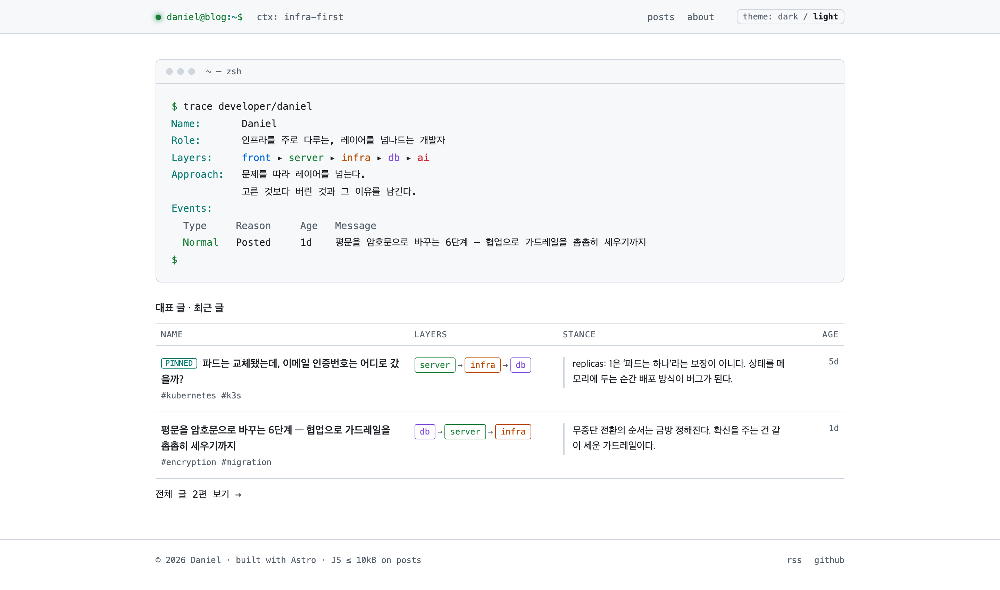
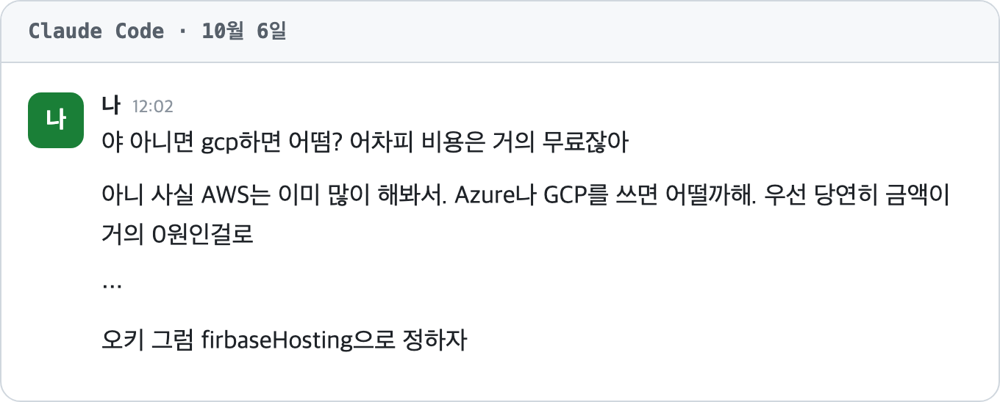
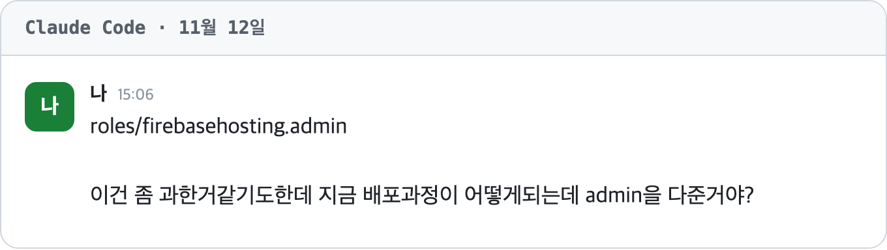

## AI 시대, 일하는 성향이 극단적으로 갈린다

적은 경력이지만 지금까지 일을 하며 느낀 두 부류가 있다. 한 부류는 **빠르게 실패해서 피드백을 얻고, 그걸 새로운 TODO로 만들어 가며** 일한다. 아무리 꼼꼼하게 짜도 버그는 결국 생기니, 빠르게 만들어 내놓고 생긴 버그에 빠르게 대응해 고쳐 나가는 방식이다. 다른 부류는 내놓기 전에 **내가 짠 코드에 어떤 리스크가 있는지 깊게 고민하고, 완성도를 높여 내놓는** 데서 성취감을 얻는다. 앞쪽은 속도를, 뒤쪽은 완성도를 먼저 챙기는 셈이다. 맞고 틀린 문제가 아니라 '*나는 어떤 성향으로 일하는 사람인가*'의 문제라고 생각한다.

그래서 조직마다 원하는 사람도 다르다. 빠르게 실패하며 시장 반응을 확인해야 하는 스타트업이라면 앞쪽을 선호할 것이고, 리스크에 신경을 쓰며 그만큼의 시간을 허용해 주는 조직이라면 뒤쪽을 원할 것이다. AI가 도입되기 전에는 이 두 성향이 서로를 보완한다고 생각했다. **그런데 AI가 들어오면서 느낌이 달라졌다.**

앞쪽은 AI로 빠르게 만들어 나간 다음, 문제가 생기거나 정리가 필요한 부분을 그때그때 정리해 가며 나아간다. 뒤쪽은 AI 덕분에 검토하는 속도도 빨라져 더 꼼꼼해졌지만, 만들어 내는 양과 속도에서는 앞쪽과 차이가 난다. 그러다 보면 서로를 이렇게 보는 극단까지 갈 수 있겠다는 생각이 들었다.

> *"저 사람들은 왜 정리를 안 하면서 개발하지?"*
> *"이 사람들은 왜 이렇게 퍼포먼스가 안 나지?"*

 다뤄야 할 영역은 점점 많아지는데 조직문화가 잘 갖춰져 있지 않다면, 두 성향은 더욱 섞이기 힘들 것이다.

그래서 AI 시대에는 내가 어떤 조직문화에 맞게 일할 수 있는 사람인지 스스로 점검하고, 회사도 뽑을 사람의 성향이 우리 문화와 맞는지 확인하는 과정이 **더 중요해졌다**고 생각한다. 물론 잘 갖춰진 조직이라면 일하는 방식이 다른 사람들도 함께 굴러가게 받쳐 주겠지만, 아무튼 이런 맥락에서 '**나를 표현하는 것**'이 정말 중요하다는 생각이 들었다. 그게 예전부터 만들어야겠다고 생각한 블로그를 지금이라도 만들자는 시작점이 되었다.

## 왜 블로그였나

블로그는 나의 생각을 정리하고 혼자 기록하는 공간이면서, 동시에 그렇게 정리된 생각이 인터넷 세상에 노출되는 공간이다. 많은 사람에게 노출이 된다면, 나의 생각이 세상의 가치와 부딪히는지 그렇다면 나의 생각을 수정할 필요가 있는지 등 **스스로를 제3자가 체크해 주는 장치**가 될 수 있고, 이전 문단에서 말했듯이 채용 담당자가 본다면 이 사람이 우리 조직에 어울리겠다는 판단이 생길 수 있다.

보통 코드를 다루는 일을 할 땐 어떤 것을 포기하고 어떤 것을 얻어가는 코드를 작성했는지 따라가다 보면 이 사람은 어떤 성향인지가 보인다. 그것을 코드에만 남겨둔다면, 같이 코드를 작성하는 사람들은 알 수 있지만 **보지 못하는 사람들은 내가 어떤 사람인지 알 수 없게 된다.**

한 달 두 달만 지나도 일하는 환경이 달라지는 지금, **내 생각이 사람들에게 공감을 얻는지, 나와 같이 생각하는 사람은 얼마나 되는지** 알고 싶었다. 그렇게 나를 표현하는 공간으로 블로그를 만들어 보겠다는 결심을 했다.

그래서 이 글에는 블로그를 직접 만들면서 무엇을 고르고 무엇을 포기했는지, 그 고민을 적어 본다.

## 그렇다면 왜 어려운 자체 블로그라는 길을 선택했을까?

예전에는 취업 준비를 목적으로 나의 공부 기록들을 velog에 글을 썼다. 이럴 땐 나의 지식의 기록을 노출시키는 게 목적이었으므로 최대한 간단한 플랫폼을 이용했다. 이번에는 '**나를 표현하는 수단**'으로 이 블로그를 직접 만들어 배포하기로 결정했다.

velog와 같은 블로그 플랫폼은 확보된 유저와 검색엔진 최적화가 보장이 되기 때문에 사실 간편하고 좋은 선택이 된다. 그럼에도 내가 자체 호스팅을 선택한 이유는 두 가지, **자유**와 **경험**이었다.

- **자유**: 무엇을 재고, 어떻게 보여 주고, 무엇을 붙일지 내가 정할 수 있다.
- **경험**: 사이트를 띄우는 일부터 검색엔진 최적화, 유입 모니터링까지 플랫폼이 대신해 주던 운영 전 과정을 직접 맡으며 경험을 쌓을 수 있다.

플랫폼이 해 주던 일을 혼자 다 맡는 건 예전 같으면 부담이었을 것이다. 그래도 **AI로 생산성이 충분히 올라간 지금이라면 혼자서도 해 볼 만하다**고 판단했다.

그래서 정적 빌드 도구인 [Astro](https://astro.build)로 글을 빌드해 정적 사이트로 만들고 도메인을 따로 사서 GCP의 Firebase Hosting에 띄웠다. 인프라는 Terraform으로 구성했다.

## 자유 — 무엇을 재고, 무엇을 붙일지 내가 고른다

나를 드러내는 방법이 꼭 글만은 아니라서 글 말고 다른 기획이 떠오르면 언제든 만들어 붙일 수 있다는 점이 컸다. 작은 기능을 하나씩 붙여 가면서 블로그를 토이 프로젝트처럼 같이 키울 수도 있다.

### 방문 지표도 내 방식으로

직접 운영하면서 가장 먼저 해 보고 싶었던 게 방문 지표였다. 어떤 도구로 잴지 내가 고를 수 있고 **그 원본 데이터도 내가 직접 갖는다.** 서버를 따로 두지 않는 정적 사이트라 호스팅이 남겨 주는 기록 안에서만 볼 수 있다는 한계는 있지만 플랫폼이 보여 주는 통계 화면만 보는 것과는 다르다.

보통은 Google Analytics(GA4) 스크립트를 붙이면 끝난다. 체류 시간이나 스크롤까지 볼 수 있으니 더 많은 걸 보여 주는 쪽은 GA4다. 그래도 이번에는 붙이지 않았다. 읽는 데 필요 없는 스크립트를 모든 글에 싣고 싶지 않았고 브라우저에서 도는 스크립트라 광고 차단기를 쓰는 사람의 방문은 아예 집계되지 않는다는 점도 걸렸다. 무엇보다 스크립트 한 줄로 끝내기보다 호스팅 기록을 직접 이어 붙여 보는 쪽이 이 블로그를 만든 이유에 더 가까웠다.

대신 Firebase Hosting이 남기는 요청 로그를 쓰기로 했다. 사이트에 들어온 요청은 **브라우저에서 무엇을 막든 서버 쪽에 기록이 남는다.** Hosting의 요청 로그는 기본으로 꺼져 있어서 Cloud Logging 연동부터 켜고 그 로그를 BigQuery로 보내는 연결을 Terraform으로 만들었다. 그렇게 쌓인 로그로 어떤 글이 읽혔는지, 어디서 들어왔는지를 쿼리로 본다. 글에 붙은 조회수도 빌드할 때 BigQuery에서 세어 HTML에 넣고 매일 아침 다시 빌드하면서 갱신된다. 로그에는 검색엔진 크롤러 같은 봇 요청도 섞여 있어서, 조회수를 셀 때는 봇과 스크립트의 요청을 빼고 같은 날 같은 방문자는 한 번만 센다.



그런데 막상 쌓인 로그를 열어 보니 홈보다 많이 찍힌 주소가 있었다. `/wp-admin/install.php`였다. *이 블로그는 워드프레스가 아닌데*, **일주일 동안 IP 135개에서 이 주소를 500번 넘게** 두드렸다. 찾아보니 설치를 끝내지 않은 워드프레스를 노리는 자동 스캐너였다. 새 도메인이 HTTPS 인증서를 받으면 그 이름이 공개 장부(Certificate Transparency 로그)에 올라가는데, 스캐너들이 이걸 지켜보다가 새 도메인마다 일단 찔러 보는 것이다. 내 블로그를 노렸다기보다 **인터넷에 새로 생긴 사이트라면 다 겪는 일**이었다. 정적 파일만 올린 사이트라 전부 404로 끝났고, 플랫폼 위에서 글만 쓸 때는 볼 수 없던 장면이라 오히려 신기했다.

이런 요청까지 저장할 필요가 있을까 싶어 따져 봤다. 일주일에 2,000여 줄, 1MB 남짓이라 한 달 적재 비용은 1원도 안 됐다. 그래서 **저장할 때는 다 쌓아 두고, 읽을 때 거르기로** 했다. 데이터는 쌓아 두면 분석은 AI가 도와줄 수 있으니, 쌓아 둔 데이터는 언제든 의미가 있다고 생각한다. 실제로 이번에도 스캐너가 얼마나 오는지, **글을 사람보다 크롤러가 더 많이 읽는다**는 것까지 쌓아 둔 로그 덕분에 알 수 있었다.

유지비는 0원을 목표로 했다. 그런데 로그를 BigQuery에 적재하는 비용에는 무료 한도가 없어서 엄밀한 0원은 안 됐다. 실제로는 한 달에 몇 원에서 몇십 원 수준이다. 많은 사람들이 봐주기 시작한다면 그만한 가치가 있으니 월 1,000원까지는 써도 좋다고 기준을 바꾸고 예산 알림을 걸어 뒀다.

### 나를 드러내는 모양도 직접: AI스러운 시안에서 터미널로

처음에는 막연하게 블로그를 만들어 달라고만 했다. 그런데 Claude가 잡아 준 디자인은 너무 *아티팩트 같고 AI스러운* 느낌이라 마음에 들지 않았다. 그래서 레퍼런스를 몇 개 찾아보면서, 이 블로그로 무엇을 표현하고 싶은지부터 생각해 봤다.

요즘 드는 생각이 있다. **AI로 코딩하는 건 쉬워졌지만, 만든 걸 실제로 띄우려고 인프라를 구성하는 일은 바이브 코딩을 하는 사람들에게 아직 장벽이다.** 나는 네트워크와 인프라 지식이 조금은 있어서 터미널이 익숙했고 설계도 비교적 수월했다. 그래서 그 부분을 드러내고 싶었다. 메이커 기질이 있는 개발자로서 **만드는 데서 끝나지 않고 인프라까지 직접 할 수 있다**는 걸 장점으로 내세우고 싶었다.

인프라 작업을 하다 보면 터미널을 마주할 일이 많다. 그래서 터미널을 콘셉트로 디자인을 잡았고, 초창기 모습은 이랬다.




이후로는 화면을 보며 AI와 피드백을 주고받으면서 다듬었다. 그때 걸렸던 건 세 가지다.

1. 블로그의 핵심은 글을 보여 주는 건데, 글 하나에 붙은 꾸밈이 너무 많았다.
2. 이벤트, 어프로치 같은 요소가 나를 과하게 포장하는 느낌이었다.
3. 그래도 첫 화면에서 새 글이나 새 기능 소식 정도는 알 수 있으면 좋겠다. 그렇다면 내 커밋 이력을 보여 주면 어떨까.

이렇게 덜어 내고 남은 게 지금의 메인 화면이다.

### 실제 터미널을 붙이면 작은 토이 프로젝트가 되지 않을까?

나는 터미널을 켜면 괜히 `ls`를 치고 `Ctrl+L`로 화면을 지우는 걸 무의식적으로 반복한다. 이런 인터랙션이 블로그에도 있다면 내 습관까지 조금 더 드러낼 수 있지 않을까 싶었다. `vim`으로 열면 내 블로그 글이 그대로 보이고, 방문자가 터미널 안에서 블로그를 탐색하는 느낌을 주고 싶었다.

생각이 한 발 더 나갔을 때는 `kubectl` 명령어로 탐색하게 하면 인프라에 관심 있는 나를 더 잘 보여 줄 수 있겠다고 생각했다. 실제로 글 목록을 `kubectl get posts`처럼 보여 주는 ~~`kubectl` 콘셉트~~도 써 봤다. 그런데 kubectl은 기능이 워낙 많아서 블로그 기획에 녹이기엔 너무 복잡했다. 그래서 다 걷어 내고 **리눅스 기본 명령어**에 초점을 맞췄다. 지금 홈은 git log 모양이고, `/cli` 페이지에서는 `ls`, `cat` 같은 명령어로 글을 볼 수 있다.

### 글 말고 다른 것도 붙일 수 있다: dagent

<!-- TODO: dagent 개발 후 채운다 -->

요즘 나는 터미널을 열면 거의 `claude`부터 띄우고 AI와 대화하면서 일을 시작한다. 복잡한 명령어 없이 대화만으로 많은 걸 할 수 있어서다. 블로그에도 비슷한 걸 붙여 방문자가 조금 더 머물게 하고 싶었고, 그게 `dagent`다. 물론 dagent로 터미널을 조작하는 건 아니다. 다만 나(다니엘)에 대해 궁금한 걸 친구나 동료처럼 대답해 주는 에이전트가 있다면, 터미널에서 AI와 대화하는 그 느낌을 조금은 줄 수 있지 않을까 생각했다. 챗봇 서버를 블로그에 연결해야 하는 일이라 **플랫폼 안에서 글만 쓴다면 할 수 없는 일**이기도 하다. 지금은 `/cli`에서 실행해도 꺼져 있다는 화면만 나온다.

## 경험 — 띄우는 것부터 운영까지 직접 맡는다

### 익숙한 AWS 대신 GCP를 고른 이유

인프라는 AWS를 이미 많이 써 봤다. 그래서 이번에는 다른 클라우드를 써 보고 싶었다. 조건은 하나, **비용이 거의 0원**이어야 했다.

그런 관점에서 AI는 오히려 *다른 걸 시도하지 말고 AWS를 쓰라*고 추천했다. 블로그와 집에 둘 챗봇 서버를 같은 주소(origin)로 묶으려면, GCP에서는 AWS의 CloudFront처럼 앞단에서 경로를 나눠 줄 로드밸런서를 따로 띄워야 해서 0원이 아니라는 이유였다. 그래도 **이미 해 본 걸 또 하기보다는 다른 걸 겪어 보고 싶었다.**



GCP, Azure, 네이버 클라우드를 후보로 꺼내 봤다. 깊게 찾아본 건 아니라 틀렸을 수도 있지만 자유롭게 무료 호스팅을 할 수 있는 곳은 그나마 GCP라고 판단했다. 예전에 GCP를 살짝이라도 써 본 경험이 있던 것도 컸다. 그래서 GCP의 Firebase Hosting을 Terraform으로 구성하기로 했다. 그렇게 GCP로 시작하며 블로그가 인프라 공부의 실습장이 되길 바랐고 다른 플랫폼을 운영할 때 마주칠 문제를 직접 겪어 보고 싶었다.

### 인프라는 이렇게 나눴다

구성은 모두 블로그 레포 안에 코드로 남겼다. 줄여서 보면 이렇다.

```text
daniel-blog/
├── src/                     # Astro 사이트 (글은 src/content/posts/)
├── firebase.json            # Hosting 설정 (/api rewrite가 들어갈 자리)
├── .github/workflows/
│   └── deploy.yml           # live-* 태그 → 빌드 → 배포, 매일 06:00 재빌드
└── infra/
    ├── bootstrap/
    │   ├── project.tf       # GCP 프로젝트, 결제 연결
    │   ├── state.tf         # Terraform state 버킷
    │   └── budget.tf        # 예산 알림
    └── main/
        ├── main.tf          # Firebase 프로젝트, Hosting 사이트
        ├── domain.tf        # kyungjin.dev 연결
        ├── ci.tf            # GitHub Actions 배포 인증과 권한
        └── analytics.tf     # Hosting 로그 → BigQuery
```

`infra/`는 두 층으로 나뉜다. `main`은 Hosting 사이트와 도메인, 배포 인증, 로그 파이프라인을 기능별 파일로 나눠 올린다. 그 아래 `bootstrap`은 GCP 프로젝트 자체와 결제 연결, 예산 알림, 그리고 Terraform이 상태(state)를 저장할 버킷을 만든다. 콘솔에서 프로젝트를 손으로 만들고 시작해도 됐지만, 프로젝트 자체부터 코드로 만들어 보고 예산 관리와 권한 관리까지 모두 코드로 진행해 보고 싶었다. 그래서 AI와 함께 이 층을 따로 만들었다. state 버킷을 bootstrap이 직접 만들다 보니, 첫 apply는 내 컴퓨터에 상태를 두고 한 뒤 버킷이 생기고 나서 그쪽으로 옮겼다.

나누는 기준은 두 가지다. 폴더는 먼저 깔아야 하는 바닥과 그 위에 올리는 것으로 나누고, 그 안의 파일은 하는 일 하나에 하나씩 둔다. 처음엔 main만 이렇게 기능별로 나뉘어 있었고 bootstrap은 파일 하나에 다 들어 있었다. 다시 들여다보면서 main 쪽 구조가 좋다고 느꼈다. "배포 권한이 과하지 않나?" 싶으면 `ci.tf`만 열면 되고, 새 기능을 붙일 땐 파일을 하나 추가하면 된다. **고민하는 단위와 파일 단위가 같아지는 것이다.** 그래서 bootstrap도 같은 기준으로 맞췄다.

배포는 GitHub Actions가 맡는다. main에 올린다고 바로 나가지 않고, `live-`로 시작하는 태그를 붙였을 때만 빌드해서 배포한다. 전체 코드는 [GitHub 저장소](https://github.com/rud1676/daniel-blog.web.app)에 공개해 두었다.

사실 bootstrap은 처음에 **AI에게 주도권을 맡기고 만든 층**이었다. 그래서 만들고 나서는 내가 주도해서 다시 들여다봤다. 예산은 어떻게 관리할지, 권한 관리는 제대로 고려되고 있는지가 중심이었다.

예산 알림은 지금 월 2,000원 기준이다. 처음엔 1,000원이었는데 뒤에 나올 챗봇 서버 때문에 올렸다. 금액의 50%와 100%를 넘을 때, 그리고 이번 달 예상 지출이 100%를 넘을 것 같을 때 결제 계정 관리자인 나에게 메일이 온다. 다만 예산 알림은 말 그대로 알림이라 **돈이 나가는 걸 막아 주지는 않는다.** 그래서 적어도 이 알림만큼은 실수로 사라지면 안 된다고 봤다. 예산 알림과 state 버킷, 프로젝트, API처럼 지워지면 안 되는 리소스에는 Terraform이 지우거나 다시 만들려고 하면 plan 단계에서 에러로 멈추는 잠금(`prevent_destroy`)을 걸어 두었다.

권한은 지금 누가 무엇을 할 수 있는지부터 확인했다. 실제로 권한을 가진 건 개발자인 나와 GitHub Actions 둘이었다. GitHub Actions는 키 파일 없이 들어온다. AWS에서 GitHub OIDC로 인증된 레포에 IAM Role을 맡기던 것처럼, GCP에서는 Workload Identity Federation으로 이 레포에서 온 요청에만 배포용 서비스 계정을 잠깐 빌려준다. *GCP의 서비스 계정이 AWS의 Role 자리*라는 걸 이때 정리할 수 있었다. 이 계정은 state 버킷을 볼 수 없다.

그런데 이 배포 계정에는 Hosting 관리자 권한(`firebasehosting.admin`)이 통째로 들어가 있었다. *배포하는 데 관리자 권한까지 필요한가?* 싶어 과하다는 생각이 들었고, 배포 과정을 처음부터 따라가 봤다.



태그를 확인하고, 키 없이 인증하고, 빌드할 때 BigQuery에서 조회수를 읽고, 마지막에 Hosting에 새 버전을 올린다. **Hosting 권한이 실제로 쓰이는 건 이 마지막 단계 하나뿐이다.** 관리자 역할을 열어 보니 사이트를 새로 만들고 지우는 권한까지 들어 있었다. 미리 만들어진 Hosting 역할이 관리자와 조회자 둘뿐이라 관리자를 줬던 것이다. 그래서 배포에 필요한 권한만 담은 역할을 직접 만들어 바꿨다. 다만 새 버전을 올리는 일 자체가 사이트 업데이트 권한 하나에 묶여 있어서, 좁힐 수 있는 건 **사이트를 만들고 지우는 것을 막는 데까지**였다.



### CloudFront는 당연한 게 아니었다

다른 플랫폼에서 마주칠 문제는 생각보다 빨리 왔다. 블로그에 `dagent`를 넣으려면 챗봇 서버를 따로 띄워서 연결해야 한다. 챗봇 서버까지 AWS나 GCP에 올리면 비용이 생길 수 있으니 서버는 내 물리적인 공간에 구성해서 연결하려고 했다. 사실 기존에 AWS를 쓸 때는 CloudFront에서 프론트 주소 뒤에 `/api`를 붙이면 백엔드로 넘어가게 해서 origin 문제(브라우저가 프론트와 다른 주소의 서버로 요청을 보내면 보안상 막는 문제)를 풀었었다. 그래서 여기서도 *당연히* 그렇게 될 거라고 생각했다.

그런데 Firebase Hosting에서는 이 방식이 안 됐다. 원하는 모양은 이랬다.

```
kyungjin.dev       → Firebase Hosting (블로그)
kyungjin.dev/api   → 챗봇 서버
```

Firebase Hosting에도 경로별로 요청을 넘기는 rewrite 기능은 있다. 그런데 넘길 수 있는 곳이 **사이트 안의 파일, 그리고 같은 GCP 프로젝트의 Cloud Run이나 Cloud Functions뿐**이다. 챗봇 서버를 다른 곳에 띄우면 `/api`를 그쪽으로 넘겨줄 방법이 없다. 외부 주소로 보내는 redirect는 되지만 그건 브라우저에게 "저 주소로 다시 가라"고 알려 주는 것이라 결국 주소가 둘이 되고 origin 문제는 그대로 남는다.

AWS에서는 이게 당연했다. CloudFront는 경로마다 다른 원본(origin)을 줄 수 있고 그 원본으로 S3든 외부 서버든 넣을 수 있다. `/api/*`에 behavior 하나만 추가하면 끝났다. GCP에서 같은 걸 하려면 로드밸런서를 따로 띄워서 URL 맵으로 경로를 나눠야 하는데 로드밸런서는 **트래픽이 없어도 매달 고정비가 나간다.** 처음에 0원 조건 때문에 뺐던 바로 그 구성이다.



GCP나 Azure 같은 거대한 플랫폼이라면 CloudFront가 하던 일도 이름만 다른 서비스로 다 있을 거라고 생각했다. 그런데 알아보니 **GCP에는 똑같은 서비스가 없었다.** 나는 경로를 보고 `/api`를 다른 서버로 보내 주는 방식으로 이미 origin 문제를 풀어 왔는데 그 방법을 그대로 쓸 수 없게 된 것이다. 그때부터 남은 선택지를 하나씩 비교하게 됐다.

그렇다고 CloudFront를 쓰려고 AWS로 옮기지는 않았다. 이미 만들어 둔 GCP 구성을 다른 플랫폼으로 바꾸는 개발 비용이 더 크다고 봤다. 처음에는 챗봇을 우리 집 서버에 띄우고 싶었다. 그래야 비용이 아예 들지 않기 때문이다. 그래서 ~~주소를 하나로 묶는 건 포기하고 브라우저가 집 서버를 따로 호출하는 쪽~~으로 정해 두었다. 로드밸런서도 띄우지 않기로 했다.

그런데 이 글을 다듬으며 AI와 이야기하다 보니 생각이 바뀌었다. 나는 Cloud Run을 *계속 켜 두는 서버*처럼 생각하고 있었는데 실제로는 **요청이 올 때만 컨테이너를 띄우고 사용자가 없으면 0대까지 줄어드는 서버리스 컨테이너**였다. 요청을 처리한 시간만큼만 과금되고 월 무료 사용량도 있어서 사용자가 없을 때는 비용이 거의 0원이다. 이 정도면 Cloud Run을 써도 괜찮겠다는 생각이 들었다.

결국 **챗봇은 서버리스로, Cloud Run에서 실행하기로 했다.** Firebase Hosting의 rewrite로 `kyungjin.dev/api`를 Cloud Run으로 넘기면, 처음에 원했던 대로 주소가 하나가 되어 origin 문제도 생기지 않는다. 요청이 없을 때는 0대로 내려가 있다 보니 첫 응답이 몇 초 늦을 수 있다는 건 감수해야 한다. 유지비 기준은 월 2,000원으로 올렸다.



돌아보면 두 번 다 같은 데서 틀렸다. CloudFront 같은 기능은 다른 플랫폼에도 당연히 있을 거라고, Cloud Run은 계속 켜 두는 서버일 거라고, 둘 다 **내가 이미 아는 틀에 맞춰 짐작했다.** 직접 알아보고 나서야 둘 다 바로잡을 수 있었다.

챗봇 서버는 dagent를 만들면서 구성하기로 하고 우선 여기까지 만들어서 첫 배포부터 했다.

### 노출은 불리하지만

첫 배포를 하고 나니 남은 건 사람들이 실제로 찾아오게 하는 일이었다. 여기서는 velog가 확실히 유리하다. 이미 사람이 모여 있고 검색엔진 최적화도 플랫폼이 챙겨 준다. 새로 만든 사이트는 검색엔진에 내가 있다는 걸 알리는 일부터 직접 해야 한다.

이게 가볍게 넘길 문제가 아니었던 건 블로그를 만든 이유 때문이다. 내 생각이 공감을 얻는지 알고 싶어서 시작했는데, **읽는 사람이 없으면 그걸 확인할 방법도 없다.** 그래도 플랫폼으로 돌아가지 않은 건, 이 숙제를 직접 풀어 보는 것 자체가 처음에 고른 '경험'이었기 때문이다.

지금까지 해 둔 건 기본기 정도다. 검색엔진이 글을 찾아갈 수 있게 sitemap과 robots.txt를 두었고 RSS와 canonical 주소, 링크를 공유할 때 보이는 기본 미리보기 이미지를 붙였다. 남은 일은 지금 무엇이 부족한지를 기준으로 정리했다.

- **검색엔진에 직접 알리기.** Google Search Console과 네이버 서치어드바이저에 사이트를 등록하고 sitemap을 제출한다. velog에서는 신경 쓸 필요가 없던 일이다. 게다가 호스팅 로그에는 어떤 검색어로 들어왔는지가 남지 않아서, 검색어를 보려면 Search Console이 있어야 한다.
- **링크로 처음 보이는 모습.** 지금은 모든 글이 같은 미리보기 이미지를 쓴다. 카카오톡 같은 메신저로 링크를 공유하면 글보다 먼저 보이는 게 이 이미지라 글마다 다르게 만들려고 한다.
- **검색 결과에서 보이는 정보.** 구조화 데이터(JSON-LD)를 넣어 검색 결과에 글 정보가 제대로 보이게 한다.
- **조회수를 사람 기준으로.** 로그를 열어 보니 글을 사람보다 크롤러가 더 많이 읽고 있었다. 지금 거르는 건 봇이라고 드러나는 요청뿐이라, 브라우저인 척하는 크롤러까지 걸러야 실제로 몇 명이 읽었는지에 가까워진다.
- **들어온 길을 보고 고치기.** 결국 알고 싶은 건 어떤 글이 누구에게 닿았는지다. 어떤 검색어와 경로로 들어오는지 주기적으로 보고, 그걸 바탕으로 글과 사이트를 고쳐 나간다.

## 마무리

사실 운영을 내가 직접 하고 관리한다는 건 시간이라는 비용이 많이 드는 일이다. 그럼에도 하나의 프로젝트로서 관리하며 경험을 쌓고 싶었고 **AI 시대에는 이런 일들이 충분히 가능하다**고 느꼈기 때문에 도전해 볼 수 있었다. 이번에도 AI와 이야기하며 내가 잘못 알던 걸 바로잡았듯이, 앞으로도 블로그를 운영하며 마주한 문제들과 그걸 해결해 나가는 방식을 이 블로그에 계속 담아내고 싶다.
