프론트 개발자로 개발 방향을 정하고 무수히 많이 썻던 grid와 flex이다. 그때 그때 마다 필요한 기능에 맞게 부분적으로 이해하며 넘어갔었다. 그러나 항상 '아 이거 딱 마스터 해야겠다'라는 생각을 항상하고 잇었다. 그러나 여행앱을 만들면서 정리를 해야될 필요성을 느꼈다. 왜냐하면 flex-shrink나 flex-basis같은 세세한 특성들을 모르면 **왜 디자인이 적용이 의도대로 되지 않는지 오랜시간 고민하게 되는 경험**을 하였다.

어느정도 ChatGPT에게 그 해당 이유를 물어보지만, 아예 내가 모르는 부분이 있다면 GPT에게 이상한 질문을 할 수 밖에 없다.

따라서 Flex와 Grid에 대하여 내가 언제라도 활용할 수 있도록 가이드라인을 블로그 글을 통해 만드려고 한다.

## Flex

Flex는 **일차원 레이아웃 배치 전용**기능으로 만들어졌다. 사실 18년도에 내가 CSS에 입문을 할 때엔 float기능에 대해 강좌에서 많이 알려줬던 것이 기억난다. 그러나 float은 중간에 float을 풀어주고 등 상당히 예측불가능한 동작을 했었다.

[지원되는 브라우저](https://caniuse.com/?search=CSS%20Flexible%20Box)
목록에 보면 IE빼고는 다 지원된다고 생각하면 될듯 하다. 따라서 서비스 범위가 IE를 포함하지 않는다면 적극적으로 사용하면 된다.

아래의 기본 구조를 통해 flex에 대해서 알아보자!

```html
<div class="container">
	<div class="item">1</div>
	<div class="item">2</div>
	<div class="item">3</div>
</div>
```

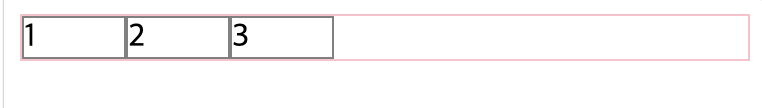

먼저 div.container는 "Flex Container", div.item은 "Flex Item"이라고 구분한다.
즉 Flex Container안에 Flex Item들이 배치되는 것이다.

따라서 Flex에 적용되는 속성은 두 가지로 분류할 수 있다.

- 컨테이너에 적용되는 속성: `flex-direction`, `flex-wrap`, `flex-flow`, `justify-content`, `align-items`
- 아이탬에 적용되는 속성: `flex-basis`, `flex-grow`, `flex-shrink`, `flex`, `align-self`, `order`, `z-index`

### display 속성

우선 div.container를 flex컨테이너로 만들기 위해 가장 먼저 해야할 일은 `display`속성을 `flex`나 `inline-flex`로 지정한다. 이것을 해주지 않으면 아래의 속성 값을 적용해줘도 작동하지 않는다.

#### flex & inline-flex

`flex`로 적용해주는 순간 div.item들이 원래 div라면 부모 요소의 넓이를 모두 차지해야 하지만, **자기의 width값만 차지**하게 된다.

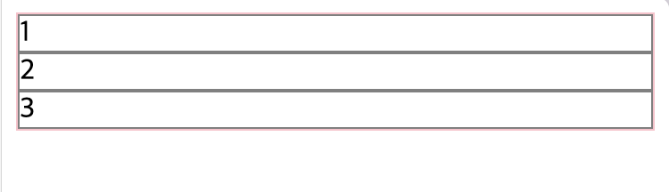
_flex를 주지않을 땐 전부를 차지한다._

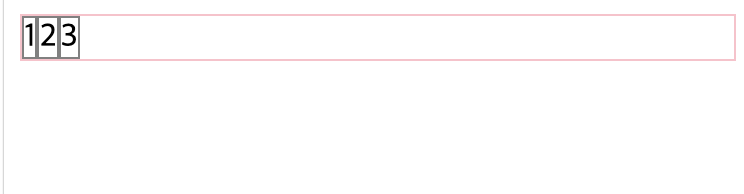
_flex를 준다면 자기의 내용물 만큼 width값이 자동으로 정해진다._

또한 **height가 부모의 요소 값**으로 맞춰진다! - 이것은 정렬의 속성을 통해 어떻게 처리할지 정해줄 수 있다!

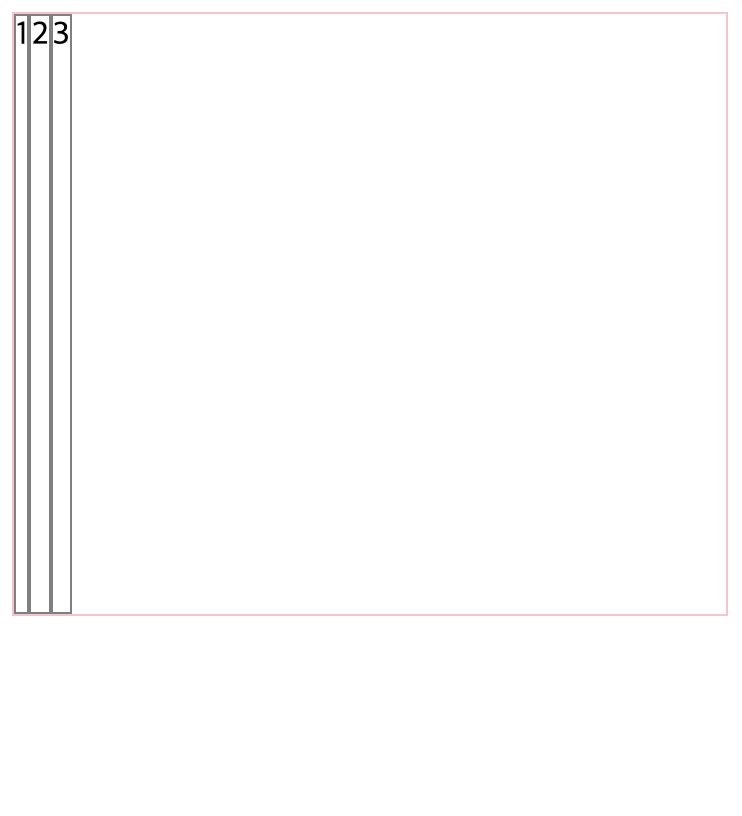
_height 300을 부모 요소에게 줬을 때 화면_

`flex`와 `inline-flex`의 차이는 컨테이너가 box로 행동할지 inline-box로 행동할지 결정이 된다. 

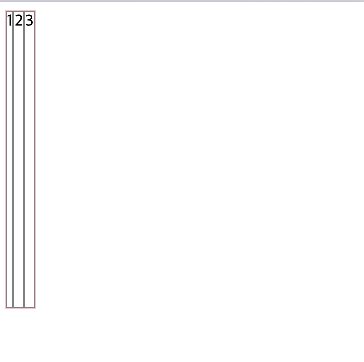
_inline-flex는 container의 width도 자식 크기에 딱 맞게 조정됨_

### Flex-Container에 적용되는 속성들

먼저 아이탬과 컨테이너에 적용된 기본 css는 아래와 같다.

```css
.container {
  display: flex;
  border: 1px solid pink;
}
.item {
  width: 30px;
  border: 1px solid grey;
}
```

#### flex-direction

flex 아이탬들이 배치되는 축의 방향을 결정한다. 아래의 코드와 같이 4가지 값이 있다.

```css
.container {
	flex-direction: row; 
	flex-direction: column;
	flex-direction: row-reverse;
	flex-direction: column-reverse;
}
```

각 속성들을 한번 비교해보자. 

- row: 기본값입니다. Item들을 가로로 배치.
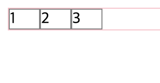
_row_

- column: Item들을 세로로 배치. block으로 배치한것과 비슷한 효과.
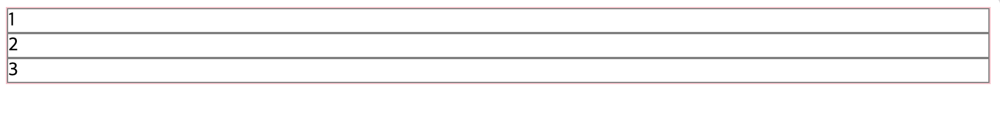
_column배치 : item에 width를 주지 않았을 때_
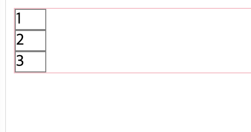
_column_

- *-reverse: 요소들을 역순으로 배치합니다.
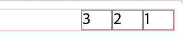
_row-reverse_
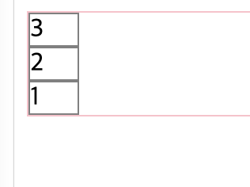
_column-reverse_

#### flex-wrap

컨테이너가 요소들을 한줄에 담지 못할 때, 줄넘김 처리를 어떻게 할지 정해주는 속성 아래와 같이 3개의 값이 있다.

```css
.container {
	flex-wrpa: nowrap; 
	flex-wrpa: wrap; 
	flex-wrpa: wrap-reverse; 
}
```

- nowrap: 기본값. 줄넘김 처리가 되지 않고 container바깥으로 넘어간다.
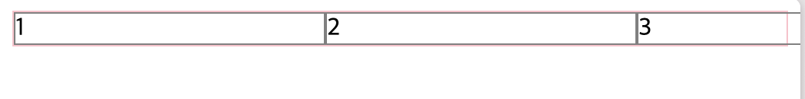

- wrap: container크기를 넘어가면 넘어가는 Item이 줄넘김이 된다.
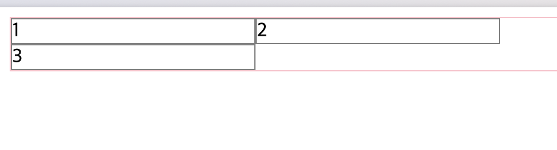

- wrap-reverse: container크기를 넘어가면 넘어가지만, 넘어가는 요소가 해당 줄에 있고 나머지가 넘어간다.
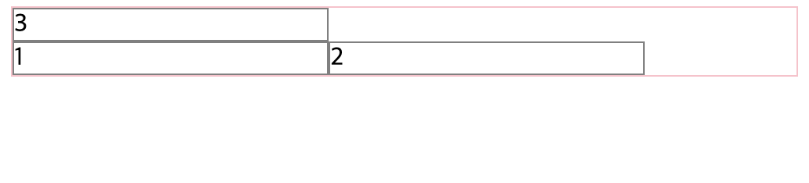

#### justify-content

지정된 축 방향으로 정렬하는 방식을 지정해주는 속성. flex-direction에 따라 가로냐 세로냐가 정해지기 때문에 축 방향으로 표현한 것이다.

```css
.container{
  justify-content:flex-start;
  justify-content:flex-end;
  justify-content:center;
  justify-content:space-around;
  justify-content:space-between;
}
```

- flex-start:  시작 부분에 항목을 축 방향으로 정렬. 기본 값이다.
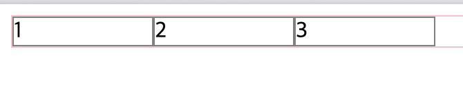
- flex-end: 끝 부분 부터 항목을 가로로 정렬한다.
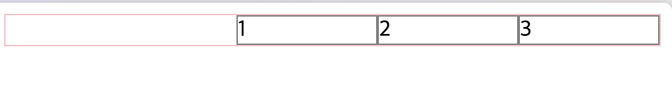
- center: 컨테이너 중앙에 정렬합니다.
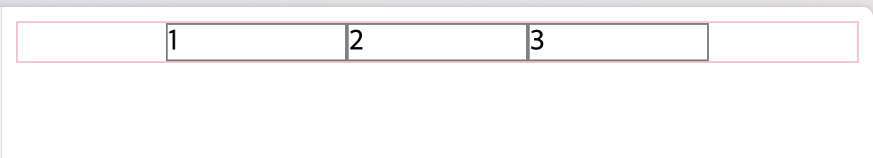
- space-between:컨테이너의 시작과 끝 사이에 항목을 일정 간격으로 배치
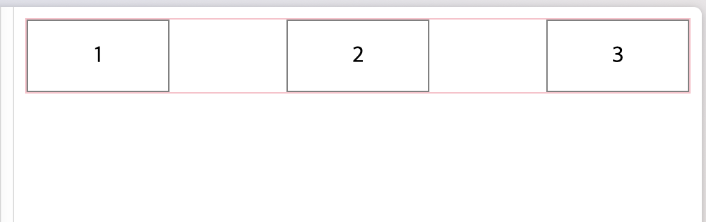
- space-around: 일정한 간격이 있게 아이템배치. 시작과 끝에도 공간도 일정한 간격을 둠.
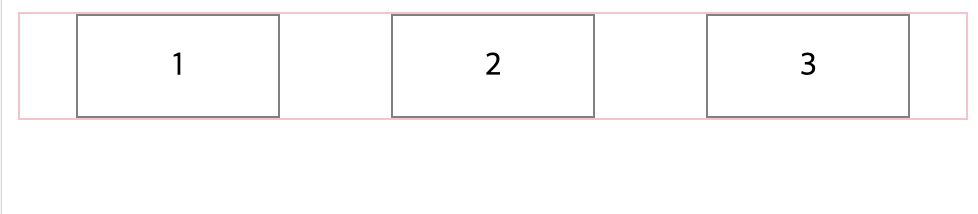
_1,2,3사이에는 일정한 간격이 1,2사이에 2번 적용되기에 양끝에 공간의 두배 간격이 적용된것_

#### align-items
지정된 축의 **수직축** 방향으로 아이템을들 정렬. justify-content와 수직 되는 방향의 정렬을 지정한다고 생각하면 됨.

```css
.container{
  align-items:stretch;
  align-items:flex-start;
  align-items:flex-end;
  align-items:center;
  align-items:baseline;
}
```


- stretch: 수직방향으로 아이탬들이 쭉 늘어남(기본값).
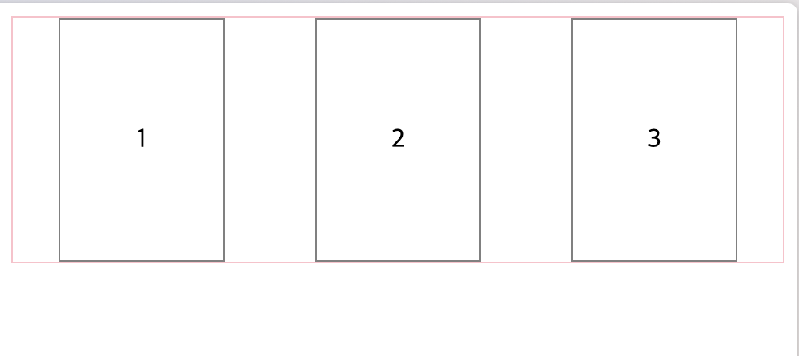
- flex-start: 수직축 시작 부분에 항목을 정렬.
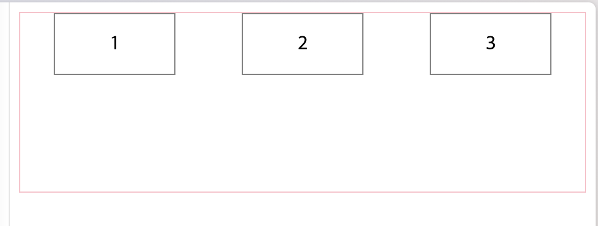
- flex-end: 수직축 끝 부분에 항목을 정렬.
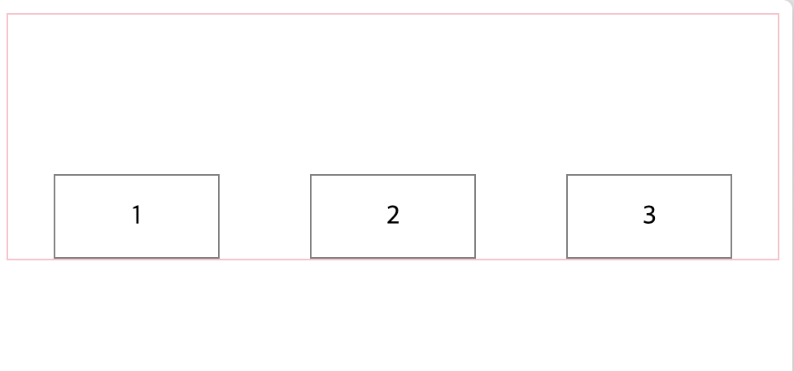
- center: 수직축 중앙에 정렬.
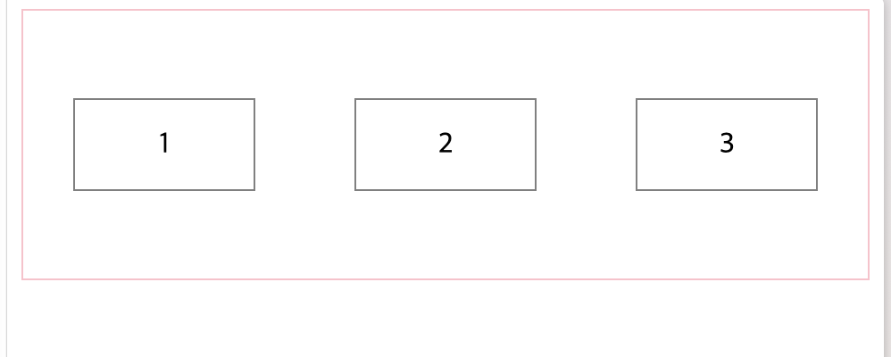
- baseline: 텍스트의 기준점 아래에 배치시킵니다. flex-start에서 맨 위에서 기준점을 시작하는 것과 다른개념.
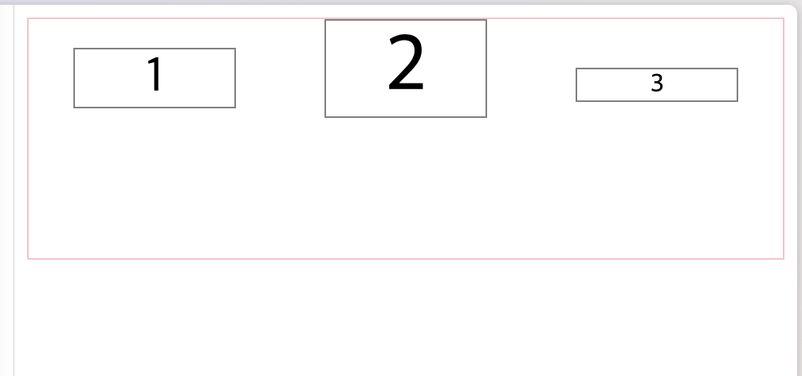

> align-item:center & justify-content:center를 해주면 어떤 Item이든 container안에 **한 가운데에** 놓을 수 있다!

#### flex-content

flex-wrap에서 wrap의 속성 값을 가질 때 요소가 다음줄에 넘어가 2줄 이상이 되었을 때 세로 방향의 배치 방법을 정해준다.

```css
.container {
	 align-content: flex-start; 
	 align-content: flex-end; 
	 align-content: center; 
	 align-content: space-between; 
	 align-content: space-around; 
	 align-content: space-evenly; 
}
```

- flex-start:
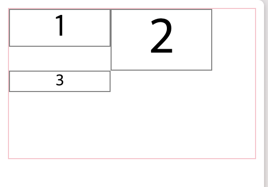
- flex-end:
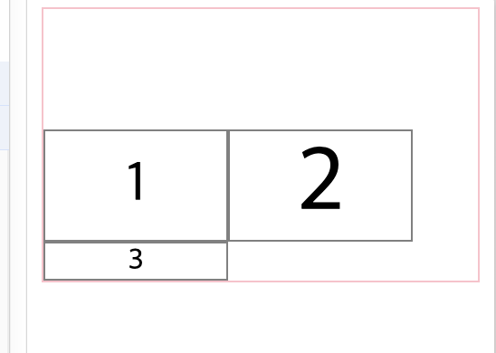
- center:
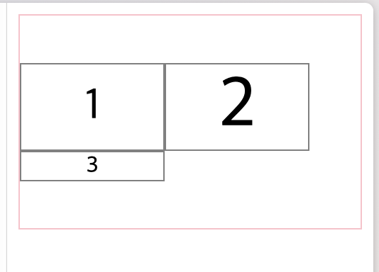
- space-between:
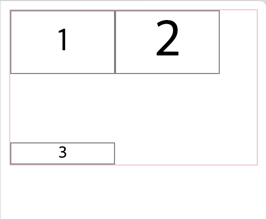
- space-around:
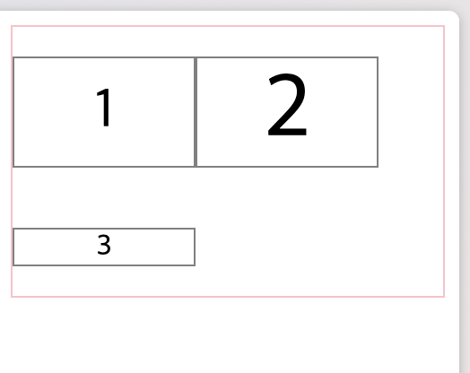

### Flex Item요소에게 적용되는 속성들

사실 Item요소들에게 flex가 어떻게 적용되는지 해당 속성들을 이해하면 flex를 지정했을 때 어떻게 동작할지 알 수 있게된다. 생소한 속성들을 알아놔야 나의 css코드가 어떤 부분을 놓쳤는지 알게된다.~~(사실 이 글을 쓰는 원인이 된.. 핵심 속성들)~~

#### flex-basis

flex요소의 기본 크기를 정해준다. 쉽게 말하면 요소의 min-width를 정한다고 생각하면 된다.

아래는 기본요소 flex-basis값을 100px로 줫을 때이다.

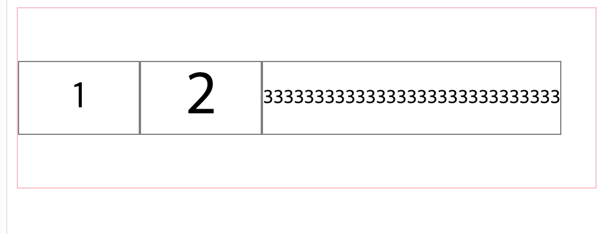
3을 가지는 요소는 이미 100px을 넘어가기 때문에 자신의 크기로 표현이 되고, 1,2요소는 100px에 못미치기 때문에 늘어난 경우이다.

이것을 width값을 100px을 준거랑 차이를 보면 바로 이해가 된다.
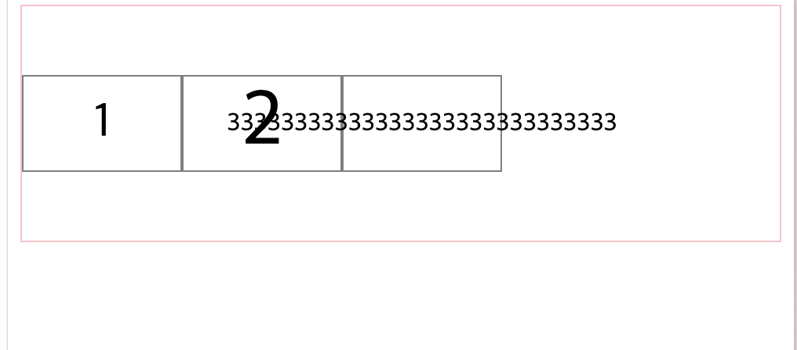

#### flex-grow

flex-grow는 유연하게 Item이 늘어날 수 있게 해주는 값이다. 0이면 아이템은 늘어나지 않고 1이상의 값을 넣어주면 값이 늘어난다. 이때 숫자의 의미는 전체에서 공백을 얼마나 줄지에 대한 비율이라고 생각하면 된다. 기본값은 0이다.

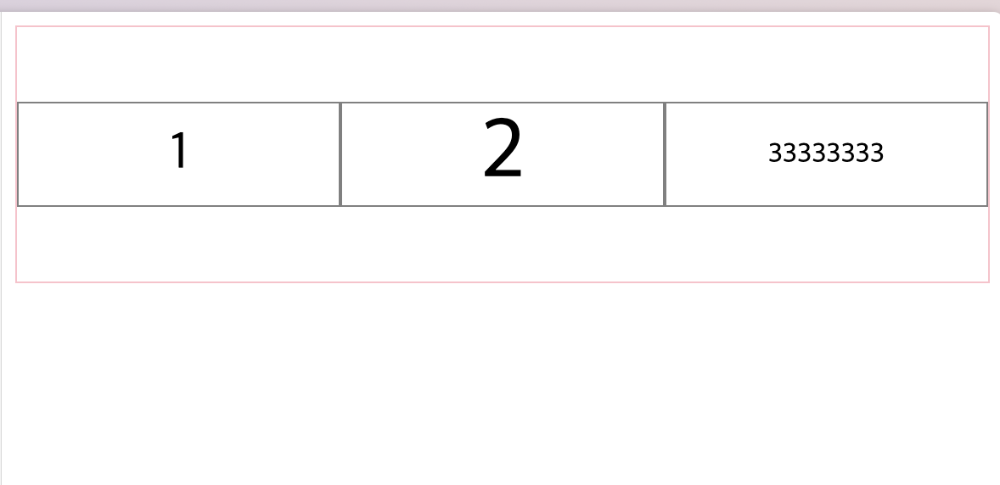
_flex-grow를 모든 item에 1로 적용_

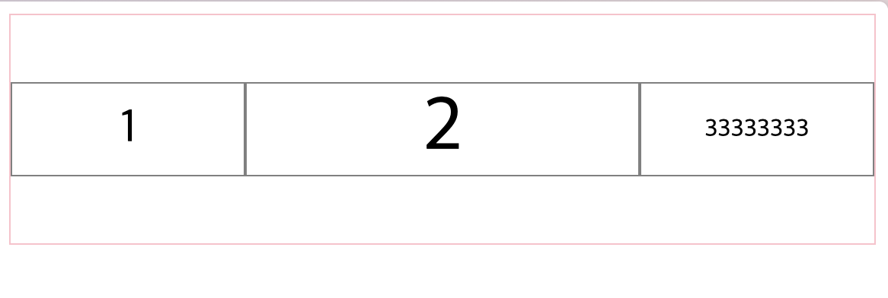
_flex-grow를 2의 요소에 3을 주고 나머지 1로 줬을 때_


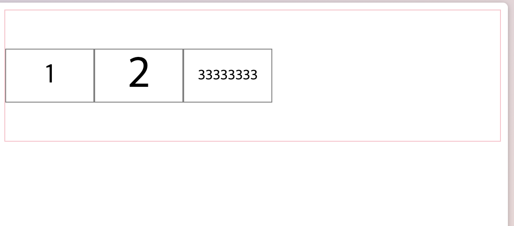
_flex-grow를 모두 0으로 할때_

#### flex-shrink

flex-shrink는 유연하게 아이탬이 줄어들 수 있게 지정해준다. 기본값은 1이다.

```css
.item{
	flex-shrink: 1;
}
#second{
	flex-shrink: 0;
}
```
와 같이 두번째 요소는 유연하게 줄어들 수 없게 지정했을 때 살펴보자.

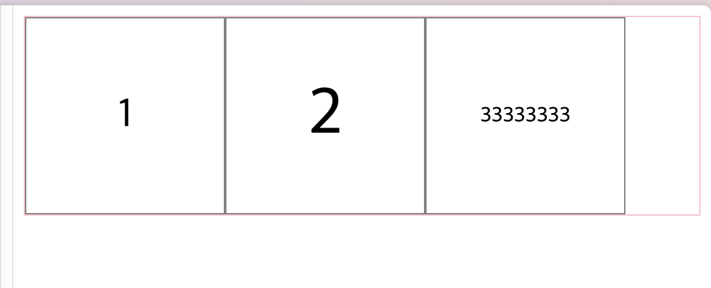

container가 자식요소보다 크면 아무런 효과도 못보지만

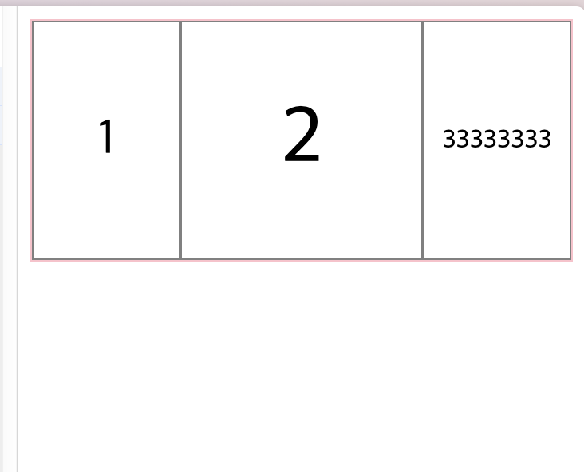

container가 자식요소보다 작아지면 1,3은 비율에 따라 줄어들지만 shrink를 0으로 지정해준 2의 요소는 그대로 유지하게 된다.

#### align-self

수직축으로 각 요소들을 정렬시키는 방법을 정해주는 속성이다. 기본적으론 auto로 지정되어 container의 align-items를 상속을 받는다. 아래처럼 개별적으로 값을 줄 수 있다.

기본적으로 align-items:flex-start로 되어있는 container에서 1번요소에 flex-end로 주어 따로 정렬되게 만들면 아래와 같이 된다.

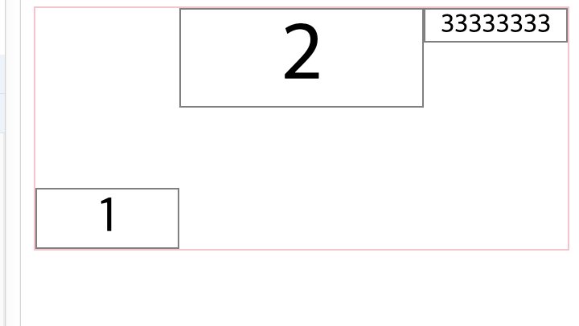


### flex 복합 속성

#### flex-flow

flex-direction과 flex-wrap을 한꺼번에 정해주는 속성이다.

예시.
```css
.container {
	flex-flow: row wrap;
}
```


#### flex
flex의 Item요소들에서 flex-grow, flex-shrink, flex-basis를 한 번에 쓸 수 있는 속성. 사용예시는 아래와 같음.

```css
.item {
	flex: 1 1 20%;
}
```
