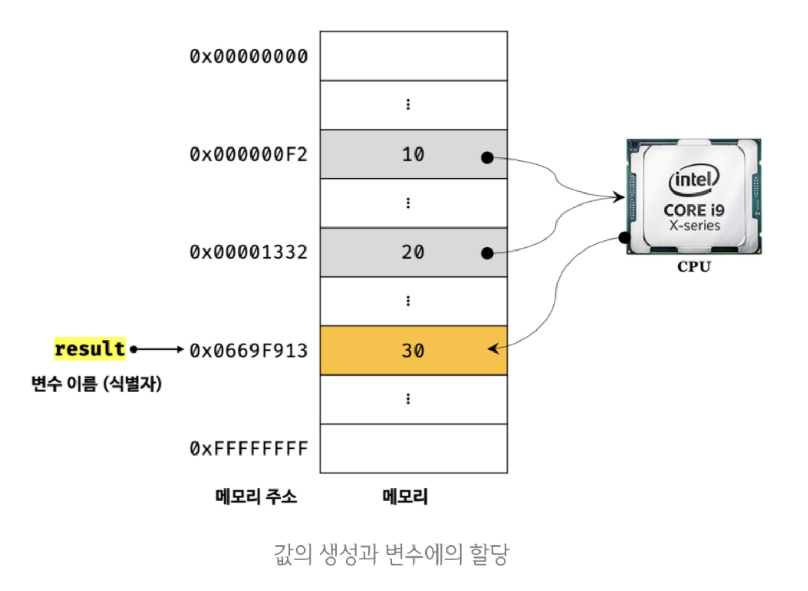
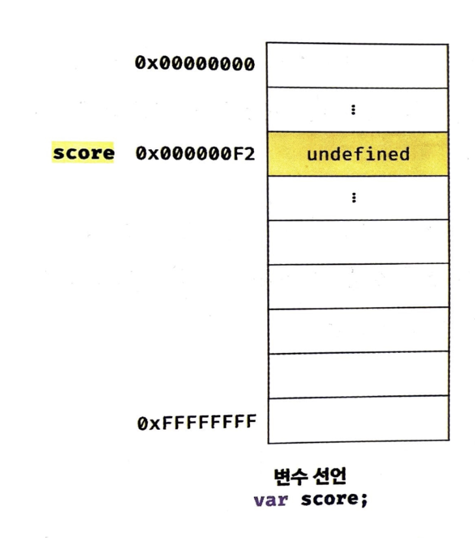
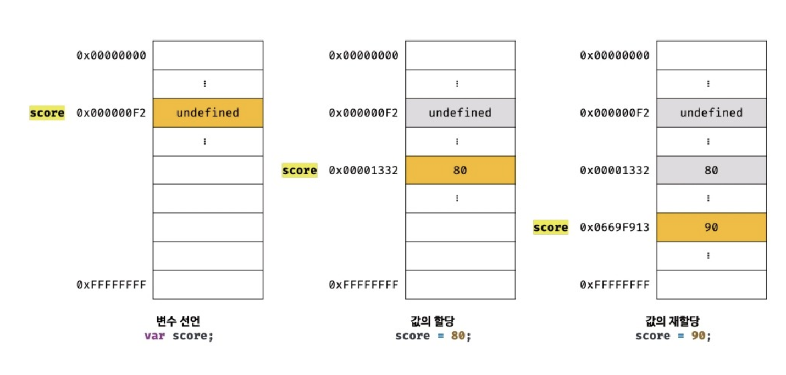

딥다이브 책을 보며 변수에 대한 내용을 정리했습니다.

## 변수의 필요성

```js
10 + 20;
```

해당 코드를 실행하면 어떤일이 일어나는지 먼저 알아보자.

1. 10과 20을 임의의 위치에 기억을 해둔다.(그것은.. 메모리어딘가)
2. CPU가 기억한 위치의 값들을 불러와서 연산을 한다.
3. 결과로 나온 30도 임의의 위치에 기억을 해둔다.

그러나 임의의 위치는 문제가 있다. 그 30이라는 숫자를 다시 가져다 쓸려면 그 위치를 알아야한다. 컴퓨터 시스템은 그 위치에 대한 것을 "메모리 주소"값으로 인식한다. 즉, 30이라는 숫자가 저장된 메모리 주소를 알면 우리는 30을 다시 가져다 쓸 수 있다.

그러나 자바스크립트는 **개발자가 직접 메모리주소에 접근**하는것을 **금지**하고 있다. 따라서 자바스크립트는(다른 프로그래밍 언어도 마찬가지) 변수라는 메커니즘을 제공한다.

즉 변수란, **메모리 공간을 식별하기 위해 붙인 이름**이다. 따라서 아래와 같이 적은 코드는 result란 이름으로 언제든 30이라는 값을 불러 올 수 있다.

```js
var result = 10 + 30;
```

\*1,2,3번의 과정을 도식화(출처 딥다이브책)

즉 변수라는 것은 값을 다시 사용하기 위해 사람이 이름을 붙여주는 것이다. 따라서 의도가 명확한 이름이라면 혀법과 품질향상에 도움이 된다. => 매우 심사숙고해서 지어야한다.

### 식별자

그리고 변수의 이름을 식별자라 하는데, 그것은 result자체를 조금더 분석해보자. result는 해당 "메모리의 주소"를 알고잇기 때문에 30이란 값을 불러 올 수 있다. 즉, result는 "메모리주소", 그에 해당하는 공간에 접근 한다는 것이다. 따라서 메모리 주소의 붙인 이름이라 해서 변수를 또다른말로 식별자라고 부른다.

또한 이러한 식별자는 **네이밍 규칙**을 준수해야 하고, **선언**에 의해 자바스크립트 엔진에 그 식별자의 존재를 알려야 한다.

## 변수 선언

변수 선언: 변수의 생성 -> 값을 저장하기 위한 메모리 확보. -> 공간을 확보하면 공간이 해제되기 전까지 누군가가 이 메모리를 사용할 수 없도록 보호한다.

방법: var,let,const를 사용하여 선언한다(각각의 차이점은 뒷장에서 다룬다.)

```js
var score;
```

_score를 선언하면 메모리에 확보해둔다_

그러나 score에 값을 할당하지 않았기 때문에 자바스크립트 엔진에 의해 undefined 라는 값이 암묵적으로 할당이 된다.

정리하면 프로그래머가 변수를 선언하면, 내부적으로 엔진은 아래와 같이 동작한다.

- 선언단계: 변수 이름을 등록한다
- 초기화 단계: 값을 저장하기 위한 메모리 할당 후 그 공간에 undefined 할당해 초기화.

변수의 이름은 **실행 컨텍스트**에 등록이 된다.

##### 실행컨텍스트

자바스크립트 엔진이 소스코드를 평가하고 실행하기 위한 환경을 제공하고 실제 실행 결과를 관리하는 영역.

따라서 변수를 사용하는 것은 반드시 선언을 해줘야된다.

만약 선언하지 않은 식별자에 접근하면 ReferenceError를 보낸다.

## 변수 호이스팅

```js
console.log(score);
var score;
```

1줄에서 선언되지 않는 score에 접근하려고 하면 ReferenceError를 뱉어야할 것 같지만, undefined가 출력이 된다. 왜일까?

자바스크립트 인터프리터가 한줄한줄 씩 읽을때, 즉 소스코드가 한줄한줄 실행되는 시점(런타임)이 아니라 그 이전단계에서 변수 선언이 먼저 실행이된다.

자바스크립트 엔진은 js코드를 볼때 **소스코드 평가**라는 과정을 거치면서 소스코드를 위한 실행 준비를 마친다. 평과 과정에서 변수 선언문을 모두 찾아내서 먼저 실행시킨다.

즉, 이 과정을 마치 변수선언이 맨 위로 올라가는 것 처럼 행동한다 해서 **변수 호이스팅**의 특징을 가진다고 이야기한다. => 사실 변수뿐아니라 키워드를 사용해서 선언하는 모든 식별자는 호이스팅의 특징을 가지고 있다.

## 값의 할당

값의 할당은 = 연산을 통해 처리가 된다. 또한 선언과 동시에 초기화를 할 수 있다.

그러나 주의할 것은 값의 할 당은 런타임 시점에 실행이 된다. 따라서 아래와 같은 코드는 주석처럼 실행이 된다.

```js
console.log(score); // undefined;
var score = 10;
console.log(score); // 80
```

**주의**: 값을 할당할 때 undefined에 저장된 공간에 80을 채워넣는 것이 아니라, 새로운 메모리 공간을 할당하여 80을 새롭게 저장한다.


예제 4-10의 생각지점

```js
console.log(score); // undefined
score = 80;
var score;
console.log(score); //??
```

1. score가 소스코드 평가에서 선언이 된다.
2. 런타임에서 첫 log에서 undefined출력
3. 선언된 score에 80저장

var이라는 키워드는 소스코드 평가시점에서 선언과 동시에 초기화되어 undefined로 된다.
그래서 3번째줄이 자바스크립트 런타임 환경에서는 아무런 효과가 없어 무시된다.

=> 이것을 let으로 바꾸면 ReferenceError가 뜬다. 왜냐하면 let이라는 키워드는 평가과정에서 선언을 하지만 undefined라고 초기화를 해주지 않기 때문이다.

## 값의 재할당

```js
var score = 80;
score = 90;
```

이렇게 선언한 변수는 값을 재할당 할 수 있다. 이전에 할당하는 것과 마찬가지로 기존에 가지고 있던 메모리 영역에서 새로운 영역의 메모리로 바꾸고 그곳을 다시 score라 하고 거기에 90을 저장한다.



_값의 재할당 과정_


#### 가비지 컬렉터

undefined와 80은 그럼 어떻게 되나? 어떤 식별자와도 연결이 되지 않고 있다. 따라서 아무도 사용하고 있지 않으니 필요하지 않다는 의미인데, 이런것들은 가비지 컬렉터에 의해 메모리 자동 해제가 일어난다. 그러나 그 메모리 해제 시점은 언제가 될지 예측할 수 없다.

> 언매니지드 언어 vs 매니지드 언어
>
> 언매니지드 언어는 메모리가 해제되는 것을 개발자가 메모리 제어 기능을 제공한다. => 개발자의 역량에 따라 최적의 성능을 보이지만, 치명적 오류를 가져갈 수도 있음.
>
> 매니지드 언어: 메모리 관리를 개발자가 아닌, 가비지 컬렉터가 그것을 관리해준다.일정한 생산성을 확보할 수 있지만, 성능면에서 어느정도 손실을 감수.

## 식별자의 네이밍 규칙

##### 금지 규칙

- 특수문자를 제외한 문자이여야됨(예외는 \_와 $는 예외다)
- 숫자로 시작하면 안됨
- 예약어는 식별자로 사용할 수 없음(자바스크립트 예약어 리스트 참고하기)

##### 이런것도 된다

- 한줄에 여러가지 변수 선언가능

```js
var person, $elem, firstname;
```

그러나 가독성이 떨어져 권장하지 않음

- ES5부터 유니코드문자를 식별자에서 허용함(한글변수, 일본어변수 가능) <=그러나 권장하지 않는다
- 대소문자 구별한다.

##### 변수를 선언할때 주의해야할 것

- 식별자만 봐도 뭔지 알아야된다 => 주석으로 이름을 설명한다면 잘못된 이름이다.
- 네이밍 컨벤션을 지키며 좋은이름 만들자
  - 카멜케이스(ex: firstName)
  - 스네이크케이스(first_name)
  - 파스칼케이스(FirstName)
  - 헝가리언케이스(strFirstName, \$elem, obeservavle\$)

보통은...

- 변수나 함수의 이름에는 카멜케이스를 사용한다.
- 생성자함수, 클래스에는 파스칼 케이스를 사용한다.
- ECMAScript에서 정의된 사양은 카멜케이스와 파스칼 케이스를 사용하고 있다. => 이것두개를 따르면 가독성이 올라간다.

## 느낀점

호이스팅에 대한 유튜브 강의를 본 적이 있다. 그때는 "아, 자바스크립트에서 변수 선언이 모두 위로 올라가는구나"라고 대략적으로 이해하고 넘어갔다. 하지만 시간이 지나며 그 세부 내용이 흐릿해졌다. 최근 다시 호이스팅에 대해 공부하면서, 이제는 다른 사람에게도 명확하게 설명할 수 있는 수준까지 이해도가 높아졌다. 특히 호이스팅이 "소스코드 평가" 단계에서 일어난다는 점을 알게 되어, 프로젝트를 진행하면서 이제 "소스코드 평가"라는 과정을 계속 의식하게 됬다.
