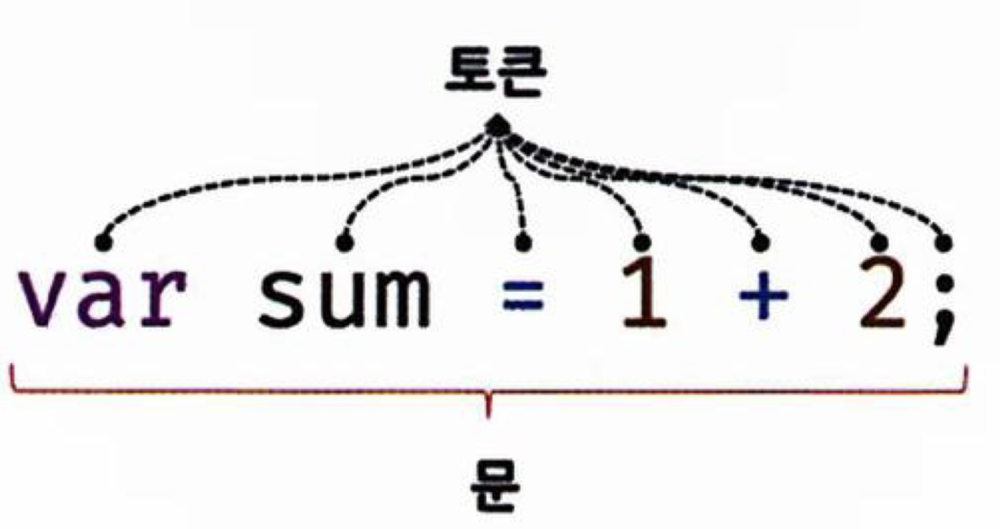

딥다이브 책을 보며 표현식, 문, 데이터 타입에 대한 내용을 정리했습니다.

## 표현식과 문

이전에 언급한 "값"이라는 표현에 대해 살펴본다.

> 개념을 정확하게 이해한다는 것은 용어를 정확하게 설명할 수 있다는 것이다.
> 정확한 용어 이해는 커뮤니케이션 스킬을 증가시킨다.

### 값

#### 값이란 식이 평가되어 생성된 결과 값

**평가**: 식을 해석해서 생성하거나 참조 하는것.

```js
10 + 20; // 10 + 20 은 평가! 되어 30의 값! 을 생성한다.
```

모든 값에는 데이터 타입을 가지며 메모리에 저장된다.

메모리에 저장된다는 의미는 2진수, 즉 비트의 나열로 저장이 된다는 것이다.

예를 들면 0100 0001을 "숫자"로 해석하면 65지만 문자로 해석하면'A'가 된다.(타입이 필요한 이유)

이전에 변수의 정의에서...

> 변수란 하나의 값을 저장하기 위해 확보한 메모리 공간을 식별하기 위해 붙인 이름

그렇다면 여기서 본 10+20이 평가되어 30이라는 것은 알겠는데 이전에 30자체로 적은 "값"은 뭐지?라는 궁금증이 생길 수 있다. 값은 식으로 생성될 수 있지만 **리터럴**을 사용해 생성할 수 있다.

### 리터럴

> 사람이 이해할 수 있는 문자, 약속된 기호를 사용해 값을 생성하는 방법

즉, 이전에 score=30에서 30은 숫자 리터럴 30으로서 이해하면 된다.

여기서의 30은 아라비아 숫자 30이 아닌, 숫자 리터럴 30을 코드에 적은 것이다. 자바스크립트 엔진은 이것을 평가해서 30을 메모리에 저장한다.

리터럴에도 다양한 종류가 있는데 자세한 내용은 MDN공식문서에 정의된 내용을 확인해보자.

[MDN이 언급한 리터럴의 종류](https://developer.mozilla.org/ko/docs/Glossary/Literal)

간단히 몇가지만 언급하면

- undefined 리터럴 : undefined
- null 리터럴: null
- 문자열 리터럴: "hello"
- 부동소수점 리터럴: 10.5
- 객체 리터럴: {name:"hi"}
- 배열 리터럴: [1,2,3]

### 표현식

> 값으로 평가가 될 수 있는 문. 즉 표현식이 평가가 되면, 새로운 값을 생성하거나 기존 값을 참고한다.

```js
var score = 50 + 50; // 50 + 50은 리터럴과 연산자로 이루어 져있다. 평가되어 100이라는 값을 생성
score; // 100 => 변수 식별자를 참조하면 값으로 평가가 된다.
```

위의 코드처럼 표현식은 리터럴, 식별자, 연산자, 함수 호출 등의 조합으로 이루어 질 수 있음.

즉, 값으로 평가가 될 수 있는 건 모두 표현식이다.

이말을 조금 더 생각해보면 아래와 같은 코드를 보자

```js
var x = 1 + 2; //3
x + 3; //6
```

즉 + 연산 사이에는 숫자가 와야되지만 2번째 줄에서 x가 3이라는 값으로 평가가 되었기에 x라는 표현식을 사용할 수 있다.

또한 표현식은 또 다른 표현식의 일부가 되어 새로운 값을 만들어낼 수 잇음.

### 문

> 프로그램을 구성하는 기본 단위(최소 실행 단위)

문은 여러 토큰으로 구분된다. 여기서 토큰은 세미콜론(;)나 마침표(.)와 리터럴 연산자, 키워드 등 더이상 나눌 수 없는 기본요소가 모두 토큰이다.




문을 또다른 말로 명령문이라 부르는 데, 즉 컴퓨터에게 내리는 명령이다.

문이 실행되면 무슨일인가가 일어나야 된다. 아래의 코드를 보자

```js
// 변수 선언"문"
var x;
// 할당"문"
x = 5;
// 함수 선언"문"
function foo() {}
// 조건"문"
if (x > 1) {
  console.log("hi");
}
// 반복"문"
for (var i = 0; i < 2; i++) {
  console.log(i);
}
```

### 세미콜론

> 문의 종결을 의미하는 문법.

모든 문이 끝날 땐 세미콜론을 붙여야한다.

그러나 중괄호로 묶은 코드 블록은 뒤에 세미콜론을 붙이지 않는데, 블록은 자체 종결성을 가지기 때문이다.

그러나 우리는 세미콜론이 옵션이다 자바스크립트 엔진은 ASI기능을 가지고 있기 때문

ASI(automatic semicolon insertion): 세미콜론 자동 삽입 기능

아래와 같은 코드가 개발자의 의도와 다르게 해석되는 ASI이 일어나는 경우다.

```js
function foo() {
  return;
  {
  }
}
console.log(foo());
// ASI: return; {}; 로 치환 => undefined 출력
// 개발자 예측 : return {}; => {}출력
```

### 표현식과 문

문은 표현식인 문이 있고 표현식이 아닌 문이 있다.

- 변수 선언문은 값이 평가가 되지 않기에 표현식이 아니다.

이것을 구분하는 가장 간단한건, 변수에 값을 할당해 보는 것이다.

표현식이 아닌문이면 에러가 뜬다.

## 데이터 타입

ES6는 7개의 타입을 제공한다. 그리고 원시 타입과 객체 타입으로 분류된다.

- 원시 타입
  - 숫자 타입: 정수,실수 구분없이 하나의 숫자 타입만 존재
  - 문자열 타입: 문자열
  - 불리언 타입: 논리적 참,거짓
  - undefined 타입: var 키워드로 선언되어 암묵적으로 할당되는 값
  - null타입: 값이 없다는 것을 의도적으로 명시
  - 심벌타입: ES6에 추가된 7번째 타입
- 객체 타입: 함수, 객체, 배열 등

### 숫자 타입

JS는 정수 실수 구분없이, 모든 숫자 타입에 대해 64비트 부동소수점 형식을 따른다. 즉, 모든 수를 실수로 처리한다.

ex) 10, 10.12, -20 모두 숫자 타입이다.

또한 2진수 8진수 16진수도 모두 메모리에 배정밀도 64비트 부동소수점 형식의 2진수로 저장된다. 이들을 표현하기 위한 데이터 타입을 제공하지 않기에 모두 10진수로 해석한다.

```js
var binary = 0b01000001;
var octal = 0o101;
var hex = 0x41;
console.log(octal === hex); // true
```

정수로 표현된 수로 나눈다해도 실수가 나올 수 있다.

```js
console.log(1 === 1.0); // true
```

#### 특별한 값

- Infinity: 양의 무한대
- -Infinity: 음의 무한대
- NaN(not a number): 산술연산이 불가능(숫자를 문자로 나누거나 등)

### 문자열 타입

0개 이상의 16비트 유니코드 문자의 집합으로 전세계의 대부분 문자를 표현가능.
""와 '' 와`를 써서 표현한다.

```js
var string;
string = "hello";
string = `hello`;
string = "큰따옴표 안의 작은'따옴표'는 문자열로 표현됨";
string = '작은 따옴표 안의 큰"따옴표"는 문자열로 표현됨';
```

만약 문자열을 따옴표로 감싸지 않으면 식별자와 같은 토큰으로 인식한다.

#### 주의사항

자바스크립트의 문자열은 원시타입이고 **변경 불가능한 값**이다. 문자열이 생성되면 문자열을 변경할 수 없는 것을 의미한다.

#### 템플릿 리터럴

ES6부터 도입된 새로운 문자열 표기법. 표현식, 태그 등 문자열처리기능을 제공한다.

1. 멀티라인 기능

일반 문자열은 개행이 허용되지 않기에 이스케이프 시퀸스를 사용해 줄넘김을 표현해야 했다.

```js
var str = "hi\nhello";
```

> 짤막 상식: 줄넘김에는 라인피드, 캐리지 리턴이 있다. 라인피드 (\n)은 종이를 한줄 올리는 의미, 캐리지리턴(\r)은 커서를 맨 앞줄로 이동하는 것. 개행을 위해 \r\n으로 맨앞으로 다음줄로 이동한다.
>
> 그러나 윈도우는 \r\n으로 새줄을 나타냇지만, 유닉스는 \n를 사용한다. 자바스크립트는 \r, \n둘다 줄넘김으로 인식한다.

그러나 템플릿 문자열은 개행이 허용된다.

```js
var template = `
  <ul>
    나는 ul
  </ul>
`;
```

2. 표현식 삽입

\${}로 감싸 표현식을 표현한다.

```js
console.log(`1+2+${1 + 2}`);
```

이때 표현식의 결과는 문자열이어야 되고, 문자열이 아니라면 강제로 문자열로 타입이 변경된다.

### 불리언 타입

true,false두개의 값의 종류만 가질 수 있다. - 조건문과 반복문에 많이 사용한다.

### undefined

undefined값이 유일한 값. 변수 선언에 의해 확보한 값을 undefined로 아직 할당되지 않는 값으로 아직 초기화가 안된것을 의도적으로 알 수 있다.

왜냐하면 자바스크립트 엔진이 변수를 초기화할 때 사용하는 값이기 때문이다.따라서 개발자가 의도적으로 undefined를 할당하는 건 권장되지 않는 행동이다. 값이 없다는 것을 할당하고 싶으면 null로 대신하기!!

### null 타입

변수에 값이 없다는 것을 의도적으로 명시할 때 사용. 변수에 null을 할당하면 이전에 참조하던 값을 더 이상 참조하지 않겠다는 의미.

```js
var el = document.querySelector(".nonclass");
console.log(el); // null
```

위에 코드는 함수가 유효한 값을 반환할 수 없을 때 명시적으로 null을 반환한다.

### 심벌 타입

변경 물가능한 원시 타입의 값. 심벌은 다른 값과 중복되지 않는 유일무이한 값. 주로 이름이 충돌할 위험이 없는 객체의 유일한 프로퍼티 키를 만들기 위해 사용.(자세한 이해는 나중에 다른장에서 나옴)

아래의 코드만 확인하고 이런느낌이구나로 이해하자

```js
var key = Symbol("key");
console.log(typeof key); // symbol

var obj = {};
obj[key] = "value";
console.log(obj[key]);
```

### 객체 타입

> 자바스크립트는 객체 기반 언어이고, 자바스크립트를 이루고 있는 거의 모든 것이 객체다.

객체 타입과 원시타입은 근본적으로 다르다 => 나중장에서 살펴본다.

### 타입의 필요성

1. **공간의 크기를 알아야한다!**

이전까지 변수부터 쭉 "메모리에 저장한다" 라는 것을 다시 생각해보자. 메모리에 저장한다는 것은 공간을 확보해야하고 그 확보해야할 공간의 크기를 알아야한다는 것이다.

```js
var score = 100;
```

리터럴 100을 숫자 타입의 값으로 해석하고 그 100을 저장하기 위해 8바이트의 메모리 공간을 확보한다(64비트 부통소수점 형식에 필요한 공간크기 => 8바이트 - 1바이트는 8비트다.)

2. **읽어드리는 크기를 알아야한다!**

타입으로 인하여 score를 참조할 땐 8바이트 단위로 메모리 공간을 끊어서 읽는 것이다.

**심벌테이블**: 컴파일러와 인터프리터는 심벌테이블이라는 자료구조를 통해서 식별자를 메모리주소, 데이터 타입, 스코프 등을 관리한다

> ECMAScript 사양에서 데이터 타입을 숫자 말고는 명시적으로 규정하고 있지 않기에 문자열과 같은 숫자 타입말고는 제조사의 구현에 따라 다를 수있다.

3. **해석방법을 알아야한다**

0100 0001의 기억을 떠올리자 숫자로는 65지만 문자로는 'A'다. 이처럼 해석방법도 타입을 통해 알 수 있다.

### 동적 타이핑

**정적 타이핑**: 컴파일 시점에 타입을 체크한다. 타입의 일관성을 강제해 안정적인 코드를 구현해 런타임에 에러를 줄인다.

자바스크립트는 런타임에 어떠한 데이터 타입의 값을 자유롭게 할당할 수 있다. 그때에 어떤타입인지 확인하는 연산은 typeof연산자로 타입을 조사할 수 있다.

**자바스크립트의 타입은 변수 선언이 아닌, 할당에 의해 결정된다**

즉 변수는 타입을 가지지 않고, 할당된 값에 의해 타입이 동적으로 결정된다고 말할 수 있다.

**동적 타이핑 언어의 특징**: 유연성은 높지만 신뢰성이 떨어진다. 따라서 JS에서 변수를 사용할 때 주의사항이 따른다.

1. 꼭 필요한 경우에 한해 제한적으로 사용하기 - 재할당으로 언제든 변경할 수 있다. 변수의 갯수가 많으면 오류가 날 확률도 높아짐.
2. 변수의 유효범위는 최대한 좁게 만들자(스코프에 대한 내용에서 자세히 언급)
3. 전역변수는 최대한 사용하지말자 어디서든 참조/변경 가능한 전역변수는 의도치 않게 값이 변경될 가능성이 높다. 원인 분석도 어려움
4. 상수를 사용하자 (const)
5. 네이밍을 적절하게 지어야 한다.

> 코드는 개발자를 위한 "문서"이다.

## 느낀점

C언어로 컴퓨터 공학에 입문했던 나는, 어떻게 동적 타이핑이 가능한지 항상 궁금해했다. 이 책을 따라가며, 값이 메모리에 할당되는 방식과 동적 타이핑의 연결 고리를 발견했다. 즉, 변수에 값이 할당될 때 타입이 결정되는 것은, 새로운 메모리 공간에 값이 할당되기 때문이었다.

자바스크립트의 동작 원리를 컴퓨터 메모리 관점에서 접근하면서, 내가 가진 궁금증들이 하나씩 해소되었다. 타입에 대한 언급과 그 세부 내용이 나중에 나온다는 점은 책을 더욱 몰입하게 만들었다.

### 책을 보며 추가로 찾은것

엔진마다 메모리관리가 다르다고하니 어떤엔진들이 있고 그게 목적이 어떻게 있는지 궁금해서 찾아봄

엔진의 종류 (by GPT)

- V8: 구글이 개발한 엔진으로, Chrome 브라우저와 Node.js에서 사용됩니다. V8은 고성능을 목표로 하며, 자바스크립트를 기계어로 직접 컴파일하는 기술을 사용해 빠른 실행 속도를 제공합니다.
- SpiderMonkey: 모질라 재단이 개발한 최초의 자바스크립트 엔진으로, Firefox 브라우저에서 사용됩니다.
- JavaScriptCore (Nitro): Apple이 개발한 엔진으로, Safari 브라우저에서 사용됩니다.
- Hermes: Facebook이 개발한 엔진으로, React Native 애플리케이션의 성능 향상을 목적으로 합니다.
- QuickJS: Fabrice Bellard에 의해 개발된 비교적 새로운 엔진으로, 소규모 프로젝트에 적합하며 효율성과 경량성이 특징입니다.
