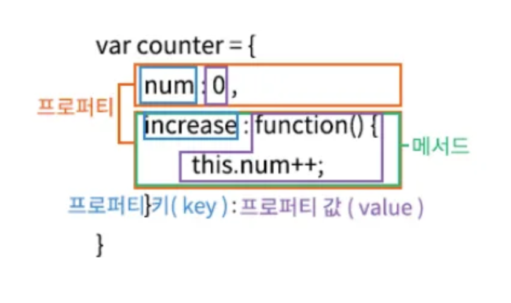

자바스크립트 타입변환, 단축 평가, 객체 리터럴에 대한 내용정리

## 타입변환과 단축 평가

### 타입변환

모든 값에는 타입이 있는데 개발자가 의도적으로 값의 타입을 변환하는 것은 **명시적 타입 변환**, **타입 캐스팅**이라고 한다.

그러나 자바스크립트 엔진에 의해 암묵적으로 타입이 자동으로 변환되기도 한다. 이것을 **암묵적 타입 변환** **타입 강제 변환**이라 한다.

타입 변환은 원시 값을 변경하는 것이 아니다.

타입변환에 대한 이해는 자신이 작성한 코드에서 암묵적 타입 변환이 나타나는지, 발생이 어떤흐름으로 되고 어떤 타입으로 암묵적으로 타입변환이 되는지 예측이 가능해야한다.

또한 이 두개를 적절히 활용해야한다.

예를 들면, 자바스크립트를 잘 모르는 개발자는 (10).toString()이 가독성이 좋지만,

자바스크립트를 아는 개발자는 10+"" 라는게 더 간결하고 쉽다.

### 암묵적 타입 변환

표현식을 평가할 때 개발자의 의도와 상관없이 코드의 문맥을 고려해 암묵적으로 타입을 변환하는 것.

```js
"10" + 2; // 모두 문자열인여야되는듯..? '102'
5 * "10"; //모두 숫자여야 되는듯...? 50
```

#### 문자열 타입으로 (암묵적)변환

```js
0 + '' // "0"
NaN + '' // "NaN"
Infinity + ''// "Infinity"

true + "" // "true"

null + "" // "null"

undefined + ""//"undefined"
(Symbol()) + '' // TypeError => Can't Symbol to string

({}) + '' // => "[object Object]"
Math+"" // => "[object Math]"
[] + "" // => ""
[10,20] + "" //=> "10,20"
(fuction(){}) +""//=> "function(){}"
Array + '' //=> "function Array() {[native code]}"

```

#### 숫자 타입으로 변환

```js
+Symbol() + // TypeError
  {} + // NaN
  [] + // 0
  [1, 2] + // NaN
  function () {}; // NaN
```

#### 불리언 타입으로 변환

불리언 형변환은 Falsy한 값 이외는 모두 true로 형변환한다. 아래가 Falsy한 값의 목록이다

- false
- undefined
- null
- +0,-0
- NaN
- ''

### 명시적 타입 변환

개발자가 의도적으로 타입을 변환하는 것. 방법은 아래와 같다.

#### 문자열 타입으로 변환

1. String생성자 함수를 new 연산자 없이 호출
2. Object.prototype.toString 메서드를 사용하는 방법
3. 문자열 연결 연산자를 이용하는 방법

```js
String(1); // "1"
String(NaN)(
  // "NaN"

  1
).toString(); // "1"
NaN.toString(); // "NaN"

1 + ""; //"1"
NaN + ""; // "NaN"
```

#### 숫자 타입으로 변환

1. Number생성자를 new 연산자 없이 사용
2. parseInt,parseFloat 함수를 사용(문자열만 숫자타입으로 변환)
3. +단항 산술 연산자 이용
4. \*산술연산자 사용하는 방법

```js
Number("0"); // 0
Number("10.52"); // 10.52

parseInt("0"); //0
parseInt("12"); //12
parseFloat("10.52") + //10.52
  +"0" + // 00
  "10.52"; // 10.52

"0" * 1; // 0
"1" * 1; // 1
```

#### 불리언 ㅌ ㅏ입으로 변환

1. Boolean 생성자 함수
2. !부정논리를 두번

```js
Boolean("x"); // true
Boolean("false"); // true
Boolean(""); // false
Boolean({}); // true
Boolean([]); // true
Boolean(NaN); // false

!!"x"; // true
!!null; //false
!!{}; // true
```

### 단축 평가

"논리 합과 논리 곱은 언제나 2개의 피연산자 중 어느 한쪽으로 평가가 된다" 는 내용을 이전 챕터에서 살펴봤다.

```js
"Cat" && "Dog"; // "Dog"
```

논리 곱과 논리 합 연산자 모두 좌항에서 우항으로 평가가 진행된다.

true로 평가될 때 **마지막에 true로 결정된 요소를 그대로!** 반환한다.

위의 예시에서 보면 'Cat'은 Truthy한 값이므로 true로 명시적 형변환이 이루어지고, 'Dog'도 명시적으로 true로 반환한다. 그러나 true로 반환된게 아닌, 마지막 결정요소인 'Dog'가 반환된다.

```js
"Cat" || "Dog";
```

에서는 'Cat'이 Truthy한 값이므로 true로 평가되고, 뒤에 표현식을 볼 필요없이 전체 평가는 true로 결정된다 따라서 'Cat'이 반환된다.

이처럼 **논리 연산의 결과를 결정하는 피연산자를 타입 변환하지 않고 반환**하는 행위가 단축 평가이다. 즉 결정되면 나머진 생량하는 것을말한다.

이런 단축평가를 알게되면 아래와 같은 코드를 의도적으로 작성할 수 있다.

```js
var done = true;
var message = "";
message = done && "완료";
console.log(message); // 완료 => done이 true이면 완료를 대입한다. 아니면 false할당 (if문 대체)
```

또한 객체가 가르키기 기대하는 변수가 null,undefined인지 확인하고 프로퍼티 참조하고 싶을 때

```js
var elem = null;
var value = elem.value // TypeError: Cannot Read Property => 강제종료 발생

-----------------
var elem = null;
var value = elem && elem.value; // null => 강제종료 안됨
```

#### 옵셔널 체이닝 사용(ES2020)

?.연산자는 좌항의 피연산자가 null, undefined라면 undefined를 반환하고, 그렇지 않으면 우항의 프로퍼티를 참조한다.

```js
var elem = null;
var value = elem?.value;
```

#### null 병합 연산자

?? 연산은 좌항의 피연산자가 null, undefined인 경우 우항의 피연산자를 반환하고 그렇지 않으면 좌항의 피연산자를 반환

변수 기본값 설정을 할 때 유용한 문법

```js
var foo = null ?? "default string";
```

## 객체 리터럴

JS는 **객체 기반 언어**이며 구성하는 거의 모든 것이 객체다. 정확히는 **원시 값을 제외한** 나머지 값은 객체이다.

**원시타입**은 **변경 불가능한**값이지만, **객체 타입은** **변경 가능한 값**이다

> 객체는 0개이상의 프로퍼티로 구성된 집합, 프로퍼티는 키와 값으로 구성되어 있다.

자바스크립트 함수는 **일급객체** 이므로 값으로 취급할 수 있다. 따라서 프로퍼티 값이 함수일 경우에, 일반함수와 구분하기 위해 메서드 라고 부른다.




- 프로퍼티: 객체 상태를 나타내는 **값**
- 메서드: 프로퍼티를 참조하고 조작할 수 있는 **동작**

### 객체 리터럴

자바스크립트는 **프로토타입 객체지향 언어**로서 객체로서 클래스 기반 객체지향 언어와 달리 다양한 객체 생성 방법을 지원한다.

- 객체 리터럴
- Object 생성자 함수
- 생성자 함수
- Object.create 메서드
- 클래스(ES6)

가장 간단한 방법은 객체 리터럴을 사용하는 방법이다.

> 리터럴은 저번에 언급했듯이, 사람이 이해할 수 있는 문자, 약속된 기호를 사용하여 값을 생성하는 표기법

```js
var person = {
  name: "Lee",
  sayHello: function () {
    console.log("Hello world!");
  },
};
console.log(typeof person); // object
console.log(person); // {name:"Lee",sayHello: f}
```

여기서 코드블록이랑 모양이 비슷하지만, 객체 리터럴은 값으로 평가되는 표현식이기에 세미콜론을 붙인다.

객체 리터럴은 자바스크립트의 유연함과 강력함을 대표하는 객체 생성 방식이다

### 프로퍼티

> 객체는 프로퍼티의 집합이며, 프로퍼티는 키와 값으로 구성된다.

프로퍼티 나열할 땐 쉼표(,)로 구분

- 프로퍼티 키: 빈문자열을 포함하는 모든 문자열 또는 심벌 값
- 프로퍼티 값: 자바스크립트에서 사용할 수 있는 모든 값

참고로 프로퍼티 키 값은 식별자 네이밍 규칙을 따라야한다.

그러나 꼭 따르지않아도 되긴하는데, 그럴땐 이름에는 반드시 따옴표를 사용해야한다.

아래 예시를 보자

```js
var person = {
  firstName: "hi", // 식별자 네이밍 규칙 준수
  "last-name": "LL", //식별자 네이밍 규칙 미준수 따옴표 생략하면 에러남!
};
```

- 프로퍼티 키를 동적으로 생성가능

```js
var obj = {};
var key = "hello";
obj[key] = "world";

console.log(obj); // {hello:"world"}
```

- 프로퍼티 키에 문자열, 심벌값 이외의 값을 사용하면 암묵적 타입변환을 통해 문자열이 된다. 숫자 리터럴을 사용하면 따옴표가 붙진 않지만 내부적으로 문자열로 변환됨

```js
var foo = {
  0: 1,
  1: 2,
  2: 3,
};
console.log(foo); // {0:1,1:2,2:3}
```

- 객체 리터럴에 키를 중복으로 선언하면 덮어쓴다.

```js
var foo = {
  name: "lee",
  name: "kim",
};
console.log(foo); // {name:'kim'}
```

### 프로퍼티 접근

객체에 프로퍼티에 접근하는 방식은 두가지

- 마침표 프로퍼티 접근 연산자를(.) 사용하는 마침표 표기법
- 대괄호 프로퍼티 접근 연산자([...])를 사용하는 대괄호 표기법

```js
var person = {
  name: "Lee",
};
console.log(person.name); // lee
console.log(person["name"]); // lee
```

대괄호 표기법 내부는 무조건 따옴표로 감싼 문자열이여야됨! 만약 감싸지 않으면 식별자로 해석한다.

```js
var person = {
  name: "l",
};
console.log(person[name]); // ReferenceError name is not define
```

- 객체에 존재하지 않은 프로퍼티에 접근 => undefined반환

#### 예제 퀴즈

```js
var person = {
  "last-name": "lee",
  1: 10,
};

person.last - name;
```

person.last-name부분을 보자

브라우저 환경에서는 NaN이라는 결과값을 보여주고

Nodejs에서는 Refernece Error : name is not defined가 뜬다.

1. 공통적으로 person.last를 찾는다=> 값이 없으므로 undefined반환

2. undefined - name이라는 식으로 바뀜

3. 브라우저: name이라는 전역변수가 있기에 연산을 실행하지만 숫자 결과를 기대하지만 불가능한 연산이므로 NaN으로 반환
4. Nodejs: name이라는 변수를 못찾아 Ref에러 뜸!

### 프로퍼티 값 갱신

이미 존재하는 프로퍼티에 값을 갱신하면 프로퍼티 값이 갱신됩니다.

#### 궁금한점: 프로퍼티에 원시 타입으로 갱신하면 메모리 재할당이 이루어지고 그곳을 가리키는 건가?

```
GPT:
자바스크립트에서 원시 타입의 값(예: 숫자, 문자열, 불리언)을 변수나 객체의 프로퍼티에 할당할 때, 그 값은 메모리에 직접 저장됩니다. 이 값이 갱신될 경우, 새로운 값으로 기존의 메모리 위치가 덮어씌워집니다. 추가적인 메모리 할당 없이, 해당 위치의 값만 변경됩니다. 원시 타입은 불변성을 가지므로, 값의 갱신은 기존 값과 완전히 독립된 새로운 값으로 처리됩니다.
```

### 프로퍼티 동적 생성 & 삭제

존재하지 않는 프로퍼티에 값을 할당하면 동적으로 생성되어 추가됨

delete 연산자로 프로퍼티를 삭제한다. 이때 피연산자는 프로퍼티에 접근가능한 표현식이여야됨. 아니면 무시된다.

```js
var person = {
  name: "Lee",
};
person.age = 20; // e동적 생성

delete person.age; // 삭제
```

#### 추가적으로 알아본것

여기서 동적으로 프로퍼티를 할당해도 메모리에 연속적으로 할당되는게 아니다.

### ES6의 객체 리터럴의 확장 기능

- 프로퍼티 키와 할당하려는 값을 변수로 사용할 때, 그 키와 변수이름이 동일하다면 생략할 수 있다.

```js
let x = 1,
  y = 2; //(ES6)
const obj = { x, y }; // {x:1,y:2}
```

- 메서드를 정의할 때 ES6에서는 생략한 축약표현을 사용할 수 잇음

```js
const obj = {
  name: "lee",
  sayHello() {
    console.log("hi");
  },
};
```

그러나 축약 표현으로 정의한 함수는 프로퍼티에 할당한 함수랑 다르게 동작한다!

## 느낀점

단축 평가를 배우며 리액트에서 && 연산자를 사용한 조건부 렌더링의 원리를 이해하게 되었다. 컴포넌트가 단축 평가의 결과로 반환되는 것 이였다! 또한, 객체의 키 값이 반드시 "문자열"이어야 한다는 사실을 알게 되었고, 이로 인해 코드를 해석할 때 예측 가능성이 향상되었다. 이러한 세부 사항을 파악하면서, 자바스크립트 문법에 대해 아직 배울 것이 많다는 것을 깨달았다. 과거에 '열혈 C, C++'을 공부하던 것처럼, 한 언어에 대해 교과서 같은 책을 통해 학습하는 것이 코드를 보는 데 있어 예측 가능성을 높여준다는 사실을 더욱 확신하게 되었다.
