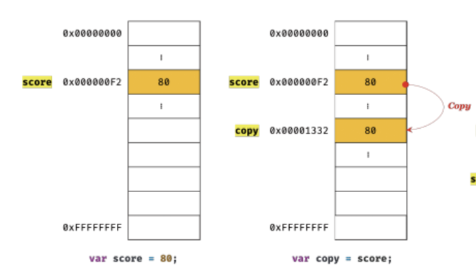
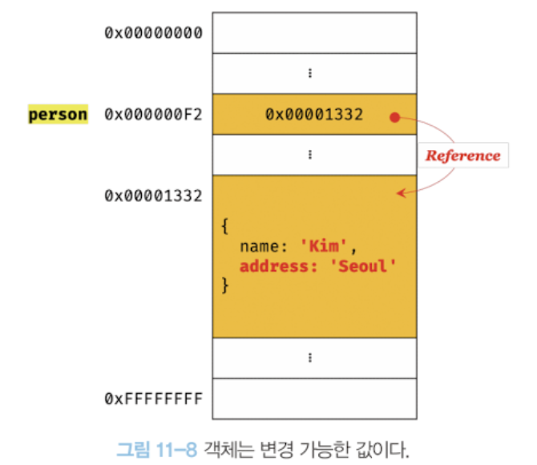
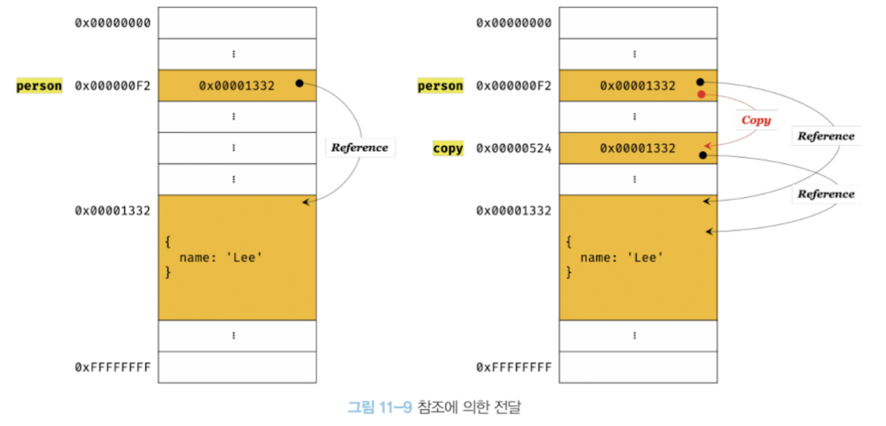
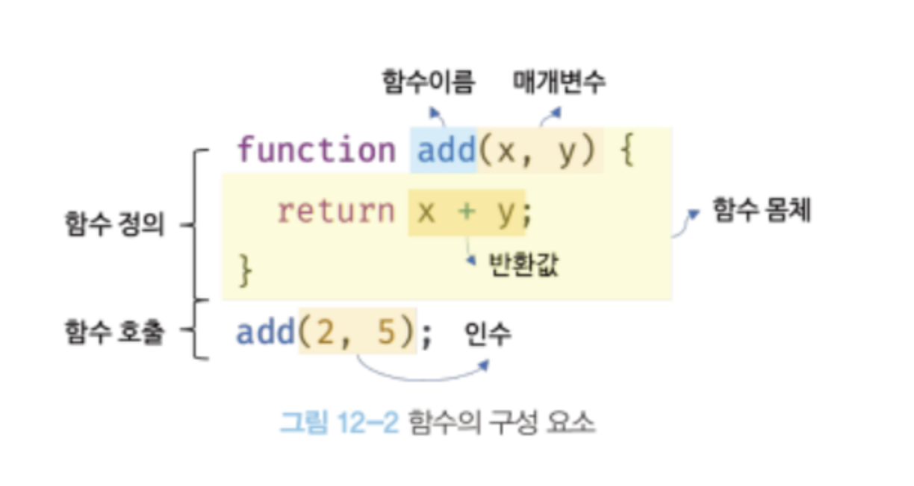
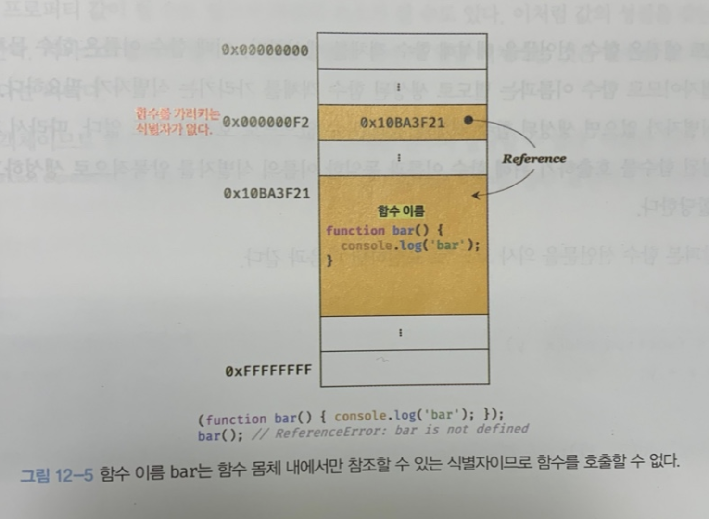

딥다이브 책 자바스크립트 원시값, 객체의 비교

## 원시 값과 객체의 비교

- 원시값 : 변경 불가능한 값
- 객체(참조) 타입 값: 변경 가능한 값.

왜 구분해놨을까?

원시 값을 변수에 할당하면 **실제 그 값이 메모리 공간에 저장**이 된다.

그러나 객체를 변수에 할당하면 변수에 **참조 값**이 저장이 된다.

### 원시 값

원시값은 변경 불가능한 읽기 전용 값이다. 여기서 유의해야할 것은 변경 불가능한 것은 변수가 아닌, 값에 대한 진술이다.

나중에 const키워드로 나올 때 "상수"는 재 할당이 불가능한 변수 일 뿐이므로, const로 선언한 객체 내부의 변경은 가능하다.

#### 변수 재할당

이전에 배웠던 변수값의 재할당을 생각해보자. 이전에 변수에 원시값을 재할당 하면, 새로운 메모리 공간을 확보하고 재할당한 원시값을 저장하고 그것을 가리키게 한다고 했다. 그 이유가 바로 **원시값은 변경 불가능하기 때문**이다. 따라서 새로운 메모리 공간을 확보하고 거기다가 원시값을 할당하고 그곳을 가리키게 되는 것이다.

이러한 특성을 **불변성**이라고 한다.

#### 문자열과 불변성

문자열은 글자 하나당 2바이트의 메모리 공간에 저장한다. **원시 타입**이며 **변경 불가능**하다.

또한 **유사 배열 객체** 이며, **이터러블**하다.

**유사 배열 객체?**

> 마치 배열처럼 프로퍼티 값에 접근할 수 있고, length프로퍼티를 갖는 객체.

아래의 코드를 살펴보면

```js
let str = "string";
//이때 변경되지 않으나 에러가 발생하지 않는다.
str[0] = "S";
console.log(str);
```

즉 'S'처럼 새로운 문자열을 바꾸려고해도 반영되지 않는다. 변경 불가능한 값이기 때문이다.

그러나 str 자체에 "java"라는 새로운 문자열을 넣는건 가능하다. 이때는 기존 문자열을 바꾸는게 아닌 'string'이 어딘가에 메모리에 존재하고, 'java'라는 메모리에 str이 가르키게 된 것이다.

#### 값에 의한 전달

```js
var score = 80;
var copy = score;
console.log(score); // 80
console.log(copy); // 80
score = 100;
console.log(score); // 100
console.log(copy); // 80
```

변수에 변수를 할당하면 어떻게 전달되는가?

score는 값 80 그래서 copy는 80으로 할당이 될 것이다. 이때 새로운 값 80을 생성해 copy에 할당이 된다.

즉 변수(원시값)에 변수를 할당하면 원시 값이 복사되어 전달된다. 이것을 **값에 의한 할당**이라고 한다.

```js
var score = 80;
var copy = score;
console.log(score === copy); // true
score = 100;
console.log(score === copy); // false
```

이것의 메모리 구조는 아래와 같다.


그러나 이 그림은 엔진의 내부동작과 다를 수 있음. ECMAScript에서 그 동작을 어떻게할지 명시가 되어있지 않기 때문.

파이썬은 두 변수가 같은 원시값을 참조하다가 재할당이 이루어질때 그때 비로소 메모리를 할당하는 방식이다. 즉, 어떤 엔진은 이렇게 동작할 수 도 있음.

> 핵심은 두 변수의 원시값은 서로 다른 메모리 공간에 저장된 별개의 값이 되어 어느 한족에서 재할당을 통해 값을 변경하더라도 서로 간섭할 수 없음!

### 객체

객체는 프로퍼티 갯수가 동적으로 추가되고 삭제될 수 있다. 따라서 메모리 공간의 크기를 사전에 정해둘 수 없다. 그래서 객체는 복합적인 자료구조이다.

또한 객체를 관리하는 방식은 브라우저 제조사마다 다를 수 있다. 객체를 생성하고 프로퍼티에 접근하는 것도 비용이 많이 든다.

##### 자바스크립트의 객체 관리 방식

객체는 프로퍼티 키를 인덱스롤 사용하는 해시 테이블이라고 생각할 수 있다. 대부분의 엔진이 해시테이블과 유사한 방법을 사용한다. 자바와 C++의 경우는 클래스를 미리 선언해서 그걸로 객체를 만들고, 객체가 만들어진 이후에 프로퍼티 생성,추가를 못한다.

이렇게보면 JS가 개발자에겐 매우 편리하지만, 성능이 많이드는 비효율적인 방식이다.

참고로 V8엔진 에서는 프로퍼티에 접근하기 위해 "히든클래스"라는 방식을 사용해, C++객체 접근 하는 정도의 성능을 보장한다.

#### 변경 가능한 값

객체는 변경 가능한 값이다. 변수에 객체를 할당하면 변수가 기억하는 메모리주소를 통해 참조 값에 접근할 수 있다.

참고로 참고 값은 객체가 생성된 메모리 공간 주소 그 자체이다.

```js
var person = {
  name:'lee'
}; // 할당이 이루어지는 시점에 객체 리터럴이 해석되고, 그 결과로 객체가 생성된다.
console.log(person) // {name:'lee'}
```

객체를 할당한 변수는 **재할당 없이 객체를 직접 변경 할 수 있다.**
```js
var person = {
  name:'lee'
}; 
person.name = 'Kim'; // 수정 가능
person.address='Seoul'; // 동적인 추가 가능
```



이전에 언급했듯이 객체는 관리가 매우 복잡하다. **메모리 사용 효율을 위해 객체는 변경 가능한 값으로 설계**가 되어있다.

따라서 구조적인 단점은 여러 개의 식별자가 하나의 객체를 공유할 수 있게된다.

##### 깊은 복사 & 얕은 복사
```js
const o = 
    {
  	x:	{
      		y:1
    	}
	}

// 얕은 복사
const c1 = {...o};
console.log(c1===o); // fasle
console.log(c1.x===o.x); // true

// Lodash를 이용한 깊은 복사
const _ = require('lodash');
const c2 = _.cloneDeep(o);
console.log(c2===o); // false
console.log(c2.x===o.x); // false
```

얕은 복사와 깊은 복사로 생성된 객체 자체는 완전 다르다. 그러나 내부에 있는 객체의 경우 얕은복사는 참조값을 복사하고, 깊은 복사는 그 객체를 복사하여 원시값과 다른 참조값을 가진 복사본을 제공한다.

#### 참조에 의한 전달

```js
var person = {
  name:'lee'
}; 
var car = person;
```

객체를 가르키는 변수를 다른 변수에 할당 하면 **참조 값이 복사가 되어 전달된다.**



따라서 car, person중 어느 한쪽에서 객체의 값을 변경하면, 서로 영향을 주고 받는다.

### 결론

"참조에 의한 전달", "값에 의한 전달"는 변수에 전달되는 값이 원시 값인지, 참조 값인지 구분해서 강조하는 용어이다.


## 함수

함수도 자바스크립트에서 핵심 키워드이다. 아래와 같은 키워드가 다 함수랑 연관이 있다.

`스코프` `실행` `컨텍스트` `클로저` `생성자 함수에의한 객체생성` `메서드` `this` `프로토타입` `모듈화`

따라서 정확하게 JS를 이해하기 위해서 함수를 정확하게 이해해야한다.

수학에서의 함수는 Input을 Output으로 반환해준다. 프로그래밍 언어에서 함수도 마찬가지 개념이다.

```js
function add(x,y){
  return x+y;
}
add(2,5); // 7
```

함수는 일련의 과정을 **문**으로 구현하고 **코드 블록으로 감싸서 하나의 실행 단위**로 구현한 것이다. 이때 입력을 전달받는 변수를 **매개 변수**, 입력을 **인수**, 출력을 **반환값**이라고 정의한다. 또한 함수는 **값**이며, 여러개 존재할 수 있으므로, **식별자인 함수 이름**을 사용할 수 있다.



함수는 함수 정의를 통해 생성하고, JS에서 함수는 다양한 방법으로 정의할 수 있다. 위의 예제는 **함수 선언문**을 통해 정의한 예이다.

위의 예제에서 **인수**를 매개변수를 통해 전달해 실행을 명시적으로 지시해야하는데 이것을 **함수호출**이라 한다. **함수호출**을 하면 코드 블록에 담긴 문들이 일괄적으로 실행되고 반환 값을 반환한다.

### 함수 사용 이유

함수는 필요할 때 여러 번 호출할 수 있는데, 실행시점을 개발자가 정할 수 있고, 재사용가능하다. 즉, **코드의 재사용**이라는 측면에서 매우 용이하다.

즉 함수 작성의 방향성은 **재사용성을 높여야한다** 그리고 그런 함수는 **유지보수 편의성**과 **코드의 신뢰성**을 높이는 효과가 있다.

함수는 **객체 타입의 값**이다. 그래서 함수 이름 또한 변수 이름과 마찬가지로 자신의 역활을 잘 설명해야한다. 이것을 지키면 **코드의 가독성**을 향샹시킨다.

### 함수 리터럴

값을 리터럴로 생성하는 것 처럼 함수 또한 리터럴로 생성할 수 있다.
```js
var f = function add(x,y){
  return x+y;
}
```

위의 코드는 함수 리터럴을 변수에 할당하고 있다. 즉, 함수 리터럴도 평가되어 값을 생성하고, 그것은 **객체**이다. 즉, 함수는 **객체**다!

일반 객체와 다른 점은. 함수는 호출할 수 있는 객체이다. 따라서 일반 객체엔 없는 함수 객체의 고유의 프로퍼티를 가지고 있다. 함수가 객체라는 것이 다른 프로그래밍 언어와 구별되는 특징이다. - 나중에 18장에서 자세히 언급.


### 함수 정의

함수를 정의하는 방법은 4가지가 있고, 정의된 함수는 엔진에 의해 **함수 객체**가 된다.

```js
function add(x,y){ return x+y } // 함수 선언문
var add3 = function(x,y){ return x+y } // 함수 표현식
var add2 = new Function('x','y','return x+y'); // Function생성자 함수
var add4 = (x,y)=>x+y; // 화살표함수(ES6)
```

정의하는 면에서는 동일하지만, 미묘한 차이가 있다.

#### 함수 선언문

함수 선언문과 함수 리터럴은 형태가 동일하나 **선언문은 이름을 생략할 수 없다**.

함수 선언문은 표현식이 아닌 **문**이다. 함수 선언문을 실행하면 undefined라는 완료값이 뜬다. 따라서 **문**이기에 변수에 할당할 수 없다.

그렇다면 위에서 본 

```js
var f = function add(x,y){
  return x+y;
}
```


이 예제는 잘못된 예제인가? 엔진은 선언문처럼 쓴 리터럴은 엔진에 맥락에 따라 해석한다.
1. 단독으로 사용한다면 함수 선언문으로 해석
2. 그 외에는 함수 리터럴로 해석

따라서 아래는 오류가 난다.

```js
(function bar(){console.log("bar");})
bar() // error: bar is not define
```

즉 선언문 처럼 쓴 리터럴은 리터럴로 해석하면 식별자는 의미가 없어진다.

위의 bar는 가리키는 참조 값이 없기 때문에 실행이 되지 않는 것이다.



##### 함수 선언문 동작 방식

엔진은 함수선언문을 해석해 함수 객체를 생성한다. 이때 함수 객체를 가리키는 식별자를 암묵적으로 생성후 거기에 함수 객체를 할당한다.

따라서 함수는 **함수 이름으로써 호출 되는 것이 아니라** 함수 객체를 가리키는 **식별자**로서 호출이 되는 것이다.

#### 함수 표현식

함수는 객체 타입의 값 이기에, 배열의 요소 & 프로퍼티의 값, 변수 등에 할당할 수 있다. 이러한 값 처럼 사용할 수 있는 객체를 **일급객체**라고 한다. **함수는 그래서 일급 객체**이다.

그래서 함수 리터럴로 생성한 함수를 변수에 할당할 수 있고, 이러한 방식으로 함수를 정의하는 것을 함수 표현식이라 한다. 또한 함수 리터럴은 일반적으로 **이름이 없는 익명 함수**로 표현하는게 일반적이다

```js
var  sub = function(x,y){
	return x-y;
}
```


##### 함수 생성 시점, 함수 호이스팅

함수표현식 & 함수 표현식은 언뜻 보면 똑같이 동작하는 것 처럼 보이지만, 미묘한 차이가 있다.

아래의 예제를 보자

```js
console.dir(add); // f add(x,y)
console.dir(sub) // undefined

console.log(add(2,5)) // 7
console.log(sub(2,5)) // error: sub is not a function

// 함수 선언문
function add(x,y){
  return x+y;
}

var sub = function(x,y){
  return x-y;
}
```

함수 선언문은 이전에 호출할 수 있지만, 함수 표현식은 이전에 호출할 수 없다.

이는 함수 선언문과 함수 표현식이 **정의한 함수의 생성 시점이 다르기**때문이다.

이전에 배운 내용 중에 "**모든 선언문은 런타임 이전에 엔진에 의해 먼저 실행된다**" 것을 배웠다. 이전엔 변수에 관한 내용 이기에 변수 호이스팅 이라고 불렀지만, 마치 함수 선언문이 맨위로 끌어 올려진 것 처럼 동작하는 JS고유의 특징을 **함수 호이스팅**이라 한다.

그러나 var 변수 호이스팅과 함수 호이스팅의 중요한 차이점은

var 변수 호이스팅은 undefined로 초기화되지만, 함수 선언문은 함수 객체로 초기화 된다.

결론적으로 함수 표현식은 **변수 호이스팅**이 발생하고, 함수 선언문은 **함수 호이스팅**이 발생한다.

> 함수 호이스팅은 호출하기 전에 함수를 선언해야된다 라는 규칙을 무시하기 때문에 JSON을 제안한 더글라스 크락포드는 함수 선언문 대신 함수 표현식을 사용하는 것을 권장한다.
##### 개인적인 궁금함
왜 "호출하기 전에 함수를 선언해야된다."가 일반적인 규칙인가? 그래서 GPT에게 물어봤다. 대답을 보니 오버라이딩이 큰 이슈라고 생각이 들었고, 유지보수성에서 커뮤니케이션에 혼란을 주기 좋다고 생각됫다.
A: 문제가 될 수 있는 상황
- 유지보수성: 함수 선언이 코드의 아래쪽에 위치해 있지만, 위에서 호출되면, 코드를 처음 보는 사람이나 나중에 코드를 다시 검토할 때 혼란을 줄 수 있습니다. 함수 호출과 선언의 위치가 떨어져 있으면 코드의 흐름을 파악하기 어렵습니다.
- 스크립트 실행 순서: 여러 스크립트 파일과 모듈이 있는 대규모 프로젝트에서는 함수 선언의 호이스팅으로 인해 예상치 못한 결과가 발생할 수 있습니다. 특히, 다른 스크립트 파일에서 같은 이름의 함수를 선언하면, 어떤 함수가 실제로 호출될지 예측하기 어려워질 수 있습니다.
- 함수 오버라이딩: 같은 스코프 내에서 동일한 이름의 함수를 여러 번 선언하면, 가장 마지막에 선언된 함수가 이전의 모든 선언을 오버라이드합니다. 이는 디버깅을 어렵게 만들 수 있습니다.


#### Function 생성자 함수

기본적으로 제공하는 Function생성자 함수에 의해 객체를 생성해서 반환한다.

그러나 일반적으로 사용하지 않는 방법이고, "클로저"라는 것을 생성하지 않아 선언문과 표현식으로 생성한 함수와 다르게 동작한다.

#### 화살표 함수

좀 더 간략한 방법으로 =>를 사용해 선언할 수 있다. 화살표 함수는 익명함수다.

그러나 문법자체를 대체하는 것이 아니고, 기존의 함수보다 표현이 간단한 것 뿐만아니라 **내부의 동작 또한 간략화 되어있다**

- this바인딩 방식이 다르다
- prototype프로퍼티가 없다
- arguments객체를 생성하지 않는다.

자세한 내용은 추후에 살펴보자

### 함수 호출

함수를 가리키는 식별자 + 한쌍의 소괄호로 **함수 호출 연산자**로 호출한다.

호출 연산자 내에는 0개 이상의 인수를 쉼표로 구분해서 나열한다. 현재의 실행 흐름을 중단하고 함수로 실행 흐름을 옮긴다. 이때 매개변수에 인수가 순서대로 할당되고 몸체의 문들이 실행되기 시작함.

#### 매개변수와 인수

- 인수: 값으로 평가가 될 수 있는 표현식이여야함. 인수는 호출할 때 지정하고, 갯수와 타입에 제한이 없다.

- 매개변수: 함수 몸체 내부에서만 참조가능.

참고로 매개변수의 갯수와 인수의 갯수가 일치하지 않아도 된다. 인수가 부족해 매개변수에 할당되지 않은 값은 undefined로 취급한다.

인수가 매개변수보다 많으면 초과된건 무시된다 => 엄밀하게는 arguments객체의 프로퍼티로 보관 됨.

```js
function add(x,y){
  return x+y;
}
console.log(add(2)) // NaN
console.log(add(3,4,5))//7


function add2(x,y){
  console.log(arguments); // [2,5,10, callee: f, s~]
  return x+y;
}
add2(2,5,10);
```

- JS에서 함수는 매개변수와 인수의 갯수가 일치하는지 확인하지 않음
- JS는 동적타입 언어이므로 매개변수 타입을 사전에 지정할 수 없다.

이렇게 엔진에서 의도치 않게 사용되는 함수들을 실행시키므로 개발자가 확인을 해줘야된다.

```js
function add(x,y){
	if(typeof x !== "number" || typeof y !== "number"){
      throw new TypeError('인수는 모두 숫자여야합니다.')
    }
  return x+y;
}
```

또한 아래와 같이 매개변수의 기본 값을 할당해 줄 수 있다.(ES6)

```js
function add(x,y=0){
	return x+y;
}
```

##### 매개변수의 갯수

함수에서 매개변수의 최대갯수를 지정하고 있지 않다. 그러나 일반적으로 최대 3개이상을 넘지 않는 것을 권장한다. 왜냐하면 여러가지 일을 한다는 증거이다. 만약 그렇게 필요하다면 객체로 인수를 전달하는 것이 유리하다. 왜냐하면 객체로 지정해주면, 매개변수의 순서를 신경 쓰지 않아도 되기 때문이다. - 유지보수성에 좋아진다.

그러나 객체로 매개변수를 전달했을 때 - 함수 외부의 객체가 변경되는 부수 효과가 나타날 수 있음으로 유의하자 => 이것도 나중에 다 자세히 살펴본다


#### 반환문

return 키워드를 사용하여 자바스크립트의 모든 값을 반환할 수 있다. 함수 호출은 표현식이고 return키워드가 반환한 표현식의 평가 결과로 평가가 된다.

역활은 두가지
- 함수의 몸체를 빠져나간다. - 그 뒤에 실행되는 건 실행되지 않고 빠져나간다
- 뒤에 오는 표현식을 평가해 반환한다. 명시적으로 지정하지 않는다면 undefined를 반환한다.

참고로 Nodejs는 모듈 시스템에 의해 파일별로 독립적인 스코프를 가지기 때문에 파일의 가장 바깥영역에서 반환문을 사용해도 에러가 발생하지 않는다.

#### 인수의 전달

매개변수도 변수와 같이 타입에 따라 값에 의한 전달, 참조에 의한 전달방식을 그대로 따른다.

아래의 코드를 보자

```js
function changeVal(p,obj){
	p +=100;
  obj.name = '바꿈!';
}

var num = 10;
var person = {name:'하이'}

console.log(num) // 10
console.log(person); // {name:'하이'}

changeVal(num,person);

console.log(num) // 10 훼손되지 않음
console.log(person) // {name:'바꿈!'}
```

즉 함수 외부에서 전달한 값이 참조값에 의해 원본 객체가 변경되는 **부수 효과**를 발생시킨다.

이처럼 함수가 외부의 상태를 바꿔버리면 추적이 어려워져서 복잡성을 증가시키고 가독성을 해친다.

이러한 변경을 추적하기 위해 **옵저버패턴**이라는 설계방법이 있고, 이것을 통해 개체의 참조를 공유하는 모든이들에게 변경 사실을 통지하고 대처하는 추가 대응을 해주는 방법론이다.

사실 해결 방법중 하나는 객체를 불변 객체로 만들어 사용하는 것이다. 객체의 상태 변경이 필요한 경우에는 **방어적인 복사**를 통해 즉, 깊은 복사를 통해 새로운 객체를 생성하고 재할당으로 교체한다.

> 순수함수: 외부의 상태를 변경하지도 않고, 외부 상태에 의존하지도 않는 함수

순수 함수를 통해  프로그래밍의 안정성을 높이는 프로그래밍 패러다임을 **함수형 프로그래밍**이라고 한다.

#### 다양한 함수의 형태

##### 즉시 실행 함수

```js
(function(){
  var a=3;
  var b=2;
  return a*b;
}());
```

정의와 동시에 즉시 호출되는 함수를 말한다. 한 번만 호출이 되며, 다시 호출할 수 없다.

즉시 실행 함수는 **함수 선언문에서는 사용할 수 없다**. 그 이유는 엔진이 암묵적으로 선언문이 끝나는 위치에 ';'를 삽입하기 때문이다.

##### 재귀 함수

```js
function fact(n){
  if(n<=1) return 1;
  return n * fact(n-1);
}
```

반드시 탈출조건이 있어야되고, 사용에 주의해야한다

##### 중첩 함수

```js
function outer(){
  var x=1;
  function inner(){
    var y =2;
    console.log(x+y);
  }
  inner();
}
outer();
```

##### 콜백 함수

아래의 코드를 보자

```js
function repeat(n){
	for(var i=0;i<n;i++){
      console.log(i);
    }
}
```

이것은 n까지의 숫자를 찍어낸다.

그러나 반복하는 내용이 하나로 정의되는게 아니라 변경될 수 있는 내용이라면?

이것을 함수를 합성해서 해결할 수 있다.


```js
funciton repeat(n,f){
  	for(var i=0;i<n;i++){
      f(i);
    }
}

var logOdds = function(i){
  if(i %2) console.log(i);
}

repeat(5,logOdds) // 반복 호출할 함수를 인수로 전달한다.
```

이 코드를 보면 반복하는 일을 f로 추상화해서 함수처럼 실행햇다. 함수는 일급 객체이므로 **매개변수를 통해 함수를 전달할 수 있다.** 매개변수를 통해 **다른 함수의 내부로 전달되는 함수를 콜백함수**라고 부른다.

매개변수를 통해 함수를 전달받거나 반환하는 값으로 함수를 반환하는 함수를 함수형 프로그래밍 패러다임 에서는 **고차함수**라고 한다.

**고차함수는 콜백 함수를 자신의 일부분으로 합성한다**

호출 시점에 콜백 함수를 결정해서 호출한다. 즉, 콜백함수는 호출할 때 결정이 된다.

```js
repeat(5, function(i){ if(i%2) console.log(i);});
```

**콜백 함수**는 **비동기 처리**에서도 활용되는 중요한 패턴이다.

#### 순수 함수와 비순수 함수

순수함수는 동일한 인수가 전달이 되면 동일한 값을 반환하는 함수이다. 즉, **외부상태**에 의존하지 않고, 오직 매개변수를 통해 함수 내부로 전달된 인수에게만 의존한다.

반대로 외부의 상태를 참조하거나 외부상태에 의존하게 되면 비순수함수라고한다.

> 함수형 프로그래밍은 순수함수와 보조함수의 조합으로 부수 효과를 최소화해서 불변성을 지향하는 프로그래밍 패러다임이다.자바스크립트는 **멀티 패러다임 언어이므로 객체지향 프로그래밍 뿐만아니라 함수형 프로그래밍도 적극 활용**하고 있다.


### 후기

함수에 관해서 자세히 알게됬고 각 용법이 어떤 차이점이 있는지 "간단하게"알게되었다. 그러나 간단하게 알게된것 만으로 나의 코드작성에 많은 영향을 줄 것 같다. 첫번째는 화살표함수를 간단한 표현때문에 썻지만, 이제는 사용에 대한 동작원리를 정확하게 이해하고 적용할 수 있게 되었다.
