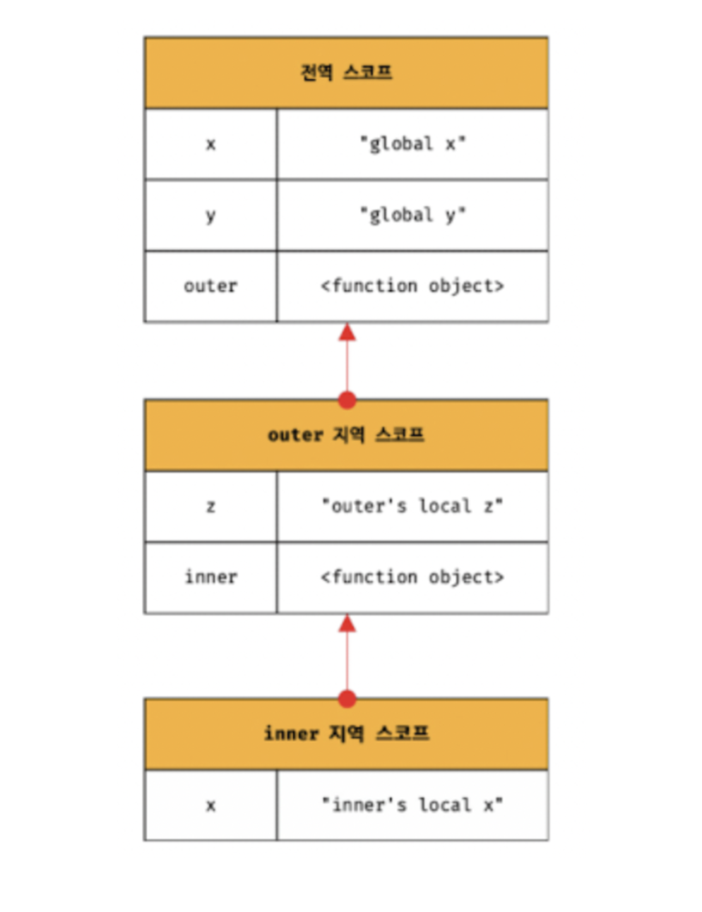
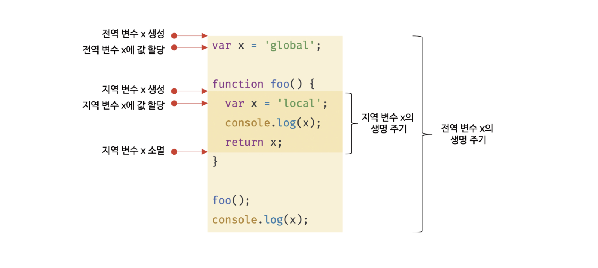
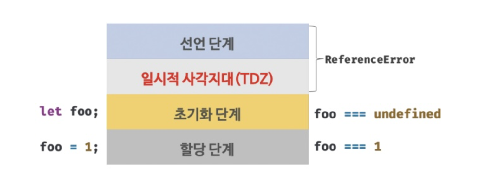

딥다이브 책을보며 스코프, 전역변수 , let & const 키워드에 대한 내용을 정리했습니다.

## 스코프

이전에 함수를 보며 대강 경험했다. 매개변수는 스코프 안에서만 참조할 수 있고 바깥에서는 참조할 수 없다.

변수는 코드의 가장 바깥 영역 뿐아니라 코드 블록이나 몸체 내에서 선언 가능하다.

변수는 자신이 선언된 위치에 자신이 유요한 범위가 결정이 된다. 이것을 확장하면 

스코프는  **모든 식별자가 자신이 선언된 위치에 의해 다른 코드가 식별자 자신을 참조할 수 있는 유효범위** 이다.

```js
var x= "global";
function foo(){
  var x = 'local'
  console.log(x);
}
foo(); // 'local'
console.log(x); // 'global'
```

위의 코드에서 엔진은 같은 두개의 변수 중 어떤 변수를 참조해야할지 결정한다. 이를 **식별자 결정**과정이라한다. 따라서 **스코프**는 **엔진이 식별자를 검색할 때 사용하는 규칙**이다.

엔진은 문맥을 고려하므로 코드가 어디에 있는지 따라 위의 코드처럼 동일한 코드라도 다른 결과를 만들어낸다.

> 코드가 어디서 실행이 되고, 주변에 어떤 코드가 있는지 를 말하는 것을 "렉시컬 환경"이라고 한다. 그리고 이를 구현한 것이 실행 컨텍스트 이다. 모든 코드는 실행 컨텍스트에서 평가되고 실행된다.


스코프 내에서는 식별자는 유일해야한다. 다른 스코프에서는 같은 이름의 식별자를 사용할 수 있다.그래서 네임스페이스라고 말할 수 있다.

#### var의 중복선언

var는 같은 스코프 내에서 중복 선언을 허용한다.

```js
function foo(){
	var x =1; //var는 스코프내에서 중복 선언을 허용한다.
    var x =2; // 이 부분은 var가 없는 것 처럼 동작한다.
  console.log(x)//2
}

// 그러나 let&const키워드는 중복선언이 안된다.
funtion bar(){
  let x=1;
  let x=2; // Error
}
```

### 스코프의 종류

스코프는 전역스코프와 지역스코프로 나눈다.

#### 전역과 전역스코프

전역은 가장 바깥영역을 말한다. 전역에서 변수를 선언하면 전역 스코프를 가지는 전역 변수가 된다. 전역변수는 **어디서든 참조할 수 있다.** 즉, 어떤 함수 내부에서도 사용할 수 있다.

#### 지역과 지역스코프

지역이란 함수 몸체 내부를 말한다. 지역에 변수를 선언하면 자신이 선언한 위치와 하위 지역에서만 변수를 참조할 수 있다.

### 스코프 체인

함수는 전역에서 정의할 수 도있고 몸체 내부에서도 정의 할 수 있다. 함수 몸체 내부에서 정의된 것을 **함수의 중첩**이라고 표현한다. 그리고 중첩으로 표현된 함수를 **중첨함수**라고 부른다.

이러한 중첩의 특징으로 지역 스코프는 외부함수의 지역 스코프랑 계층적 구조를 가진다. 이때 외부함수의 지역 스코프를 **상위스코프**라고 부른다. 또한 **스코프가 계층적으로 연결되는 것**을 **스코프체인**이라고 부른다. 모든 지역 스코프의 최상위 스코프는 전역 스코프이다.

엔진은 스코프 체인을 통해 변수를 참조하는 코드의 스코프에서 시작해 **상위 스코프로 이동하며 선언된 변수를 검색**한다. 코드를 실행하기 앞서 **렉시컬환경**의 자료구조를 실제로 생성하고 변수 선언이 실행이 되면 변수 식별자가 이 자료구조에 키로 등록되고 

변수 할당이 일어나면 이 자료구조의 변수 식별자에 해당하는 값을 변경한다.

> 스코프체인은 실행 컨텍스트의 렉시컬 환경을 단방향으로 연결한 것이다. 전역 렉시컬환경은 코드가 로드되면 곧바로 생성되고, 함수의 렉시컬 환경은 함수가 **호출될 때** 생성된다.


_스코프체인을 도식화한것_


### 함수 레벨 스코프

var키워드의 중요한 특징이 하나 있다.

**모든 코드 블록은 사실 지역 스코프를 만든다.** 이러한 특성을 **블록 레벨 스코프**라고 한다. 하지만 var 키워드는 함수의 코드 블록만을 지역스코프로 인정한다. 이러한 var키워드의 특성을 **함수 레벨 스코프**라고한다.

```js
var i=1;
for(var i=0;i<5;i++){
	console.log(i);
}

console.log(i)// i값이 변경되었다.
```

즉 var키워드를 사용하면 의도치않은 전역변수 재할당이 일어난다. 블록레벨 스코프를 지원하는 언어는 for문을 위해 선언된 i는 지역변수이다. 그러나 var는 블록레벨 스코프를 인정하지 않기에 전역변수가 된다. 따라서 i가 중복선언이 되고 값의 재할당이 일어난 것이다.

이러한 문제를 보완한 것이 ES6에서 도입된 let과 const키워드이다.

### 렉시컬 스코프

```js
var x =1;
function foo(){
  var x =10;
  bar();
}
function bar(){
	console.log(x);
}
foo(); // ??
bar(); // ??
```
위의 실행결과는 bar함수의 상위스코프가 뭐냐에 따라 결정이 되는데, 이때 두 가지 패턴을 예측할 수 있다.

1. **함수를 어디서 호출**했는지에 따라 함수 상위 스코프가 결정된다.
2. **함수를 어디서 정의**했는지에 따라 함수 상위 스코프가 결정된다.

1번의 방식은 **동적 스코프**라고 한다. 함수가 정의되는 시점에서는 어디서 호출될지 모르기 때문에 그렇게 부른다.

2번의 방식은 **정적 스코프** or **렉시컬 스코프**라고 부른다. 자바스크립트와 대부분의 프로그래밍 언어는 렉시컬 스코프를 따른다.

즉 중요한건 **함수의 상위 스코프는 자신이 정의된 스코프**이다. 엔진은 함수의 정의가 실행이 되어 생성된 함수 객체는 이렇게 결정된 상위 스코프를 기억한다.

## 전역 변수의 문제

전역변수는 반드시 사용해야되는 이유가 있다. 무분별한 사용은 위험을 초래하기 때문이다. 그 위험을 알아보자

### 변수의 생명주기

생명은 생성과 소멸되는 주기가 있는데 마찬가지로 변수에도 이러한 주기가 있다. 만약 변수에 생명주기가 없다면 한번 선언된 변수는 프로그램이 종료되지 않는 한, 메모리에 계속 남아있을 것이다. 

변수는 자기가 선언된 위치에서 생성하고 소멸한다.

#### 지역변수의 생명주기

```js
function foo(){
  var x ='local';
  console.log(x);
  return x;
}
foo();
console.log(x);//Error x is not defined
```

지역변수 x는 foo함수가 호출되기 전까지 생성되지 않는다. 호출하지 않으면 선언문이 실행되지 않기 때문이다.

그런데 이상하지 않나? 이전에 호이스팅을 배울 때

> 변수 선언은 어디에 있든 상관없이 가장 먼저 실행이되고, 런타임 이전단계에서 엔진에 의해 먼저 실행이 된다.

라고 배웠었다. 사실 이 문장은 엄밀히 말하면 전역 식별자에 한정된 이야기다. **함수 내부에서는 함수가 호출된 직후에** 엔진에 의해 선언한 변수가 **먼저 실행**이 된다.

즉, 함수 호출된 직후 몸체를 실행하기 전에 var x를 undefined로 초기화가 된다.그리고 함수가 종료되면 x변수도 소멸되어 생명주기가 종료된다.

변수의 생명주기는 **메모리 공간이 확보**된 시점에서 **메모리 공간이 해제**되어 **가용 메모리 풀**에 반환되는 시점까지이다.

그런데 대부분은 지역 변수의 생명 주기가 함수의 생명 주기랑 일치하지만, 지역 변수가 함수보다 오래 생존하는 경우도 있다.


> 할당된 메모리 공간은 누구도 참조하지 않을 때 가비지 콜렉터에 의해 해제되어 가용 메모리 풀에 반환된다. **스코프 또한** 마찬가지이다. **누군가가 참조하고 있다면 스코프는 소멸하지 않고 생존**한다.

### 전역 변수의 생명주기

코드가 로드되자마자 전역 객체의 프로퍼티가 된다. 즉 전역 객체의 생명 주기와 일치된다.

> 전역 객체는 엔진에 의해 어떠한 객체보다도 가장 먼저 생성되는 특수한 객체. 전역객체는 브라우저에서는 window, node.js에서는 global객체를 의미한다. 따라서 환경에 따라 전역 객체를 가리키는 식별자가 다양했으나 ES11에서 globalThis로 통일되었다.



### 문제점

모든 코드가 전역 변수를 참조하고 변경할 수 있는 **암묵적 결합**을 허용하게 되는데, 그렇게되면 가독성이 나빠지고, 위험성도 높아진다.

- 긴 생명주기를 가진다. => 메모리 리소스를 오랜기간 소비한다
- 스코프 체인상 종점에 존재한다. => 전역변수의 검색속도가 가장 느리다.
- 네임스페이스 오염 => 파일이 분리되어도 전역객체는 공유가된다. 즉, 다른파일이라도 동일한 이름으로 명명된 전역변수는 의도치 않은 동작을 부른다.

### 해소법

전역변수의 사용이유를 반드시 찾기. 아래는 억제하는 방법들을 소개한다

#### 즉시 실행 함수 사용하기

모든 코드를 즉시 실행 함수로 감싸면 모든 변수는 즉시 실행함수의 지역변수가 된다.

#### 네임스페이스 객체

전역에 네임스페이스 역활을 하는 객체를 생성해 전역변수처럼 사용하고 싶은 프로퍼티를 추가한다.

```js
var MYAPP= {};
MYAPP.name ='hi';
console.log(MYAPP.name);
```

#### 모듈패턴

클래스를 모방해서 관련있는 변수와 함수를 모아 즉시 실행함수로 감싸 하나의 모듈을 만드는 패턴이다. **전역변수의 억제와 캡슐화**까지 구현할 수 있다.


**캡슐화**는 객체의 상태를 나타내는 프로퍼티와 프로퍼티를 참조하고 조작하는 동작인 메서드를 하나로 묶은 것을 말한다. 객체의 특정 프로퍼티나 메서드를 감출 목적으로 사용되기도 하는데 이를 **정보 은닉**이라 한다.

대부분의 객체지향 언어에서는 public private protected 등의 접근 제한자를 사용해 공개 범위를 한정할 수 있다. 그러나 자바스크립트는 접근 제한자를 제공하지 않는다.
```js
var Counter = (function(){
	var num =0;
  return {
    increase(){
      return ++num;
    },
    decrease(){
      return --num;
    }
  };
}());

console.log(Counter.num) // undefined
console.log(Counter.increase()) // 1
console.log(Counter.increase()) // 2
console.log(Counter.decrease()) // 1
```

노출하고 싶은 변수나 메서드를 **반환한다**. 이 반환되는 객체를 public member로 생각하면되고, 반환되는 객체에 추가하지 않는다면 private member로 생각한다.

#### ES6 모듈

ES6모듈은 파일 자체의 독자적인 모듈 스코프를 제공한다. 따라서 모듈 내의 var키워드는 전역 변수도 아니고, window객체의 프로퍼티도 아니다. 모던 브라우저에서는 ES6모듈을 사용할 수 있고, type="module"이라는 어트리뷰트를 추가하면 그 자바스크립트 파일은 모듈로서 동작한다. 모듈의 파일 확장자는 mjs를 권장한다.


## let & const

참 많이 나오는 면접 질문 중에 "let과 const에 대해서 설명해주세요" 였는데 드디어 자세히 알아본다.

var 문제점을 보완하기 위해 let & const 키워드가 ES6에 도입이되었다.

### var의 문제점

- 변수 중복 선언 허용

```js
var x = 1;
var y = 1;

var x = 100; // 초기화 되어있는 변수가 var키워드가 붙어있다면 엔진에 의해 없는 것 처럼 동작
var y; // 무시
console.log(x) //100
console.log(y) //1
```

- 블록 레벨이 아닌 함수 레벨 스코프
```js
var x =1;
if(true){
  var x =10;
}
console.log(x) //10
```
- 변수 호이스팅
```js
console.log(foo); // undefined
foo=123;
console.log(foo); //123
var foo;
// 프로그램 흐름이 이상해지고 가독성을 떨어트림
```

### let

- 변수 선언 중복 금지
```js
let bar = 123;
let bar = 456; // SyntaxError 
```
- 블록 레벨 스코프
```js
let foo =1;
{
  let foo=2;
  let bar=3;
}
console.log(foo) // 1
console.log(bar) //Referror
```
- let의 변수 호이스팅

우선 var변수의 호이스팅은 **선언 + 초기화**가 호이스팅 되어 진행된다.

그러나 let은 엔진에 의해 **선언**단계가 먼저 실행되지만, var처럼 undefined을 할당하지 않는다. 선언만 했을 뿐, 초기화 단계까지 참조할 수 없다.


_let변수의 생명주기_

그래서 마치 호이스팅이 발생하지 않는걸로 오해할 수 있으나 그렇지 않다. 아래의 코드를 보자.

```js
let foo = 1;
{
  console.log(foo); // Referror: cannot access 'foo' before initilization
  let foo=2;
}
```

만약 호이스팅이 안된다면 전역변수 foo가 출력되어야한다. 그러나 스코프 실행 직전에 **선언**먼저 했기 때문에 에러가 뜬다.

ES6에 도입된 키워드 let,const,class는 모두 이러한 동작을 거친다.

#### 전역객체와 let

var키워드를 전역 변수로 선언하거나 전역 함수로 선언하면, 전역 객체인 window의 property가 된다. 전역 객체의 프로퍼티를 참조할 때 아래의 코드처럼 window를 생략해서 접근할 수 있다.

```js
var x =1;
y=2; // 암묵적 전역

function foo(){} // 전역 함수

console.log(window.x) // 1
console.log(window.y) //2
console.log(window.foo) // f foo(){}

console.log(x) // 1
console.log(y) //2
console.log(foo) // f foo(){}
```

그러나 let은 window.foo처럼 접근할 수 없다. let은 보이지 않는 개념적인 블록(전역 렉시컬환경의 선언적 레코드 - 나중에 실행컨텍스트 살펴볼 때 자세히다룸)내에 존재하게 된다.

### const

const 는 상수를 선언하기 위해 사용하지만, 반드시 그 용법은 아니다. - 이것은 책의 후반부에서 살펴보자. const의 특징은 아래와 같다.

- 선언과 초기화 : const는 **반드시 선언과 동시에 초기화를 해야함** 그렇지 않으면 에러가 뜸.
- 재할당 금지
- 상수: 원시 값을 할당하면 변경할 수 있는 방법이 없음.

#### 객체와 const

그러나 const로 선언된 변수에 객체를 할당하면 변경가능하다. 객체는 재할당 없이도 값을 변경할 수 있기 때문이다.

따라서 const가 **재할당을 금지**할 뿐이지, **불변을 의미하지 않는다**

### 각 키워드의 사용 상황

- ES6에선 var키워드를 사용하지 않기
- 재할당이 필요한 경우는 let키워드 사용하나, 스코프는 최대한 좁게 만들기
- 대부분은 const를 사용하자.


## 후기

let, const를 자주 사용했으나 더 안전하다 라는 것만 알앗지 자세한 것은 잘 몰랐다. 특별히 보안적인 이슈라고 그냥 막연히 생각햇던거 같은데, 일단 이것은 오해였다는 것을 깨달았고, Javascript의 너무 많은 것을 허용해주는 단점을 보완하기 위해 프로그래밍의 흐름을 지키기 위해 let과 const를 사용한다는 것을 깨달았다.
