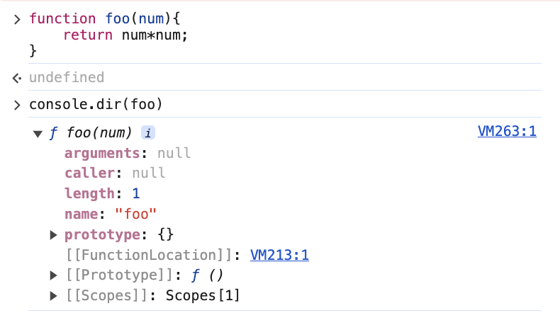
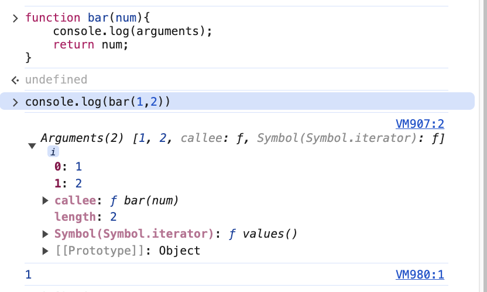

## 프로퍼티 어트리뷰트

### 내부 슬롯, 내부 메서드

 >ECMAScript 사양에서 사용하는 의사 프로퍼티, 의사 메서드.
 객체 내부를 콘솔에서 볼 때, \[\[\]\]로 감싸진 이름이다. 

 대표적인 예가 `[[Prototype]]`인데, 모든 객체는 `[[Prototype]]`라는 내부 슬롯을 가진다. 
 
 이것은 엔진 내부의 로직이므로 **개발자가 직접 접근할 수 없지만, 일부는 간접적으로 접근하는 수단**을 가진다.

Prototype같은 경우는 `__proto__`를 통해 접근 가능하다.

```js
const o = {}
o.__proto__ // Obeject.prototype
```

### 프로퍼티 어트리뷰트

> 프로퍼티의 상태를 나타내는 값.

또한 프로퍼티의 상태를 담은 객체 즉, 프로퍼티 어트리뷰트를 담은 객체를 **프로퍼티 디스크립터 객체**라고 부른다.

이 프로퍼티의 상태를 보기 위해선 ES8에 도입된  `Object.getOwnPropertyDescriptor`메서드를 사용해 확인할 수 있다. 

```js
const person = {
  name:'Lee'
}
console.log(Object.getOwnPropertyDescriptor(person,'name');
// {value:"Lee",writable:true,enumerable:true,configurable:true}
```

첫번째 인자: 객체의 참조
두번째 인자: 프로퍼티의 키(문자열로 전달)

### 프로퍼티의 구분

프로퍼티는 2가지로 구별할 수 있다.

#### 데이터 프로퍼티

> 키와 값으로 구성된 **일반적인 프로퍼티**. 아래와 같은 프로퍼티 어트리뷰트를 가진다.

- writable : 프로퍼티 값의 변경 여부. false되면 읽기 전용 프로퍼티가 됨.  (default: 프로퍼티 값)
- enumerable: 열거 가능 여부. false면 `for...in`, `Object.keys`등 으로 열거 할 수 없음.  (default: true)
- configrable: false가 되면 프로퍼티의 삭제, 프로퍼티 어트리뷰트 값 모두 변경 금지가 된다.(예외는 writable이 true인 경우, writable을 false로 변경하는 것과 value변경은 허용  (default: true)
- value: 프로퍼티 키를 통해 접근하면 반환되는 값 프로퍼티의 키를 통해 값을 변경하면 \[\[Value\]\]값을 재할당 한다. (default: true)

#### 접근자 프로퍼티

> 자체적으로 값을 가지는 프로퍼티가 아닌, 다른 데이터 프로퍼티의 값을 읽거자 저장할 때 사용하는 접근자 함수로 구성된 프로퍼티.

- get: 접근자 프로퍼티 키로 접근할 때 호출되는 getter함수.
- set: 접근자 프로퍼티 키로 값을 저장할 때 호출되는 setter함수.
- enurable: 데이터 프로퍼티와 같다
- configrable: 데이터 프로퍼티와 같다

예제.

```js
const person ={
  //firstName,lastName은 데이터 프로퍼티이다.
	firstName:'ungmo',
  	lastName:'Lee',
  
  // fullName은 접근자 프로퍼티이다.
  // getter 정의
  	get fullName(){
      return `${this.firstName} ${this.lastName}`;
    },
    // setter 정의
  	set fullName(name){
      [this.firstName, this.lastName] = name.split(' ');
    }
}
person.fullName="na na" // settter 호출
console.log(person) // {firstName:"na",lastName:"na"}
console.log(person.fullName) // getter 호출

console.log(Object.getOwnPropertyDescriptor(person,'fullName');
// {get:f,set:f,enumerable:true,configurable:true}
```
 
 ### 프로퍼티 어트리뷰트의 정의
 
 기존에는 새로운 프로퍼티를 추가하면서 프로퍼티 어트리뷰트 자체를 알아서 생성하게 해주었다.
 
 그러나 `Object.defineProperty`메서드를 사용해서 프로퍼티를 새로 생성하면서 해당 프로퍼티의 어트리뷰트를 정의할 수 있다.
 
 ```js
const person ={};
Object.defineProperty(person,'firstName',{
  value: "Lee",
  writable:true,
  enumerable:true,
  configurable:true,
})
 ```

이때 `Object.defineProperty` 로 정의할 때 프로퍼티 일부를 생략하면 default값으로 설정이 된다. 기본값 목록은 아래와 같음

- value: undefined
- get: undefined
- set: undefined
- writable: false
- enumerable: false
- configurable: false

### 객체 변경 방지

객체 변경에는 프로퍼티 추가, 삭제, 프로퍼티 값 갱신, 프로퍼티 어트리뷰트 재정의를 변경할 수 있다. 이것을 방지시키는 메서드를 자바스크립트에서 제공해준다.

- Object.preventExtension: 프로퍼티 추가X
- Object.seal: 프로퍼티 추가, 삭제, 어트리뷰트 재정의 X
- Object.freeze: 프로퍼티 추가, 삭제, 어트리뷰트 재정의, 값 쓰기 X

참고로 **strict mode가 아니면** 해당 메서드를 통해 제약을 걸어놓아도, 에러가 뜨지않고 **행위가 "무시"** 된다.

참고로 해당 Object가 freeze,seal,preventExtension인지 검사하는 메서드도 제공하고 해당 함수들은 `Object.isFrozen`,`Object.isSealed`, `Object.isExtensible` 이다.

#### 불변 객체

프로퍼티의 값이 객체여서 중첩되는 객체에서는 변경방지를 적용할 수 없다.

따라서 **완전 불변 객체**를 위해선 모든 프로퍼티에 대해 **재귀적으로 freeze**를 해주어야 된다.

```js
function deepfreeze(target){
	if(target && typeof target === 'object' && Object.isFrozen(target)){
    	Object.freeze(target);
      	Object.keys(target).forEach(key=>deepfreeze(target[key]));
    }
}
return target;
```

## 생성자 함수에 의한 객체 생성

### 객체 리터럴에 생성 방식의 문제점

객체 리터럴 방식은 직관적이고 간편하나, 단 하나의 객체만을 생성한다. 여러개를 생성하는 경우는 비효율 적이다.

```js
const circle1 = {
  radius: 5,
  getDiameter() {
    return 2*this.radius;
  }
};

const circle2 = {
  radius: 10,
  getDiameter(){
    return 2*this.radius;
  }
};
```
_코드 중복 발생_

### 생성자 함수에 의한 객체 생성 방식

객체를 생성하기 위한 템플릿 처럼 생성자 함수를 사용해 프로퍼티 구조가 동일한 객체 여러개를 간편히 생성한다.

```js
function Circle(radius){
  this.radius = radius;
  this.getDiameter = function(){
    return 2*this.radius;
  };
}

const circle1 = new Circle(5);
const circle2 = new Circle(10);
```

> 참고로 this에 대해서는 잠깐 살펴보면 **함수 호출 방식**에 따라 동적으로 결정되는데, 
- 일반함수는 전역객체 
- 메서드로 호출하면 메서드를 호출한 객체
- 생성자 함수로서 호출되면 생성자 함수가 생성할 인스턴스
로 결정이 된다.

### 생성자 함수

위에 사용법에서 봤듯이, 생성자 함수는 **객체**를 생성하는 함수다. 

**일반 함수와 동일한 방법으로 정의**하고, **new연산과 함께 호출하면 해당 함수가 생성자 함수**로 동작한다.

일반 함수로 호출하면 어떻게 동작하는지 아래를 보자

```js
function Circle(radius){
  this.radius = radius;
  this.getDiameter = function(){
    return 2*this.radius;
  };
}

const circle3 = Circle(15);
console.log(circle3); // undefined - 반환이 없으므로
console.log(radius); // 15 // Circle안에 this가 전역 객체로 되어 접근이 가능하다.
```

### 생성자함수의 인스턴스 생성 과정

생성자 함수는 **구조가 동일한 인스턴스를 생성하기 위한 템플릿**으로 동작하여 인스턴스를 생성하는 것과 생성된 인스턴스를 초기화하는 것이다.

자바스크립트 엔진은 **new**연산자와 함께 생성자 함수를 호출하면 아래와 같이 동작한다.

1. 인스턴스 생성과 this 바인딩.

**빈 객체가 생성되고, 해당 객체가 this가 된다.** 이 과정이 있기에 생성자 내부의 this가 생성할 인스턴스를 가리키는 것이다.

> 바인딩: 식별자와 값을 연결하는 과정. this를 바인딩 한다는 것은 this가 가리키는 값을 지정해주는 것(여기선 생성한 빈 객체)


2. 인스턴스 초기화

생성자 함수에 있는 코드 한 줄씩 실행이 되고, this에 바인딩 된 인스턴스를 초기화 한다.

3. 인스턴스 반환

생성자 함수 내부의 모든 처리가 끝나면 초기화가 완료된 this가 암묵적으로 반환된다. => 그러나 return 문에 반환이 객체가 명시되어 있으면 this가 반환되지 않고 return문에 명시된 객체가 반환된다.

```js
function Circle(radius){
  this.radius = radius;
  this.getDiameter = function(){
    return 2*this.radius;
  };
  return {};
}

const circle = new Circle(1); // 3번째에서 this가 아닌 {}가 반환된다.
console.log(circle) // {} 
```

그러나 원시 값이 반환된다면 반환은 무시되고 this가 반환된다.

즉 우리가 함수가 **생성자 함수로서 동작하기 원하면 객체를 반환하면 안된다.** 원시 값이 this가 반환된다 하더라도 return문은 생략하자!

### 함수 객체

잠깐 정리하면 함수 선언문, 함수 표현식으로 정의한 함수는 일반적인 함수 뿐만 아니라 new키워드와 함께 생성자 함수로서도 호출이 될 수 있다. 그리고 이전에 언급했던 것 처럼 **함수는 함수 객체** 이다.

함수 객체는 객체의 내부 슬롯과 내부 메서드 뿐만 아니라 Call,Construct같은 내부 메서드를 추가로 가지고 있다.

**일반 함수로서 함수가 호출이 되면 내부메서드 \[\[Call\]\]이 호출**이 되고, **new 연산자와 함께 생성자 함수로서 호출되면 내부 메서드 \[\[Construct]]가 호출**이 된다.

```js
function foo() {} // 함수 객체

foo() // 일반적 함수로서 호출 [[Call]]이 호출된다.
new foo() // [[Construct]]가 호출된다.
```

이때 \[\[Call\]\]을 가지는 함수 객체를 callable이라 하며, \[\[Constructor\]\]를 가지는 함수 객체를 constructor, 가지지 않은 함수 객체는 Non-constructor라고 말한다.

> **모든 함수 객체는 Callable하지만 constructor일수도, non-constructor일수도 있다.** 다시 말하면, 함수 객체는 함수 호출은 가능하지만, 생성자로서 함수를 호출 할 수도있고 없을 수도 있다.

### JS엔진의 constructor, non-contstructor 구분

- constructor: 함수 선언문, 함수표현식, 클래스(클래스도 함수다)
- non-constructor: 메서드(ES6의 메서드 축약 표현), 화살표 함수

```js
function foo(){}
const bar = function (){};
const baz = {
  x: function (){}
};

// 아래 3개는 constructor
new foo();
new bar();
new baz.x();

const arrow = ()=>{};
new arrow() // TypeError: arrow is not a constructor

const obj= {
  x(){}
}; // ES6의 메서드 축약 표현만이 메서드로 인정

new obj.x(); //TypeError: arrow is not a constructor
```

> 일반 함수를 함수로서 호출할지, 생성자함수로서  호출할지 결정을 해야하는데 겉보기에는 차이가 없다. 따라서 **파스칼 케이스**를 통해 생성자 함수와 일반함수를 구별할 수 있도록 노력하면 좋다.

### new.target


>new연산자로 생성자 함수를 호출하면 new.target은 자기자신, new연산자 없이 일반함수로서 호출하면 new.target은 undefined다.

생성자 함수가 new연산자 없이 호출되는 것을 방지하기 위해 ES6에서는 new.target을 지원한다.(그러나 IE는 지원하지 않는다)

```js
function Circle(radius){
  if(!new.target){
    return new Circle(radius); // 일반 함수로 호출 될때 생성자 함수로 다시 호출해서 예외 처리함.
  }
 	this.radius = radius;
  	this.getDiameter = function(){
      return 2*this.radius;
    };
}

const circle = Circle(5); //new연산 없어도 생성자 함수로 다시 호출해준다.
console.log(circle.getDiameter());
```

### 빌트인 생성자

위와 같이 대부분 빌트인 생성자(Number,String,Object 등) 은 new 연산자와 함께 호출되면서 적절한 값을 반환한다.

일부는 new연산자 없이 호출해도 new 연산자와 함께 호출했을 때 처럼 동일하게 동작한다. - Object, Function 등

그러나 String,Number,boolean생성자는 new 연산자로 호출했을 때엔 String,Number,Boolean객체를 생성하여 반환하지만, new를 붙이지 않으면 원시타입인 string,number,boolean으로 반환된다.

## 함수와 일급 객체

### 일급객체

아래의 조건을 만족하면 일급 객체다.

1. 무명의 리터럴로 생성할 수 있다. => 런타임에 생성이 가능하다.
2. 변수나 자료구조(객체,배열)에 저장할 수 있다.
3. 함수의 매개변수에 전달할 수 있다.
4. 함수의 반환값으로 사용할 수 있다.

예를들면 함수는 위의 조건을 만족하기에 일급객체다.

```js
const increase = function(num){
  return ++num;
} // 런타임에 (1)리터럴로 평가되 (2) 변수에 담을 수 있음.

function makeCounter(aux){
  let num =0;
  return function(){
    num=aux(num);
    return num;
  }
}
// (3) 매개변수에 전달되 (4)반환값으로 사용할 수 있다.

```

일급 객체라는 것은 **객체와 동일하게 사용 가능**하다는 뜻.

> 자바스크립트에서 함수가 일급객체라는 의미는 함수형 프로그래밍이 가능하게 하는 장점이 생긴다.

### 함수 객체의 프로퍼티

함수 객체의 내부를 들여다 보자. 


arguments,caller,length,name,prototype 프로퍼티는 함수 객체의 **데이터 프로퍼티**이다. 이것들을 살펴보자

#### arguments 프로퍼티 : 호출시 전달된 인수의 정보를 담고있다.

자바스크립트의 함수의 매개변수와 인수의 갯수가 일치하는지 체크하지 않는데, 선언된 매개변수보다 적게 전달 되었을 땐, `undefined`가 할당되고, 인수를 더 많이 전달한 경우 무시된다. 

> 이 전달되는 정보를 담고 있는 것이 `arguments`프로퍼티 이다.

아래의 bar함수에서 `arguments`가 찍힌 로그를 보자.



전달하는 인수들은 arguments의 **프로퍼티의 키(순서): 프로퍼티 값** 으로 매칭이되고, **callee는 arguments 객체를 생성한 함수, 즉 함수 자기자신**을 가리키고, length는 인수의 갯수를 나타낸다.

> Symbol(Syambol.iterator)는 arguments를 순회 가능한 iterable로 만들기 위한 프로퍼티.

또한 argumnets는 유사배열 객체이다. 유사배열 객체는 객체지만 반복문으로 순회가능하고 , length 프로퍼티 를 가진 객체이다.

#### Caller프로퍼티: 호출한 자기자신

ECMAScript사양에 포함되지 않은 비표준 프로퍼티이다.Nodejs에선 다른 결과가 나온다.

#### length프로퍼티: 선언한 매개변수의 갯수

헷갈리면 안되는 게 arguments.length랑 햇갈리면 안된다.

함수의 length는 **매개변수 갯수** 이고, arguments.length는 **전달된 인수**의 갯수이다.

#### name프로퍼티: 함수의 이름

ES6에서 표준이 되었다.
익명함수에서의 name은 ES5에서는 빈 문자열을 가진다.그러나 ES6에서는 변수 이름을 담은 값으로 저장된다.

#### prototype 프로퍼티: 생성자 함수로 호출할 수 있는 함수 객체, constructor만이 소유하는 객체.

함수가 객체를 생성하는 생성자 함수로 호출 될 때, 생상자 함수가 생성할 인스턴스의 프로토 타입 객체를 가리킨다.


## 느낀점

자바스크립트는 객체 기반 언어라는 개념을 접한 적이 있었다. 이번 챕터에서 왜 그 말이 나왔는지 조금은 알 것 같다는 생각을 했다. 또한 이러한 사실이 자바스크립트의 유연성과 강력함을 더욱 느끼게 해주었다.

개인적으로 학습에 대한 방향성에서 자주 사용하는 것들에 대해 자동으로 생성되는 프로퍼티를 공부하는 것이 중요하다는 생각이 들었다. 물론 이번에 집중한 주제는 '함수 객체'를 주로 다루었지만 내가 자주 사용하는 객체를 정리해서 다루어봐야겠다고 생각했다.
