## 프로토타입

자바스크립트는 **명령형**, **함수형**, **프로토타입기반**, **객체지향**을 지원하는 멀티 패러다임 언어라고 한다. 따라서 JS에서 프로토타입은 정말 중요한 개념이다.

### 객체지향 프로그래밍

> 현실의 사물이나 개념의 인식을 프로그래밍에 접목하는 것. **실체**와 그것을 나타내는 **속성**을 가지고 있다.

예를 들면 사람이라 했을 때, 사람은 이름,주소, 나이, 체중, 학력 등 다양한 속성을 가지고 있다. 

그런데 이름, 주소만 필요한 속성이라 하면 간추려 표현하는 것을 **추상화** 라고 한다.

```js
const person = {
  name: 'lee',
  address: 'Seoul',
};
```
_이름과 주소를 가지는 사람을 객체로 표현_

또한  **동작**도 속성으로 나타낼 수 있다.

```js
const circle = {
  radius: 5,
  getDiameter(){
    return 2*this.radius;
  },
  getPerimeter(){
    return 2*Math.PI*this.radius;
  },
  getArea(){
    return Math.PI*this.radius**2;
  }
}
```
_원의 넓이, 지름을 구하는 **동작**으로 표현_ 

이처럼 객체지향에서의 객체는 **동작(메서드)과 상태(프로퍼티)를 논리적인 단위로 묶은 자료**라고 생각하면 된다. (이 객체의 또 다른 말은 **클래스**)

### 상속과 프로토타입

> 객체지향에서 상속은 기존 객체(클래스)의 속성과 메서드를 물려받아 **재사용하고 확장**하는 개념.

자바스크립트는 **프로토타입을 기반으로** 상속을 구현한다.

- 상속을 사용하지 않을 때 코드

```js
function Circle(radius){
  this.radius = radius;
  this.getArea = function(){
    return Math.PI * this.radius**2;
  };
}

const circle1 = new Circle(1);
const circle2 = new Circle(2);
console.log(circle1.getArea === circle2.getArea) // false
```

코드를 보면 `getArea`라는 함수가 동일한 함수이지만, new 키워드를 통해 생성자 함수로 객체를 생성한다.

 메모리 관점에서 보면 circle1,2가 각각 **해당 메서드를 같은 내용이라도 메모리상에서 따로 가지고 있다.** 즉, 이 코드에선 2번이지만 3,4,... 10번 반복하면 불필요한 공간이 9개나 더 생기는 것이다.

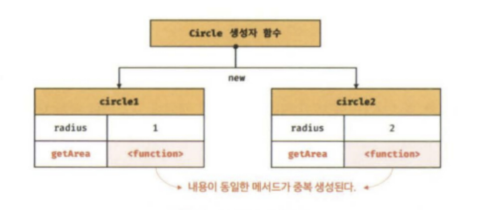
_메모리상에서 동일한 내용이 두번 저장이 된다.(출처 책)_


- 프로토타입을 사용해 **상속**을 사용한 코드

```js
function Circle(radius){
  this.radius = radius;
}

Circle.prototype.getArea = function(){
  return Math.PI*this.radius**2;
}

const circle1 = new Circle(1);
const circle2 = new Circle(2);
console.log(circle1.getArea === circle2.getArea) // true
```

프로토 타입을 사용한 것을 **메모리 관점**에서 관찰하게 되면, 함수를 공유하고, 메모리의 불필요한 낭비를 없애준다.

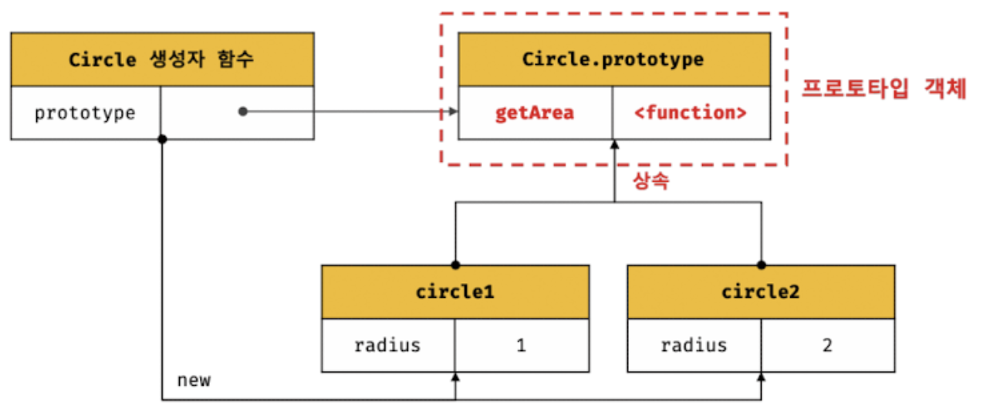

> 생성자 함수가 생성한 모든 인스턴스는 **자신의 프로토타입 객체를 통해 상속받는다**

### 프로토타입 객체

> 객체지향 프로그래밍을 가능하게 하는 **상속**을 구현하기 위해 사용되는 것이 프로토타입 객체다.

모든 객체는 **\[\[Prototype\]\]** 라는 [내부 슬롯](/posts/deepdive-js-08-property-attribute-constructor/)을 가지고, 프로토타입은 **객체의 생성 방식**에 의해 결정이 된다.

- 객체 리터럴로 생성한 객체 : 프로토타입 = `Object.prototype`
- 생성자 함수에 의해 생성된 객체 : 프로토타입 = 생성자 함수의 `prototype` 프로퍼티에 바인딩 되어있는 객체.

**모든 객체는 하나의 프로토 타입을 가진다**

### \__proto__ 접근자 프로퍼티

```js
const person = {name:'john',age:30,job:'developer'}
```

라는 객체를 생성하고 콘솔에 찍으면 아래와 같다. 

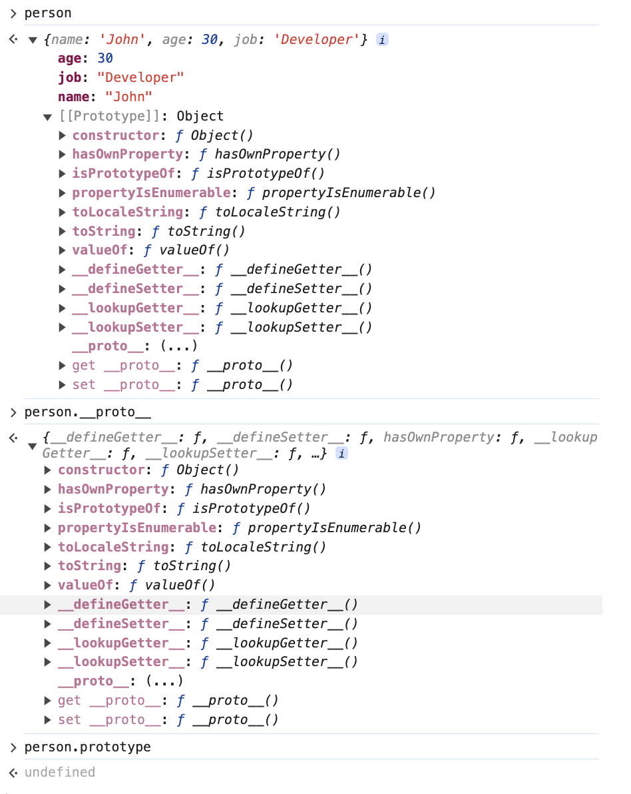

- \.prototype이라고 찍으면 undefined로 직접 접근이 안되는 것을 볼 수 있다.

- 프로퍼티 디스크립터로 \_\_proto\_\_ 를 살펴보면 접근자 프로퍼티 라는 것을 또한 알 수 있다.


이때 객체안에 \[\[Prototype\]\]가 있는데 이건 내부 슬롯으로 접근할 수 없다. 

그러나 **\_\_proto\_\_ 접근자로 자신의 프로토타입에 접근**할 수 있다.

#### Object.prototype의 진실

```js
const person = { name: "Lee" };
// 객체 자신은 __proto__가 없음
console.log(person.hasOwnProperty('__proto__')); // false
// 모든 객체의 __proto__는 Object.protype을 상속받아 사용할 수 있는 것.
console.log({}.__proto__ === Object.prototype); // true
```

객체의 \_\_proto\_\_의 프로퍼티는 `Object.prototype`에서 상속을 받아 모든 객체에서 사용할 수 있는 것이다.

#### 주의사항: \_\_proto\_\_를 직접 코드에서 사용하지 말자

원래 proto는 비표준이였다가 **ECMAScript6에서 표준으로 채택**했다.

또한 **직접 상속**이라는 방법을 통해 Object.prototype을 상속받지 않은 객체를 생성할 수도 있기에 proto를 사용할 수 없는 경우가 있다.

따라서 MDN에서는 proto에 접근하고 싶을땐 

- `Object.getPrototypeOf`
- `Object.setPrototypeOf`

메서드 사용을 권장한다.

### 함수 객체의 prototype 프로퍼티

함수 객체가 소유하는 prototype은 **생성자 함수가 생성한 인스턴스의 프로토타입**을 가리킨다.

```js
// 함수 객체는 prototype 프로퍼티를 소유한다.
(function() {}).hasOwnProperty('prototype'); // true

// 일반 객체는 prototype 프로퍼티를 소유하지 않는다.
({}).hasOwnProperty('prototype'); // false
```

> **non-constructor인 것은 prototype프로퍼티를 소유하지 않고, 프로토타입도 생성하지 않는다!**

### 프로토타입의 constructor 프로퍼티와 생성자 함수

**모든 프로토 타입은 constructor 프로퍼티 갖는다.** 

```js
function Person(name){
  this.name=name;
}

const me = new Person('Lee');

// me 객체의 생성자함수는 Person이다.
console.log(me.constructor === Person); // true
```

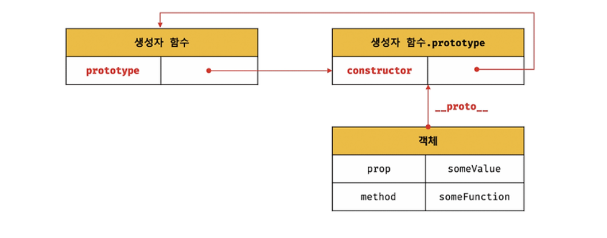
_이러한 메모리 구조를 가진다_

### 생성한 객체의 생성자 함수

생성자 함수에 의해 생성된 인스턴스는 프로토타입의 **constructor 프로퍼티에 의해 생성자 함수와 연결**된다.

```js
const obj = new Object();
console.log(obj.constructor === Object)// true;
function Person(name){
  this.name=name
}
const me = new Person("Lee");
console.log(me.constructor === Person) // true
```

### 리터럴에 의한 객체 생성에서 생성자 함수

리터럴에 의한 객체 생성의 ECMAScript 사양은 다음과 같다.

1. `OrdinaryObjectCreate`를 만들고
2. `new.target`의 확인, 프로퍼티 추가가 일어난다

이 과정은 **가상의 생성자 함수를 가지는 것처럼 작동**한다. 즉, 객체 리터럴로 생성된 객체도 생성자 함수로 생성된 객체와 유사하게 prototype과 constructor 프로퍼티를 통해 연결된다.

따라서 리터럴 표기법으로 생성한 객체를 생성자 함수로 생각해도 크게 무리는 없지만, 생성 동작에는 차이가 있는 정도로만 생각하면 된다.

>프로토타입과 생성자 함수는 단독으로 존재 할 수 없고 언제나 **쌍으로 존재**한다.

### 프로토타입 생성시점

위에서 살펴본 것 처럼 프로토타입은 **생성자 함수가 생성되는 시점**에 더불어 생성이 된다.

### 함수 선언문, 함수 표현식의 프로토타입 생성 시점

**함수의 정의가 평가되어 함수 객체를 생성하는 시점**에 프로토타입도 더불어 생성된다. 

- 함수 선언문으로 표현: 호이스팅 된 시점
- 함수 표현식으로 표현: 실행컨텍스트에서 정의가 평가된 시점

```js
// 함수 정의가 평가되었기 대문에 프로토타입이 존재한다.
console.log(Person.prototype); // constructor: f
function Person(name){
  this.name=name;
}
```

> 빌트인 생성자 함수와 프로토타입 생성시점 : 모든 빌트인 생성자 함수는 전역 객체가 생성되는 시점에 생성된다.


### 5가지의 객체 생성 방식에 대한 프로토타입 결정

5 가지의 생성 방식의 공통점은 ECMAScript사양에서 추상연산 `OrdinaryObjectCreate`에 의해 생성된다.

따라서 프로토타입은 이 `OrdinaryObjectCreate`에 어떤 인수를 전달하느냐에 결정이 된다.

> 추상연산: ECMAScript에서 내부 동작의 구현 알고리즘을 표현한것. 설명을 위해 사용되는 함수와 유사한 수도 코드라고 이해하면된다.

#### 1. 객체 리터럴에 의한 객체생성

객체 리터럴에서 `OrdinaryObjectCreate`에 전달되는 프로토 타입은 `Object.prototype`이다.

```js
const obj = {x:1};
console.log(obj.constructor === Object) // true
```

#### 2. Object생성자 함수에 의해 생성된 객체

객체 리터럴과 마찬가지로`OrdinaryObjectCreate`에 전달되는 프로토 타입은 `Object.prototype`가 전달된다.

```js
const obj = new Object();
obj.x = 1;
console.log(obj.constructor === Object) // true
```

#### 3. 생성자 함수에 의해 생성된 객체

`new` 연산과 함께 생성자 함수를 호출하면 `OrdinaryObjectCreate`가 똑같이 호출이 된다. 이때 전달되는 프로토타입은 **생성자 함수의 prototype에 바인딩 되어 있는 객체**다.

```js
function Person(name){
  this.name = name;
}
const me = new Person('Lee');
```

해당 코드가 실행이 되면 아래와 같이 구조가 만들어진다.

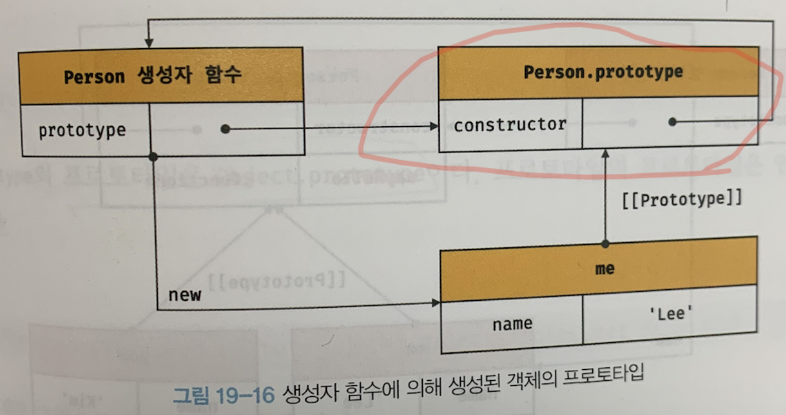

사용자 정의의 Person생성자 함수를 통해 함께 생성된 prototype은 프로퍼티가 construct뿐이다.

Person.prototype에 프로퍼티를 추가해 자식 객체가 상속 받을 수 있도록 구현하면 아래와 같다.
```js
function Person(name){
  this.name = name;
}

Person.prototype.sayHello = function(){
  console.log(`Hi My name is ${this.name}`);
};

const me = new Person("Lee");
const you = new Person("joo");

me.sayHello() // Hi My name is Lee
you.sayHello() // Hi My name is joo
```
Person의 생성자함수로 생성한 **모든 객체는 sayHello를 자신의 메서드 처럼 사용**할 수 있고 이때 가지는 구조는 아래와 같다.

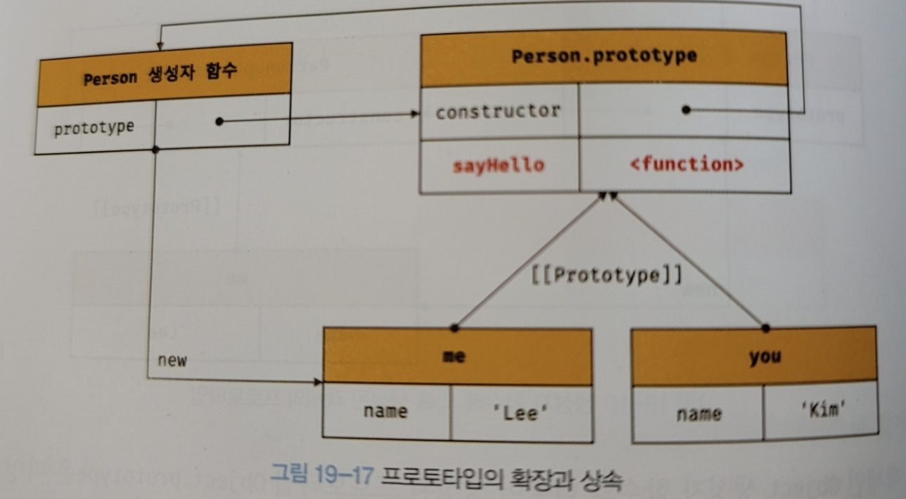

### 프로토타입 체인

그런데 위의 예제에서 me가 가지고 있지 않은 `me.hasOwnProperty('name')` 을 호출하면 실행이 된다. 

me는 `Person.prototype`뿐만아니라 `Object.prototype`을 상속 받았다는 의미이다.

```js
Object.getPrototypeOf(Person.prototype) === Object.prototype // true
```

다시 말하면 프로토타입은 객체이기 때문에 프로토타입의 프로토타입은 언제나 Object.prototype이다.


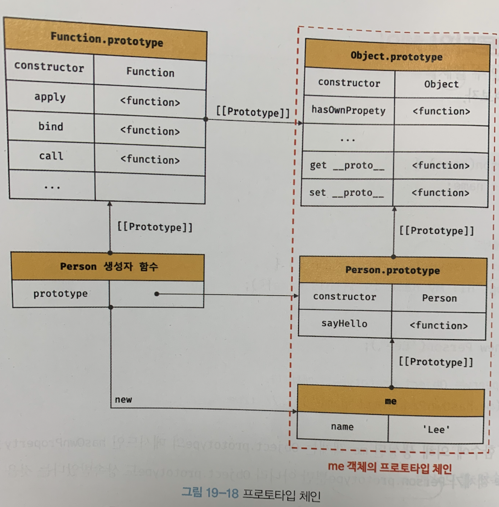

자바스크립트는 **객체의 프로퍼티에 접근할 때** 해당 객체의 프로퍼티가 없다면 \[\[Prototype\]\] 내부 슬롯의 참조를 따라 **자신의 부모 역활을 하는 프로토타입의 프로퍼티를 순차적으로 검색**한다.

이것을 **프로토타입 체인** 이라고 한다. 그리고 이것이 상속을 구현하는 메커니즘이다.

me객체에서도 hasOwnProperty메서드를 찾기 위해 프로토타입 체인이 발생한 것이다.

이때 `Object.prototype`은 항상 **프로토타입 체인의 종점**이다. 

> - 프로토타입 체인 : 객체의 프로퍼티 검색을 위한 메커니즘
- 스코프 체인: 식별자를 위한 검색 매커니즘.
**프로토 타입 체인**과 **스코프 체인**은 서로 협력해 식별자와 프로퍼티를 찾는다.

#### 참고

> 위에서 prototype은 접근자 프로퍼티로 \_\_proto\_\_로 접근한다 했는데 **set으로 프로토타입을 지정해 줄 수 있다.** 그러나 Get함수에서 프로토 타입 체이닝을 거치기 때문에 잘못 지정하면 **순환참조**가 발생하면 안되기에 set함수에서 **순환참조가 되는 상황에 Error 발생한다**.

### 오버라이딩, 프로퍼티 섀도잉

- 오버라이딩 : 상위 클래스가 가지고 있는 메서드를 **하위 클래스가 재정의**
- 오버로딩 : 함수의 이름은 동일하지만, 매개변수의 타입, 갯수가 다른 메서드를 구현해 **메서드를 구별하여 호출**하는 방식

```js
const Person = (function() {
  function Person(name){
  	this.name = name;
  }
  Person.prototype.sayHello = function(){
    console.log(`Hi My name is ${this.name}`);
  };
  return Person; // 생성자 함수 반환
}());

const me = new Person('Lee');

me.sayHello = function () {
  console.log(`Hey My name is ${this.name}`);
}
me.sayHello() // Hey My name is Lee
```

이 코드를 그림으로 나타내면 아래와 같다.

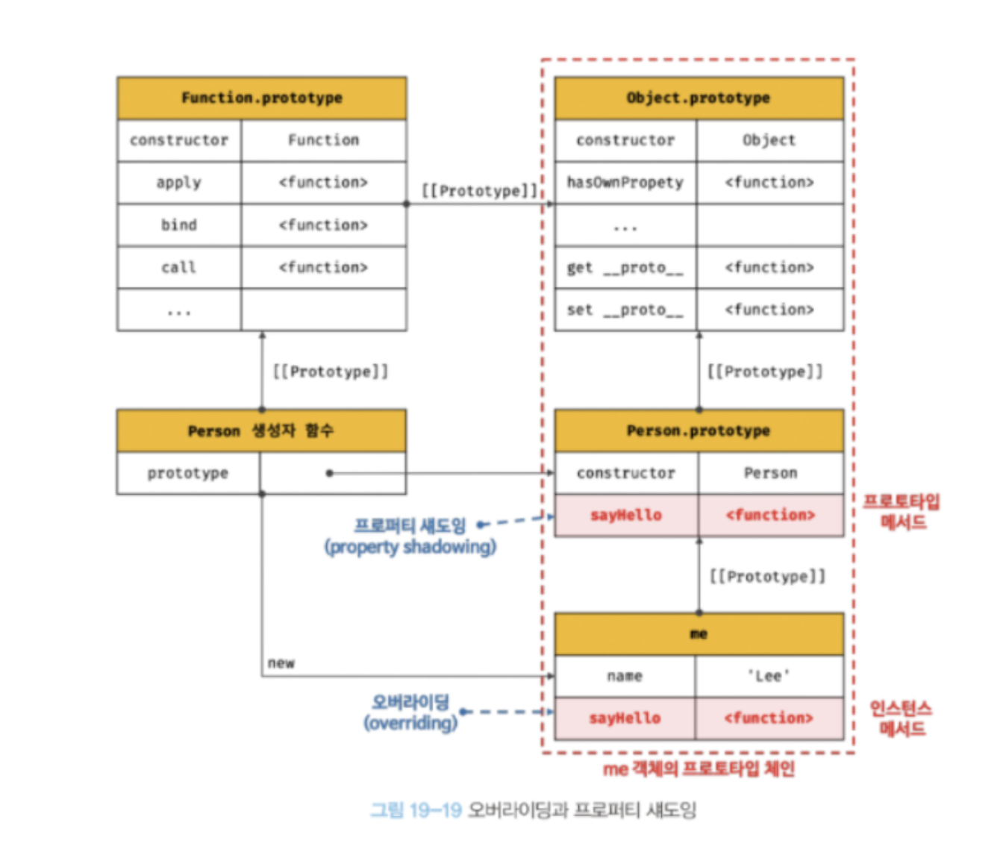

- **프로토타입 메서드** : 프로토타입이 소유한 메서드
- **인스턴스 메서드** : 인스턴스가 소유한 메서드

코드에서 me객체는 **프로토타입 메서드와 같은 이름의 프로퍼티 함수를 추가하면 인스턴스 프로퍼티로 추가**가된다.

따라서 **프로토타입 체이닝**에 의해 sayHello를 인스턴스메서드로서 먼저 발견하고 이것이 마치 상위에 sayHello를 덮어쓴 효과로 **오버라이딩 했다**라고 표현할 수 있다.

이렇게 프로퍼티가 가려지는 현상을 **프로퍼티 섀도잉** 이라고 한다.

추가 뿐만 아니라 삭제하는 경우도 **인스턴스 메서드 부터**삭제된다.

```js
delete me.sayHello;
me.sayHello(); // Hi! My name is Lee
```

그러면 delete를 한번더 하면 프로토타입 메서드도 삭제가 될까?

```js
delete me.sayHello;
me.sayHello();// Hi! My name is Lee
```
그러나 출력되는 것을 확인할 수 있는데, 이것은 **하위 객체에서 프로퍼티 변경, 삭제를 허용하지 않는다.** 정확히 표현하면 

> 하위 객체에서는 프로토타입의 set에 액세스가 되지 않는다.

즉 변경하기 위해선 프로토타입의 체인으로 접근하는 것이 아니라 프로토타입에 직접 명시해서 지워줘야된다.

```js
delete Person.prototype.sayHello;
me.sayHello(); //TypeError: NotFound
```
_억지로 지우는 방법_

### 프로토타입 교체

프로토타입은 다른 객체로 변경 가능한대 => 바꿔 말하면 동적으로 부모 객체를 변경시킬 수 있다는 의미다.

#### 1. 생성자 함수에 의한 프로토타입 교체

```js
const Person = (function() {
  function Person(name){
  	this.name = name;
  }
  Person.prototype = {
      sayHello(){
        console.log(`Hi My name is ${this.name}`);
      };
  }
  return Person; // 생성자 함수 반환
}());

const me = new Person('Lee');
```

이때 `Person.prototype`에 객체 리터럴을 할당했다. 이것을 그림으로 나타내면 아래와 같다.

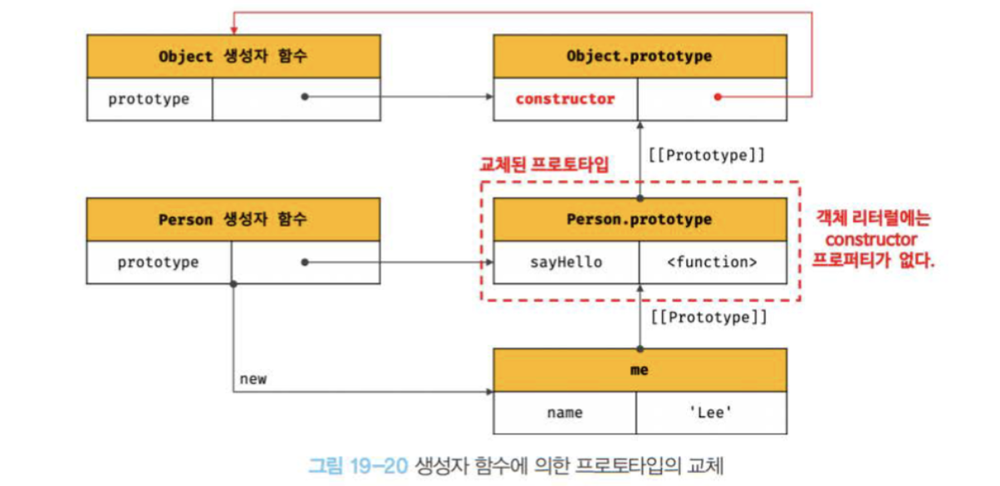

프로토타입으로 교체한 객체 리터럴에는 Constructor이 없다. 따라서 사진과 같이 `me.constructor`를 검색하면 `Object.prototype`의 constructor인 Object가 나온다.

```js
console.log(me.constructor === Person); //false;
console.log(me.constructor === Object); // true
```

따라서 constructor를 Person으로 살리고싶다면 아래와 같이 코드를 작성한다.

```js
const Person = (function() {
  function Person(name){
  	this.name = name;
  }
  Person.prototype = {
      constructor: Person, // 이젠 프로토타입에서 constructor가 검색이 가능하다.
      sayHello(){
        console.log(`Hi My name is ${this.name}`);
      };
  }
  return Person; // 생성자 함수 반환
}());
```

#### 2. 인스턴스에 의한 프로토타입 교체

위에서 언급한 것 처럼 인스턴스의 `__proto__` 의 접근자 프로퍼티로 (또는 `Object.get/setPrototypeOf`)로 프로토타입에 접근이 가능하다. 참고로 이 방식은 **이미 생성된 객체**의 프로토타입을 교체하는 것.

```js
function Person(name){
  this.name=name;
}
const me = new Person('Lee');
const parent = {
  sayHello(){
    console.log("hi");
  }
};
Object.setPrototypeOf(me,parent);

me.sayHello(); // hi
```

그림으로 나타내면 아래와 같다. 인스턴스 me에 대한 동작이다.

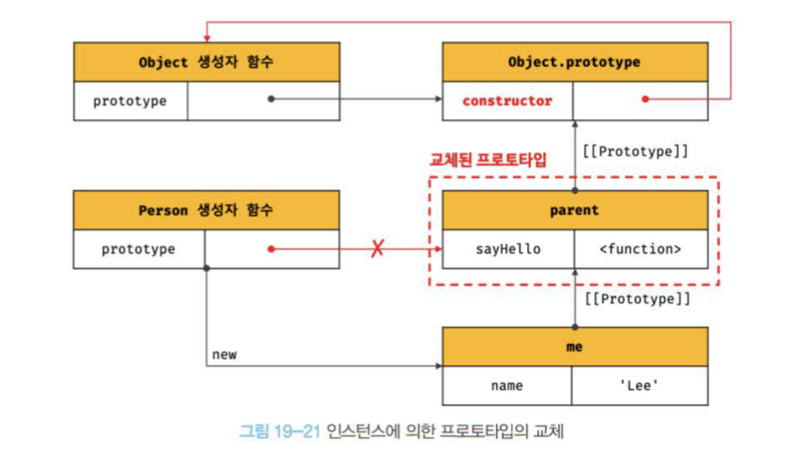

햇갈리면 안되는 것이 **Person.prototype** 자체를 바꾼게 아니라, me가 만든 prototype을 바꾼것이다.

### instanceof 연산자

> 객체 instanceof 생성자 함수

우변의 생성자 함수의 prototype에 바인딩된 객체가 좌변 객체의 프로토타입 체인상에 존재하면 true, 그렇지 않으면 false

```js
function Person(name){
  this.name = name;
}

const me = new Person('Lee');

console.log(me instanceof Person); // true
console.log(me instanceof Object); // true
```

임의로 프로토타입을 교체한 예제를 살펴보면

```js
function Person(name){
  this.name = name;
}

const me = new Person('Lee');
const parent = {};
Object.setPrototypeOf(me,parent);

console.log(me instanceof Person); // false
console.log(me instanceof Object); // true
```

`instanceof`연산자를 함수로 바꾸면 아래와같다.

```js
function isInstanceof(instance, constructor) {
  const prototype = Object.getPrototypeof(instance);
  
  if(prototype === null) return false;

  return prototype === constructor.prototype || isInstanceof(prototype, constructor_;
}

console.log(isInstanceof(me, Person)); // true
console.log(isInstanceof(me, Object)); // true
console.log(isInstanceof(me, Array));; // false
```

### 직접 상속

#### Object.create에 의한 직접 상속

`Object.create`함수는 객체를 생성하는 함수인데, **프로토타입을 지정**해 새로운 객체를 만드는 함수다. 아래에 예시코드를 참고해보자.

```js
/** 
/* 지정된 프로토타입 및 프로퍼티를 같은 새로운 객체를 생성하여 반환한다.
/* @params {Object} prototype - 생성할 객체의 프로토타입으로 지정할 개체
/* @params {Object} [properiesObject] - 생성할 객체의 프로퍼티를 갖는 객체
/* @return {Object} 지정된 프로토타입 및 프로퍼티를 갖는 새로운 객체
/*

Object.create(prototype, [, properiesObject];
*/
// 프로토타입이 null 인 객체를 생성한다. 생성된 객체는 프로토타입 체인의 종점에 위치한다.
let obj = Object.create(null);
console.log(Object.getPrototypeOf(obj) === null); // true
// Object.prototype를 상속받지 못한다.
console.log(obj.toString());; // TypeError: obj.toString is not a function

// obj -> Object.prototype -> null
// obj = {}; 와 동일하다.
obj = Object.create(Object.prototype);
console.log(Object.getPrototypeOf(obj) === Object.prototype); // true;

// obj -> Object.prototype -> null
// obj = {x:1}; 과 동일하다.
obj = Object.create(Object.prototype, {
  x: {value: 1, writable: true, enumerable: true, configurable: true}
});
// 위 코드는 아래와 동일하다.
// obj = Object.create(Object.prototype);
// obj.x = 1;
console.log(obj.x); // 1
console.log(Object.getPrototypeOf(Obj) === Object.prototype); // true

const myProto = { x : 10 };
console.log(Object.getPrototypeOf(obj) === Object.prototype); // true

const myProto = { x: 10 };
// 임의의 객체를 직접 상속받는다.
// obj -> myProto -> Object.prototype -> null
obj = Object.create(myProto);
console.log(obj.x); // 10
console.log(Object.getPrototypeOf(obj) === myProto); // true

// 생성자 함수
function Person(name){
   this.name = name;
}
// obj -> Person.prototype -> Object.prototype -> null
// obj -> new Person('Lee') 와 동일하다.
obj = Object.create(Person.prototype);
obj.name = 'Lee';
console.log(obj.name); // Lee
console.log(Object.getPrototypeOf(obj) === Person.prototype); // true
```

create메서드로 직접 상속을 구현하면 아래와 같은 특징을 가진다.
- new연산 없이 객체 생성 가능
- 프로토타입을 지정하면서 객체 생성가능.
- 객체 리터럴에 의해 생성된 객체도 상속 받을 수 있음.

> Create메서드는 확장성이 더 확되된 객체 생성방식으로 이해하면 된다.

그러나 ESLint에서 **권장하지 않는 객체 생성 방식**이다. 프로토타입 체인의 종점에 위치하는 객체를 생성할 수 있기 때문이다.

아래의 코드를 살펴보면

```js
const obj = Object.create(null);
obj.a = 1;

// Function.prototype.call 메서드는 22장에서 언급한다.
console.log(obj.hasOwnProperty('a')); // Error : is not a function
```

우리는 객체를 생성했지만 객체에서 사용할 수 있는 함수를 사용할 수 없다. 이러한 상황이 발생하기에 권장하지 않는 방식이다.

#### 객체 리터럴 내부에서 \_\_proto\_\_에 의한 직접 상속

그러나 `Object.create`함수를 살펴보면 프로퍼티를 정의하는게 번거롭다. 따라서 ES6에서 객체 리터럴 내부에서 \_\_proto\_\_ 접근자 프로퍼티를 사용해서 직접 상속을 구현할 수 있다.

```js
const myProto = { x: 10 };

// 객체 리터럴에 의해 객체를 생성하면서 프로토타입을 지정하여 직접상속 받을 수 있다.
const obj = {
  y: 20,
  __proto__ : myProto
};

console.log(obj.x, obj.y); // 10 20
console.log(Object.getPrototypeOf(obj) === myProto); // true
```

### 정적 프로퍼티/메서드

다른 프로그래밍 언어에서 static키워드를 붙인 함수라고 생각하면 된다. 즉, **생성자 함수로 인스턴스를 생성하지 않아도 참조/호출할 수 있는 프로퍼티/메서드이다.**

```js
function Person(name) {
  this.name = name;
}

// 프로토타입 메서드
Person.prototype.sayHello = function() {
  console.log(`hi my name is ${this.name}`);
}

// 정적 프로퍼티
Person.staticProp = 'static prop';

// 정적 메서드
Person.staticMethod = function() {
  console.log('staticMethod');
};

const me = new Person("lee");

Person.staticMethod(); // staticMethod

me.staticMethod(); // TypeError: me.staticMethod is not a function
```

이 코드를 그림으로 나타내면 아래와 같다.

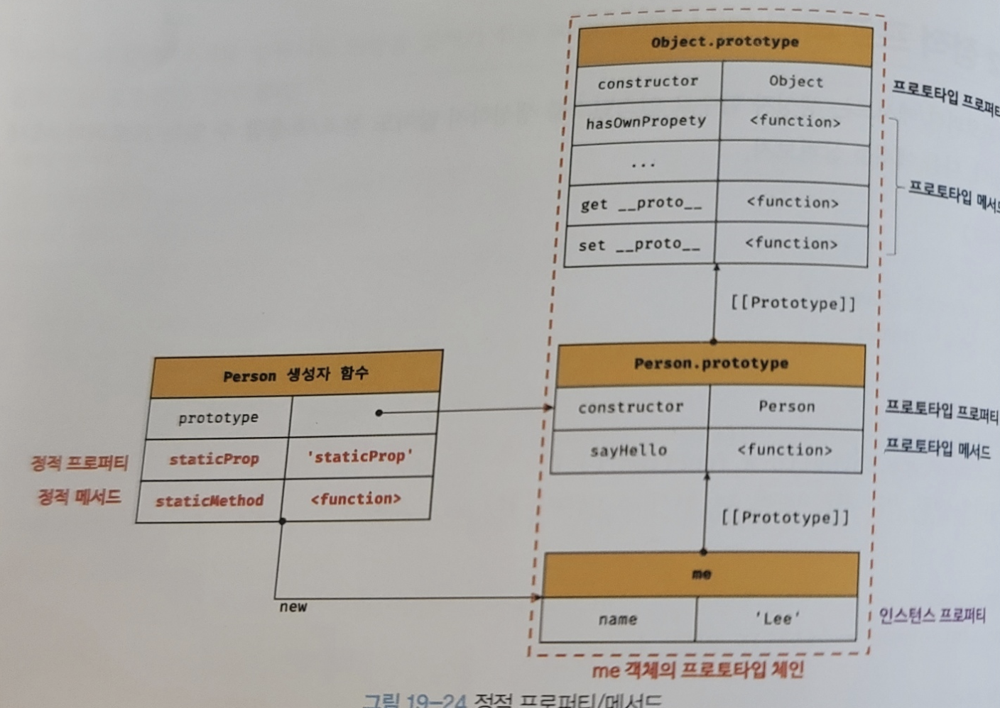

- 정적 프로퍼티/메서드는 생성자함수로 참조/호출 할 수 있다.
- 정적 프로퍼티/메서드는 생성자 함수로 생성한 인스턴스의 프로토타입 체인에 속하지 않지 때문에 호출할 수 없다.


앞서본 `Object.Create` 메서드도 Object 생성자 함수의 **정적 메서드**이다. 즉 인스턴스는 이 함수를 호출할 수 없다.

위와 같은 케이스를 더살펴보려면 MDN에서 어떻게 메서드를 구분하는지 살펴보면 어떤 종류의 메서드인지 알 수 있다.
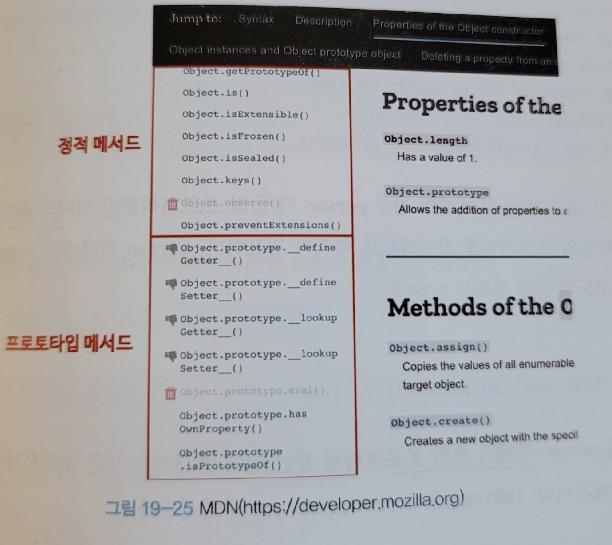

참고로 메서드에서 메서드 내부에서 인스턴스를 참조하지 않는다면, 정적 메서드로 변경해도 동작한다.

### 프로퍼티 존재 확인

#### in 연산자

> key in object
in 연산자는 객체 내에 특정 프로퍼티의 존재를 프로토타입 체인 상에 있는 프로퍼티를 모두 검색한다.

```js
const person = {
   name: "lee",
   address: "seoul",
};

// person 객체에 name 프로퍼티가 존재한다.
console.log('name' in person); // true;
console.log('address' in person); // true;
console.log('age' in person); // false;

console.log('toString' in person); // true;
```

ES6에서 도인된 Reflect.has 메서드를 사용할 수도 있다. in과 동일하게 동작한다.

```js
const person = {
   name: "lee",
};
console.log(Reflect.has(person, 'name')); // true;
console.log(Reflect.has(person, 'toString')); // true;
```

Object.prototype.hasOwnProperty 
메서드를 사용해도 객체에 특정 프로퍼티가 존재하는지 알 수 있다. 그러나 프로토타입 체인을 거쳐 검색하지 않는다.

```js
const person = {
   name: "lee",
};
console.log(person.hasOwnProperty('name')); // true;
console.log(person.hasOwnProperty('age')); // false;
console.log(person.hasOwnProperty('toString')); // false;
```

### 프로퍼티 열거

> for ... in 문

객체의 모든 프로퍼티를 열거할때 사용한다. 상속받은 프로퍼티도 순회되지만, 프로퍼티 어트리뷰트 값 중 **\[\[Enumerable\]\] 이 false이면 순회하지 않는다.**

```js
const person = {
   name: "lee",
   address: "seoul",
};

// [[Enumerable]] false
console.log('toString' in person); // true
console.log(Object.getOwnPropertyDescriptor(Object.prototype, "toString"));
// {writable: true, enumerable: false, configurable: true, value: ƒ}

for (const key in person) {
 console.log(key + ': ' + person[key]);
}
// name: lee
// address: seoul
```

프로퍼티의 갯수만큼 순회하고 키를 key변수에 할당한다.

주의할 점은 열거 순서를 보장하지 않는다는 것이다. 또한 key가 심볼인 프로퍼티는 열거하지 않는다.
다만 대부분의 모던 브라우저에서는 숫자에 대해서는 정렬이 된다.

```js
const obj = {
 2: 2,
 3: 3,
 1: 1,
 b: 'b',
 a: 'a',
}
for (const key in obj) {
 if(!obj.hasOwnProperty(key)) continue;
 console.log(key + ': ' + person[key]);
}
//  1: 1
//  2: 2
//  3: 3
//  b: 'b'
//  a: 'a'
```

#### Object.keys/values/entries메서드

위에 for .. in 문은 상속받은 프로퍼티도 열거한다. 따라서 자신의 프로퍼티만 열거하기 위해선 Object.keys/values/entries메서드를 사용하는게 유리하다.

- `Object.keys` : 객체 자신의 열거가능한 프로퍼티 키를 배열로 반환. 

```js
const person = {
   name: "lee",
   address: "seoul",
};

console.log(Object.keys(person)); // ['name', 'address']
```

- `Object.values` : ES8에서 도입됬고, 객체 자신의 열거가능한 프로퍼티 값를 배열로 반환.

```js
console.log(Object.values(person)); // ['lee', 'seoul']
```

- `Object.entries` : ES8에 도입됬고,객체 자신의 열거가능한 프로퍼티 키 값 쌍 배열을 반환.

```js
console.log(Object.entries(person)); // [['name', 'lee'], ['address', 'seoul']]
Object.entries(person).forEach([key, value]) => console.log(key,value));
// name Lee
// address seoul
```


## 느낀점

그동안 자바스크립트의 프로토타입을 단순히 자동으로 생성되는 프로퍼티 중 하나로 생각해왔다. 그래서 실제로 활용하지도 않았다.

프로토타입은 자바스크립트의 객체지향 프로그래밍에서 매우 중요한 부분이다. 이를 간과한 것은 자바스크립트의 큰 부분을 놓친 것이나 다름없다. 지금이라도 프로토타입을 공부하게 되어 다행이라고 생각한다. 객체지향 언어로서 자바스크립트의 강력한 기능을 이해하고 활용할 수 있는 기회를 얻게 되어서 좋다.


### 이미지 출처
- DeepDive책
