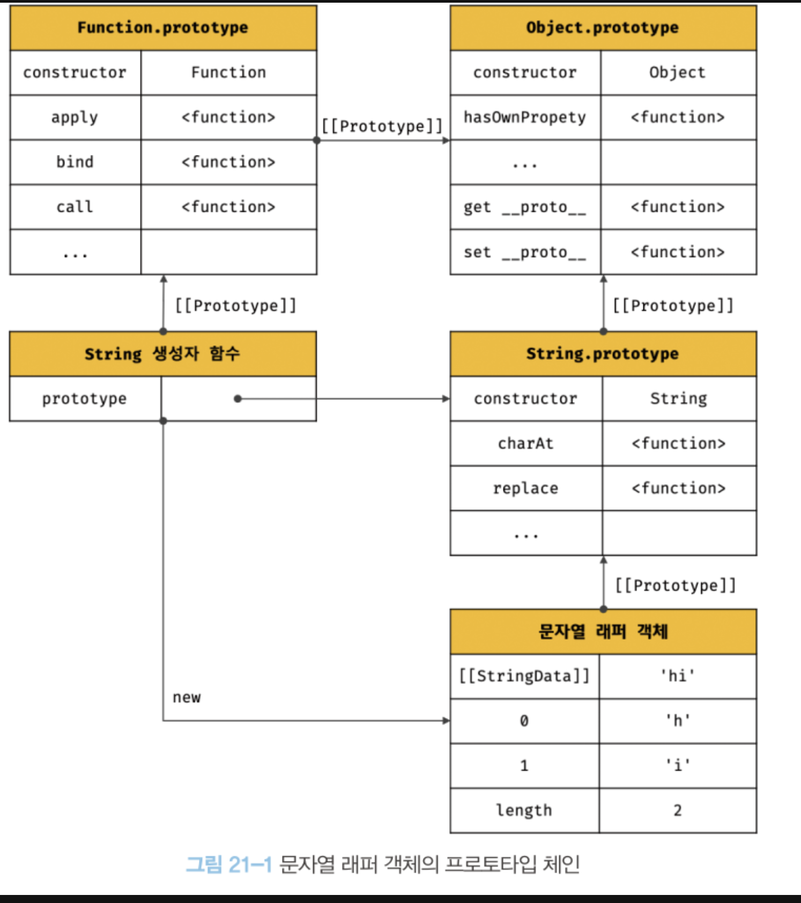
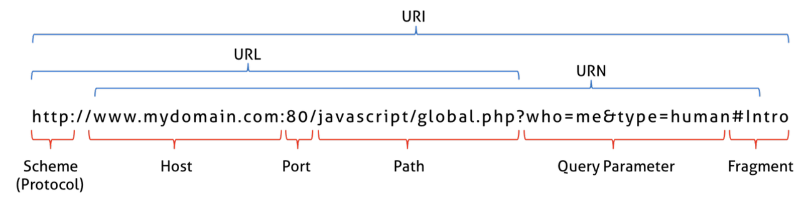
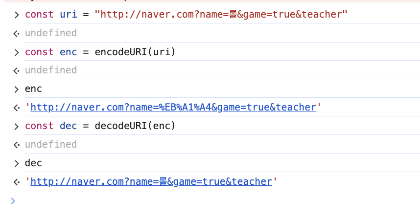
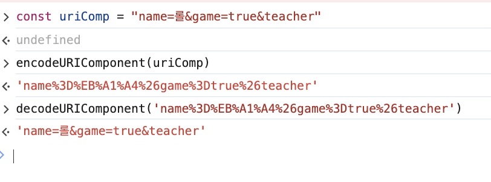
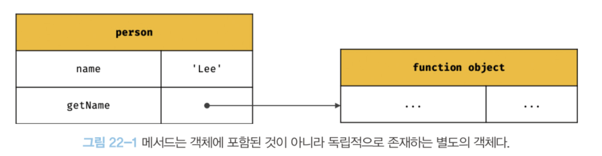
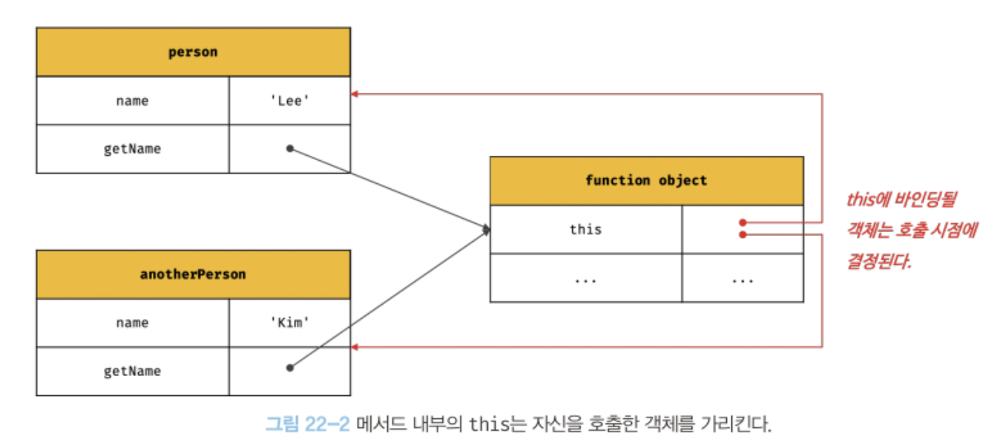

## Strict Mode

```js
function foo(){
	x=10;
}
foo();
console.log(x) // ?
```

이전에 var변수를 다룰 때 다루었다. foo를 실행하면서 x변수를 검색하고 엔진은 foo에서 없으므로 전역객체에서 찾는다. 그런데 존재하지 않기에 이때 엔진은 암묵적으로 x프로퍼티를 전역객체에 선언한다.

이때 이러나는 현상을 암묵적 전역이라고 한다. 개발자 의도와 상관 없는 이 행동은 오류를 발생시키는 원인이 될 가능성이 크다. 따라서 엔진에서 이렇게 행동하더라도 var, let ,const를 사용하여 변수를 선언한 다음에 사용해야한다.

하지만 오타라는 확률은 언제나 존재하니 근본적인 접근법이 필요한대, ES5에서부터 엄격모드가 추가가 되었다. strict mode에서는 오류가 발생할 수 있는 가능성에 대해 명시적인 에러를 뱉어준다. 참고로 ESLint같은 린트 도구를 사용해도 유사한 효과를 얻을 수 있다. 린트 도구는 정적 분석기능을 통해 문법적 + 잠재적 오류까지 찾아준다.

> 참고: ES6에 도입된 class와 모듈은 기본적으로 strict mode가 적용된다.

### 적용하기

함수 몸체, 전역 선두에 "use strict" 을 추가하면 적용된다. 그리고 다시 위의 코드를 실행시키면 Error가 발생한다.


```js
"use strict"
function foo(){
	x=10;
}
foo();
console.log(x) // ?
```


```js
function foo(){
	"use strict"
	x=10;
}
foo();
console.log(x) // ?
```


```js
function foo(){
	x=10;
	"use strict"
}
foo();
console.log(x) // ?
```
_해당 코드는 에러를 발생시키지 않음_

> 주의 : 전역으로 strict를 적용하면 외부 라이브러리가 non-strict일 때 곤란해진다. 이럴 땐 즉시 실행함수로 전체를 감싸 스코프를 구분하자
> ```js
> (function () {
> "use strict"
> x=1;
> console.log(x);
> })();
> ```

### strict이 발생시키는 에러 종류

- 암묵적 에러
- 변수, 함수, 매개변수의 삭제 - delete키워드로 삭제하는 경우
- 매개변수 이름 중복
- with문 사용 : with문은 스코프 체인에 전달된 객체를 추가시키는 키워드인데 가독성이 나빠져 사용을 지양해야한다.

### strict모드 적용에 의한 변화
- 일반함수의 this : 생성자 함수로 사용되지 않으면 this는 사용을 할 필요가 없기 때문에 전역 객체가 아닌 undefined로 바인딩 해준다.
- arguments 객체: 전달된 인수를 재할당해 변경해도 arguments객체에 반영되지 않음

## 빌트인 객체
- 표준 빌트인 객체: ECMAScript에 정의된 객체, 앱 전역에 공통 기능을 제공. 따라서 자바스크립트 실행 환경이면 어디서나 사용 가능. 전역 객체의 프로퍼티로서 제공된다.
- 호스트 객체: ECMAScript에 정의되진 않았지만, 실행환경에 따라 제공되는 객체. 예시로는 브라우저에서는 DOM,BOM,Canvas과 같은 Web API를 호스트 객체로 제공하고 Node.js는 Node의 고유 API를 호스트 객체로 제공
- 사융자 정의 객체 : 말그대로 사용자가 직접 정의한 객체

### 표준 빌트인 객체

[Mozilla](https://developer.mozilla.org/ko/docs/Web/JavaScript/Reference/Global_Objects)가이드에 보면 40여개의 표준 빌트인 객체를 제공한다. Math, Reflect, JSON을 제외하면 모두 생성자 함수 객체이다.

위의 3개는 정적 메서드만 제공하기에 제공되지 않지만 굳이 생성자로서 생성을 한다가정해도 의미가 없다.

물론 생성자 함수에서도 정적 메서드를 제공하기 때문에 어떤게 정적 메서드인지는 각 객체의 가이드라인을 확인하자

### 원시값과 래퍼 객체


그런데 Boolean, String, Number은 원시 타입이 존재하는대도 왜 빌트인 생성자 함수가 존재할까?

그런데 조금 생각해보면 이 질문도 이상한 것을 알 수 있다. 아래의 예제를 보자

```js
const str = "hello";
console.log(str.length) // 5
console.log(str.toUpperCase()) // HELLO
```

마치 객체처럼 동작하지 않는가? 이건 **원시값에 대해 마침표로 접근하면 엔진이 일시적으로 원시값을 연관된 객체로 변환**해주기 때문이다.

즉, 원시값을 객체처럼 사용하면, 암묵적으로 객체로 생성해주고 생성된 객체로 프로퍼티에 접근하거나 메서드에 호출한 뒤 다시 원시 값으로 되돌린다.

이렇게 임시로 생성되는 객체를 **래퍼 객체** 라고 부른다.

즉 위의 예제에서는 str에 대해 마침표로 접근하는 순간 문자열은 래퍼객체 `[[StringData]]`가 내부 슬롯에 할당이 된다. 그래서 String객체의 메서드를 상속받아 사용 가능.

동작을 그림으로 표현하면 아래와 같다.



되돌리고 나면 래퍼 객체는 아무도 참조하고 있지 않기 때문에 가비지 컬렉션의 대상이 된다.

참고로 문자열, 숫자, 불리언, 심벌 이외의 원시 값 즉 undefined, null은 래퍼 객체를 생성하지 않는다.

### 전역 객체

전역 객체는 코드 실행 이전에 **어떠한 객체보다 먼저 생성**되는 특수한 객체이고, 어떠한 객체에 속하지 않은 **최상위 객체**이다.

전역 객체는 자바스크립트 환경에 따라 이름이 다르다. 브라우저에서는 `window`, Node에서는 `global`이다.

> ES2020에서 globalThis로 이름을 통일 시키는 것을 제공해준다.

전역 객체는 **빌트인 객체**, **호스트 객체**, var로 선언한 전역 변수, 전역 함수를 프로퍼티로 가진다.

- 전역 객체는 개발자가 의도적으로 생성할 수 없다.(생성자 함수를 제공하지 않는다.)
- 프로퍼티를 참조할 때, 객체의 이름을 생략할 수 있다.

```js
window.parseInt('F',16);
parseInt('F',16);

parseInt === window.parseInt // true
```

> let, const로 선언한 전역 변수는 전역 객체의 프로퍼티가 아니다. 이것들은 보이지 않는 개념적인 블록내에 존재하게 된다. - 전역 렉시컬 환경

#### 빌트인 전역 프로퍼티

위에서 언급 한것 처럼 빌트인 전역 프로퍼티는, 전역 객체의 프로퍼티 이기도 하다.

- Infinity: 무한대를 나타내는 숫자 값
- NaN : 숫자가 아님을 나타냄

#### 빌트인 전역 함수


- eval: 문자열을 인수로 전달받아 표현식이 라면 그것을 평가해 값을 생성, 표현식이 아니라면 런타임에서 그 코드를 실행한다. 여러개의 문으로 되어있어도 모두 실행함. 한마디로 이미 그 위치에 있는 코드 처럼 행동한다는 것이다.

> strict mode에서는 eval의 문자열로 된 코드를 실행할 때 스코프로 감싸진다. 또한 let,const를 사용해 변수를 선언하면 암묵적 strict mode적용.

사실 이 함수는 엔진에 의해 최적화가 수행되지 않음으로 처리속도가 매우 느리다. 따라서 eval함수는 사용하면 안된다.

- isFinite : 유한수인지 검사하는 함수. 전달 받은 것이 숫자면 true, 아니면 false(NaN로 평가되면 false). 단, 숫자가 아닌 타입이 전달받았다면 암묵적으로 타입 변환 후 검사 실행 
- isNaN: 인수가 NaN인지 검사. 마찬가지로 암묵적 형변환이 적용된다.
- parseFloat: 문자열을 실수로 해석해 반환
```js
parseFloat('3.14') // 3.14
parseFloat('10.00') // 10

parseFloat('3 14 12') // 3 - 공백은 첫째 문자열만 반환
parseFloat('He') // NaN
parseFloat('  3  ')//3 앞뒤 공백 무시 
```

- parseInt: 인수를 정수로 해석해 반환
```js
parseInt("10"); // 10
parseInt("10.123"); // 10
parseInt(10.123); // 10

parseInt(10,2); // 10을 2진수로 해석해 반환 //2 
parseInt("0xf"); // 16진수 리터럴은 10진수 정수로 반환해줌 // 16
parseInt("0b10"); // 2진수, 8진수 리터럴은 해석 안됨 // 0 - 0이후 b부터 무시됨
parseInt("20",2); // 해당 진수로 해석하지 못할때 NaN반환
```

- encodeUR / decodeURI : URI를 문자열로 받아 이스케이프 처리를 위해 인코딩 or 디코딩.

> URI는 인터넷에 있는 자원을 나타내는 유일한 주소. 하위 개념으로 URL과 URN이 있다.

> 인코딩: 문자들을 이스케이프 처리하는 것을 의미함. 
> 이스케이프: 특정 문자가 가진 원래의 의미를 잠시 무시하고 다른 목적으로 사용하게 하는 방법




_예제_

- encodeURIComponent / decodeURIComponent : URI의 구성요소를 인수로 전달받아 인코딩 or 디코딩


#### 암묵적 전역

```js
var x =10;
function foo(){
  y=20;
}
foo();
console.log(x+y) // 30 선언하지 않은 y를 전역에서 참조
```

엔진은 foo함수의 y=20을 실행할 때 스코프 체인으로 y변수의 선언을 찾을 수 없으므로 전역에 프로퍼티를 동적으로 생성해 20을 할당하는데, 이떄 마치 동작이 `globalThis.y =20` 처럼 동작하기에, 마치 전역 객체의 프로퍼티가 되어 행동하는데, 이것을 **암묵적 전역**이라 한다.

참고로 y는 변수가 아니라 단지 전역객체의 프로퍼티에 추가된 것. 그래서 y는 호이스팅이 발생하지 않는다.

## this

"this를 모르면 자바스크립트를 모른다"라는 문장을 끊임 없이 언급이 되는데, 거의 모든 것이 객체인 자바스크립트에서 자신이 속한 객체의 프로퍼티를 참고하기 위해선 자신이 속한 객체를 가르키는 식별자를 알아야된다. 이것을 위해 this가 있다.

참고로 객체 리터럴 방식으로 생성한 객체는 메서드 내부에서 자신이 속한 객체를 재귀적으로 참조할 수 있다.
```js
const circle = {
  radius:  5,
  getDiameter(){
    return circle.radius;
  }
};
```


1. 객체 리터럴은 circle에 변수에 할당되기 직전에 평가가 된다.
2. getDiameter메서드가 호출되는 시점은 이미 circle이 할당이 된 이후다.

따라서 circle을 재귀적으로 호출 할 수 있는 것이다. 그러나 이것은 바람직한 방법은 아니다.

생성자 함수로서 함수를 작성할 때를 생각해보면 바로 알 수 있다

```js
function Circle(radius) {
  ????.radius = radius // 벌써 멈칫하는 부분이 생긴다. 생성할 인스턴스를 가리키는 식별자를 알 수 없음.
}
```

생성자 함수는 정의한 이후 new연산자와 함께 생성자 함수를 호출하는 단계가 필요하다. 따라서 먼저 생성자 함수가 존재해야 인스턴스를 생성할 수 있다.

그래서 정의되는 시점에 자신을 가리키는 식별자를 알 수 없다. 그것을 위해 this를 제공한다.

> this는 자신이 속한 객체, 자신이 생성한 인스턴스를 가리키는 **참조 변수**이다. 엔진에 의해 암묵적으로 생성이 된다. 이 때 this가 가리키는 값은 **함수 호출 방식에 의해 동적으로 결정**된다.

> 바인딩은 식별자와 값을 연결하는 과정. 가리키는 메모리 주소를 주는 것이라 생각하면 됨.

### 일반 함수 호출의 this바인딩

함수 호출방식엔 4가지가 있다
- 일반 함수 호출
- 메서드 호출
- 생성자 함수 호출
- Function.prototype.apply/call/bind 에 의한 간접 호출

기본적으로 일반 함수 호출은 **this에 전역 객체가 바인딩**된다.

```js
function foo(){
  console.log(this) //window
  function bar(){
    console.log(this)//window
  }
  bar();
}
foo();
```
이 코드 처럼 중첩된 함수도 모두 전역 객체이다. 그러나 일반 함수에서는 사실 this가 어떤 값을 가지던 **객체를 생성하지 않는 일반함수 에서는 this는 의미가 없다** 따라서 이전에 언급햇던 것 처럼 "strict mode"에서는 undefined가 바인딩 된다.

나중에 배울 콜백 함수 내부에서 this도 전역 객체다. **어떠한 함수라도 일반함수로 호출이 되면 this는 전역객체가 바인딩 된다.**

사실 이러한 부분 때문에 오히려 문제가 생긴다. 콜백함수는 전달되는 함수를 **보조함수**라고 표현하는데 이것은 외부 함수를 돕는 역활을 할 수도 있기 때문이다. 외부 함수인 메서드와 콜백 함수의 this가 일치하지 않는 것은 헬퍼함수로서의 역활을 하기가 힘들다.

따라서 화살표 함수 등장 전에는 this바인딩을 아래와 같은 코드로 작성해주엇다. (나중에 화살표함수를 살펴보자)

```js
var value = 1;
const obj = {
  value: 100,
  foo(){
    const taht = this;
    setTimeout(function(){
      console.log(that.value) // 100
    },100);
  }
};
obj.foo();

```

#### 메서드 호출

메서드 내부의 this에는 메서드를 호출한 객체, 즉 메서드 이름 앞의 마침표 연사자 앞에 기술된 객체가 바인딩 된다.

메서드 내부의 this는 메서드를 **소유한 객체가 아닌 메서드를 호출한 객체**가 바인딩이 된다.

```js
const person = {
  name: 'Lee',
  getName(){
    return this.name;
  }
};
console.log(person.getName()); // Lee
```

getName은 person의 메서드로 정의 되어 있다. 즉, person의 getName이라는 프로퍼티에 바인딩 된 함수이다. 이때 getName이 가리키는 함수는 getName이 함수가 아니라 **별도로 존재하는 함수 객체**이다. 아래의 그림을 보면 쉽게 이해된다.



따라서 메서드를 다른 객체의 프로퍼티에 할당하는 것으로 **다른 객체의 메서드가 될 수 있고 일반 변수에 할당해 일반 함수로 호출 될 수 있다**

```js
const person = {
  name: 'Lee',
  getName(){
    return this.name;
  }
};
console.log(person.getName()); // Lee

const anotherPerson = {
  name:'Kim'
};

anotherPerson.getName = person.getName;


console.log(anotherPerson.getName()) // this는 호출한 anotherPerson을 가리키기에 'Kim'출력

const getName = person.getName;
console.log(getName());// 일반함수로 호출되면 this는 전역 객체이고, 따라서 this.name 은 window.name와 같이 취급되기에 ''로 출력된다.
```

따라서 이 코드를 그림으로 표현하면 아래와 같다.



그리고 프로토타입 메서드 내부에서 사용된 this도 호출한 객체에 바인딩된다.

```js
function Person(name){
  this.name;
}
Person.prototype.getName = function(){
  return this.name;
}
const me = new Person('Lee');
console.log(me.getName()); // 'Lee' getName을 호출한건 me
Person.prototype.name = 'Kim';
console.log(Person.prototype.getName()); // 'Kim' getName을 호출한 객체는 Person.prototype
```

#### 생성자 함수 호출

생성자 함수가 미래에 **생성할 인스턴스**가 바인딩 된다.


```js
function Circle(radius){
  this.radius = radius;
  this.getDiameter = function (){
    return 2 * this.radius;
  }
}
const circle1 = new Circle(5);
const circle2 = new Circle(10);

console.log(circle1.getDiameter()); // 10
console.log(circle1.getDiameter()); // 20
```

#### Function.prototype.apply/call/bind 메서드에 의한 간접 호출

3개의 함수는 this로 사용할 객체와 인수 리스트를 전달 받아 함수를 호출하는 함수이다.

apply,call 함수를 사용한 예제를 보자

```js
function getThisBinding(){
  console.log(arguments)
  return this;
}

const thisArg = {a:1};
console.log(getThisBinding()); // window
console.log(getThisBinding.apply(thisArg,[1,2,3]))  // Array롤 전달
// Argument(3) [1,2,3,callee:f ,,,}
// {a:1} 
console.log(getThisBinding.call(thisArg,1,2,3)) // 쉼표로 구분
// Argument(3) [1,2,3,callee:f ,,,}
// {a:1}

```


bind함수는 this 바인딩이 교체 된 함수를 반환한다. - **실행은 하지 않는다!!**

```js
function getThisBinding(){
  return this;
}
const thisArg = { a : 1 };
console.log(getThisBinding.bind(thisArg)); // getThisBinding
console.log(getThisBinding.bind(thisArg)()); // 명시적으로 호출해야됨 {a:1}
```

bind의 함수는 콜백함수를 전달할 때 유용하다. 특별히 화살표함수를 사용하지 못햇던 버전에서는 보조함수에서의 this불일치 문제를 아래와 같은 예시로 bind를 사용하여 해결했다.

```js
const person = {
  name:'Lee',
  foo(callback){
    setTimeout(callback.bind(this),1000);
  }
}
person.foo(function(){console.log(`hi my  name is ${this.name}`)}); // HI MY NAME IS Lee
```

### 정리
|함수호출방식|this바인딩|
|--|--|
|일반 함수 호출|전역 객체
|메서드 호출|메서드를 호출한 객체|
|생성자 함수 호출|생성자 함수가 생성할 인스턴스|
|apply,call,bind메서드에 의한 간접 호출|첫번쨰 인수로 전달한 객체|

## 느낀점

내장 함수를 살펴보며 주로 사용한 내장 함수 뿐만아니라 어떤 것들이 있는지 알게되었다. 사실 자주 쓰지는 않지만, 비슷한 요구사항을 써야할 경우 떠올라서 바로 써먹을 수 있을듯하다. 그리고 자바스크립트에서 가장 중요한 핵심인 this에 대해서 정확하게 이해하게 되었다. 함수 호출 방식에 따른 this바인딩이 어떻게 할당이 되는지 파악해 도움이 많이 되었다.
