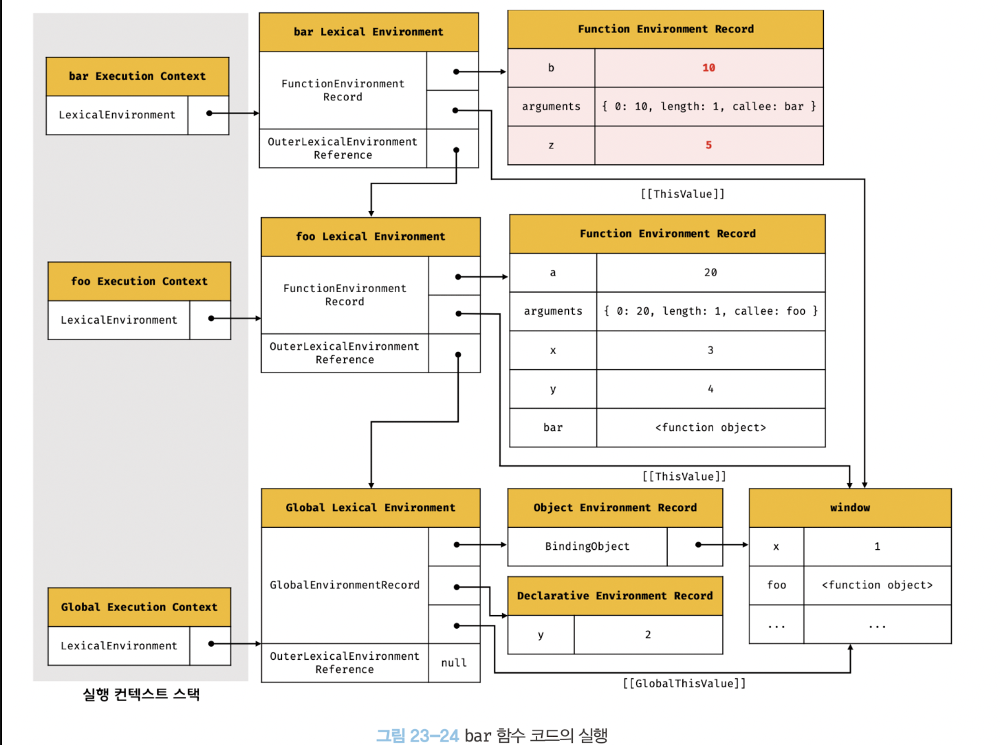
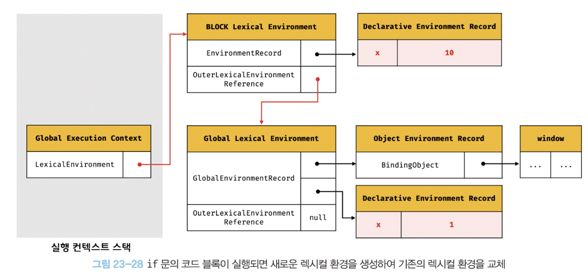
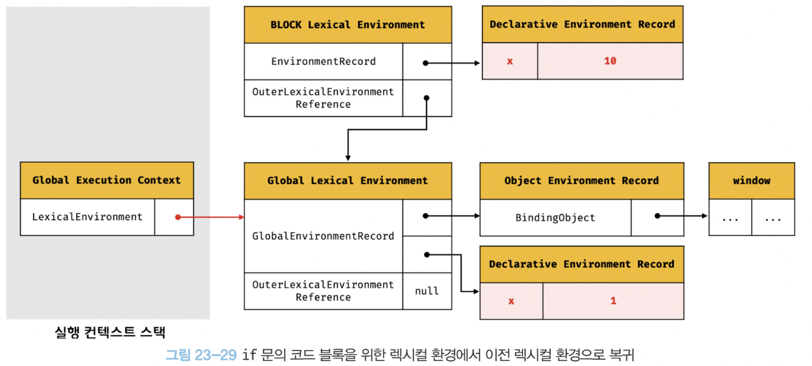
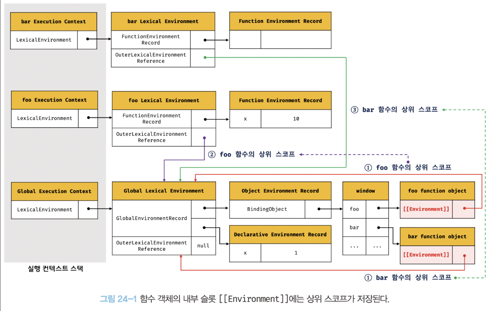
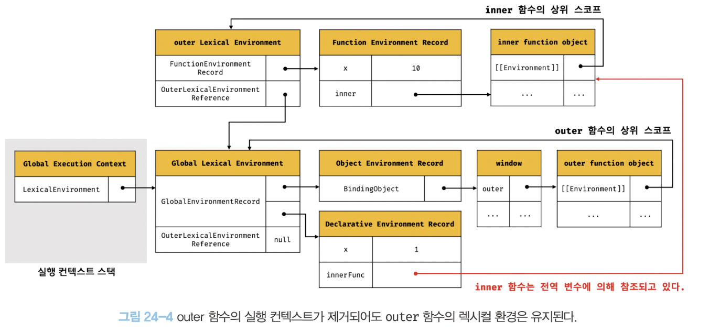

## 실행 컨텍스트

자바스크립트의 **동작 원리**를 담고있는 핵심 개념.

### 소스코드의 타입

ECMAScript에선 소스코드를 **4가지 타입**으로 구분. 각 타입의 소스 코드는 실행 컨텍스트를 생성한다.

1. 전역 코드 : 전역 변수를 관리하기 위해 최상위 스코프로서 전역 스코프 생성. 전역 변수, 함수, 객체를 관리한다.

2. 함수 코드 : 지역 스코프 생성하고 매개변수, 지역변수, arguments 객체를 관리.그리고 생성한 지역 스코프를 전역 스코프에서 시작하는 **스코프 체인 일원으로**연결해야한다.

3. eval코드 : strict mode에서 자신만의 독자적인 스코프 생성

4. 모듈 코드 : 모듈별로 독립적인 모듈 스코프를 생성.

요약하면 **소스코드를 평가** 하면 **맞는 실행 컨텍스트**를 생성한다.

### 소스코드의 평가 & 실행

엔진은 소스코드를 2개의 과정을 거쳐 실행시킨다. 그것이 **평가**, **실행**이다.

- 평가과정: 실행 컨텍스트 생성 후 **변수 함수 선언문만 먼저 실행**해 실행 컨텍스트가 관리하는 스코프에 등록한다.

- 실행과정: 순차적으로 코드를 실행. 이때 런타임이 시작이다. 실행에 필요하는 정보는 실행 컨텍스트가 관리하는 스코프에서 검색해 취득. 그리고 필요하면 결과는 다시 실행 컨텍스트가 관리하는 스코프에 등록

```js
var x;
x=1;
```
이러한 소스코드가 실행이 된다면..

1. 평가 과정에서 **실행컨텍스트**가 x = undefined로 선언문 먼저 실행하고 x를 관리한다.
2. 실행 과정에서는 var x는 이미 평가 과정에서 실행했기에 x=1만 실행이 된다. x가 관리하는 스코프에 x가 등록되어있는지 확인하고 x가 등록된 변수라면 값을 할당해 그 결과를 실행 컨텍스트에 등록해 관리한다.


### 실행 컨텍스트의 역활

조금 더 복잡한 코드를 살펴 보자.

```js
const x = 1;
const y = 2;
function foo(a){
  const x = 10;
  const y = 20;
  console.log(a + y + x);
}

foo(100);
console.log(x+y);
```

#### 1. 전역 코드 평가

전역 코드를 실행 하기 전에 **전역 코드 평가**를 거친다. 선언문만 먼저 실행해 실행 컨텍스트가 관리하는 전역 스코프에 등록된다. {x,y}

#### 2. 전역 코드 실행

평가가 끝나면 런타임 시작되 순차적으로 실행. 이 떄 **함수가 호출이 된다면 전역 코드의 실행을 일시 중단 하고 코드 실행 순서를 변경**해 함수 내부로 진입.{x=1,y2}

#### 3. 함수 코드 평가

호출에 의해 코드 실행 순서가 변경되어 함수 내부로 진입하면 **함수 코드 평가**를 거쳐 매개변수, 지역변수 선언문이 실행되고 실행 컨텍스트가 관리하는 **지역 스코프**에 등록된다. 이떄 **arguments**, **this**바인딩도 결정 됨.{x,y,arguments,this ... }

#### 4. 함수 코드 실행

매개변수, 지역변수에 값이 할당 되고, console.log함수를 만나 실행한다. 

1. console을 스코프 체인으로 검색. (전역 객체에서 발견)
2. log프로퍼티를 프로토타입 체인을 통해 검색. 인수로 전달될 a+x+y가 평가가되고, 식별자는 스코프체인으로 검색


3. console.log메서드의 실행이 종료되면, 함수 코드 실행 과정 종료 => 호출 이전으로 돌아가 전역 코드 실행을 진행


이처럼 코드가 실행이 되려면 **스코프,식별자,코드 실행 순서**의 관리가 필요하다. 이 모든 것을 관리 해주는 것이 **실행 컨텍스트** 이다.

요약하면 **실행 컨텍스트 = 소스코드를 실행하는 데 필요한 환경을 제공하고 코드 실행 결과를 실제로 관리하는 영역**이다.
**식별자를 등록하고 관리, 스코프와 코드 실행 순서 관리를 구현한 매커니즘**.

식별자, 스코프는 **렉시컬 환경**으로 관리, 실행 순서는 **실행 컨텍스트 스택**으로 관리.

### 실행 컨텍스트 스택

```js
const x = 1;
function foo(){
const y = 2;
function bar () {
const  z=3;


console.log(x+y+z);

}
bar();
}
foo(); // 6

```
위의 예제에서 함수가 호출이 될 떄 함수 코드 **평가** - **함수 실행컨텍스트 생성** 이떄 실행 컨텍스트는 스택으로 관리된다. 따라서 위의 코드에서 시간의 흐름으로 실행 컨텍스트 스택을 아래와 같이 흐름을 나타낼 수 있다.

1. 전역 코드의 평가 & 실행
2. foo 함수 코드의 평가 & 실행
3. bar 함수 코드의 평가 & 실행
4. foo함수 코드로 복귀
5. 전역 코드로 복귀

즉 실행 컨텍스트 스택은 **코드의 실행 순서를** 관리한다.

### 렉시컬 환경

식별자와 식별자에 바인딩 된 값, 상위 스코프에 대한 참조 기록을 기록하는 **자료구조**

실행컨텍스트가 코드의 실행 순서를 관리한다면, 렉시컬 환경은 **스코프와 식별자를 관리**한다.

렉시컬 환경은 두개의 컴포넌트로 구성

- 환경 레코드 : 식별자에 바인딩 된 값을 관리하는 저장소.
- 외부 렉시컬 환경에 대한 참조 : 상위 스코프를 가리킴. 상위스코프는 해당 실행 컨텍스트를 생성한 소스코드를 포함하는 상위 코드의 렉시컬 환경

### 실행 컨텍스트의 생성과 식별자 검색 과정

```js
var x= 1;
const y = 2;

function foo(a){
  var x = 3;
  const y =4;
  
  function bar(b){
    const z = 5;
    console.log(a + b + x + y +z);
  }
  bar(10);
}
foo(20);
```

#### 1. 전역 컨텍스트

1. 전역 실행 컨텍스트 생성: 비어있는 전역 실행 컨텍스트를 실행 컨텍스트 스택에 푸시
2. 전역 실행 컨텍스트 안에 렉시컬 환경에 전역 렉시컬 환경 생성해 바인딩.
	1. 전역 실행 컨텍스트 안에 환경 레코드 생성 - 환경 레코드에 전역 객체를 바인딩한다.
	2. ES6에서는  let,const에서 var와 구분하여 관리하기 위해 **선언적 환경 레코드**를 제공한다.
3. this 바인딩. 전역 실행 컨텍스트는 this참조하면 전역 환경 레코드의 바인딩 되어 있는 객체를 가져온다.
4. 외부 렉시컬 환경에 대한 참조를 결정한다.
5. 전역 코드를 실행한다.

#### 2. foo함수의 코드 평가

foo함수를 호출 할 떄 일어나는 일

1. 전역 코드의 실행을 일시 중단
2. 함수 실행 컨텍스트 생성 (이때 실행 컨텍스트 스택에 최상위에 push한다.)
3. 함수 렉시컬 환경 생성
	1. 환경 레코드 생성 - arguments 내부변수, 매개변수 등
	2. this 바인딩 - 일반 함수 실행이므로 window에 연결
	3. 외부 렉시컬 환경에 의한 참조 결정 - 이떄 어디서 호출햇는가가 아닌 **어디에 정의햇는지**에 따라 상위 스코프를 결정 (내부 슬롯인 `[[Environment]]`에 저장)
4. foo 함수의 실행.

마찬가지로 bar함수도 실행컨텍스트를 생성해 렉시컬 환경을 생성하고 환경 레코드에 바인딩

#### 3. console.log함수 실행

1. console의 식별자를 스코프 체인에서 검색 - 현재 실행 중인 **실행 컨텍스트의 렉시컬 환경에서 시작해 외부 참조로 이어지는 렉시컬 환경의 연속이다.** (그림을 참조해 이해해보자)
2. 즉 bar의 실행컨텍스트 - foo함수의 렉시컬 환경으로 이동 - 전역 렉시컬 환경 - console탐색 완료.
3. log메서드를 검색해 x,y,z,a,b를 스코프체인으로 찾아(마찬가지로 외부 렉시컬 환경의 연속으로 탐색)

여기까지를 그림으로 나타내면 아래와 같다.




#### 4. bar함수 코드 실행종료

실행 컨텍스트 스택에서 bar함수의 실행 컨텍스트를 pop 되어 제거한다.

이떄 렉시컬환경이 누군가가 참조하고 있다면 바로 삭제되지 않고 메모리에 남아있다.

그리고 이어서 foo, 전역코드도 실행을 종료한다.

### 실행 컨텍스트 & 블록 레벨 스코프

var는 코드 블록만을 지역 스코프로 인정하는 함수 레벨 스코프를 따르지만,

**let, const는 if문, for문 등** 모든 코드 블록을 지역 스코프로 인정하는 블록 레벨 스코프를 따른다. (let,const링크 추가)

```js
let x =1;
if(true){
	let x =10;
	console.log(x); // 10;
}

console.log(x);
```

해당 코드의 실행 컨텍스트 스택을 살펴보자. if문의 코드 블록이 실행이 되면 새로운 렉시컬 환경(블록 렉시컬 환경)을 만들어 기존 렉시컬 환경과 교체한다.




그리고 아래의 그림처럼 if문이 종료되면 이전의 렉시컬 환경으로 되돌린다.





## 클로저

클로저는 사실 자바스크립트 고유의 개념이 아니다. 함수형 프로그래밍 언어에서 사용되는 중요한 특성이다. 또한 ECMAScript에서 정의된 개념도 아니다. MDN에서 정의한 내용은 아래와 같다.
> 클로저는 함수와 그 함수가 선언된 렉시컬 환경과의 조합이다.

### 외부 렉시컬 환경의 참조

이전에 실행 컨텍스트에서 자세히 살펴보듯, **함수의 상위 스코프를 결정하는 행위** 는 렉시컬 환경의 외부 렉시컬 환경에 대한 참조에 저장할 참조값을 결정한다는 것과 같다.

**외부 렉시컬 환경에 대한 참조**에 저장할 참조값, 즉 함수 코드가 평가되는 시점(위치)에 의해 결정이 된다. 이것이  외부 렉시컬 환경의 참조이다.

### 함수 객체의 내부 슬롯 \[\[Environment\]\]
함수가 정의되는 위치, 호출되는 위치는 다를 수 있다. 그래서 **렉시컬 스코프가 가능하게 하려면 환경과 상관 없이 정의 된 환경 - 상위 스코프를 기억**해야하는데, 이것은 `[[Environment]]`라는 내부 슬롯을 통해 상위 스코프 참조를 저장한다.

```js
const  x =1;
function foo (){
	const x=10;
	bar();
}
function bar(){
console.log(x);
}
foo();
bar();
```

위 코드 흐름을 bar함수 실행할 시에 실행 컨텍스트를 나타내는 사진은 아래와 같다.




맨 처음 전역 실행컨텍스트에서 코드 평가 시점에서

foo, bar가 함수 선언문으로 생성되어 있기 때문에, **평가 시점에 foo,bar의 함수 객체를 생성**했다. 그래서 `[[Environment]]`라는 값이 상위 스코프를 기억했고, 그것이 bar, foo의 실행 컨텍스트를 생성할 때 **외부 렉시컬 환경에 대한 참조값을 Evironment에 저장된 렉시컬 환경의 참조값을 할당**한다. 그래서 같은 곳을 화살표가 가리키는 것이다.

이것이 상위 스코프를 결정하는 렉시컬 스코프의 실체이다.

### 클로저와 렉시컬 환경

```js
const x =1 ;
//(1)
function outer(){
const x = 10;
const inner = function(){console.log(x);}; //(2)
return inner;
}

const innerFunc = outer(); // (3)
innerFunc(); // (4) 10
```

innerFunc변수에 outer함수를 실행하면 inner에 담긴 함수참조가 반환된다. 그리고 outer함수는 생명주기를 마감한다.

그런데 innerFunc를 실행하면 x가 살아잇는 느낌으로 동작을 한다.

이처럼 중첩함수가 더 오래 유지되는 경우 중첩 함수는 이미 생명 주기가 종료한 외부 함수의 변수를 참조할 수 있다. 이러한 **중첩 함수**를 클로저라 부른다.

outer 함수를 호출하면 outer함수의 렉시컬 환경이 생성되고, `[[Environment]]` 내부 슬롯에 저장된 전역 렉시컬 환경을 outer함수 렉시컬 환경의 외부 렉시컬 환경에 대한 참조에 할당한다. 

그리고 inner가 평가가 된다. (inner는 함수 표현식으로 정의했기에 런타임에 평가 된다.) 그리고 평가가 될 떄 현재 실행 중인 실행 컨텍스트의 렉시컬 환경 즉 `[[Environment]]`내부슬롯은 outer함수의 렉시컬 환경을 상위 스코프로 저장한다.

그리고 outer가 실행이 종료가 된다면 inner함수를 반환하면서 outer의 생명주기가 종료된다. 즉, **실행 컨텍스트 스택에서 제거**된다. 실행 컨텍스트 스택에서 outer 실행 컨텍스트는 제거되지만, outer함수의 **렉시컬 환경까지 소멸하는 것이 아니다** 왜냐하면  `[[Environment]]` 내부 슬롯에 참조가 되고 있기 때문이다. 해당 그림을 나타내면 아래와 같다.



그래서 반환된 inner함수를 호출하면 inner함수의 실행 컨텍스트가 생성이 되고, 스택에 푸쉬가 된다. 그리고 해당 실행 컨텍스트의 외부 렉시컬 환경에 대한 참조는 자연스럽게 `[[Environment]]` 가 가리키는 참조값을 가지게 된다.

> 중첩함수 중 상위 스코프의 식별자를 참조하지 않으면 클로저가 아니다. 그래서 조금더 정확한 워딩으로 정의하면, **클로저는 중첩함수가 상위 스코프의 식별자를 참조하고 있고 중첩함수가 외부함수보다 더 오래 유지되는 경우** 이다.


### 클로저의 활용

클로저는 상태를 안전하게 변경하고 유지하기 위해 사용한다. 

#### 은닉성

```js
const increase = (function () {
  let num = 0;
  
  // 클로저
  return function () {
    return ++num;
  };
}());

console.log(increase()); // 1
console.log(increase()); // 2
console.log(increase()); // 3
```

위 코드를 실행하면 즉시 실행 함수가 반환한 참조값이 increase 변수에 할당된다.

increase 변수에 할당된 함수는 자신이 정의된 위치에 의해 결정된 상위 스코프인 즉시 실행 함수의 렉시컬 환경을 기억하는 클로저다.

외부에서 num을 접근할 수 없기에 재할당이 될 일은 없다.

그래서 마치 num 변수는 외부에서 직접 접근할 수 없는 은닉된 private 변수가 된것이기에 더 안정적인 프로그래밍이 가능하다.


### 함수형 프로그래밍 예제

```js
// 함수를 반환하는 고차 함수
// 이 함수는 카운트 상태를 유지하기 위한 자유 변수 counter를 기억하는 클로저를 반환한다.
const counter = (function () {
  // 카운트 상태를 유지하기 위한 자유 변수
  let counter = 0;

  // 함수를 인수로 전달받는 클로저를 반환
  return function (aux) {
    // 인수로 전달 받은 보조 함수에 상태 변경을 위임한다.
    counter = aux(counter);
    return counter;
  };
}());

// 보조 함수
function increase(n) {
  return ++n;
}

// 보조 함수
function decrease(n) {
  return --n;
}

// 보조 함수를 전달하여 호출
console.log(counter(increase)); // 1
console.log(counter(increase)); // 2

// 자유 변수를 공유한다.
console.log(counter(decrease)); // 1
console.log(counter(decrease)); // 0
```

makerCounter 함수를 호출해 함수를 반환할 때, 자신만의 독립된 렉시컬 환경을 갖는다.


### 캡슐화 정보 은닉

캡슐화는 객체의 **프로퍼티와 메서드를 하나로 묶는 것**을 말한다. 이는 객체 지향 프로그래밍의 기본 원칙 중 하나로, **객체의 상태와 행위를 하나의 단위로 결합하여 데이터와 기능을 한 곳에 모아 관리**할 수 있게 한다.

또한, 캡슐화는 객체의 특정 프로퍼티나 메서드를 감출 목적으로 사용하기도 하는데 이를 정보 은닉이라 한다. **정보 은닉**은 외부에 공개할 필요가 없는 구현의 일부를 외부에 공개되지 않도록 감추어 적절치 못한 접근으로부터 객체의 상태가 변경되는 것을 방지해 정보를 보호하고, 객체 간의 상호 의존성, 즉 **결합도를 낮추는 효과가 있다.**

자바스크립트는 **정보 은닉을 완전하게 지원하지 않는다.** 인스턴스 메서드를 사용한다면 자유 변수를 통해 private 속성을 흉내 낼 수는 있지만 프로토타입 메서드를 사용하면 이마저도 불가능해진다.


## 느낀점

클로저를 들으면 떠오르는 코드가 있었으나, 이를 어떻게 응용할 수 있을지 생각하기가 어려웠다. 그러나 이 책에서는 많은 예시들과 함께 클로저를 다루어 주었다. 잠깐이지만 함수형 프로그래밍의 맛도 보았다. 이 책을 다 읽고 나서 함수형 프로그래밍이 무엇인지 공부해보자는 마음을 먹었는데, 이를 위해서는 기본 개념을 확실히 알아야 JavaScript에 맞는 함수형 프로그래밍을 정확하게 구현할 수 있을 것이라고 생각했다.

또한, 실행 컨텍스트를 통해 엔진이 코드를 어떻게 읽고 관리하는지 알게 되었다. 이전에는 이 컨텍스트도 모른 채 그냥 한 줄 한 줄 읽어나가는 느낌으로 코딩을 했던 것이 부끄러워졌다. 주요 개념인 클로저와 실행 컨텍스트를 알게 되어 개발자로서 한 단계 성장한 느낌이다.

이와 같은 공부를 통해 느낀 점을 정리해보면, 이제 기본 개념을 탄탄히 하여 더 복잡하고 효율적인 프로그래밍 패턴을 적용할 수 있는 자신감을 얻게 되었다. 계속해서 깊이 있는 학습으로 성장하는 느낌을 계속 받아야겠다.

### 참고자료

이미지 출처 - DeepDiveJS책
