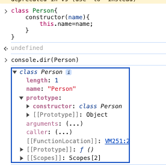
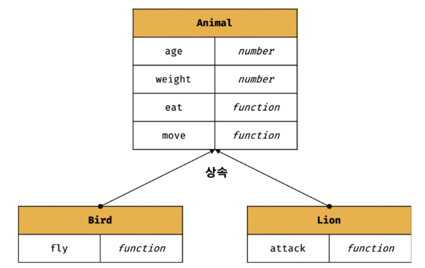
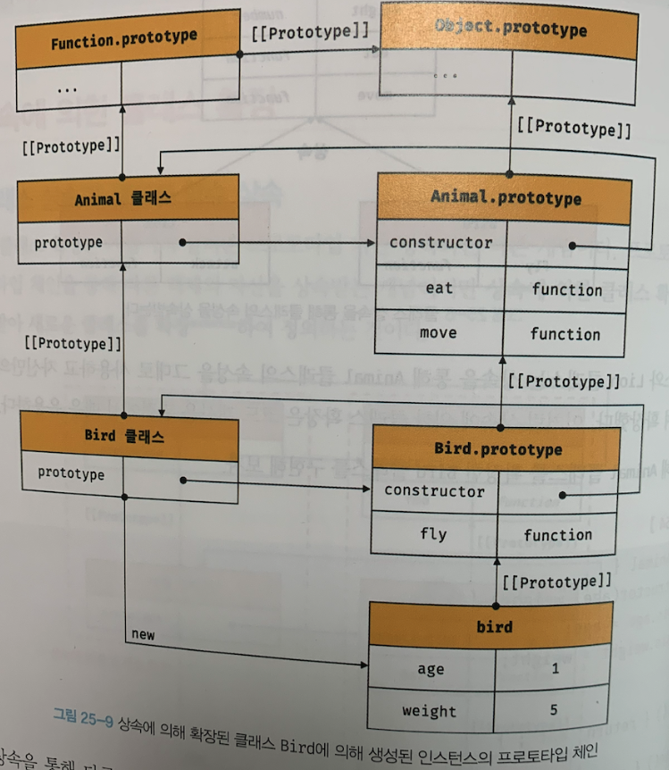
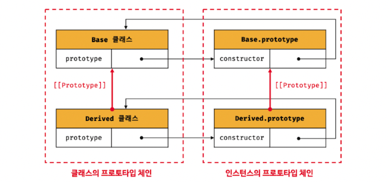
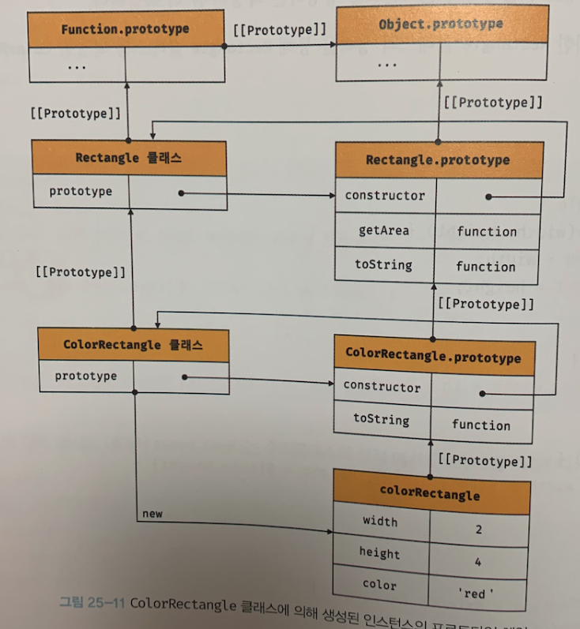

## 생성자 함수와의 차이점

- new 연산자 없이 호출하면 에러
- extends, super 키워드 제공
- 호이스팅이 발생하지 않는 것 처럼 동작한다.(let & const와 동작방식이 똑같다. - 일시적 사각지대가 존재)
- strict mode가 자동으로 지정된다.
- contructor, 프로토타입 메서드, 정적 메서드는 열거형이 아니다.

> 클래스 문법은 객체 생성의 **새로운 메커니즘**을 제공해준다.

## 클래스 정의하기

기본적이고 **올바른** 사용방법으로는 파스칼 케이스로 class키워드를 사용하여 정의한다.

```js
class Person{}
```

아래와 같이 사용하는 것은 문법적 오류가 없으나 좋은 방식은 아니다.

```js
const Person = class {} // 익명 클래스
const Perso  = class MyClass {}; // 기명 클래스
```

이러한 특성을 가지는 것은 클래스 또한 **값으로 사용할 수 있는 일급 객체**라는 뜻이다.

> 일급 객체의 중요한 특징
- 무명 리터럴로 생성 가능(런타임에 생성할 수 있음)
- 변수나 자료구조에 저장할 수 있음.
- 매개변수로 전달할 수 있음.
- 반환 값으로 사용할 수 있음.

### 메서드 정의

몸체에서 정의할 수 있는 메서드는 생성자, 프로토타입 메서드, 정적 메서드 3가지이다


```js
class Person{
  constructor(name){ // 인스턴스 생성 및 초기화(생성자)
  	this.name = name;
  }
  sayHi(){ // 프로토타입 메서드
    console.log('Hello');
  }
  static sayHello(){ // 정적 메서드
    console.log('Hello!');
  }
}

const me = new Person('Lee');
console.log(typeof Person) // function
```

#### Contructor

>인스턴스를 생성하고 초기화하기 위한 메서드로 이름 변경할 수 없음

constructor 내부의 this에 추가한 프로퍼티는 인스턴스 자체의 프로퍼티가 된다. 즉 this는 생성자함수의 this바인딩과 똑같이 미래에 생성할 인스턴스를 가리킨다.

또한 class가 생성한 contructor는 **메서드**로 평가되지 않기때문에 안보인다. 함수 객체코드의 일부가 된다. 클래스 정의가 평가되면 constructor의 기술된 동작을 하는 **함수 객체**가 생성된다.


_프로토타입안에 constructor가 있다. 이전에 생성자 함수에서 살펴본 내용_

차이점이라면... **생성자 함수는 함수자체가 constructor의 역활**이 되지만, **class는 constructor에 기술된 내용**을 가진다.

- constructor는 1개만 존재할 수 있다.
- 생략할 수 있다. 이때 암묵적으로 빈 contructor함수를 정의된다.
- 반환문을 갖지 않아야 한다.(생성자 함수에서 this이외의 객체를 리턴하면 올바른 사용법이 아니라했다. 따라서 return을 명시할 이유가 없음.)

#### 프로토타입 메서드

클래스에 메서드를 추가하면 기본적으로 프로토타입 메서드가 된다.

```js
class Person{
  constructor(name){
    this.name = name;
  }
  sayHi(){
    console.log('Hi!');
  }
}
const me = new Person('lee');

// me 객체의 프로토타입은 Person의 프로토타입
Object.getPrototypeOf(me) === Person.prototype; // true
me instanceof Person; // true

Object.getPrototypeOf(Person.prototype) === Object.prototype; // true
me instanceof Object // true

me.contructor === Person // true
// me 객체의 constructor는 Person 클래스임.
```

클래스도 생성자함수와 마찬가지로 생성한 인스턴스는 프로토타입 체인의 일원이 된다.

**결국 클래스도 프로토타입 기반의 객체 생성 메커니즘이다.**

#### 정적 메서드

생성자 함수에서 가지는 특징을 그대로 가지고 있다.

```js
class Person{
  constructor(name){
    this.name=name;
  }
  static sayHi(){
    console.log("HI!");
  }
}
Person.sayHi();
```

#### 정적 메서드와 프로토타입 메서드 차이

1. 정적 메서드와 프로토타입 메서드는 자신이 속해 있는 프로토 타입 체인이 다르다.

2. 정적 메서드는 클래스로 호출하고 프로토타입 메서드는 인스턴스로 호출한다.

3. 정적 메서드는 인스턴스 프로퍼티를 참조할 수 없지만 프로토타입 메서드는 인스턴스 프로퍼티를 참조할 수 있다.

정적 메서드는 **하나의 네임스페이스로** 사용해 정적 메서드를 모아놓으면 이름 충돌을 줄여주고, 구조화 하는 효과가 있다. 따라서 앱 전역에서 유틸함수를 메서드로 구조화 할 때 유용하다.

#### 클래스에서 정의한 메서드 특징

- function 키워드를 생략한 메서드 축약 표현을 사용한다.

- 객체 리터럴과는 다르게 클래스에 메서드를 정의할 때는 콤마가 필요 없다.

- 암묵적으로 strict mode로 실행된다

- for ... in 문이나 Object.keys 메서드 등으로 열거할 수 없다. 즉, 프로퍼티의 열거 가능 여부를 나타내며, 불리언 값을 갖는 프로퍼티 어트리뷰트 [[Enumerable]]의 값이 fasle다.

- 내부 메서드 [[Construct]]를 갖지 않는 non-constructor다.(new연산자와 함께 호출할 수 없다.)

## 클래스의 인스턴스 생성 과정

생성자 함수의 인스턴스 생성 과정과 유사하게 거친다.

### 1. 인스턴스 생성과 this바인딩

new연산자와 함께 클래스 호출하면, **constructor전에 빈 객체가 생성**된다. 그리고 그 **빈 객체가 this에 바인딩** 된다.

### 2. 인스턴스 초기화

constructor가 실행되어 초기화 과정을 거친다.

#### 3. 인스턴스 반환

constructor가 종료되고, this가 반환된다.

```js
class Person {
  // 생성자
  constructor(name) {
    // 1. 암묵적으로 인스턴스가 생성되고 this에 바인딩된다.
    console.log(this); // Person {}
    console.log(Object.getPrototypeOf(this) === Person.prototype); // true

    // 2. this에 바인딩되어 있는 인스턴스를 초기화한다.
    this.name = name;

    // 3. 완성된 인스턴스가 바인딩된 this가 암묵적으로 반환된다.
  }
}
```

## 프로퍼티

### 인스턴스 프로퍼티

constructor 내부에서 this를 통해 정의한다.

```js
class Person {
  constructor(name) {
    // 인스턴스 프로퍼티
    this.name = name; // name 프로퍼티는 public하다.
  }
}

const me = new Person('Lee);
                      
// name은 public하다.                      
console.log(me); // Person {name: "Lee"}
```

- constructor 내부의 this에는 빈 객체가 바인딩되어 있다.
- constructor 내부에서 this에 인스턴스를 프로퍼티를 추가한다.
- constructor 내부에서 this에 추가한 프로퍼티는 인스턴스의 프로퍼티가 된다.
- 인스턴스 프로퍼티는 언제나 public하다. - private, protect등을 아직은 지원하지 않는다.


### 접근자 프로퍼티

> Getter와 Setter로 이루어진 접근자 프로퍼티로 이루어진 프로퍼티이다.

```js
class Person {
  constructor(firstName, lastName) {
    this.firstName = firstName;
    this.lastName = lastName;
  }
  
  // fullName은 접근자 함수로 구성된 접근자 프로퍼티다.
  // getter 함수
  get fullName() {
    return `${this.firstName} ${this.lastName}`
  }
  
  set fullName(name) {
    [this.firstName, this.lastName] = name.split(' ');
  }
}

const me = new Person('Ungmo', 'Lee');

// 데이터 프로퍼티를 통한 프로퍼티 값의 참조.
console.log(`${me.firstName} ${me.lastName}`) // Ungmo Lee

// 접근자 프로퍼티를 통한 프로퍼티 값의 저장
// 접근자 프로퍼티 fullName에 값을 저장하면 setter 함수가 호출된다.
me.fullName = 'Heegun Lee';
console.log(me); // {firstName: 'Heegun', lastName: 'Lee'}

// 접근자 프로퍼티를 통한 프로퍼티 값의 참조
// 접근자 프로퍼티 fullName에 접근하면 getter 함수가 호출된다.
console.log(me.fullName); // Heegun Lee

// fullName은 접근자 프로퍼티다.
// 접근자 프로퍼티는 get, set, enumerable, configurable 프로퍼티 어트리뷰트를 갖는다.
console.log(Object.getOwnPropertyDescriptor(Person.prototype, 'fullName'));
// {get: ƒ, set: ƒ, enumerable: false, configurable: true}
```
- get,set을 직접 호출하는 것이아님.
- 접근할 때 get호출, 할당 시에는 set으로 지정된 함수가 호출
- 다시말하면 get은 무조건 하나는 반환해야하고, set은 무조건 하나의 값을 매개변수로 받아야된다.

### 클래스 필드 정의 제안

Java나 C++에서는 클래스 필드를 this를 생략 하여 참조할 수 있다.

원래 자바스크립트 클래스 몸체에는 **메서드만 지정이 가능하다**. 그러나 아래의 코드를 실행해보자.

```js
class Person {
  // 클래스 필드 정의
  name = 'Lee';
}

const me = new Person();
console.log(me); // Person {name: "Lee"}
```

아마 최신 브라우저(Chrome 72 이상) 또는 최신 Node.js(버전 12 이상)로 실행했다면 SyntaxError가 발생하지 않고 정상 동작한다.

그 이유는 자바스크립트에서도 인스턴스 프로퍼티를 마치 클래스 기반 객체지향 언어의 클래스 필드처럼 정의할 수 있는 새로운 표준 사양인 “Class field declarations“가 **TC39프로세스의 stage 3(candidate)에 제안**되어 있기 때문이다.

#### 클래스 필드 몸체에서 정의할때 주의

- 클래스 필드에서 this를 사용하면 안된다. - 문법 에러
- 초기화 하지않으면 undefined를 가진다.
- 메서드에서 클래스 필드를 참조할 경우 this를 꼭 붙여야됨.
- 클래스 필드에 함수를 할당하면 **인스턴스 메서드가** 된다.

### private 필드 정의 제안

클래스 필드로 정의하면 기본적으로 public이다. 그러나 선두에 #을 붙여 정의하면 private필드가 된다.참조할 때에도 #을 붙인다.

```js
class Person{
  #name = '';
  constructor(name){
    this.#name=name;
  }
}
const me =Person('l');
console.log(me.#name) // error
```

private필드는 **무조건 클래스 몸체에 정의해야된다.**

### static필드

마찬가지로 변수 앞에 static을 붙이면된다

```js
class MyMath{
  static PI = 22/7;
  static #num = 10 // static private 필드도 정의가능
  static increment(){
    return ++MyMath.#num;
  }
}
```


>책이 써진 시점에서는 ES2021이였지만, 해당 private static 등 클래스 필드에 관한 것은 ES2022에 표준으로 채택됬습니다!

## 상속

상속에 의한 클래스 확장은 이전 프로토타입 기반 상속과는 다른 개념이다. **프로토 타입 기반 상속**은 **프로토타입 체인을 통해 다른 객체의 자산을 상속받는 개념**이였지만 상속에 의한 **클래스 확장은 기존 클래스를 상속 받아 새로운 클래스를 확장 하여 정의**하는 것이다.

예를 들면 동물을 추상화한 Animal클래스와 새와 사자를 추상화한 Bird,Lion클래스를 각각 정의 해보자.

이 관계를 상속으로 표현하면 아래와 같다.



이것을 class로 구현하면 다음과 같다.

```js
class Animal {
  constructor(age, weight) {
    this.age = age;
    this.weight = weight;
  }
  
  eat() { return 'eat'; }
  
  move() { return 'move'; }
}

// 상속을 통해 Animal 클래스를 확장한 Bird 클래스
class Bird extends Animal {
  fly () { return 'fly'; }
}

const bird = new Bird(1, 5);

console.log(bird); // Bird {age: 1, weight: 5}
console.log(bird instanceof Bird); // true
console.log(bird instanceof Animal); // true

console.log(bird.eat());  // eat
console.log(bird.move()); // move
console.log(bird.fly());  // fly
```

이것을 확장된 클래스로 생성된 인스턴스의 프로토타입 체인은 아래와 같다.



### extends 키워드

extends키워드를 사요해 상속받을 클래스를 정의한다.

확장된 클래스를 **서브클래스**라고 부르고, 상속된 클래스를 **수퍼클래스**라고 부른다.

**서브클래스는** 자식클래스, 파생 클래스라고도 부르고,

**수퍼클래스**는 베이스 클래스, 부모 클래스 라고도 부른다. 

용어가 많으니 주의!!

extends키워드를 통한 상속관계를 프로토타입과 Constructor로 나타내면 아래와 같다.



### 동적 상속

extends 키워드는 클래스 뿐만아니라 **생성자 함수를** 상속받아 확장할 수도 있다. 즉, constructor 내부 메서드를 갖는 함수 객체로 평가될 수 있는 모든 표현식이 올 수 있다.

```js
function Base1() {}

class Base2 {}

let condition = true;

// 조건에 따라 동적으로 상속 대상을 결정하는 서브클래스
class Derived extends (condition ? Base1 : Base2) {}

const derived = new Derived();
console.log(derived); // Derived {}

console.log(derived instanceof Base1); // true
console.log(derived instanceof Base2); // false
```

### 서브 클래스의 constructor

그냥 클래스에서는 constructor를 생략하면 **빈 constructor**가 온다고 했었다. 그러나 서브클래스에서 constructor를 생략하면 다음과 같은 constructor가 암묵적으로 정의된다.

```js
constructor(...args){super(...args)}
```

```js
// 수퍼클래스
class Base {
  constructor() {}
}

// 서브클래스
class Derived extends Base {
  constructor(...args) { super(...args); }
}

const derived = new Derived();
console.log(derived); // Derived {}
```

이때 `super()`는 수퍼클래스의 constructor이고, 그것을 호출한다.

### super

super 키워드는 **함수처럼 호출할 수도 있고 this와 같이 식별자처럼 참조할 수 있는** 특수한 키워드다.

- super를 호출하면 수퍼클래스의 constructor(super-construcotr)를 호출한다.
- super를 참조하면 수퍼클래스의 메서드를 호출할 수 있다.

#### super의 호출

```js
// 수퍼클래스
class Base {
  constructor(a, b) {
    this.a = a;
    this.b = b;
  }
}

// 서브클래스
class Derived extends Base {
	constructor(a,b,c){
      super(a,b);
      this.c=c;
    }
}

const derived = new Derived(1, 2,3);
console.log(derived); // Derived {a: 1, b: 2, c:3}
```
super를 통해 Base의 constructor를 사용한다.

> 주의사항
- 서브클래스에서 constructor를 생략하지 않을 때 super를 반드시 한번 호출해야한다.
- 서브클래스에서 super를 호출하기 전에 this를 참조할 수 없다.
- 서브클래스에서만 super를 호출할 수 있다.

#### super의 참조

`super`를 참조해 수퍼클래스의 메서드를 호출할 수 있다.

```js
// 수퍼클래스
class Base {
  constructor(name) {
    this.name = name;
  }
  
  sayHi() {
    return `Hi ${this.name}`'
  }
}

// 서브클래스 
class Derived extends Base {
  sayHi() {
    // super.sayHi는 수퍼클래스의 프로토타입 메서드를 가리킨다.
    return `${super.sayHi()}. how are you doing?`;
  }
}

const derived = new Derived('Lee');
console.log(derived.sayHi()); // Hi! Lee. how are you doing
```

`super`참조를 통해 수퍼클래스의 메서드를 참조하려면, 수퍼클래스의 prototype프로퍼티에 바인딩 된 프로토타입을 참조할 수 있어야한다.

즉 super는 **자신을 참조하고 있는 메서드가 바인딩 되어있는 객체의 프로토타입**을 가리킨다.(Derived의 sayHi 메서드가 바인딩 되어있는 객체 **derived의 프로토타입인 Base.prototype**을 가리킨다.)

super참조의 동작은 Derived클래스의 sayHi메서드의 [[HomeObject]]내부 슬롯을 통해 자신을 바인딩하는 객체를 알수있다.

자신을 바인딩하는 객체를 알면 프로토타입 체인을 통해 super를 참조할 수 있게된다.

주의할 점은 ES6의 메서드 축약 표현으로 정의된 함수만 [[HomeObject]]를 갖는다는 것이다. 무슨 말이냐 하면.. 아래의 코드를 보자.

```js
const obj = {
  // foo는 ES6의 메서드 축약 표현으로 정의한 메서드다. 따라서 [[HomeObject]]를 갖는다.
  foo() {},

  // bar는 ES6의 메서드 축약 표현으로 정의한 메서드가 아니라 일반 함수다.
  // 따라서 [[HomeObject]]를 갖지 않는다.
  bar: function () {}
};
```

- 서브클래스의 프로토타입 메서드 내에서 super.sayHi는 수퍼클래스의 프로토타입 메서드 sayHi를 가리킨다.
- 서브클래스의 정적 메서드 내에 super.sayHI는 수퍼 클래스의 정적 메서드 sayHi를 가리킨다.

### 상속 관계의 인스턴스 생성 과정

아래의 코드를 통해 두 클래스가 어떻게 협력해 인스턴스를 생성하는지 살펴보면

```js
// 수퍼클래스
class Rectangle {
  construcotor(width, height) {
    this.width = width;
    this.height = height;
  }
  
  getArea() {
    return this.width * this.height;
  }
  
  toString() {
    return `width = ${this.width}, height = ${this.height}`;
  }
}

// 서브 클래스
class ColorRectangle extends Rectangle {
  construcotor(width, height, color) {
    super(width, height);
    this.color = color;
  }
  
  // 매서드 오버라이딩 
  toString() {
  	return super.toString() + `, color = ${this.color}`;
  }
}

const colorRectangle = new ColorRectangle(2,4, 'red');
console.log(colorRectangle); // ColorRectangle {width: 2, height: 4, color: "red"}

// 상속을 통해 getArea 메서드를 호출
console.log(colorRectangle.getArea()); // 8
// 오버라이딩된 toString 메서드를 호출
console.log(colorRectangle.toString()); // width = 2, height = 4, color = red
```

해당 클래스들의 프로토타입 체인은 아래와 같다.



#### 1. 서브클래스의 super 호출

자바스크립트 엔진은 클래스를 평가할 때 **수퍼클래스와 서브클래스를 구분하기 위해 base 또는 derived를 값으로 갖는 내부 슬롯 [[ConstructorKind]]를 갖는다.**

서브클래스는 **자신이 직접 인스턴스를 생성하지 않고 수퍼클래스에게 인스턴스 생성을 위임**한다. 이것이 바로 서브클래스의 constructor에서 반드시 **super를 호출해야 하는 이유**다.

서브클래스가 new 연산자와 함께 호출되면 서브클래스 constructor 내부의 super 키워드가 함수처럼 호출된다.(수퍼클래스가 평가되어 생성된 함수 객체의 코드가 실행되기 시작한다.)

요약하면 new 연산자를 통해 서브클래스 인스턴스를 생성하려면 **인스턴스를 생성하는 주체는 수퍼 클래스이다.**

#### 2. 수퍼클래스의 인스턴스 생성과 this 바인딩

수퍼클래스의 **constructor전에 빈 객체가 생성**된다. 그리고 그 **빈 객체가 this에 바인딩** 된다.

즉 인스턴스 수퍼클래스가 생성한 것. 하지만 new 연산자와 함께 호출된 클래스가 서브클래스라는 것이 중요.

그리고 수퍼클래스에서의 constructor에서 new.target을 살펴보면 서브클래스를 가리킨다. 인스턴스는 서브클래스가 생성한 것으로 처리가 된다.

```js
// 수퍼클래스 
class Rectangle {
  constructor(width, height) {
    // 암묵적으로 빈 객체, 즉 인스턴스가 생성되고 this에 바인딩된다.
    console.log(this); // ColorRectangle {}
    // new 연산자와 함께 호출한 함수, 즉 new.target은 ColorRectangle이다.
    console.log(new.target); // ColorRectangle 
    
    // 생성된 인스턴스의 프로토타입으로 ColorRectangle.prototype이 설정된다.
    console.log(Object.getPrototypeOf(this) === ColorRectangle.prototype); // true
    console.log(this instanceof ColorRectangle); // true
    console.log(this instanceof Rectangle); // true
  }
```

#### 3. 수퍼클래스의 인스턴스 초기화

수퍼클래스의 constructor가 실행 this에 바인딩되어 있는 인스턴스를 초기화과정을 거친다

#### 4. 서브클래스의 constructor의 복귀와 this 바인딩

super 호출이 종료되고 제어 흐름이 서브클래스 constructor로 돌아온다.

이때 super가 반환한 인스턴스가 this에 바인딩 서브클래스는 별도의 인스턴스 생성하지 않음.

```js
// 서브클래스
class ColorRectangle extends Rectangle {
	constructor(width, height, color) {
      super(width, height);
      
      // super가 반환한 인스턴스가 this에 바인딩된다.
      console.log(this); // ColorRectangle {widht: 2, height: 4}
```

> 이 처럼 super가 호출되지 않으면 인스턴스가 생성되지 않으며, this도 바인딩 할 수 없다. 서브클래스의 constructor에서 super를 호출하기 전에는 this를 참조할 수 없는 이유가 바로 이 때문이다.

#### 5. 서브클래스의 인스턴스 초기화

마찬가지로 초기화 과정을 거친다. this에 바인딩 되어있는 인스턴스에 서브클래스의 프로퍼티를 추가적으로 초기화 한다.

#### 6. 인스턴스 반환

모든 처리가 끝나면 바인딩 된 this가 암묵적으로 반환된다.

### 표준 빌트인 생성자 함수 상속

extends에서 상속할 수 있는 것은 클래스 뿐만아니라 construct라는 내부 메서드를 가지는 함수 객체로 평과되는 모든 표현식이 가능하다.

그래서 표준 빌트인 객체도 생성자 함수이므로 확장할 수 있다. 아래의 코드만 읽어보면 이해가 된다.

```js
// Array 생성자 함수를 상속받아 확장한 MyArray
class MyArray extends Array {
  // 중복된 배열 요소를 제거하고 반환한다: [1,1,2,3] => [1,2,3]
  uniq() {
    return this.filter((v, i, self) => self.indexOf(v) === i);
  }
  
  // 모든 배열 요소의 평균을 구한: [1, 2, 3] => 2
  average() {
    return this.reduce((pre, cur) => pre + cur, 0); / this.length;
  }
}

const myArray = new MyArray(1, 1, 2, 3);
console.log(myArray); // MyArray(4) [1, 1, 2, 3]

// MyArray.prototype.unip 호출
console.log(myArray.uniq()); // MyArray(4) [1, 2, 3]
// MyArray.prootype.average 호출
console.log(myArray.average()); // 1.75
```

Array 생성자 함수를 상속받아 확장한 **MyArray 클래스가 생성한 인스턴스**는 Array.prototype과 MyArray.prototype의 모든 메서드를 사용할 수 있다.

#### 주의 사항

Array가 가지고 있는 것을 사용할 때 반환되는 건 MyArray이다! 기존 Array에서 생성한 인스턴스 타입이 아니다! 이것이 주의할 점이다.


```js
console.log(myArray.filter(v => v % 2) instanceof MyArray); // true
```

만약 새로운 배열은 반환하는 매서드가 MyArray 클래스의 인스턴스를 반환하지 않고 Array의 인스턴스를 반환하면 MyArray 클래스의 메서드와 메서드체이닝이 불가능하다.

```js
// 메서드 체이닝
// [1, 1, 2, 3] => [1, 1, 3] => [1, 3] => 2
console.log(myArray.filter(v => v%2).uniq().average()); // 2
```

> 메서드 체이닝이란?
메서드가 객체를 반환하게 되면 메서드의 반환 값인 객체를 통해 또 다른 함수를 호출할 수 있다. 이러한 프로그래밍 패턴을 메서드 체이닝(Method Chaining)이라 부른다.


이것을 강제로 바꾸려면 Symbol.species를 사용해 정적 접근자 프로퍼티를 추가한다. (해당 심볼에 대한 내용은 다음에 살펴보자)
```js
// Array 생성자 함수를 상속받아 확장한 MyArray
class MyArray extends Array {
  // 모든 메서드가 Array 타입의 인스턴스를 반환하도록 한다.
  static get [Symbol.species]() { return Array; }
  
  // 중복된 배열 요소를 제거하고 반환한다: [1, 1, 2, 3] => [1, 2, 3]
  uniq() {
    return this.filter((v, i, self) => self.indexOf(v) === i);
  }
  
  // 모든 배열 요소의 평균을 구한다: [1, 2, 3] => 2
  average() {
    return this.reduce((pre, cur) => prec + cur, 0) / this.length;
  }
}

const myArray = new MyArray(1, 1, 2, 3);

console.log(myArray.uniq() instanceof MyArray); // false
console.log(myArray.uniq() instanceof Array); // true

// 메서드 체이닝
// uniq 메서드는 Array 인스턴스를 반환하므로 average 메서드를 호출할 수 없다.
console.log(myArray.uniq().average());
// TypeError: myArray.uniq(...).average is not a function
```

## 느낀점

자바스크립트 클래스를 공부하며 느낀 점을 적어보았다. 기존에 C++과 같은 객체지향 언어를 경험해서인지 상대적으로 익숙하게 느껴졌다. 특히 모든 것이 프로토타입 체이닝으로 동작하는 점이 신기했다. 이로 인해 '문법적 설탕'이라는 표현이 더욱 와닿았다. 만약 클래스 키워드가 없었다면, private 같은 기능을 구현하기 위해 더 많은 코드가 필요했을 것이다. 다행히 이제는 표준이 되어 일반적인 클래스 문법을 사용해도 동일하게 동작한다. 앞으로도 프로젝트에서 이 클래스를 적극 활용해볼 계획이다.

## 이미지 출처

DeepDive책
