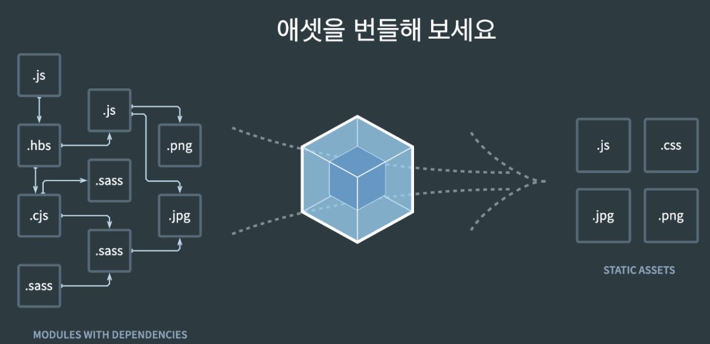

외주 프로젝트 중 Next로 프로젝트를 시작 했었는데, 사실 Next로 기능을 많이 사용하지 않았다. 그래서 React와 Webpack을 사용해 앱을 다시 구성해본 여정을 기록한다.

## Framework & library

Next와 React는 프레임워크와 라이브러리이다. 주된 차이점은 **제어의 주도권**이 누가 가지고 있느냐가 핵심인데 자세히 살펴보면 아래와 같다

### Framework

 **프레임워크**는 **응용프로그램을 프레임워크가 flow를 관리**하고, 개발자는 필요한 기능이 생긴다면 프레임워크가 가지는 `Logic`, `Rule`에 맞춰서 사용한다. 
 
 ### Library
 
  **라이브러리**는 **응용프로그램이 라이브러리를 사용**하는 개념이고, 개발자가 필요한 기능을 제공하는 라이브러리를 사용하면 된다.
  
## React와 Next의 동작 방식

### 1) React의 동작

먼저 **React**는 **UI를 만들기 위한 도구**일 뿐이므로 개발에 편리한 개발서버설정이나, JSX문법 지원하기 위해선 바벨설정 등 여러가지 설정을 해줘야된다. 그래서 **보통 React만으로 앱을 구성한다 하면 Webpack설정이 무조건 들어간다**고 생각하면 된다. 
(물론 진짜 순수 createElement라는 함수로 앱을 만들 수 있지만 [리액트공식문서](https://ko.legacy.reactjs.org/docs/introducing-jsx.html)에서도 JSX를 권장한다)

그래서 웹팩설정을 보통 보편적으로 해주기 때문에 **CreateReactApp(CRA)이라는 도구를 통해 앱을 구성**한다.

또한 CRA를 통해 앱을 구성하면, CSR(Client-Side-Rendering)방식으로 앱이 동작하는데 **UI를 클라이언트에서 화면을 구성**한다.

CSR의 동작에 대한 관점을 유저와 서버, 브라우저의 입장에서 생각을 해보자.

1. 유저가 우리 서비스(서버)를 **브라우저를 통해 접속**한다면
2. 우리의 서버는 브라우저에게 **빈 html과 JS파일**을 보내준다.
3. 브라우저가 **JS파일을 다운로드하고있는 동안** 유저는 **빈 화면**을 보게된다.
4. JS가 다운로드가 끝나면 JS파일을 실행해 **리액트의 코드가 실행이 되어 UI를 랜더링**한다.
5. 유저는 랜더링이 되고 나서 원하는 화면을 볼 수 있게된다.

즉, JS가 다운로드가 마치고 실행이 완료될 때 까지 원하는 UI를 볼 수 없다.

따라서 장점으로는 처음에 JS파일을 모두 불러오기 때문에 **초기에 로딩만 기다린다면** 이후에 화면 전환시 서버에 요청하는 것이 **AJAX를 통한 data 정도**이기 때문에 부하도 줄고 **랜더링 과정도 빠르다**.

### 2) Next의 동작

React기반의 오픈소스 프레임워크 입니다. 핵심은 **SSR과 SSG**를 제공해주고, 자동 코드 분할, API라우터 등 다양한 기능들을 제공하는 프레임 워크 입니다.

마찬가지로 유저, 서버, 브라우저 입장에서 설명을 하면 다음과 같다.

1. 유저가 우리 서비스를 **브라우저를 통해 접속**하면
2. **서버에서 리액트를 실행**하고
3. 리액트는 **UI를 랜더링**해서
4. 그 **결과**를 브라우저에게 **HTML로 제공**한다. => 이때 **초기화면**을 유저는 볼 수 있다.
5. 이후 리액트 코드가 있는 **JS파일을 브라우저가 다운받고 실행**시킨다.
6. 실행이 완료되면 **리액트의 앱과 같이 동작**을 하게되고 이 과정을 hydration이라고 한다.

**이미 랜더링된 HTML을 받으므로** 초기 로딩속도가 빠르고, 검색엔진이 HTML코드를 바로 확인할 수 있어 **SEO에 용이**하다.

그러나 view가 바뀔 때마다 서버에 UI를 계속 요청하기 때문에 부하가 CSR보다 크다. 또한 사용자 관점에서 새로고침되는 느낌이 들어 **사용자 경험이 저하**된다.

### Hydrate란?

위에서 설명한 SSR의 4번 과정에서 JavaScript가 로드되면, React는 서버에서 렌더링되어 **클라이언트에 보내준 HTML에 생명을 불어넣어주는 작업**을 한다.

이 과정을 hydrates라고 하는데, 이는 React가 서버에서 생성된 마크업을 인식하고, 해당 마크업에 **React 컴포넌트의 이벤트 리스너와 상태 관리 기능을 연결하는 과정**이다.

예를 들어, 블로그 포스트의 "좋아요" 버튼이나 "댓글 작성" 폼이 이제 클릭 가능하고, 사용자 입력을 받을 수 있게 된다. 즉 상호작용이 가능한 페이지로 변환이 되는 것이다.
 

## 마이그레이션을 해보자

우선 next와 관련된 package들을 yarn remove명령어를 통해 제거한뒤 React,Typescript를 설치하였다.

```sh
yarn add react react-dom
yarn add -D typescript @types/react @types/react-dom
yarn tsc --init
```

그런다음 Webpack에 관한 패키지를 설치한다

```sh
yarn add webpack —dev
yarn add webpack-cli —dev
yarn add html-webpack-plugin webpack-dev-server ts-loader --dev
```

### Webpack은 무엇인가?





웹 페이지를 만들 때 **수 많은 파일들이 연결이 될 때 여러가지 문제가 발생**하는데 그것들을 해결하기 위해 수 많은 파일을 하나로 묶어주는 도구이다. (이러한 도구를 번들러라고 한다 => `webpack`말고 `parcel`도 있다)

### Webpack을 사용하는 주된 이유

일단 여러 개의 파일을 하나로 묶어주기 때문에 클라이언트-서버의 통신부하가 줄어든다. 그리고 모듈끼리는 전역스코프를 공유하는 문제가 있는데, 이 문제를 해결하기 module타입이 나오기 전까진 즉시실행 함수로 감싸주었지만, ES6에서는 module을 통해 쉽게 해결할 수 있다.

그러나 **모든 브라우저가 지원하는게 아니여서 js가 어떤버전에 맞춰서 작성됫냐에 따라 호환성 문제가 발생**하는데 그것을 **모듈별로 스코프를 만들어주는 역활로서 웹팩이 수행**이 된다.

### 핵심개념

[공식문서](https://webpack.kr/concepts/)에서 제시한 6가지의 개념을 먼저 이해해야한다.

- Entry(엔트리): 번들링의 시작파일을 명시해 시작 파일에서 사용중인 파일들을 번들링해준다. - import를 따라가며 번들링을 해준다.
- Output(출력): 결과물에 대한 설정을 해준다. 여러가지 속성들이 있는데 사용한 몇 가지만 살펴보면

1) filename: 번들링 결과 파일명
2) path: 번들링 결과 파일 경로
3) clean: 번들링 시 이전에 생성되어있던 번들링 파일을 지우고 번들링
- Loaders(로더): 로더를 사용하면 다른 유형의 파일을 처리하거나(css,svg 등의 파일), 그들을 유효한 모듈로 변환 하여 의존성에 추가합니다.

내가 했던 설정을 예시로 살펴보자.

```js
//...
  module: {
    rules: [
      {
        test: /\.(js|jsx|ts|tsx)$/,
        use: 'babel-loader',
        exclude: /node_modules/,
      },
      {
        test: /\.css$/, // .css 확장자를 가진 모든 파일에 적용
        use: ['style-loader', 'css-loader'], // css-loader를 적용한 후 style-loader 적용
      },
      {
        test: /\.svg$/, // .svg 확장자를 가진 모든 파일에 적용
        type: 'asset/resource', // 파일을 별도의 파일로 내보내고 URL을 제공
      },
    ],
  },
//...
```

rules에서 loader를 적용할 파일들을 정의해주고 각 파일에 대해 적용할 loader를 정의하는 개념이다.

1) test: loader를 적용할 파일의 확장자를 정규표현식으로 선언
2) exclude: 정규표현식에 일치하는 파일 중에서 제외할 파일
3) use: 사용할 loader들 선언

- Plugins(플러그인): 로더와는 다른 extension개념. 플러그인을 활용하여 번들을 최적화하거나, 애셋을 관리하고, 또 환경 변수 주입등과 같은 광범위한 작업을 수행할 수 있도록 돕는다.

내가 사용한 플러그인을 보면 아래와 같은대 각각의 사용법과 설명은 플러그인마다 다르니 확인해야한다.

1) HtmlWebpackPlugin: html을 자동으로 생성해주는 역활. 해당 플러그인 없이 빌드하면 html파일이 없기 때문에 일일히 추가해줘야된다. 그 문제를 해결하기 위한 플러그인
2) CleanWebpackPlugin: 빌드시 이전에 남아있던 빌드 결과물을 지우고 새로 생성하는 플러그인

```js
//...
  plugins: [
    new CleanWebpackPlugin(),
    new HtmlWebpackPlugin({
      template: './public/index.html',
    }),
  ],
//...
```


- Mode(모드) : 파일을 어떻게 번들링을 해줄 것인지 설정할 수 있는데 [문서](https://webpack.kr/configuration/mode)에 나온 내용을 요약하면 아래와 같다.
	
1) production 모드 : 로드 시간을 줄이기 위해 번들 최소화, 가벼운 소스맵 및 애셋 최적화에 초점을 맞춘다.
2) development 모드 : 개발 생산성을 높이기 위한 모드. 버그발생 위험이 있는 코드를 미리 경고해 주는 검증 코드도 포함되어 있다.

### 나의 webpack.config.js

```js
const config: Configuration = {
  mode: 'development',
  entry: './src/index.tsx',
  output: {
    path: path.resolve(__dirname, 'dist'),
    filename: '[name].bundle.js',
    clean: true,
  },
  devtool: 'inline-source-map',
  devServer: {
    static: './dist',
    hot: true,
    port: 3001,
    historyApiFallback: true,
  },
  module: {
    rules: [
      {
        test: /\.(js|jsx|ts|tsx)$/,
        use: 'babel-loader',
        exclude: /node_modules/,
      },
      {
        test: /\.css$/, // .css 확장자를 가진 모든 파일에 적용
        use: ['style-loader', 'css-loader'], // css-loader를 적용한 후 style-loader 적용
      },
      {
        test: /\.svg$/, // .svg 확장자를 가진 모든 파일에 적용
        type: 'asset/resource', // 파일을 별도의 파일로 내보내고 URL을 제공
      },
    ],
  },
  resolve: {
    alias: {
      '@': path.resolve(__dirname, 'src/'), // '@/': './src/' 경로에 대한 별칭 설정
    },
    extensions: ['.ts', '.tsx', '.js', '.jsx'],
  },
  plugins: [
    new CleanWebpackPlugin(),
    new HtmlWebpackPlugin({
      template: './public/index.html',
    }),
    new DefinePlugin({
      'process.env.MAP_API_KEY': JSON.stringify(process.env.MAP_API_KEY),
      'process.env.NEXT_PUBLIC_API_URL': JSON.stringify(
        process.env.NEXT_PUBLIC_API_URL,
      ),
      'process.env.WEATHER_API': JSON.stringify(process.env.WEATHER_API),
    }),
  ],
};

export default config;

```

### DevServer

설정에서 잠깐 Devserver부분을 살펴보자.

```js
//...
  devtool: 'inline-source-map',
  devServer: {
    static: './dist',
    hot: true,
    port: 3001,
    historyApiFallback: true,
  },
//...
```

 devServer는 먼저 `webpack-dev-server`라이브러리를 설치해야 한다.

- hot : 수정된 부분만 바뀌게 해주는 옵션.
- historyApiFallback : 라우팅에 관한 기능인데, SPA에서 라우팅을 사용하여 사용자가 **다른 경로로 이동할 때 페이지를 다시로드하지 않고도 해당 컴포넌트를 동적으로 변경**한다. 단일 페이지 애플리케이션에서 라우팅을 지원하게 해준다.
