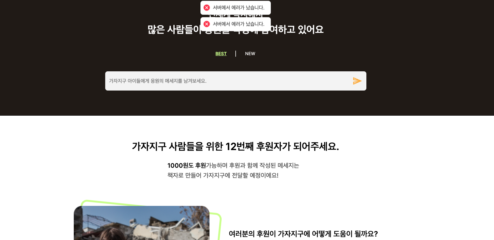
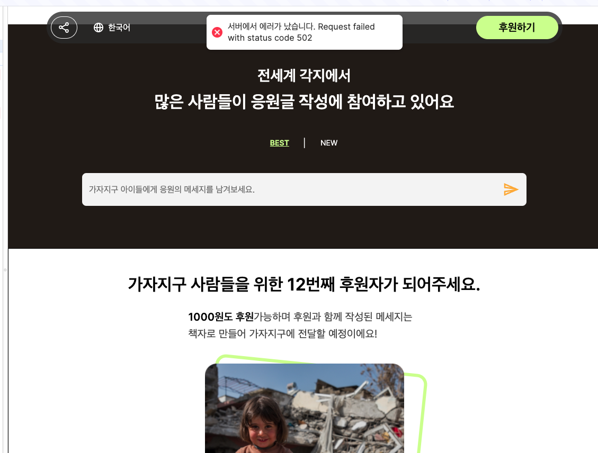
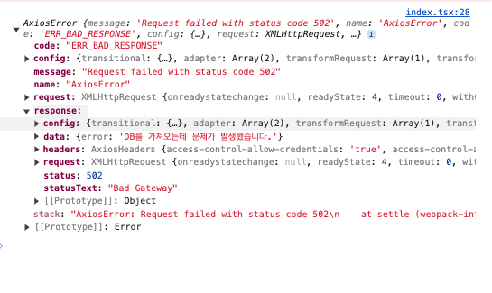
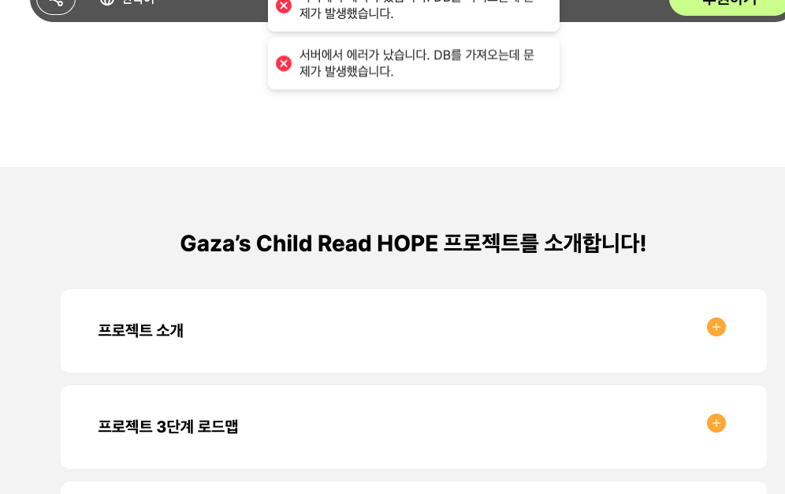
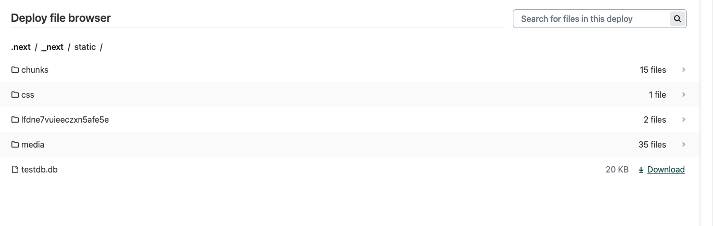
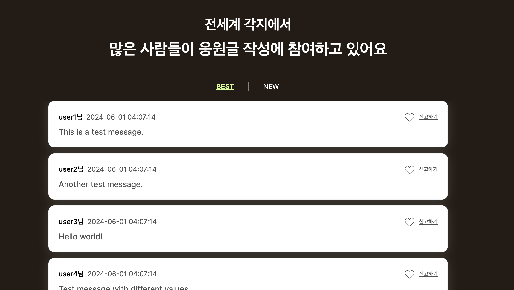

## 테스트 API 서버 도입 결정

최근 취업 시즌으로 인해, 1차 버전의 실패 이후 팀원들이 모여 야심차게 준비한 2차 버전 가자지구 프로젝트의 개발 속도가 지연되었다. ㅠㅜ

그래서 포트폴리오를 면접관들에게 보여드릴 페이지가 없다는 점이 아쉬웠다. 백엔드 개발자분께 양해를 구해, 테스트 API 서버를 프론트엔드 서버로 구현하여 **MVP 형태로 우선적으로 배포**하기로 했다. 이 글에서는 SQLite와 Next.js의 APIRoute를 활용해 테스트 API 서버를 구현한 경험과 함께 맞닥트렸던 오류 중 크게 깨달으며 해결한 것이 있어 기록과 함께 공유하려고 한다.

사실 백엔드의 기능이 많지 않아 이렇게 결정할 수 있었다.

### 테스트 API의 목표

> 우선적으로 정의된 API를 천천히 읽어본 후, 백엔드 개발자분이 만드신 스키마 테이블을 SQLite에 그대로 옮기는 것이 목표. MVP이기에 생성과 함께 테스트 데이터도 삽입한다.

### DB생성

db.js 스크립트를 빌드 직전에 실행시켜 testdb.db파일을 통해 데이터베이스를 생성한다. SQLite는 이 파일을 통해 데이터베이스를 관리하기 때문에 생성한다.

우선 DDL을 백엔드 개발자에게 전달받았다. 사실 테이블이 like테이블과 message테이블 뿐이였다. 그래서 sqlite를 통해 SQL을 구현해 실행할 수 있도록 만들었다.

```js
// 메세지 테이블
db.run(
  `
CREATE TABLE IF NOT EXISTS message (
id INTEGER PRIMARY KEY,
username TEXT NOT NULL,
content TEXT,
nation TEXT,
latitude REAL,
longitude REAL,
amount INTEGER DEFAULT 0,
created_dt TIMESTAMP DEFAULT (DATETIME('now', 'localtime', '+9 hours')),
modified_dt TIMESTAMP DEFAULT (DATETIME('now', 'localtime', '+9 hours'))
);`,
  err => {
    if (err) {
      console.error(err.message);
    } else {
      console.log('Message table created.');

      // ... 테스트 데이터 5개 넣는 코드는 생략

      console.log(
        'message default modified_dt 현재시간으로 수정하는 트리거 추가',
      );
      const createTriggerSQL = `
CREATE TRIGGER IF NOT EXISTS update_modified_dt
AFTER UPDATE ON message
FOR EACH ROW
BEGIN
UPDATE message SET modified_dt = DATETIME('now', 'localtime', '+9 hours') WHERE id = OLD.id;
END;
`;
      db.run(createTriggerSQL, err => {
        if (err) {
          console.error(err.message);
          throw err;
        }
        console.log('Update trigger created or verified.');
      });

      console.log('Message Test Datas created!!!');
    }
  },
);
// like한 테이블
db.run(
  `
CREATE TABLE IF NOT EXISTS like (
id INTEGER PRIMARY KEY,
ip TEXT NOT NULL,
message_id INTEGER,
FOREIGN KEY (message_id) REFERENCES message (id)
);`,
  err => {
    if (err) {
      console.error(err.message);
    } else {
      console.log('Like table created.');
// .. 테스트 데이터 생략
      console.log('Like test Datas created!!!');
    }
  },
);

```

참고로 내가 주로 백엔드를 구현할 땐 Sequlize ORM을 통해 구현했는데, **테이블 생성하면 기본적으로 modified_dt를 스키마에 항상 정의**를 해주었다.

그래서 데이터가 바뀌면 자동으로 modified_dt가 현재 시간으로 갱신되는 기능이 신경쓰지 않아도 자동으로 처리가 되었는데, 아무래도 ORM을 사용하는 것이 아니니 Message스키마에 **해당 기능에 대한 Trigger를 작성**했다.

이제 **nodejs로 db.js를 실행하면 testdb.db 파일이 생성**되고 백엔드와 같은 환경의 스키마가 정의가 되어 동일한 환경으로 API를 정의해줄 수 있게되었다.

### API개발

사전에 논의한 API통신 시나리오는 아래와 같다.

> 웹 브라우저 => 프론트서버API => 백엔드 API

이렇게 프론트서버를 거치는 이유는 브라우저의 IP를 얻기 위해 거친다. 원래는 바로 보낼 수 있을 줄 알았는데, 브라우저에서 보안때문에 request에서 IP정보를 담아 보낼 수 없다.

그래서 프론트서버에서 브라우저에 대한 응답을 받고 IP정보를 담아 백엔드와 추가적으로 통신하도록 거쳤다.

~~그런데 만들고나니.. 비효율적인것을 알게되었다.~~

#### GET message

프론트 API 엔드포인트 : 
```
/message?sort=new&page=0&size=20
```

프론트 API에서는 브라우저의 IP정보그대로 담아 url query에 추가한다. 따라서 구현체가 사실 별로 없다. 단지 IP를 얻어오는 부분만 추가적으로 구현했다.

req를 매개변수로 받아 ipegeolocation이라는 서비스를 활용해 **위도,경도,해당 나라**의 정보를 얻어와서 추가적으로 담아주는 객체를 반환시켰다.

```js
const getIpInfo = async (req: NextRequest): Promise<IpInfoType> => {
  try {
    let ip: any = req.headers.get('x-forwarded-for');
    if (ip) {
      [ip] = ip.split(',');
    }
    if (ip === '::1') {
      ip = '';
    }
    const url = `https://api.ipgeolocation.io/ipgeo?apiKey=${process.env.NEXT_PUBLIC_IPGEOAPIKEY}&ip=${ip}`;
    const ipInfo = await axios.get<IpInfoResponse>(url);
    return {
      nation: ipInfo.data.country_code3,
      latitude: ipInfo.data.latitude,
      longitude: ipInfo.data.longitude,
      ip: ip === '' ? '127.0.0.1' : ip,
    };
  } catch (err) {
    throw Error('IP정보를 얻는과정에서 에러가 났습니다.');
  }
};

```

백엔드 API 엔드포인트 : 
```
/message?sort=new&page=0&size=20&ip=127.0.0.1
```

백엔드 API는 실제 db에서 ip정보의 좋아요를 누른 갯수를 like테이블을 참고해 반환해준다. db의 파일을 오픈한뒤 Select명령으로 가져온다.

```js
export const getMessage = async (
  size: number,
  sort: string,
  page: number,
  ip: string,
): Promise<MessageType[]> => {
  try {
    const db = await open({
      filename: `${process.cwd()}/rc/script/testdb.db`,
      driver: sqlite3.Database,
    });
    const rows = await db.all(
      `
SELECT
    m.id AS message_id,
    m.username,
    m.content,
    m.nation,
    m.latitude,
    m.longitude,
    m.amount,
    m.created_dt,
    m.modified_dt,
    COUNT(l.id) AS like_count,
    CASE 
        WHEN EXISTS (SELECT 1 FROM like l2 WHERE l2.message_id = m.id AND l2.ip = ?) THEN 1
        ELSE 0
    END AS user_liked
FROM
    message m
LEFT JOIN
    like l ON m.id = l.message_id
GROUP BY
    m.id
       ORDER BY
         CASE WHEN ? = 'new' THEN m.created_dt END DESC
       LIMIT ? OFFSET ?;`,
      [ip, sort, size, (page - 1) * size],
    );
    return rows;
  } catch (err) {
    throw new Error('DB를 가져오는데 문제가 발생했습니다.');
  }
};
```

나머지 라우터도 이와 비슷한 흐름으로 구현했다.


## 배포환경 이슈

처음에는 구현만 해놓고 개발환경에서 배포하면 그대로 동작할 줄 알았다. 그래서 Dev로 확인하는 단계에서 구현을 할 때에 배포할 때를 생각하지 못한채로 작업을 진행했다. 그러나 구현을 마친 뒤, 배포된 페이지를 확인해 보니...



서버에러가 났다고 뜬다.

### 첫번째 문제 : 에러 메세지 전달

첫번째 발견점은 에러 처리를 잘못하고 있었다. 백엔드에서 던져주는 에러 메세지를 프론트에서 받을 떄 **"서버에서 에러가 났습니다."로 똑같이 표현되는 것**이였다. 따라서 배포환경에서 에러가 발생했을 때 어떤 부분에서 에러가 났는지 전혀 추측을 할 수 없는 상태였다.

 사실 개발환경에서는 에러를 로그나 debbuger를 통해 비교적 쉽게 잡을 수 있지만, 배포환경에서는 그렇지 않다는 것을 온전히 느끼지 못했다.
 
 배포 후 이런 알 수 없는 에러 메세지가 발생한 웹 페이지를 맞닥뜨렸을 때, 에러의 가능성을 추측하기보다는 먼저 에러의 본질을 파악해야겠다는 생각이 들었고, 따라서 에러를 정확히 확인하기 위해 **여러 가능성을 고려하며 접근**했습니다. 이러한 접근법은 **이슈에 대한 대응이 늦어진다는 것을 깨달았고**, 이를 위해 에러 처리가 서버에서 던져주는 메시지를 즉각적으로 보여줄 수 있도록 코드를 변경했습니다.
 
```js
  useEffect(() => {
    instance
      .get(`/message?size=100&page=1&sort=new`)
      .then(res => setComments(res.data))
      .catch(e => {
        toast.error(`서버에서 에러가 났습니다. ${e.message}`);
        // toast.error('서버에서 에러가 났습니다.'); 기존 코드
      });
  }, []);

```



그러나 서버에서 내가 처리한 메시지와 다른 에러 메시지가 나타났다. 에러 객체를 살펴본 결과...



 객체를 보면서 서버에서 처리할 수 있도록 코드를 변경했다. 프론트엔드 API 서버에서 백엔드 요청을 처리할 때, 백엔드에서 에러 처리를 했다면 응답 값으로 에러 내용을 받아와야 했다. 
 
 또한 502 코드는 의미적으로도 잘못된 코드였기 때문에 에러 응답 값을 400으로 변경했다. 이렇게 에러 코드를 수정한 후 배포하고 실제 에러 내용을 살펴보았습니다.

```js
// app/api/message/route.ts
  } catch (e: any) {
    console.dir(e);
    return new Response(JSON.stringify({ error: e.response.data.error }), {
      status: 400,
    });
  }
```



### 두번째 접근 : DB 접근 에러 

DB에 대해서 접근 오류를 보내고 있다는 것을 알게되었다. 원인을 생각해 보니 package.json에서 yarn build 명령어를

```json
"build": "node src/script/db.js && next build"
```
로 작성해 db.js에서 **testdb.db를 생성하고 빌드**했다. 참고로 db.js에서 만든 testdb.db는 db.js가 위치하는 폴더에 만들었다.

그러나 배포 과정에서는 **.next 폴더가 배포 폴더로 만들어지기 때문에 생성한 testdb.db를 .next 폴더로 복사**해야 했습니다.

 아래의 이미지 처럼 Netlify에서는 static 폴더의 내용을 볼 수 있게 되어 있어, testdb.db파일을 .next/static 폴더로 옮기면 testdb.db가 Netlify에 올라가 읽을 수 있을 것이라고 생각했다. 
 
 ```json
 "build": "node src/script/db.js && next build && cp src/script/testdb.db .next/static/testdb.db && echo 'DB file copied'"
```

빌드가 끝난 후 생성된 testdb.db를 .next 폴더로 옮기는 작업을 했고, Netlify에서 성공적으로 복사 명령이 수행되었는지 확인하기 위해 echo 명령어도 실행시켰다.

_netlify에서 확인한 testdb.db_


성공적으로 작업이 되어 위의 사진처럼 testdb.db가 올라가게 되었다. 그래서 GET 명령 시 DB를 불러오는 경로를 절대 경로로 수정했다.

기존 코드:

```js
const db = await open({
  filename: `src/script/testdb.db`,
  driver: sqlite3.Database,
});
```
수정된 코드:

```js
const db = await open({
  filename: `.next/static/testdb.db`,
  driver: sqlite3.Database,
});
```

그러나 **여전히 DB 파일을 찾을 수 없었다**.

### 로그를 활용한 문제 해결

DB를 찾도록 해결하기 위해 두 번째 접근 방법으로 사용한 것은 로그를 확인해 보는 것이였다.

다행히 **Netlify에서 Function을 통해 실시간으로 console.log를 확인**할 수 있었다. 

따라서 해당 기능을 이용해 GET 명령 시 동작하는 서버의 위치와 폴더, 파일 리스트를 확인하기 위해 로그를 찍어보았다.

```js
//...message/route.ts
    console.log(`${process.cwd()}/`);
    fs.readdir(`${process.cwd()}/`, function (error, filelist) {
      console.log(filelist);
    });
    console.log(`${process.cwd()}/.next/`);
    fs.readdir(`${process.cwd()}/.next/`, function (error, filelist) {
      console.log(filelist);
    });

    console.log(`${process.cwd()}/.next/src`);
    fs.readdir(`${process.cwd()}/.next/src`, function (error, filelist) {
      console.log(filelist);
    });

    console.log(__dirname);
    console.log(process.cwd());
    const db = await open({
      filename: `${process.cwd()}/src/script/testdb.db`,
      driver: sqlite3.Database,
    });
    console.log('디비를 받아왔습니다. 이로그가 보인다면 SELECT가 문제입니다.');
//....
```

배포후 Message GET요청을 보내 실제로 Function 로그를 확인해 보니 다음과 같았습니다.

```
// 이전에 로그 기록이 다지워져서.. 일단 생각나는 대로 적었습니다 ㅠ
//.next/
server/
buildmanifast.json
react-loadable-manifest.json
//...
```
서버 환경에서는 **static 폴더가 빠져 있는 것을 직접 확인**했다.

## Netlify가 내 앱을 배포하는 원리

그래서 원초적인 질문이 들었다. Netlify는 어떻게 우리의 사이트를 배포하길래 netlify가 보여주는 폴더와 로그가 다른걸까? 공식문서를 정독하면서 깊게 깨달았다. 깨달은 부분에 대한 기록을 남긴다.

[Netlify-Funtion](https://docs.netlify.com/functions/overview/)
[Netlify-SiteDeploy](https://docs.netlify.com/site-deploys/overview/)
[Netlify-Next](https://docs.netlify.com/frameworks/next-js/overview/)

### Netlify의 Next앱 배포 방식

> Next앱을 통해 Netlify에 배포된다고 가정하고 설명하겠습니다. 보통 저는 이렇게 Netlify를 사용하기에...

### Next의 빌드 결과물

Next앱은 빌드될 때 크게 3가지로 구분한다.

- 정적 페이지 (Static Pages): 미리 렌더링된 HTML 페이지로, 빌드 시에 생성

위치: .next/static 또는 .next/server/pages

- 동적 페이지 (API Routes): 서버에서 실행되는 SSR(서버 사이드 렌더링) 페이지와 API 라우트가 포함

위치: .next/server/

- 클라이언트 앱 (Client-side Application): 브라우저에서 실행되는 JavaScript 코드와 관련된 파일들로, 정적 페이지와 함께 제공.

위치: .next/static 또는 .next/static/chunks


### Netlify에서의 배포 분석

Netlify는 Next.js의 배포 결과물을 다음과 같이 처리한다

- 정적 페이지: CDN을 통해 제공됨.
- API Routes 및 SSR: Netlify Functions로 서버리스 환경에서 실행됨. 각 요청에 대해 서버리스 함수로 처리됨.
- 클라이언트 앱: CDN을 통해 제공되는 정적 파일.

따라서, 실제로 접속하는 서비스는 CDN을 통해 제공된다. Netlify 서버는 빈 HTML 파일을 제공하며, 이 HTML에서 앱이 담긴 JavaScript 코드 및 기타 리소스들은 CDN을 통해 제공된다. 

이는 Netlify가 Single Page Application(SPA)처럼 동작하는 방식을 지원하는 방법임.

### 그렇다면 Function에 testdb.db를 담아내는 건?

[Netlify-netlify.toml](https://docs.netlify.com/configure-builds/file-based-configuration/)

해당 문서내용을 보면 빌드 과정에서 **Function함수에 파일을 포함시키는 설정**이 있다. 이 과정을 통해 testdb.db를 포함시키면 된다.

```toml
[build]
  command = "yarn build"
  publish = ".next"

[functions]
  included_files = ["src/script/testdb.db"]  # 정확한 경로 지정

[[plugins]]
  package = "@netlify/plugin-nextjs"
```

이렇게 하고 GET Message요청을 보내 로그를 확인해보면 이전 파일들 확인하는 로그에서 testdb.db를 확인할 수 있었다. 따라서 우리의 사이트가 정상 작동 한다!!




### 느낀점

사실 고민한 것에 비해 간단한 설정만 해주면 끝나는 문제였다. 그러나 배포 과정과 Next.js 빌드 결과물에 대해 조금 더 공부할 수 있었다. 확실히 내가 사용하는 것에 대해 정확하게 공부해야겠다는 생각이 들었다. 그동안 만드느라 정신없이 부분 부분 사용법만 익혔는데, 이번처럼 일이 많지 않을 때 내가 사용하는 기술에 대해(특별히 가장 먼저 정독을 하고싶은건 Next) 공식 문서를 정독하는 시간을 가져야겠다.

또한, "정적 콘텐츠를 CDN에 배포한다"는 말을 Vercel을 사용하면서 수도 없이 본 문장인데 그저 그렇구나 하고 넘겼었다. 그러나 이번 경험을 통해 SPA에서 동작하는 모든 JS 코드를 CDN에 배포해 불러오는 방식이 비용 절감에 효과적임을 체감할 수 있었다.

### 추가적으로 개선하고 싶은 것.

거의 7시간에 걸쳐 에러를 해결했으나 여전히 개선해야될게 너무 많이 보였다.

- 통신 시나리오: 직접 구현하고 보니 의문이 생겼다. 그냥 바로 백엔드에서 Request IP를 확인하면 되지 않았나 생각한다.
- 에러 처리: 이 부분은 공부가 많이 필요하다고 느꼇다. 배포환경에서 이슈를 빠르게 처리하기 위해선 정말 중요한 내역이다.

### 참고자료

[Next빌드분석](https://www.moonkorea.dev/React-NextJS-%EB%B9%8C%EB%93%9C-%EB%A6%AC%EC%86%8C%EC%8A%A4-%EC%82%B4%ED%8E%B4%EB%B3%B4%EA%B8%B0)
