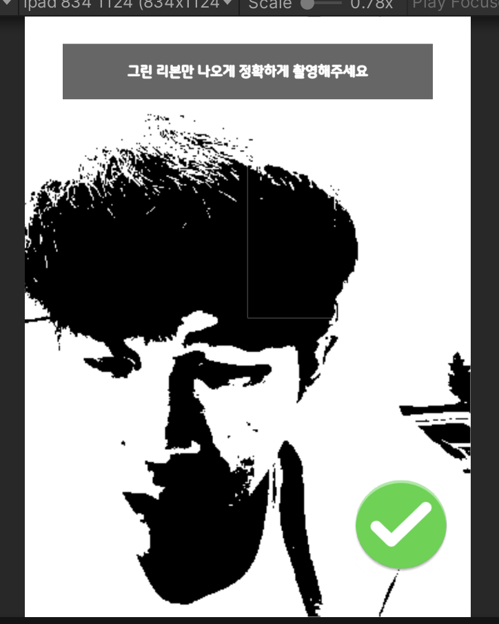
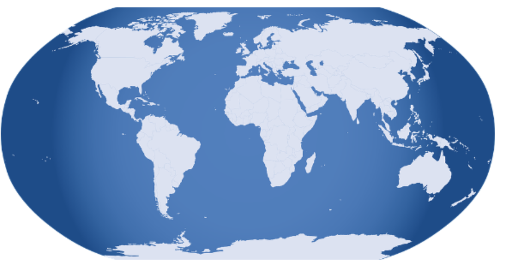
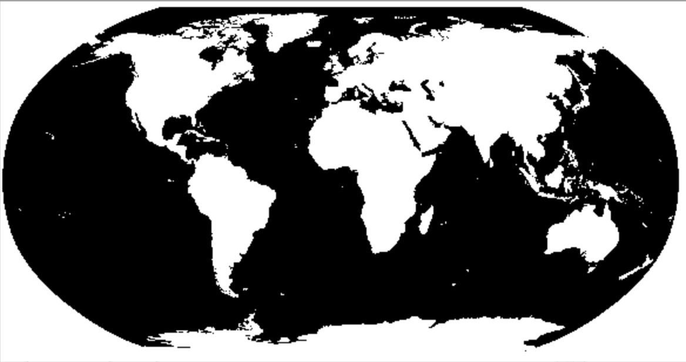
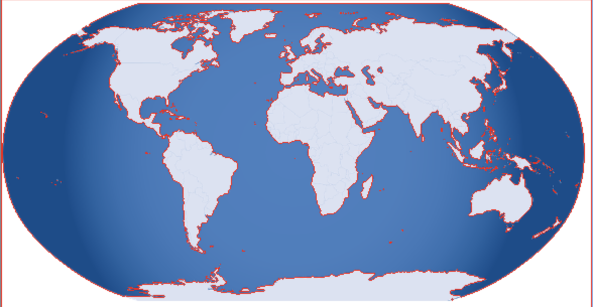

이전에 외주 프로젝트로 유니티로 구현한 앱에서 "아이가 그린 그림에 색입히기"를 구현한 경험을 했었다. 참 안타깝게도 프로젝트가 한참 진행 중에 업체의 사정에 의해서 무산이 됬지만, 개인적으로 OpenCV를 활용해 색깔 입히기를 구현했던 것은 많은 인사이트를 줘서 기록을 해보려고한다.

## 요구사항

> "교구"를 사용해 아이가 그림을 그리고 선들로 이루어진 그림을 인식해 내부를 아이가 앱에서 색깔을선택하여 바꿀 수 있게 구현.

해당 요구사항에서 업체에서 제공하는 "교구"를 사용하기 때문에 흰 배경에 아이가 그리는 흰 배경에 검은색 선을 따는 그림은 확보가 가능하다. 이것을 **쓰레시홀딩 과정을 통해 선을 따고, 컨투어를 통해 색칠하는 과정**을 살펴보자.

## OpenCV

 아무래도 영상처리하면 대표적으로 떠오르는 라이브러리이고, 동료개발자와 기술조사를 하다가 [Maxst](https://developer.maxst.com/)같은 솔루션을 찾기도 했다. 그러나 아무리 교구를 사용한다 해도 형광등을 사용하는지, 빛이 어떻게 들어오지는 지에 대한 상황들을 생각해야되서 **수정의 자유도가 높은 OpenCV를 활용**하기로 했다.

> OpenCV는 세계 최대 규모의 컴퓨터 비전 라이브러리입니다.

 OpenCV (Open Source Computer Vision Library)는 컴퓨터 비전 및 머신 러닝 소프트웨어 라이브러리로, 실시간 이미지 처리에 중점을 둔 방대한 기능을 제공합니다. 해당 요구사항에서는 **감마변환, Thresholding, Contour**를 Opencv로 처리한다.

## 선 추출하기

### 1) 감마보정

실제 사진을 찍으면 빛의 밝기에 따라 같은 펜으로 그린 검은색 선이여도, 밝기가 다 다르다. 따라서 밝기를 조절해 어두운 부분이나 밝은 부분의 정보를 드러나게 해줘야 인식이 잘된다. 특히, **어두운 영역에서 세부 정보를 더 잘 볼 수 있도록 밝기를 조절**해야한다.

따라서 **감마 변환을 통해** 이미지의 대비를 조정하여 어두운 부분이나 밝은 부분의 정보를 더욱 선명하게 하여 선을 따는 작업에 있어 **선의 경계를 더 명확하게 만들어 준다.**

### 2) thresholding

스레시홀딩은 **여러 값을 어떤 임계점을 기준으로 두가지 부류로 나누는 방법**이다. 아이가 그리는 그림은 실제 사진이고, 배경은 흰색 선은 검은색으로 되어있다. 카메라로 찍기에 밝기가 다른데, 일정 부분까지는 아예 하얀색으로, 일정 부분까지는 검정색으로 이분화 시킬 필요가 있다. 그래야 아이가 그린 그림의 선을 딸 수 있다.

**전역 쓰레시홀딩은 어떤 임계값을 정한 뒤 픽셀 값이 임계값을 넘으면 255, 임계값을 넘지 않으면 0으로 지정하는 방식**을 전역 스레시홀딩이라고 한다. OpenCV에서 제공하는 함수 threshold() 함수로 구현할 수도 있다.


_쓰레시홀딩의 결과_

### 3) 구현된 코드

유니티에서 텍스처를 가져와 Opencv라이브러리를 활용해 이미지 처리를 하는 과정을 구현한 코드이다.

```cs
private Texture2D ImageProcessing(Texture2D texture,Color texture_color){
        Mat rgbMat = new Mat(texture.height, texture.width, CvType.CV_8UC3);
        Mat grayMat = new Mat(texture.height, texture.width, CvType.CV_8UC1);

        Utils.texture2DToMat(texture, rgbMat);
        
        if (lut == null || Mathf.Abs(gamma - (float)lut.get(0, 0)[0]) > float.Epsilon)
        {
            gamma = Mathf.Max(gamma, 0.01f); // Ensure gamma is non-zero
            CreateLUT();
        }

        Core.LUT(rgbMat, lut, rgbMat);

// Convert the image to grayscale
        Imgproc.cvtColor(rgbMat, grayMat, Imgproc.COLOR_RGB2GRAY);
        // Apply thresholding
        Imgproc.threshold(grayMat, grayMat, threshold, 255, Imgproc.THRESH_BINARY);

        Texture2D thresholdTexture = new Texture2D(grayMat.cols(), grayMat.rows());
        Utils.matToTexture2D(grayMat, thresholdTexture);

        Texture2D coloredTexture = FillColor(thresholdTexture,texture_color);
        Texture2D resultTexture = overlayTexture(coloredTexture,thresholdTexture);
        

        rgbMat.release();
        grayMat.release();

        return MakeWhitePixelsTransparent(resultTexture);
    }
```

### 4) 코드 설명

```cs
Mat rgbMat = new Mat(texture.height, texture.width, CvType.CV_8UC3);
Mat grayMat = new Mat(texture.height, texture.width, CvType.CV_8UC1);

Utils.texture2DToMat(texture, rgbMat);
```
**Mat은 Unity에서 OpenCV라이브러리가 제공하는 데이터**이다. 이것을 사용해 **OpenCV의 이미지 처리를 적용**할 수 있다.

texture2DToMat함수를 통해 카메라에서 가져와 텍스처로 변환된 것을 Mat데이터로 바꾼다.


1. 감마변환

```cs
if (lut == null || Mathf.Abs(gamma - (float)lut.get(0, 0)[0]) > float.Epsilon)
{
	gamma = Mathf.Max(gamma, 0.01f); // Ensure gamma is non-zero
	CreateLUT();
}
Core.LUT(rgbMat, lut, rgbMat);
```

CreateLUT() 함수는 **감마 보정을 위한 룩업 테이블(LUT)을 생성하거나 업데이트하는 역할**을 한다.

그래서 그 **LUT을 통해 Core.LUT(rgbMat, lut, rgbMat) 함수를 사용해 rgbMat 이미지 행렬에 감마 보정을 적용**한다.

#### LUT을 사용하는 이유

- 효율성: LUT를 사용하는 것은 계산적으로 매우 효율적이다. 미리 계산하여 LUT에 저장함으로써, 이미지나 비디오 스트림에 대한 신속한 처리를 할 수 있게 해준다.
- 일관성: LUT는 이미지 전체에 걸쳐 복잡한 변환을 일관되고 빠르게 적용할 수 있는 방법을 제공한다.
- 유연성: 보기 조건이나 감마 설정이 변경되더라도 LUT를 쉽게 조정할 수 있으며, 이미지를 처음부터 다시 처리할 필요 없이 적용할 수 있다.

한마디로... 감마 변환시 **계산의 효율성을 위해 룩업테이블을 사용**한다.

2. 흑백으로 사진 변환 후 쓰래시홀드 적용

```cs
Imgproc.cvtColor(rgbMat, grayMat, Imgproc.COLOR_RGB2GRAY);
Imgproc.threshold(grayMat, grayMat, threshold, 255, Imgproc.THRESH_BINARY);
```

grayMat에 흑백사진으로 변환 후 **threshold 변환을 grayMat에 적용**시킨다.

- threshold: 이미지의 픽셀이 threshold 값 이상이면 255값으로 바꿔준다. 즉, 밝은부분은 하얗게 그냥변환시켜서 명확한 선을 얻는다.

테스트를 하며 **선을 가장 잘 뽑아낼 수 있는 적당한 값**을 찾아야하기 때문에 threshold라는 변수로 조절할 수 있게 만들어 주었다. 해당 프로젝트에서는 100이라는 값이 가장 이상적인 값이였다.

## 색 입히기

선을 추출했다면 색깔 입히는 과정을 진행합니다. 선으로 둘러쌓인 영역을 구분하여 선으로 둘러쌓인 영역들은 모두 색칠하는 과정을 거친다.

추출한 threshold를 통해 윤곽선이 선명한 이미지를 기반으로 구현이 된다.

### Contour

**컨투어(contour)** 란 동일한 색 또는 동일한 픽셀값을 가지고 있는 영역의 경계선 정보다. **물체의 윤곽선, 외형을 파악하는데 사용**된다. 따라서 컨투어정보를 추출해서 **내부의 영역을 지정**을 해줘야한다.

예를 들면 해당 원본의 이미지를



쓰레시홀드 처리 후


컨투어처리를 해서 테두리에 빨간색을 칠하면 아래와 같이 나온다.


### 구현 코드

```cs

private Texture2D FillColor_gpt4(Texture2D inputTexture,Color texture_color)
{
	Mat imgMat = new Mat(inputTexture.height, inputTexture.width, CvType.CV_8UC3);
	Utils.texture2DToMat(inputTexture, imgMat);

 	System.Collections.Generic.List<MatOfPoint> contours = new System.Collections.Generic.List<MatOfPoint>();
	Mat hierarchy = new Mat();
	Imgproc.findContours(imgMat, contours, hierarchy, Imgproc.RETR_EXTERNAL, Imgproc.CHAIN_APPROX_SIMPLE);

	Mat mask = Mat.zeros(imgMat.size(), CvType.CV_8UC1);
	for (int i = 0; i < contours.Count; i++)
	{
		Imgproc.drawContours(mask, contours, i, new Scalar(255), -1);  // -1 fills the contour
	}

	Scalar fillColorScalar = new Scalar(texture_color.r * 255, texture_color.g * 255, texture_color.b * 255);
	imgMat.setTo(fillColorScalar, mask);

	Texture2D outputTexture = new Texture2D(imgMat.cols(), imgMat.rows(), TextureFormat.RGB24, false);    
	Utils.matToTexture2D(imgMat, outputTexture);

	return outputTexture;
}
```

컨투어 과정을 자세히 살펴보면


```cs
 	System.Collections.Generic.List<MatOfPoint> contours = new System.Collections.Generic.List<MatOfPoint>();
	Mat hierarchy = new Mat();
	Imgproc.findContours(imgMat, contours, hierarchy, Imgproc.RETR_EXTERNAL, Imgproc.CHAIN_APPROX_SIMPLE);

	Mat mask = Mat.zeros(imgMat.size(), CvType.CV_8UC1);
	for (int i = 0; i < contours.Count; i++)
	{
		Imgproc.drawContours(mask, contours, i, new Scalar(255), -1);  // -1 fills the contour
	}

```

먼저 contours라는 리스트를 생성하는데 이 리스트는 **MatOfPoint객체로 여러개의 점들을 저장하는 객체**이다.

실제 윤곽선을 추출하여 MatOfPoint객체에 저장한다. **윤곽선을 추출하는 함수는 opencv에서 제공하는 findContours함수**이다. findContours의 함수의 파라미터를 설명하면 아래와 같다.

- imgMat:입력 이미지. 쓰레시 홀드처리를 한 이진 이미지가 보통 인풋으로 들어간다.
- contours: 검출된 윤곽선들이 저장될 리스트. 이 리스트는 MatOfPoint의 객체들을 저장하는 리스트로, 각 MatOfPoint 객체는 여러개의 점들이 모여 하나의 윤곽선을 나타낸다.
- hierarchy: 윤곽선들의 계층 구조를 나타내는 출력 벡터. 이 정보는 이미지 내 윤곽선들의 부모-자식 관계를 표현하며, 각 윤곽선이 다른 윤곽선과 어떻게 관련되어 있는지를 나타낸다.
- Imgproc.RETR_EXTERNAL:윤곽선 검출 모드. RETR_EXTERNAL은 가장 바깥쪽 윤곽선만을 추출한다. 
- Imgproc.CHAIN_APPROX_SIMPLE:윤곽선을 근사화하는 방법. 직선 중간중간 점들을 모두 저장하는 것이 아니라 끝점들만 저장하는 방식으로 윤곽선 점들을 저장한다.

이후 mask를 위한 Mat데이터를 생성하고 openCV에서 **마스크로 지정하는 mat.zeros메서드**를 활용한다.

Mat.zeros 함수는 주어진 크기와 타입에 맞는 새로운 Mat 객체를 생성하고, 모든 값을 0으로 초기화합니다. 여기서 imgMat.size()는 이진화 이미지와 동일한 사이즈로 지정하고, CvType.CV_8UC1은 8비트 단일 채널 이미지(그레이스케일)를 의미한다.

찾은 윤곽선들을 반복문을 돌면서 **drawContours 함수를 호출해 윤곽선을 마스크에 담아낸다**

윤곽선의 색상을 지정(new Scalar(255)) 후, -1옵션으로 윤곽선의 내부를 채운다.

이렇게 해서 mask로 사용할 정보들을 담아낸다.

```cs
Scalar fillColorScalar = new Scalar(texture_color.r * 255, texture_color.g * 255, texture_color.b * 255);
imgMat.setTo(fillColorScalar, mask);

Texture2D outputTexture = new Texture2D(imgMat.cols(), imgMat.rows(), TextureFormat.RGB24, false);    
Utils.matToTexture2D(imgMat, outputTexture);
```

이제 mask정보를 사용하여 내부를 사용자가 선택한 색상으로 채운다. 그리고 그것을 Unity의 Texture로 바꿔준다.

## 후기

어쩌다 보니, OpenCV라는 전혀 경험해보지 못한 분야에 발을 들여놓게 되었다. 처음에는 조금 당황하고 막막했지만 시니어 개발자분이 옆에서 해야할 것들과 서치해야할 것들을 알려주셔서 방향성을 잡고 접근할 수 있었다. OpenCV 라이브러리를 활용하여 이미지의 thresholding 처리를 경험하면서 컴퓨터 비전 분야의 영상 처리 방식에 대해 조금은 이해하게 되었다.

프로젝트가 중단되어 아쉽기는 하지만, 이번 경험을 통해 컴퓨터 비전 분야의 매력을 느낄 수 있었고, 제 시야가 훨씬 넓어진 것 같다.

아이들이 게임 내의 색깔 버튼을 누르면 그림의 내부가 빨간색이나 파란색으로 채워지는 기능을 구현하는 과정에서 이런 기술들이 어떻게 활용될 수 있는지 맛보고 생각의 영역을 확장 시킬 수 있었다. 따라서 프로젝트를 통해 기술적인 부분 뿐만 아니라 창의적인 면에서도 많은 영감을 얻을 수 있었다.
