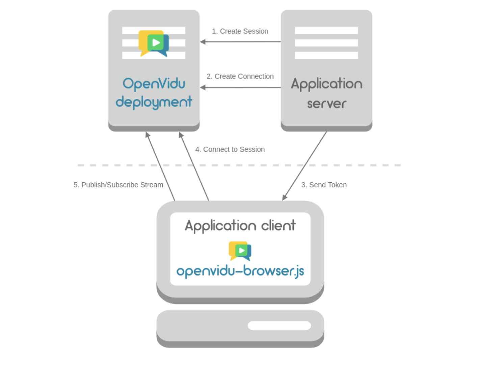
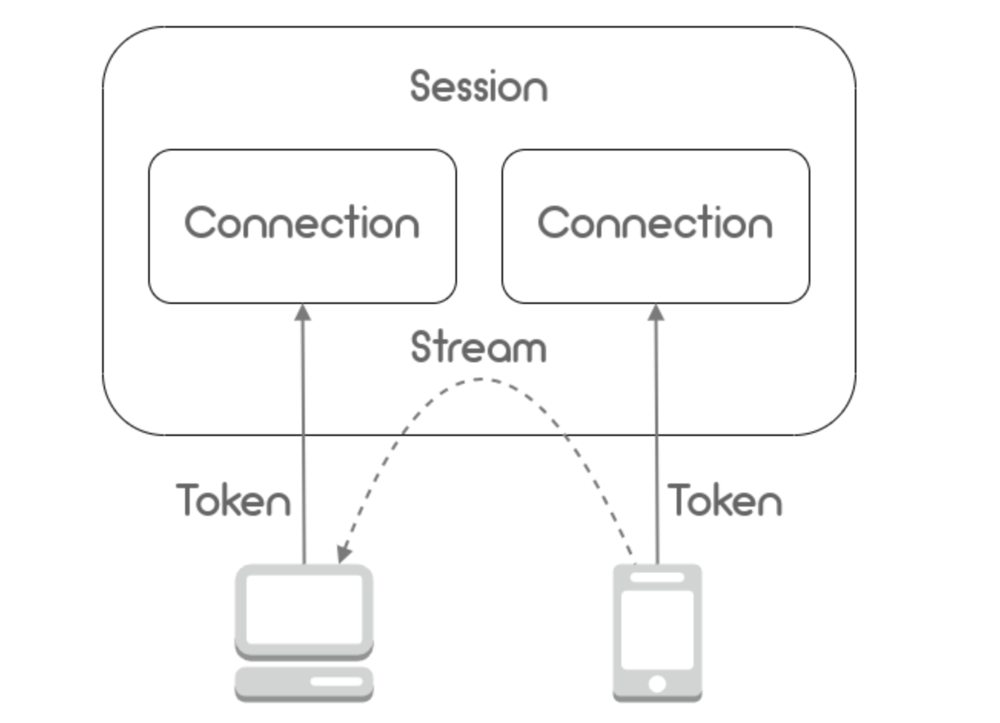
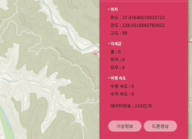
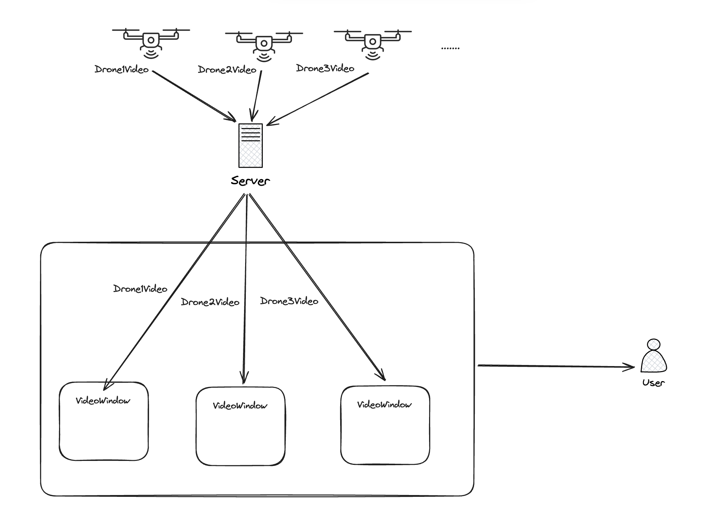
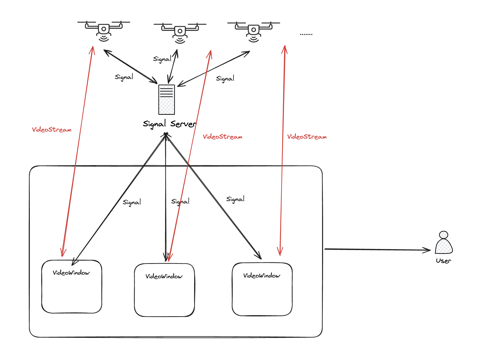

외주 개발을 진행했을 때 **드론 영상 컴포넌트**를 구현한 적이 있었다. 업체에서 요구한 요구사항은 아래와 같았다.
> 드론에서 찍힌 영상이 핸드폰에서 **OpenVidu플랫폼의 데모 서버**로 접속이 되고, 그 **영상 주소**를 담아 정보를 보내드릴 테니, 이것을 활용해서 **비디오 컴포넌트를 구현**해 주세요

OpenVidu를 왜 써야 했는지 **분석을 해보고 근거를 공유하고**, 실제로 OpenVidu를 활용해 데모 서버에서 비디오를 받아 비디오 컴포넌트를 구현했던 경험을 적고자 한다.

## OpenVidu

먼저 [OpenVidu홈페이지](https://docs.openvidu.io/en/2.29.0/)에 나온 OpenVidu의 소개 글을 요약하면 다음과 같다.

> OpenVidu는 웹과 모바일에서 영상 통화 기능을 통합할 수 있는 플랫폼입니다. 개발자가 빠르게 추가할 수 있도록 설계되었으며, 매우 적은 코드 변경으로 구현이 가능합니다. 주요 목표는 **개발 과정의 복잡성을 줄이면서도 효과적으로 기능을 통합**할 수 있게 하는 것입니다.

언급된 **영상 통화 기능**은 WebRTC기반의 비디오 회의이다.

 **WebRTC로 영상 통화 기능**을 구현할 때 어떠한 흐름으로 구현이 되는지를 알아야한다. 따라서 [라이브 스트리밍 서비스 구현](/posts/webrtc-live-streaming/)을 해보며 WebRTC의 통신 시나리오를 자세히 알게 되었고, 이것을 개발자가 간편하게 해준다는 의미이다.
 
 ### 1. 아키텍처
 
 

OpenVidu의 아키텍처는 위와 같다.

요약하면 

1. Server가 시그널링을 컨트롤 해주는 세션을 만들어준다.

2. Server에 **인증 토큰**을 받는다.

3. **토큰**을 사용해 사용자는 세션에 접속한다. 해당 세션에 시그널링을 주고받는다.


### 2. 비디오스트리밍 시나리오



3번의 과정을 도식화한 것은 위와 같다. 중요한 건 **토큰을 Server에 발급받고 연결요청을 할 수 있다.**

### 3. 데모서버는 뭐야?

위의 아키텍처에 보면 **Application Server**는 **클라우드 인프라를 이용**하거나, **온프레미스로 자체 서버에 구축**해야 한다. 그런데 OpenVidu에서 체험판으로 [Demo서버](https://demos.openvidu.io/openvidu-call/#/)을 제공해 주고 있다. Application Server의 영역을 체험판으로 소개했다. 드론과의 카메라 통신은 해당 데모 서버를 이용한다.

데모 버전의 URL을 살펴보면

```
https://demos.openvidu.io/openvidu-call/#/[세션 이름]
```

이렇게 되어있다. 즉, 드론에서 보내주는 **OpenVidu의 세션 주소를 통해 Server에서 토큰을 발급받고** 보내주는 주소에 **연결요청**을 진행한다.

즉 드론 소켓 서버에서 받은 해당 드론이 보낸 **OpenVidu URL**로 해야 하는 동작은 두 가지이다.

1. **토큰을 발급**받는다
2. 발급받은 토큰을 통해 **해당 Session에 접속해 스트림을 받는다.**


### 4. Client사용법

아키텍처에 보면 OpenVidu-broswer 모듈을 사용해 접속한다고 나와 있다. 따라서 OpenVidu-browser의 [문서](https://docs.openvidu.io/en/2.29.0/reference-docs/openvidu-browser/)와 [리액트 데모](https://github.com/OpenVidu/openvidu-call-react)를 살펴봤다.

우리가 해야 할 일은 **세션에 참여하는 것**이다. [공식 문서](https://docs.openvidu.io/en/2.29.0/cheatsheet/join-session/)에 보면 WebRTC 만들 때 시그널 이벤트의 이름을 정한것처럼, **OpenVidu에서도 자체적으로 시그널 이벤트를 정의를 했다.** 따라서 우리는 OpenVidu에서 정한 시그널에 이벤트 동작을 정의해줘야 한다.

## 요구사항 정리와 구현


_해당창을 구현해야한다_

여기서 우리가 구현해야 할 앱의 요구상황과 현재상황을 다시한번 살펴보자.

> 드론의 상태 창에서 "카메라 모양"버튼을 누르면 해당 드론이 촬영하고 있는 영상이 나오는 컴포넌트를 띄운다.

- 드론이 운용 중이라면 **이미 세션에 드론의 카메라를 송출하는 유저가 접속해 있다.**
- 촬영하고 있는 영상을 받으려면, 내가 해당 세션에 다른 유저로서 접속하고 **드론 카메라를 송출하는 유저의 화면만 컴포넌트에 붙여주면 된다.**
- 중간에 **네트워크 상태로 인해 드론의 카메라를 송출하는 유저가 접속을 종료할 수 있다.** 

이제 코드로 구현해야 할 것들을 요구사항과 아키텍처를 다시 확인해서 간단하게 정리해 보자.


1. 서버에 **세션을 요청**해 세션을 만든다. -세션이 없으면 서버에서 만들어주고 세션 이름을 반환해 주고 기존에 있다면 세션 이름만 반환해 준다.
2. 해당 세션 이름으로 **토큰을 요구**한다.
3. 모니터링 앱에서 **세션을 다루는 객체를 초기화**한다.
4. 세션 객체에 사전에 정의된 OpenVidu시그널 중 **streamCreated(누군가가 스트림이 연결될 때), streamDestroy(누군가가 스트림이 종료될 때)에 대한 동작을 정의**한다. => 서버에서 해당 이벤트를 받으면 정의된 동작을 진행한다.
5. 세션에 토큰을 이용해 **[Join](https://docs.openvidu.io/en/2.29.0/cheatsheet/join-session/)하고**
6. 연결된 스트림이 하나뿐이므로 그 **스트림을 비디오 컴포넌트에 붙여준다.**


### 나의 코드가 이상한데..?

리액트 데모를 살펴보며 작성한 코드에서 지금 다시 살펴보니 불필요한 과정을 진행하고 있었다. 아래의 코드처럼 모니터링 앱에서 해당 세션에 접속하면 **모니터링 앱에 연결된 음성, 카메라의 데이터를 스트림에 Publish 하는 과정**이 코드에 포함 되어있었다.

이것이 불필요하다고 판단된 이유는 브라우저에서 나의 카메라, 음성을 드론에 제공할 이유가 없기 때문에 Publish 과정이 필요가 없다. 그저 **우리는 스트림을 받기만 하면 될 뿐이다.**

```js
    getToken().then(token => {
      CurrentSession.connect(token, { clientData: myUserName })
        .then(async () => {
          const publish = await OV.initPublisherAsync(undefined, {
            audioSource: undefined, // The source of audio. If undefined default microphone
            videoSource: undefined, // The source of video. If undefined default webcam
            publishAudio: false, // Whether you want to start publishing with your audio unmuted or not
            publishVideo: undefined, // Whether you want to start publishing with your video enabled or not
            resolution: '640x480', // The resolution of your video
            frameRate: 30, // The frame rate of your video
            insertMode: 'APPEND', // How the video is inserted in the target element 'video-container'
            mirror: false, // Whether to mirror your local video or not
          });

          // --- 6) Publish your stream ---
          CurrentSession.publish(publish);
        })
        .catch(error => {
          console.error(
            'There was an error connecting to the session:',
            error.code,
            error.message,
          );
        });
    });
  };
```

따라서 리팩토링 과정에서 해당 코드를 삭제했다.

### 1. 세션만들기

데모 서버에 세션을 요청해준다. 데모 서버는 **URL로 제공되어있으므로 http 요청을 통해 진행한다.** [문서](https://docs.openvidu.io/en/2.29.0/reference-docs/REST-API/#post-session)

```js
  const createSession = async (sessionId: string) => {
    const sendURL = `${APPLICATION_SERVER_URL}api/sessions`;
    const res = await axios.post(
      sendURL,
      { customSessionId: sessionId },
      {
        headers: { 'Content-Type': 'application/json' },
      },
    );
    return res.data; // 세션 객체 반환
  };

```

### 토큰 요청하기

받은 세션 객체를 통해 해당 세션에 인증 토큰을 요청한다.

```js
  const createToken = async (sessionId: string) => {
    const sendURL = `${APPLICATION_SERVER_URL}api/sessions/${sessionId}/connections`;
    const response = await axios.post(
      sendURL,
      {},
      {
        headers: { 'Content-Type': 'application/json' },
      },
    );
    return response.data; // The token
  };

```

### 2. 세션 다루는 객체 초기화 후 이벤트 정의

[문서](https://docs.openvidu.io/en/2.29.0/cheatsheet/join-session/)에 보면 Join 과정 전에 세션 객체를 초기화하라고 나와 있다. 그리고 그 객체를 통해서 서버에서 이벤트를 받으면 동작을 정의할 수 있다.

다른 사람이 세션에 접속될 때 수신되는 **시그널을 통해 video 컴포넌트에 스트림을 mainStreamManager로 넣어준다.**

```js
  const initSession = () => {
    const OV = new OpenVidu();
    // --- 2) Init a session ---
    const CurrentSession = OV.initSession();
    // --- 3) Specify the actions when events take place in the session ---
    // 세션에 이미 연결된 다른사람을 발견할 때, 세션에 다른 사람이 연결 할 때 발생하는 이벤트.
    CurrentSession.on('streamCreated', event => {
      const subc = CurrentSession.subscribe(event.stream, undefined);
      setMainStreamManager(subc);
    });

    // 세션에 다른사람 카메라 연결이 끊어졌을 때 발생
    CurrentSession.on('streamDestroyed', () => {
      deleteSubscriber();
    });

    // On every asynchronous exception...
    CurrentSession.on('exception', exception => {
      // eslint-disable
      console.warn(exception);
    });
    return CurrentSession;
  };

```

### 3. Join

이전에 구현햇던 작업들을 합쳐서 token을 받아오고, session의 connect함수를 통해 join한다!

```js
  const joinSession = async () => {
    try {
      mySession.current = initSession();
      // --- 4) Connect to the session with a valid user token ---
      const sessionId = await createSession(sessionName);
      console.log(`${sessionId}에 연결합니다`);
      const token = await createToken(sessionId);
      await mySession.current.connect(token, { clientData: myUserName });
    } catch (e: any) {
      console.error(
        'There was an error connecting to the session:',
        e.code,
        e.message,
      );
    }
  };

```


## 내부 코드 살펴보기 - Connection과정

그런데 OpenVidu에서 제공하는 코드가 어떻게 WebRTC를 사용해 이전에 라이브스트리밍을 구현한 적이 있는데 그 흐름을 관리하고 모듈화했는지 궁금했다.

따라서 한번 살펴보았다. initSession() 에서 주로 OpenVidu의 모듈을 사용했으므로 이 함수를 뜯어본다.

```js
//    const OV = new OpenVidu();
//    const CurrentSession = OV.initSession();의 과정과 관련된 코드

 OpenVidu.prototype.initSession = function () {
     this.session = new Session_1.Session(this);
     return this.session;
 };

```

initSession 함수를 통해 Session 객체를 생성한다. Session 객체의 값을 초기화했지만, WebRTC에 무조건 사용되는 RTCPeerConnection는 생성되지 않았다.

RTCPeerConnection 객체는 Session 객체의 connect할 때 생성이된다.

```js
// await mySession.current.connect(token, {
//   clientData: myUserName 
//});

// node_modules/openvidu/session.js
...
_this.processJoinRoomResponse(response, token);
_this.connection = new Connection_1.Connection(_this, response);
...

// node_modules/openvidu/connection.js

Connection.prototype.addStream = function (stream) {
     stream.connection = this;
     this.stream = stream;
};
```

이때 생성되는 Connection객체가 Stream객체를 생성하고 Stream 객체는 RTCPeerConnection에 대한 정보를 담고 있다. 실제 구현부는 아래와 같다.

```js
this.pc = new RTCPeerConnection({ iceServers: this.configuration.iceServers });
this.pc.addEventListener('icecandidate', function (event) {
  if (event.candidate !== null) {
    // `RTCPeerConnectionIceEvent.candidate` is supposed to be an RTCIceCandidate:
    // https://w3c.github.io/webrtc-pc/#dom-rtcpeerconnectioniceevent-candidate
    //
    // But in practice, it is actually an RTCIceCandidateInit that can be used to
    // obtain a proper candidate, using the RTCIceCandidate constructor:
    // https://w3c.github.io/webrtc-pc/#dom-rtcicecandidate-constructor
    var candidateInit = event.candidate;
    var iceCandidate = new RTCIceCandidate(candidateInit);
    _this.configuration.onIceCandidate(iceCandidate);
    if (iceCandidate.candidate !== '') {
      _this.localCandidatesQueue.push(iceCandidate);
    }
  }
});


```

우리가 구현햇던 Connection 함수와 비슷한 구조로 되어있다. 물론 조금더 복잡하지만

- 이벤트 검증: null이면 처리 x
- 후보자 초기화: 후보자 정보를 사용하여 RTCIceCandidate 객체를 생성.
- 후보자 처리: 생성된 RTCIceCandidate 객체를 처리 함수(onIceCandidate)로 전달. 다른 피어에게 전송하여 연결을 시도하는 데 사용.
- 로컬 후보자 큐 저장: 유효한 후보자(candidate 속성이 비어 있지 않은 경우)를 로컬 큐에 저장.

이런 역활들을 한다. 즉, 우리가 구현했던 것과 같은 흐름으로 확인할 수 있다.

## 마무리

> 드론에서 찍힌 영상이 핸드폰에서 **OpenVidu플랫폼의 데모 서버**로 접속이 되고, 그 **영상 주소**를 담아 정보를 보내드릴테니, 이것을 활용해서 **비디오 컴포넌트를 구현**해주세요

이러한 요구사항 OpenVidu에서 제공되는 데모 서버를 활용하여 손쉽게 드론이 송출하는 화면을 모니터링 앱에 구현할 수 있었다.

사실 데모 서버와 OpenVidu를 사용하는 것은 업체와 우리 팀과 같이 합의했다. 해당 프로젝트는 **빠르고 간단하게 구현하는 게 목표**였고, 그에 따라 알아본 결과 OpenVidu라는 솔루션에서 데모 서버까지 제공된다는 것을 알았다.

 만약 Web-RTC와 OpenVidu를 활용하지 못했다면 아래와 같은 아키텍처로 구성을 해야할 것이다.
 
 
_비적용 아키텍처_


_적용 아키텍처_

**그러나 데모 서버를 통해 시그널링 서버를 따로 구현하지 않고 온전히 클라이언트 개발에 집중할 수 있었다** 아무튼 좋은 솔루션을 사용해 WebRTC를 손쉽게 구현할 수 있었다.
