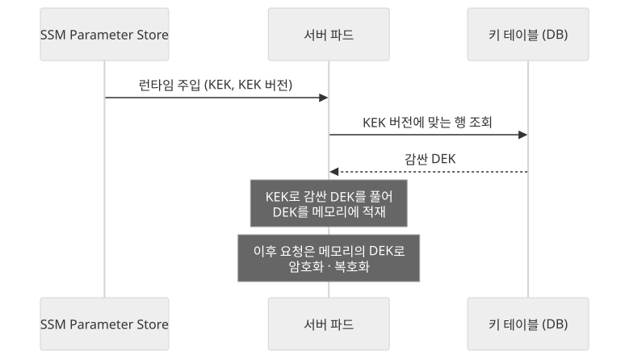
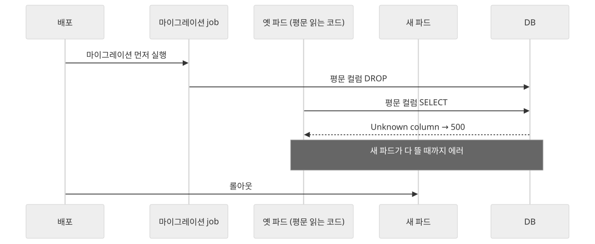

## 누군가는 해야 할 일을 맡았다

우리는 작은 서비스로 시작했지만 처음부터 건강 기록 같은 민감정보를 다루는 서비스였고 그 데이터를 DB에 평문으로 두고 있었다. 앱이 커지면서 민감정보를 암호화해서 저장해야 한다는 요구사항이 들어왔다.

맡고 있던 일이 따로 있었지만, 이건 누군가는 해야 할 일이었다. 나는 좋은 기회라고 생각했고 민감정보 암호화를 맡겠다고 했다. 조건은 하나, 서비스를 멈추지 않는 것.

먼저 Claude와 함께 어떻게 진행할지부터 정리했다. 암호화 컬럼을 추가하고 코드가 그 컬럼을 쓰게 바꾸고 한 주 지켜본 뒤 평문 컬럼을 지운다. 그걸 적어 놓고 이렇게 물었다.

> "이렇게 하는게 표준이라는거지?"

그리고 바로 문서로 남겨 달라고 했다. 이 작업을 한 컬럼에서 끝내지 않고 여러 테이블에 반복할 거라는 걸 알고 있었기 때문이다.

정리한 흐름은 인프라 업무를 주로 맡고 있는 동료에게 들고 가서 조언을 구했다. 흐름을 먼저 설명했고, 동료는 괜찮다고 했다. 다만 정말 핵심은 키 관리일 것 같으니 그 부분도 같이 조사해 보면 좋겠다고 조언해 주었다. 그렇게 처음 작업 순서를 정했다.

```text
0. 영향도 조사         값으로 검색하는 코드가 있는지 (있으면 그 컬럼은 암호화 대상에서 뺀다)
1. 암호문용 컬럼 추가   (~~Crypto)
2. dual-write        평문과 암호문을 같이 쓴다
3. 백필               기존 행의 암호문 컬럼을 채운다
4. dual-read         암호문을 우선으로 읽는다 (그리고 한 주 관찰)
5. 평문 제거           평문 쓰기를 멈추고 평문 컬럼을 지운다
```




이제 남은 건 암호화 키를 어떻게 관리하고 암호화 알고리즘은 무엇으로 할지 같은 부분이었다. 양방향 암호화를 해야 하는데 어떤 방식이 좋을까.

알고리즘은 오래 고민하지 않고 가장 대중적인 AES-256-GCM으로 정했다. 널리 쓰이고 검증된 알고리즘이라면 어느 것을 골라도 충분히 안전하다고 생각했다. 알고리즘이 뚫려서 데이터가 새는 일보다, 키를 허술하게 다뤄서 새는 일이 훨씬 현실적이었다.

키는 달랐다. 우리는 데이터 암호화에 많은 인력을 쓸 수 있는 조직이 아니었으니, 우선 가장 단순한 방식으로 접근했다. 내가 처음 생각한 건 DEK(Data Encryption Key) 하나로 관리하는 방식이었다.

키 하나를 만들어 서버만 알게 두고 그 키로 암호화도 복호화도 한다. 예를 들어 `abc123`이라는 키로 "몸무게 34"를 `asdfjkasdnfcd`로 바꿔 저장하고, 읽을 때는 같은 `abc123`으로 다시 "몸무게 34"로 되돌린다. 키도 하나, 규칙도 하나라 구현도 관리도 가장 가볍다.

## 키 하나로는 키를 바꿀 수 없다

그런데 이 방식의 문제는 키 교체였다. 만약 키를 아는 담당자가 퇴사한다면? 키가 유출된 흔적이 보인다면? 그때마다 암호화된 데이터를 전부 옛 키로 복호화하고 새 키로 다시 암호화해서 넣어야 한다. 데이터가 쌓일수록 이건 말이 안 되는 작업이 된다. 당시 남긴 메모에도 그 생각이 그대로 있다.

> "DEK는 회전주지않아 - > 데이터복호화후암호화의 리소스가 너무커서"

인프라를 맡던 동료에게 조언을 구하면서 이런 생각을 하게 됐다. DEK를 KEK(Key Encryption Key)로 한 번 더 감싸는 봉투 암호화(envelope encryption)를 쓰고 키 교체는 KEK만 하는 것이다. 그러면 KEK가 유출되더라도 KEK 한 번만 바꾸면 되지 않을까.

우리는 작은 조직이라 보안만 전담하는 사람이 없었다. 키를 누가 계속 들여다보고 관리해 줄 수 없다면, 키 로테이션까지 감당하면서도 관리 비용이 가장 적게 드는 쪽이어야 했다. KEK가 새어 나갔을 때 데이터는 건드리지 않고 KEK 하나만 바꾸면 되는 구조가 그 조건에 맞았다.

- **DEK**: 실제 데이터를 암호화하는 키. 한 번 만들면 바꾸지 않는다.
- **KEK**: DEK를 암호화하는 키. 바꿀 일이 생기면 이것만 바꾼다.

앞의 예에서 `abc123`(DEK)을 그대로 두지 않고 `kek123`이라는 KEK로 한 번 더 암호화해 둔다. 데이터를 읽으려면 두 번 풀어야 한다. KEK로 DEK를 풀고 그 DEK로 데이터를 푼다.




따라서 키를 관리할 테이블을 하나 만들고 아래와 같이 정리했다.

### 처음 키를 만들 때

스크립트 하나로 처음 키를 만든다.

1. 스크립트가 DEK(`abc123`)와 KEK(`kek123`)를 둘 다 생성한다.
2. DEK를 KEK로 암호화한다. 결과가 `qweqwe`라면 이게 "감싼 DEK"다.
3. DEK의 해시값을 구해 둔다. 나중에 풀어 낸 DEK가 원래 그 키가 맞는지 대조하는 용도다.
4. 키 테이블에는 `qweqwe`, 해시값, KEK 버전 `1`만 저장한다. (아래 "KEK가 새어 나갔다면"의 표 첫 행)
5. KEK는 DB에 저장하지 않는다. 스크립트가 끝나며 콘솔에 한 번만 보여 주고 그 값을 서버 파드에 환경변수(KEK, KEK 버전)로 런타임에 주입한다.

결과적으로 원본 DEK는 DB에도, 환경변수에도 없다. DB만 털려서는 감싼 DEK밖에 못 얻고, 환경변수만 새어도 데이터가 DB에 있으니 바로 풀 수 없다.

### 서버가 켜질 때

DEK를 푸는 건 서버 파드 안에서, 런타임에 주입된 환경변수의 KEK로 한다.

1. 환경변수의 KEK 버전으로 키 테이블에서 그 버전의 행을 고른다.
2. 환경변수의 KEK로 감싼 DEK를 푼다.
3. 풀어 낸 DEK를 메모리에 들고 있다.

그 뒤로 복호화가 필요한 API는 부팅 때 올려 둔 이 DEK를 쓴다.




### KEK가 새어 나갔다면

이 절차도 그때그때 손으로 하지 않도록 재생성 스크립트로 만들어 두었다. 스크립트가 1~4번을 처리하고, 사람은 새 KEK를 받아 5번만 하면 된다.

1. 새 KEK(`kek124`)를 만든다.
2. 지금 KEK(`kek123`)로 감싼 DEK를 풀어 `abc123`을 꺼낸다.
3. 같은 `abc123`을 새 KEK로 다시 감싼다. 결과가 `werwer`다.
4. 키 테이블에 버전을 올린 새 행을 추가한다. DEK 해시는 같은 키라서 모든 행이 똑같다.
5. 환경변수를 새 KEK, 새 버전으로 바꾼다.

```text
| 감싼 DEK | DEK 해시 | KEK 버전 |
|----------|----------|----------|
| qweqwe   | (해시)   | 1        |
| werwer   | (해시)   | 2        |   ← 추가

DATA_ENCRYPTION_KEK         = kek124
DATA_ENCRYPTION_KEK_VERSION = 2
```

데이터 쪽은 한 행도 건드리지 않는다. 다시 암호화하는 건 DEK 하나뿐이다.

옛 행(`qweqwe`)은 지우지 않고 남겨 두었다. 그때 가장 신경 쓴 건 "이 과정에서 우리가 실수해서 데이터가 날아가면 어떻게 하지?"였다. 교체 중에 무언가 잘못돼도 옛 행이 있으면 옛 KEK로 DEK를 다시 꺼낼 수 있다. 대신 옛 KEK가 정말 새어 나간 거라면, 이 행이 남아 있는 동안은 그 KEK로도 DEK를 풀 수 있다는 점은 감수했다.

물론 이 구조가 모든 유출을 막아 주지는 않는다. KEK만 새었다면 KEK 교체로 끝나지만, KEK와 DB가 함께 새면 감싼 DEK를 풀어 DEK 자체를 얻을 수 있다. 그때는 결국 DEK를 새로 만들고 데이터를 전부 다시 암호화해야 한다. 이 경우까지 고려하면 구조가 훨씬 복잡해지는데, 암호화 작업을 오래 붙잡고 있을 수 없는 팀 입장에서는 고민이 많이 됐다. 그래서 이 구조로는 "KEK만 샌 경우"까지 막기로 하고, DB까지 함께 새는 경우는 DEK를 다시 만드는 무거운 길이 남아 있다는 걸 알고 가기로 했다. DB와 키가 함께 새는 건 그 자체로 아주 큰 사고라, 이 구조의 범위 밖으로 두었다. 이렇게 정한 키 처리 방식은 문서로 정리해 인프라 동료의 검토를 받았다.




돌아보면 키를 두 겹으로 나눈 이 선택도 이 글 전체를 관통하는 걱정에서 나왔다. 키가 하나뿐이면, 키를 바꿀 때마다 라이브 DB의 암호화된 데이터를 전부 꺼내 풀고 다시 암호화해서 써 넣어야 한다. 그것도 한 번이 아니다. 담당자가 바뀔 때마다, 유출이 의심될 때마다 해야 한다. 라이브 DB에 가장 무거운 작업을 언제 다시 해야 할지 모르는 채로 안고 가는 것이다. 봉투 암호화에서는 키를 바꿔도 다시 암호화하는 건 DEK 한 줄뿐이라, 라이브 데이터에는 부하가 가지 않는다.

키를 어디에 두고 어떻게 꺼낼지도 동료와 몇 번 더 이야기했다. 처음엔 AWS KMS(Key Management Service)를 쓰는 그림도 있었다. 키를 클라우드가 대신 보관해 주니 가장 정석적인 선택이다. KEK 자리에 KMS를 두고 부팅할 때 KMS를 불러 DEK를 푸는 식이다.

하지만 그러려면 서버 파드에 KMS 권한(IAM)을 붙이고 부팅 때 KMS를 부르는 경로를 새로 깔아야 했다. 우리에게는 이미 쓰고 있는 길이 있었다. 설정값을 AWS SSM Parameter Store에 넣어 두고 서버 파드에 환경변수로 런타임에 주입하는 길이다. 새 경로를 까는 것보다 그 위에 KEK 하나를 얹는 게 훨씬 단순했다. 그래서 KEK는 SSM에 `SecureString`으로 넣고 다른 설정값과 똑같이 환경변수로 주입했다. `SecureString` 자체가 KMS로 암호화되니 KMS를 아예 버린 건 아니다. KEK를 보관하는 자리에만 썼다.

마지막으로 정할 건 KEK를 처음 만들 때 그 값을 누가, 어떻게 받아 SSM에 넣느냐였다. KEK는 DB에 저장하지 않으니, 만들어지는 순간 사람이 한 번은 받아 적어야 한다. 두 가지 안이 있었다.

- **관리 도구에서 버튼으로**: 사내 관리 도구에서 API를 호출하면 서버가 KEK를 만들고 응답으로 돌려준 값을 화면에 한 번만 보여 준다.
- **서버에서 스크립트로**: 서버에 직접 접속해 생성 스크립트를 돌리고 터미널에 찍힌 KEK를 그대로 옮겨 적는다.

첫 번째가 더 편해 보이지만, KEK는 애초에 밖으로 드러나면 안 되는 값이다. 그런 값이 서버를 떠나 여러 네트워크 경로를 거쳐 브라우저 화면에 뜬다는 것 자체가 위험하다고 판단했다. 두 번째는 서버 접속 권한이 있는 사람의 터미널에만 키가 나타난다. 그래서 "안전하고 단순한 방법"으로 두 번째를 골랐다.

이렇게 서버가 켜질 때 메모리에 DEK를 적재해 두면서 암호화할 준비가 끝났다.

## 배포했더니 전부 암호화됐다

사실 여기까지 오는 길이 처음부터 이랬던 건 아니다. 처음엔 키 하나로 시작했다. 일정 주기로 키를 바꾸는 로테이션은 개발 소요가 있어서 우선은 하지 않기로 했고 백필도 마이그레이션 파일로 만들었다. 배포하면 마이그레이션이 돌면서 그때 들어 있던 키로 데이터를 채우는 구조였다.

그러다 중간에 실수를 했다. 키 값을 환경변수가 아니라 설정 파일에 직접 박아 넣었고 결국 키를 새로 갱신해야 하는 상황이 됐다. 키 교체 문제 때문에 키 방식을 봉투 암호화로 바꾸기로 한 것도 이즈음이다. 그런데 개발 서버는 이미 배포와 함께 백필이 돌아, 곧 버릴 키로 데이터가 전부 암호화돼 있었다.


다음 화요일 정기 배포에선 라이브에서도 같은 마이그레이션이 돌 예정이었다. 꽤 당황했다. 이 일을 어떻게 할지 인프라 담당 동료와 이야기했고, 결론은 단순했다. 암호화 데이터는 배포와 상관없이 우리가 원하는 타이밍에 백필돼야 한다. 처음에 마이그레이션으로 백필하기로 한 건 내가 임의로 판단한 것이었는데, 이걸 백필 스크립트로 바꾸기로 했다. 키를 만들어 환경변수로 주입한 다음 우리가 직접 스크립트를 돌리는 시점에 암호화 컬럼을 채우는 방식이다. 문제는 그 마이그레이션이 개발 서버에서는 이미 돌았다는 것이다. 그래서 파일은 지우지 않고 본문만 주석 처리해 라이브 배포 때는 아무것도 하지 않고 지나가게 했고, 개발 서버에 잘못 채워진 컬럼은 새 마이그레이션으로 비웠다.




라이브는 그렇게 배포만 먼저 나갔고, 암호화 컬럼은 나중에 백필 스크립트를 돌려 채웠다. 그게 아래에 쓴 첫 라이브 백필이다. 그 뒤로 규칙이 하나 생겼다. **백필은 마이그레이션에 넣지 않는다.**

## "백필 실행 중에 서버가 죽으면 어떻게 하지?"

백필 스크립트는 내가 검증했고 하는 일도 비어 있는 암호화 컬럼을 채우는 것뿐이어서 데이터가 사라질 걱정은 하지 않았다. 무서웠던 건 라이브 서버가 부하를 받아 멈추는 것이었다.

여름에 라이브에서 처음 백필을 돌렸을 때 거의 5분이 걸렸다. 미리 Claude에게 물어봤을 땐 이 암호화 방식은 부하가 크지 않다는 답을 들었는데, 라이브는 데이터가 많았다. 그날 팀에 "다음엔 부하 정도도 체크해 봐야겠다"고 남겼고 메모리 점유율이 크게 오르는 걸 대비해 200개씩 나눠 돌리게 바꿨다.


나중에 LLM 응답을 캐시하는 테이블을 옮길 때는 200도 믿지 않았다. 그 테이블은 행 하나에 긴 JSON이 들어 있었다.

> "메모리가 부족하지 않을까? 쿼리를 말해주면 내가 라이브db에 입력한결과를 알려줄게"

라이브 DB에서 행 크기를 직접 재 보고 한 번에 20행씩으로 줄였다. 이때 알았다. 배치 크기를 "몇 개씩"으로 세던 게 틀렸다. "한 번에 메모리에 얼마나 올라가나"로 정해야 한다. 같은 이유로 **서비스 중인 파드 안에서 백필을 돌리지 않는다**는 규칙도 생겼다. 그 파드의 메모리 한도를 백필이 같이 쓰면 백필보다 서비스가 먼저 멈춘다.

<!-- 📷 사진 6: 라이브 백필 터미널 로그 캡처 — 배치 단위 진행 로그("N행 처리 (lastId=…)"). ⚠️ 클러스터 컨텍스트·네임스페이스·계정 정보는 가림 -->


## "왜 따로 안 하지?"에서 나온 함정

평문 컬럼을 지울 차례가 됐다. 내 계획은 단순했다. 코드에서 평문 컬럼을 쓰는 곳을 모두 지워 참조를 0으로 만들고, 같은 배포에 DROP 마이그레이션까지 넣어 라이브에 한 번에 내보내는 것이었다. 참조가 0이니 컬럼을 지워도 문제없다고 생각했다.


그런데 AI는 DROP 마이그레이션만 따로 미뤄 두었다. 이유가 궁금해서 물었다.

> "왜 평문컬럼 삭제 마이그레이션은 따로 안하지?"

돌아온 답은 내가 놓친 배포 순서였다. 우리 서버는 롤링 업데이트로 배포된다. 옛 파드를 한 번에 내리지 않고, 새 파드가 하나씩 뜨는 동안 옛 파드가 계속 요청을 받는다. 그리고 마이그레이션은 새 파드가 뜨기 전에 먼저 돈다. 같은 배포에 DROP을 넣으면 이렇게 된다.

1. 배포가 시작되면 마이그레이션이 먼저 돌아 평문 컬럼을 지운다.
2. 새 파드가 다 뜰 때까지 옛 파드는 평문 컬럼을 읽는 옛 코드로 요청을 받는다.
3. 옛 파드가 없는 컬럼을 찾다가 500을 낸다.

새 코드에서 참조가 0이어도, 배포가 끝나기 전까지는 옛 코드가 살아 있다. 롤링 업데이트가 도는 짧은 순간이지만 그동안 에러가 난다. 그래서 코드 정리와 DROP은 따로 내라는 권고였다.




이미 한 번 평문을 지운 적이 있었는데도 이걸 몰랐다. 그때 깨지지 않은 건 쓰기 중단과 DROP이 우연히 다른 배포로 나갔기 때문이었다. 그대로 따라갔다면 다음 DROP에서 만났을 것이다. 그래서 **평문 쓰기 중단과 DROP은 다른 배포(release)로 낸다**는 규칙이 붙었다. 처음 순서표에서 한 단계로 묶여 있던 "평문 제거"가 둘로 쪼개졌고, 순서표는 최종적으로 이렇게 바뀌었다.

```text
0. 영향도 조사         값으로 검색하는 코드가 있는지 (있으면 그 컬럼은 암호화 대상에서 뺀다)
1. 암호문용 컬럼 추가   (~~Crypto)
2. dual-write        평문과 암호문을 같이 쓴다
3. 백필               기존 행의 암호문 컬럼을 채운다
4. dual-read         암호문을 우선으로 읽는다 (그리고 한 주 관찰)
5. 쓰기 중단           평문 쓰기를 멈춘다
6. DROP              평문 컬럼을 지운다
```

0번은 시작 전 조사라, 실제로 평문을 암호문으로 바꾸는 건 1~6의 여섯 단계다.

## 회차를 거듭할수록 가드레일이 촘촘해졌다

그 뒤로는 테이블마다 같은 틀을 복제했다. 계획 문서를 같은 형식으로 쓰고 PR 하나가 배포 하나가 되게 했다. 남은 테이블이 여럿이었지만 "전부 동시에 하기엔 리스크"라고 보고 묶음으로 나눴다.

순서는 처음 며칠 만에 거의 정해졌다. 대신 테이블을 한 번 옮길 때마다 가드레일이 한 줄씩 늘었다. 한 회차에서 부딪힌 일은 다음 회차의 가드레일이 됐고 회차를 거듭할수록 그 간격이 촘촘해졌다.

| 가드레일 | 어디서 생겼나 |
|---|---|
| 값으로 검색하는 컬럼은 통째로 암호화하지 않는다 | "`IS NOT NULL` 검색이 있어서 전체 암호화를 하면 안 될 텐데" |
| 평문이 필요할 때 raw 쿼리로 읽지 않는다 | ORM getter를 건너뛰면 암호문(`v1:...`)이 그대로 나온다 |
| 백필을 마이그레이션에 넣지 않는다 | 키를 바꿨더니 배포 순간 전부 암호화됨 |
| 백필은 dual-write가 라이브에 깔린 뒤에만 | 백필 뒤에 들어온 행이 암호문 없이 남지 않게 |
| 서비스 중인 파드에서 백필하지 않는다 | 메모리 한도를 서비스와 같이 씀 |
| 배치 크기는 행 크기를 재고 정한다 | 라이브 백필 5분, 행 하나가 무거운 테이블 |
| 쓰기 중단과 DROP은 다른 배포 | 옛 파드가 없는 컬럼을 읽다 500 |

<!-- 📷 사진 8: 암호화 검증 화면 캡처 — 백필 후 모든 값이 암호문 형식인지·복호화되는지 확인하는 관리 도구 화면. ⚠️ 도구 이름·URL·테이블명·실제 값은 가림 -->

이 가드레일은 전부 내가 당황했거나, 불안해서 한 번 더 물어본 자리에서 생겼다. 순서는 문서 몇 개만 봐도 알 수 있다. 하지만 "이건 같이 내면 안 된다", "이건 이 뒤에만 된다"는 우리 배포 방식과 우리 데이터 크기를 겪어야만 생긴다. 그래서 다음 테이블로 그대로 가져갈 수 있었던 것도 순서표가 아니라 이 가드레일이었다.

## 확신은 혼자 만들지 않았다

최근에는 라이브 백필을 남에게 부탁하지 않고 직접 돌릴 수 있게 권한을 받았다. 반복 작업이니 자동화 워크플로로 만들까도 생각했지만, 한 달 남짓이면 끝날 작업이라 수동으로 두기로 했다. 그래도 매번 백필 직전에는 긴장된다. 가드레일이 쌓였다고 라이브가 덜 무서워지지는 않았다.


처음 일을 시작했을 때 가장 많이 한 고민은 "내 코드에 어떻게 확신을 가질까"였다. 경험이 쌓이면서 알게 된 답은 세 가지였다. 테스트, 가드레일, 그리고 협업. 이번 일에서 테스트는 백필 스크립트를 개발 서버에서 먼저 돌려 확인한 뒤에야 라이브 실행을 요청한 것이었다.

작은 팀이라 그동안은 혼자 결정하고 혼자 책임져야 하는 일이 많았다. 이번 일은 달랐다. 처음 흐름을 짤 때부터 인프라를 맡은 동료와 크로스체크하며 진행했다. "핵심은 키 관리일 것 같다"는 한마디 덕분에 가장 중요한 키 관리에 집중할 수 있었고 키를 설정 파일에 박아 넣는 실수를 했을 때도 혼자 수습하지 않고 같이 고민했다. "백필은 우리가 원하는 타이밍에 돌린다"는 원칙은 그 자리에서 나왔다.

돌아보면 가장 아팠던 건 배포와 함께 백필이 돌아 개발 서버 데이터가 곧 버릴 키로 전부 암호화돼 버린 일이다. 그 일로 남은 생각은 이렇다. 언제나 원상복구할 준비를 해야 하고, 되돌릴 수 없는 작업은 신중하게 해야 한다. 키를 바꾸고도 옛 행을 지우지 않은 것도 같은 이유였고 평문 컬럼 DROP처럼 되돌릴 수 없는 단계는 따로 떼어 냈다. 라이브 앞에서 나를 붙잡아 준 가드레일은 같이 봐 주는 사람이 있었기에 더 빨리, 더 촘촘하게 세워질 수 있었다.
