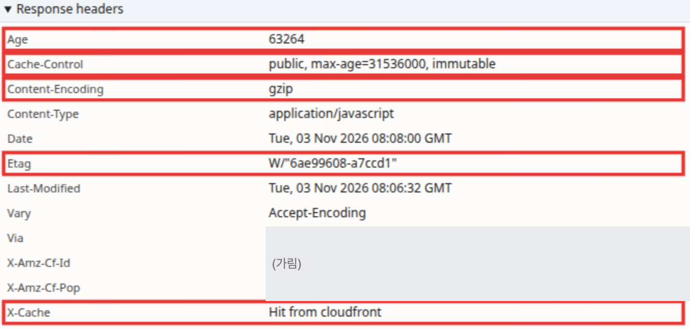
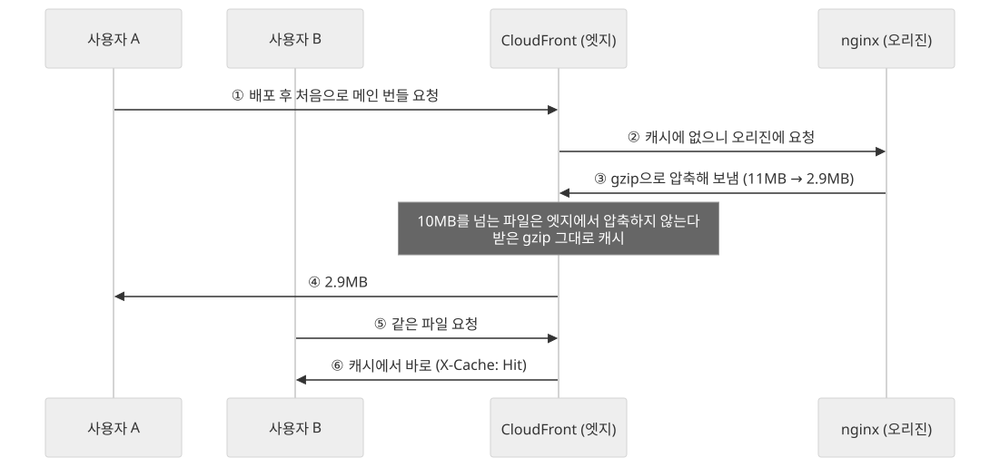
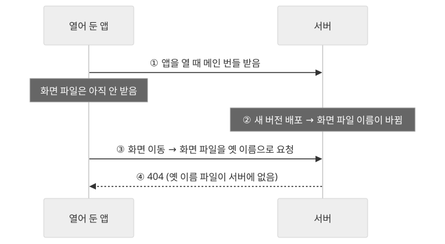
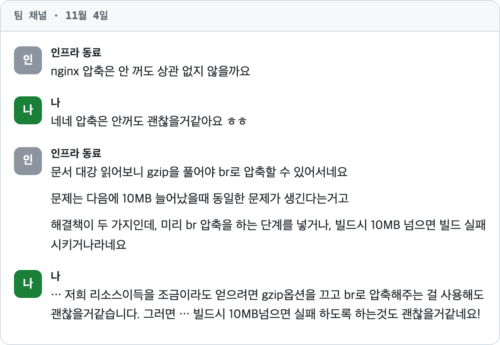
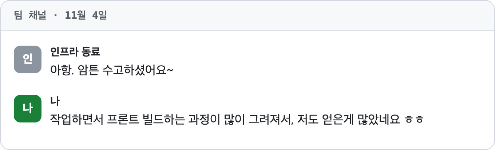

티켓 제목은 이랬다. **"프론트 파일 10MB 초과로 CloudFront 캐시 제외 현상 해소를 위한 페이지 단위 코드 스플리팅 적용."**

전날 인프라를 맡은 동료가 팀 채널에 메인 번들이 10MB를 넘었다고 알렸고 나는 "코드 스플릿은 우선 간단하게 페이지(라우트) 단위로만 적용해 볼까 한다, 하루이틀 걸릴 것 같다"고 답해 둔 상태였다. 할 일도 정해져 있었고 방법도 정해져 있었다.

그런데 작업을 시작하면서 코드보다 질문이 먼저 들었다.

## 캐시가 실패했다는 건 어떻게 알지

> 근데 나 궁금한 게, 이게 CloudFront 캐시랑 어떤 연관이 있지? 1번, 캐시가 실패했다는 건 어떻게 알 수 있지? 2번, 그렇다면 코드 스플리팅을 하면 경로마다 캐시가 가능한가?

우리 앱은 SPA라서 어느 경로로 들어오든 같은 `index-xxx.js`(이하 메인 번들)를 받는다. 이 파일이 10MB를 넘어서 캐시가 안 된다면 모든 사용자가 매번 오리진(CloudFront 뒤에 있는 우리 nginx 서버)까지 간다는 얘기다. 그게 사실이면 꽤 큰 문제였는데, 확인해 본 적은 없었다.

그래서 운영 환경(live)에 접속해 개발자 도구로 메인 번들 응답을 직접 열어 봤다.



- `X-Cache: Hit` — **캐시는 되고 있었다.**
- `Content-Encoding: gzip`, 11MB 파일이 약 2.86MB로 전송됐다.
- `ETag`가 nginx 형식이었다. 압축한 주체는 CloudFront가 아니라 **오리진의 nginx**였다.

알고 보니 CloudFront의 자동 압축은 1KB~10MB 파일에만 걸린다. 10MB를 넘은 메인 번들은 엣지(사용자 가까이에서 응답하는 CloudFront 서버)에서 압축되지 않았고 동료는 그 대응으로 nginx에서 gzip을 켜 둔 것이었다. 동료가 처음 쓴 말도 "10MB 넘어서 **자동 압축**을 안 해 준다"였다. "캐시 제외"는 티켓으로 옮기면서 생긴 오기였다.

솔직히 이때 나는 nginx가 파일을 그대로 서빙만 하는 줄 알았다. 우리 프론트 서버는 쿠버네티스 파드에 뜬 nginx인데, 배포 후 첫 요청만 이 파드를 거치고 나머지는 CloudFront가 캐시해 둔 걸 보낸다고 알고 있었다. 그러니 nginx가 하는 일은 빌드된 파일을 CloudFront에 한 번 건네주는 것뿐이라고 생각했다. 압축까지 해서 보내 준다는 건 이번에 처음 알았다.

## 내가 이해한 걸 소리 내서 읊어 봤다

헤더 몇 개 보고 "아 그렇구나" 하고 넘어가면 나중에 다시 헷갈릴 것 같았다. 그래서 내가 이해한 흐름을 처음부터 말로 풀어 봤다.

> 빌드하면 index-xxx.js가 11MB쯤 된다. A 사용자가 배포 후 처음 요청하면 nginx가 이걸 주고, CloudFront는 11MB짜리를 받아 캐시하고 A에게 보낸다. 이후 B 사용자는 CloudFront 캐시에서 받으니까 nginx까지 안 간다.

여기까지는 맞았다. 틀린 건 그다음이었다. 나는 티켓 문구대로 "캐시가 안 되니까 모든 요청이 nginx까지 간다"를 문제로 이해하고 있었다. 동료가 걱정한 건 따로 있었다. nginx gzip을 켜기 전에는 **압축이 안 된 11MB가 그대로 캐시되고 모든 사용자가 그 11MB를 받고 있었다.**



처음 내 관점, 그러니까 티켓대로 모든 요청이 파드까지 가는 게 문제라고 보던 관점에서는 코드 스플리팅이 굳이 필요해 보이지 않았다. 압축은 이미 nginx가 하고 있었으니까. 그래서 이렇게 물었다.

> 근데 이런 관점이면 번들링이 굳이 필요한 느낌은 아니네? nginx에서 압축하나 엣지에서 압축하나, 어차피 브라우저에서 압축 푸는 건 똑같은 거 아님?

지금은 nginx gzip이 켜져 있으니 당장 전송량 문제는 없다. 그럼 코드 스플리팅으로 얻는 게 뭘까. 따져 보니 이유는 "10MB 미만"이 아니었다.

- **첫 방문 전송량과 파싱 시간.** 신규 사용자는 첫 화면에 필요 없는 코드까지 전부 받고 실행한다.
- **압축을 원래 자리로 돌리기.** 모든 파일이 10MB 아래로 내려가면 nginx의 임시 gzip을 걷고 CloudFront 엣지 압축(br)으로 돌아갈 수 있다.

마지막 항목은 사실 미묘한 차이다. 선택지는 여럿 있었다. nginx gzip을 그대로 두면 당장은 아무 문제가 없고 동료도 "nginx 압축은 안 꺼도 상관없지 않을까요"라고 했다. AI는 오리진에서 압축하는 방법이나 CloudFront 엣지 함수를 쓰는 방법을 제안했다. 다 합리적인 선택지였다.

나는 여기에 판단 하나를 붙였다. **같은 압축이라면 nginx 파드의 CPU를 쓰는 것보다 CloudFront의 자원을 쓰는 게 조금이라도 이득이다.** 동료와 맞춘 지점도 이 정도였다. 실측한 건 아니고, 솔직히 너무 미묘해서 의미가 크지는 않다. 다만 CloudFront가 기본으로 해 주는 압축을 굳이 안 쓸 이유도 없었다. 급하게 넣은 임시 설정을 계속 들고 가지 않아도 되고 압축을 CDN 한 곳에서 관리할 수 있다. 덤으로 "br이 gzip보다 압축률이 좋다"고 알고 있었으니 전송량도 조금 줄 거라고 기대했다.

작업은 그대로 하기로 했다. 다만 목표를 "10MB 미만"에서 **"캐시 단위를 쪼개 첫 진입 비용을 줄이고 압축을 엣지로 돌린다"**로 다시 적었다.

## 쪼개려던 메뉴는 다 합쳐 0.16MB였다

원래 계획대로 페이지 단위 `route.lazy`(화면 코드를 그 화면에 들어갈 때 따로 받게 하는 React Router 기능)를 적용하려고 확인할 항목을 뽑아 보니 19개가 나왔다. 언어를 바꿀 때 번역이 제대로 바뀌는지, 카카오톡 공유 링크처럼 깊은 경로로 바로 들어와도 괜찮은지, 앱을 열어 둔 채 배포되면 옛 청크가 404가 나지 않는지(앱을 켜 둔 채 배포를 맞으면, 아직 안 받은 화면 파일을 옛 이름으로 찾다가 서버에 없어서 실패하는 문제).



> 야 근데 보니까 엄청 깨질 수 있는 거 같은데, 별로 추천 안 하는 변경이냐? 생각보다 많이 깨질 수 있는 거 같아서.

그러자 동료가 소스맵으로 실제 어떤 코드가 빌드 결과물 용량을 차지하는지부터 살펴보자고 제안했다. 빌드할 때 소스맵을 함께 뽑는 옵션(`build.sourcemap`)을 켜고, 그 소스맵으로 번들 구성을 HTML로 그려 열어 봤더니 이랬다.

| 묶음 | 크기 |
|---|---|
| 외부 라이브러리 (react, MUI, 차트, PDF 생성, 전화번호 검증 등) | **5.13MB (52%)** |
| 건강 기록 / 습관 화면 | 0.89MB / 0.42MB |
| **원래 1차로 쪼개려던 메뉴 4개 합계** | **약 0.16MB** |

계획서에 "2.6MB"라고 적혀 있던 메뉴들은 이미지와 테스트까지 포함한 소스 폴더 크기였고 minify된 실제 코드는 0.16MB였다. 1차를 다 해도 메인 번들은 2%밖에 안 줄고 배포 중 옛 청크 404 같은 위험은 첫 단계부터 그대로 진다. **위험은 다 지고 효과는 거의 없는 구성**이었다.

페이지 단위가 효과가 없다는 뜻은 아니었다. 무거운 건 대부분 특정 화면만 쓰는 라이브러리라서, 그 화면을 떼면 라이브러리도 같이 빠진다. 기준을 **"어느 메뉴냐"에서 "무엇을 끌고 오느냐"**로 바꿔야 했다.

## 순서를 바꿨다: vendor부터

조건은 하나 걸었다. **기존 동작에 영향이 적어야 한다.** 그래서 위험이 작은 것부터 순서를 다시 짰다.

1. **vendor 분리** — `manualChunks`로 앱 시작에 필요한 라이브러리를 별도 파일로 묶는다. 화면 코드를 언제 받는지는 그대로이고 파일만 나뉜다. 앱을 열 때 둘 다 받으니 옛 청크 404도 생기지 않는다.
2. **버튼을 누를 때 라이브러리 받기** — PDF 생성, 화면 캡처처럼 특정 버튼에서만 쓰는 라이브러리는 그 시점에 `import()`.
3. **무거운 화면만 lazy** — 차트 라이브러리를 끌고 오는 화면만 `route.lazy`.

1단계에서 `node_modules`를 통째로 vendor에 넣지 않은 게 핵심이었다. 그러면 차트·PDF 라이브러리까지 시작 청크에 들어가서 2·3단계의 효과가 사라진다. 그래서 **엔트리에서 정적 import로 닿는 라이브러리만** vendor로 보내는 규칙을 넣었다.

```js
// Vite 5(Rollup) 기준. 실제 코드에서 스타일 파일 필터와 헬퍼 처리는 줄였다.

// 엔트리에서 정적 import로 닿는 모듈인지 (동적 import로만 쓰이는 모듈은 false)
const isStaticallyReachable = (id, getModuleInfo, seen = new Set()) => {
  // importers를 거슬러 올라가며 엔트리에 닿는지 확인한다
};

manualChunks(id, { getModuleInfo }) {
  if (id.includes('node_modules') && !id.endsWith('.css')
      && isStaticallyReachable(id, getModuleInfo)) {
    return 'vendor';
  }
}
```

이 부분은 솔직히 어려웠다. 나는 처음에 우리가 쓴 `App.jsx` 같은 코드가 이 함수 인자로 넘어오는 줄 알았다. 실제로는 Rollup이 모듈 그래프를 만든 뒤 **모듈 하나하나의 경로를 `id`로 넘기고**, 함수는 그 모듈이 어느 청크에 갈지만 답한다. 라인 단위로 설명을 듣고 나서야 이해가 됐고 주석은 내가 이해한 말로 직접 고쳐 썼다.

실제 코드에는 하나가 더 있다. Rollup이 만든 헬퍼 모듈까지 vendor에 넣어, vendor와 index가 서로를 import하는 순환을 막았다.

결과는 이렇다. live 기준 **index 4.9MB + vendor 5.3MB.** 10MB를 넘는 파일이 없어졌다. 이번에 나간 건 여기까지다. 다른 일감이 많아서 화면 lazy를 포함한 나머지 단계는 나중에 작업하기로 했다.



## 빌드 설정을 바꿨으니 앱 전체를 크게 크게 돌려 봤다

`manualChunks`는 빌드 설정을 바꾸는 일이라 영향이 빌드 결과물 전체에 미친다. 어디서 사이드 이펙트가 날지 확신이 없었다. 그래서 몇 군데만 골라 보지 않고 **기능이 깨지지 않는지부터 크게 크게 확인하기로** 했다. 처음에 걱정한 번역 전환과 공유 링크 직접 진입을 중심으로 체크리스트를 만들었다. 성능은 이 단계에서 재지 않았다. 로컬과 개발 서버는 CloudFront를 거치지 않아서 거기서 잰 숫자로는 실제 효과를 알 수 없었다.

같은 날 동료가 사내 다른 프로젝트의 메인 번들도 13.8MB라며 같은 작업을 부탁했고 그쪽에도 vendor 분리를 넣었다. 동료는 이어서 **빌드 결과에 10MB를 넘는 파일이 있으면 빌드를 실패시키는 규칙**을 공통 빌드 워크플로에 넣었다. 한 번 고치고 끝내지 않고 다시 넘지 않게 막는 데까지 이어진 셈이다.

## 기대했던 숫자가 틀렸다

live에 나간 뒤 같은 방법으로 다시 쟀다(서버의 headless Chromium, 캐시 끔, 3회 중앙값).

| 항목 | 전 | 후 |
|---|---|---|
| 첫 방문 요청 수 | 32 | 29 |
| 첫 방문 전송량 | 7.5MB | 7.65MB |
| 메인 번들 전송량 | 2,865kB (nginx gzip) | index 1,499 + vendor 1,622 = 3,121kB (CloudFront br) |
| 가장 큰 파일 | 10,997kB | 5,337kB |
| 스크립트 실행 시간 (CPU 감속 ×4 / ×6) | 1,440 / 2,150ms | 1,339 / 1,985ms |

가장 큰 파일은 11MB에서 5.3MB로 줄어 이제 모든 파일이 CloudFront 압축 한도 아래다. 하지만 첫 진입에 받는 양은 거의 같았고 실행 시간도 오차 범위 안이었다. 파일을 둘로 나눴을 뿐 첫 화면에서 둘 다 받아 실행하니 당연한 결과다. 이번 단계가 바꾼 건 **"얼마나 잘게 나뉘어 캐시되느냐"**였다. 받는 양은 그대로다.

예상 밖이었던 건 압축이었다. 응답은 기대대로 br로 바뀌었는데, 메인 번들 전송량은 2,865kB에서 3,121kB로 **오히려 늘었다.** 같은 파일을 인코딩별로 받아 보니 br이 gzip보다 약 11% 컸다(index 기준 br 1,497kB, gzip 1,348kB). 둘 다 CloudFront가 압축한 응답이다. 같은 파일을 로컬에서 압축해 보니 엣지 gzip은 기본 레벨(`gzip -6`)과 거의 같았고, 엣지 br은 그보다 크고 가장 약한 레벨(`gzip -1`)보다는 작았다. CloudFront는 요청 순간에 압축하느라 br을 낮은 품질로 돌리는 것 같다. "br이 더 작다"는 건 둘 다 높은 품질로 압축했을 때의 이야기였다.

## 그래도 결정은 그대로였다

숫자를 보고 잠깐 생각했다. 압축률이 결정 이유였다면 오늘 이 결정을 뒤집어야 했을 것이다. 그런데 그렇지 않았다. 내가 실제로 저울질한 건 이것이었다. **nginx의 자원을 쓸 것인가, CloudFront의 자원을 쓸 것인가. 임시 설정을 계속 들고 갈 것인가.**

정리하면 이렇다.

- **얻은 것**: 오리진(nginx)이 압축을 안 해도 된다. 급하게 넣은 임시 설정이 사라졌다. 압축을 CDN 한 곳에서 관리한다.
- **포기한 것**: 메인 번들 전송량 약 250kB(+9%). 그것도 브라우저 캐시가 없는 첫 방문과 배포 직후에만 해당한다.

이 판단은 숫자가 빗나가도 그대로 유효했다. 결정 이유를 내가 직접 붙였기 때문이다.

사실 이 결정은 나 혼자 내린 것도 아니다. 처음엔 동료도 나도 "nginx 압축은 안 꺼도 괜찮다"는 쪽이었다. 그러다 동료가 짚었다. CloudFront의 br 압축을 쓰려면 nginx gzip을 꺼야 하는데, 그러고 나서 파일이 다시 10MB를 넘으면 그때는 아무도 압축해 주지 않는다. 그래서 gzip을 끄는 대신 10MB를 넘으면 빌드가 실패하도록 막자는 쪽으로 정리됐다. 나는 어느 쪽이든 크게 개의치 않았다. 지금 압축은 동료가 켜 둔 nginx 설정이었고 차이도 워낙 미묘했으니, 그분 생각대로 가는 게 맞다고 봤다.



이번 작업에서 가장 크게 남은 게 이 부분이다. AI는 합리적인 선택지를 준다. 단순 압축도, 엣지 함수도 다 말이 되는 답이었다. 하지만 기술적인 선택은 이렇게 세세하게 들어가면 결정하는 맥락이 따로 있다. 그건 정답의 문제가 아니라 **무엇을 얻고 무엇을 포기할지**의 문제다. 우리 팀이 어떤 비용을 더 싫어하느냐는 AI가 알아서 정해 주지 않는다. 배고프면 치킨을 먹을지 내가 정하는 것처럼, 내가, 그리고 팀이 정해야 하는 일이다.

## 알게 된 것

돌아보면 판단을 바꾼 건 매번 직접 열어 본 숫자였다. 헤더 세 줄과 소스맵 표 하나가 없었다면 나는 계획서대로 메뉴 4개를 떼고 2%를 줄이고 배포 위험만 떠안았을 것이다. br은 반대였다. 숫자가 기대와 달라도, 무엇을 얻고 무엇을 포기하는지 알고 고른 결정은 버틸 수 있었다.

이번 작업으로 **프론트가 빌드돼서 사용자에게 도착하기까지의 과정**도 처음으로 머릿속에 그려졌다. 번들러가 모듈을 어떻게 상자에 담는지, 그 상자가 nginx와 CDN을 지나며 어디서 압축되고 캐시되는지. 라이브러리를 따로 묶어 두는 건 어떤 프로젝트든 처음부터 해 두면 좋겠다는 생각도 들었다.



무엇보다 하나하나 따져 보면서 한 작업이라 재미있었다. 앞으로도 이런 갈림길에서 무엇을 얻고 무엇을 포기하는지 더 잘 판단하고 팀에 그 선택지를 제시할 수 있는 개발자가 되고 싶다.
