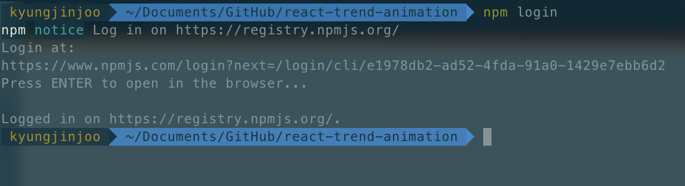
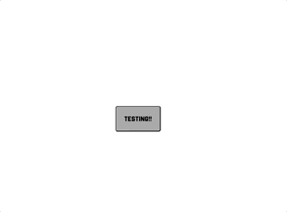
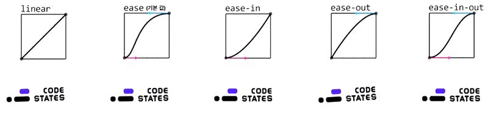
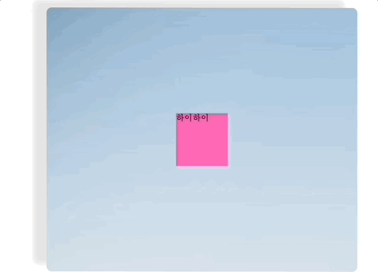
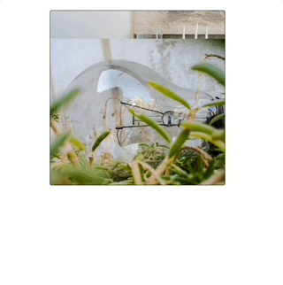

이전에 원페이지 웹 앱을 만들 때 **디자이너가 요구해준 애니메이션 기법**들이 있었다. 프론트엔드 개발을 하며 Interactive요소들을 실제로 적용해 보는것은 처음이였는데, 너무 유용한 기법들이라 **다른 대부분의 프로젝트에도 적용해도 사용자 경험을 향상시켜줄 것 같다고 생각이 되었고**, 내가 어떤 화면을 만들던지 보편적으로 사용할 수 있게 만들어 놓자고 생각했다.

따라서 해당 글에서 최신 애니메이션 기법들을 알아보고 그것을 **리액트용 커스텀 패키지**로 만들어서 적용해보고, 나아가 **NPM에 배포해보는 경험**을 해보려구 한다.

> [프로젝트Github](https://github.com/rud1676/react-trend-animation)
> [프로젝트NPM](https://www.npmjs.com/package/react-trend-animation)

~~많은 사람들이 써주면 좋긴하겠는데..~~

## 🐭 웹 애니메이션

사실 "웹 애니메이션"이라는 단어에 정말 많은 내용이 포함되어 있다. 이전에 프로젝트를 진행했을 땐, 3가지의 기법만을 적용했었는데, **조금 더 추가해 5가지 정도 구현을 해보려고 한다.**

5가지를 선정한 기준은 랜딩 페이지에서 HeroSection에 많이 사용되는 기법들을 구현했다.

- Opacity Fade-In : [참고(채널톡)](https://channel.io/ko)
- Activated Number Counter : [참고유튜브](https://www.youtube.com/watch?v=Sv54eYCfDZc) 
- 3D Tilting Card : [참고유튜브](https://www.youtube.com/watch?v=eOJTj_mWJds)
- Scrolling Text : [네이버밴드이벤트페이지](https://campaign.naver.com/band-10th-anniversary/)
- Parallex scrolling : [참고유튜브](https://www.youtube.com/watch?v=oxLX25rDoDI)

## ⚙️ NPM 배포환경 구축


> npm은 Node Package Manager의 줄임말인데 우리가 사용하는 Javascript 라이브러리들이 대부분 이 곳에 배포가 되어있다.


**내가 개발하는 어떤 리액트 환경에도 적용이 될 수 있도록 하는 것**이 목표라면, **배포를 해서 공유하는 경험**을 가지면 어떨까라는 생각에 시도했다.

### 1. NPM계정 생성 & 로그인

[NPM](https://www.npmjs.com/) 공식 홈페이지에 접속해서 `회원가입` 버튼을 클릭해서 진행한다.

그 다음 터미널 환경에서 로그인한다.



### 2. CreateReactApp

**React기반 패키지**를 제작할 것이기 때문에 CRA로 환경을 셋팅한다. 이때 타입스크립트를 적용시킨다. 대부분의 **프로젝트에서 타입스크립트를 사용하기 때문에 타입스크립트를 지원하게 해준다.**

``` 
$: create-react-app react-trend-animation --template typescript
```

### 3. tsconfig.json

설정한 tsconfig는 아래와 같다

```json
{
  "compilerOptions": {
    "target": "es5",
    "lib": ["dom", "dom.iterable", "esnext"],
    "allowJs": true,
    "skipLibCheck": true,
    "esModuleInterop": true,
    "allowSyntheticDefaultImports": true,
    "strict": true,
    "forceConsistentCasingInFileNames": true,
    "noFallthroughCasesInSwitch": true,
    "module": "esnext",
    "moduleResolution": "node",
    "resolveJsonModule": true,
    "isolatedModules": true,
    "noEmit": false,
    "jsx": "react-jsx",
    "declaration": true,
    "outDir": "./dist"
  },
  "include": ["./src/lib/**/*.tsx", "./src/lib/**/*.ts"]
}
```

몇 가지만 살펴보면

- `noEmit`: 배포를 위해선 만든 컴포넌트 또는 파일이 출력으로 나와야한다. `false`로 출력을 하게 설정한다.
- `declaration`: .d.ts파일을 생성하는지 여부인데 라이브러리가 타입스크립트를 지원하기 위해선 무조건 필요하다.
- `include`: 어떤 파일을 컴파일할지 정해주는 옵션이다. lib폴더에서 개발을 진행할 것이기 때문에 위와 같이 작성했다.
- `outDir`: tsc명령어로 컴파일된 파일들이 어디에 위치할지 정해주는 옵션이다.

### 4. package.json

패키지 배포를 할 때 package.json파일을 꼼꼼하게 작성하고 알아야한다.

1. `name`

라이브러리 이름은 꼭 npm패키지에 검색해야 한다. 이미 존재하는 이름이라면 사용할 수 없기 때문이다.

2. `version`

라이브러리 버전을 명시하는 곳이고, major | minor | patch 순으로 구분해서 사용한다.

npm에 매번 배포할 때마다 버전을 무조건 올려서 배포해야 한다.

3. `private` 

무조건 true바꿔야 npm저장소에 올라간다.

4. `main`

라이브러리의 진입점을 명시해주는 곳 이다.

5. `type`

타입스크립트의 타입 추론을 도와주는 진입 점을 설정 한다.

6. `description`

프로젝트의 설명이 나오는 곳이다. search에서 검색된 리스트에 표시가 되기 때문에 사람들이 패키지를 찾는데 도움을 준다.

7. `keywords`

마찬가지로 프로젝트를 검색할 때 참조되는 키워드다. 일종의 태그로 생각하면 될 듯.

8. `author`

json형식으로 프로젝트 작성자의 정보를 기입한다. 

9. `repository`

소스코드를 보관하는 저장소의 주소를 적습니다. 소스코드에 참여하려고 하는 사람들에게 도움이 될 수 있다!

자세한건 공식문서의 [package.json설명](https://docs.npmjs.com/cli/v7/configuring-npm/package-json)을 참조하자

### 5. .npmignore

배포에 필요없는 파일을 명시한다.

```
node_modules/
src/
public/
tsconfig.json
```

컴파일해서 dist폴더에 필요한 것 들을 둘 것이므로 나머지는 모두 제외한다.

## 🔨 개발시작

tsconfig.json 설정에서 lib 폴더의 결과물을 빌드한다. 따라서 lib/ 폴더에서 작업을 시작한다. 먼저 작업하는 폴더구조를 잠깐 살펴보자

최신 애니메이션 기법에 나와있는 5개의 컴포넌트를 작성할 예정이다.
따라서 아래의 폴더구조를 잡았다. (5개의 폴더 내부엔 index.tsx를 가지고 있다.)

```
📦src
 ┣ 📂lib
   ┣ 📂FadeInDiv
   ┃ 📂ParallexScrolling
   ┃ 📂ActivatedNumber
   ┃ 📂TiltingCard
   ┃ 📂ScrollingText
   ┃ ┣ 📜index.tsx
   ┃ ┗ 📜styled.tsx
   ┗ 📜index.tsx
```

```js
// lib/index.tsx
export { default as FadeInDiv } from "./FadeInDiv";
export { default as ParallexScrolling } from "./ParallexScrolling";
export { default as ActivatedNumber } from "./ActivatedNumber";
export { default as TiltingCard } from "./TiltingCard";
export { default as ScrollingText } from "./ScrollingText";
```


### 1. FadeInDiv

>해당 컴포넌트를 발견 시 Opacity 0=>1 로 조정되는 컴포넌트 [참고(채널톡)](https://channel.io/ko)



채널톡 페이지 진입 시 또 스크롤을 내리면서 컴포넌트를 발견 시에 opacity가 0에서 1로 변한다!

이 애니메이션을 구현하기 위해 가장 먼저 생각한 것은 **IntersectionObserver**와 css-animation기법 이다.

#### CSS

채널톡의 FadeIn을 자세히 살펴보면 **마지막에 천천히 스르륵하는 움직임**을 발견할 수 있다. 

그래서 어떻게 구현할까 고민하다가 흥미로운 사실들을 알게되었다. 애니메이션의 **부드러운 움직임을 구현하는 것은 수학적인 함수를 기반으로 한다는 것**, 대표적으로 나와있는 움직임 함수가 아래에 있다.


_[이미지출처](https://velog.io/@edith_0318/CSS-%EC%95%A0%EB%8B%88%EB%A9%94%EC%9D%B4%EC%85%98)_


따라서 구현해야할 애니메이션의 처음과 결과에 대한 값을 **keyframe으로 만들어 움직임을 정의**해서 animation 속성에 keyframe과 함께 값을 정해본다.

```js
const Layout = styled.div<{ speed: number; ypos: number }>`
  opacity: 0;
// 투명도 0 -> 1로
// Y값 살짝 아래-> 원래위치로
  @keyframes fadeInUp {
    from { 
      opacity: 0;
      transform: translateY(${(props) => props.ypos}px);
    }
    to {
      opacity: 1;
      transform: translateY(0);
    }
  }
  &.fadeInUpAnimation {
    animation: fadeInUp ${(props) => props.speed}s ease-out forwards; // 마지막에 천천히 올라와 ease-out함수로 적용
  }
`;

```

#### InterSectionObserver API

> [공식문서](https://developer.mozilla.org/ko/docs/Web/API/IntersectionObserver): IntersectionObserver는 웹 개발에서 요소가 뷰포트(사용자 화면)에 진입하거나 나갈 때 이를 감지하는 API입니다. 주로 지연 로딩, 무한 스크롤, 애니메이션 트리거 등에 사용됩니다. 
타겟 요소와 하나 이상의 부모 또는 최상위 문서의 뷰포트와의 교차 상태 변화를 **비동기적**으로 관찰합니다.

이것을 활용해 **뷰포트에 감지될 때** fadeInUpAnimation 클래스를 동적으로 추가하여 애니메이션을 실행한다.

```js
//FadeInDiv/index.tsx
//...
  useEffect(() => {
    const divEl = ref.current;
    const observer = new IntersectionObserver(
      ([entry]) => {
        if (entry.isIntersecting) {
          if (divEl) divEl.classList.add("fadeInUpAnimation");
        }
      },
      {
        threshold: threshold <= 1 ? threshold : 1, // 10% 이상 보이면 콜백을 실행합니다.
      },
    );
    if (divEl) {
      observer.observe(divEl);
    }
    return () => {
      if (divEl) {
        observer.unobserve(divEl);
      }
    };
  }, []);
//...
```
_IntersectionObserver는 짱이야..._

### 2. Activated Number Counter

> 숫자가 점점점 증가해 해당 Value에 도착하는 애니메이션 [참고유튜브](https://www.youtube.com/watch?v=Sv54eYCfDZc) 

#### easeOut 함수

해당 컴포넌트는 숫자의 Value만큼 점점빨라지다가 도착지점에서 천천히 증가해 Value로 맞춰지는 컴포넌트이다. 마찬가지로 부드러운 증가를 위해 easeOut을 적용해야 한다. 

그런데 CSS가 아닌 직접 구현을 해서 상태값을 바꿔줘야 한다. 따라서 함수를 식을 직접 구현을 해줘야 한다. [구현 식](https://stackoverflow.com/questions/13462001/ease-in-and-ease-out-animation-formula)의 파라미터는 아래와 같다

- t: 현재 시간 (또는 애니메이션의 진행 시점)
- b: 시작 값 (애니메이션 시작 시의 값)
- c: 변화량 (종료 값에서 시작 값을 뺀 값)
- d: 지속 시간 (애니메이션의 총 지속 시간)

```js
function easeOutQuad(t: number, b: number, c: number, d: number) {
  t /= d;
  return -c * t * (t - 2) + b;
}

const ActiveNumber = ({ value, interval, style = {} }: ActiveNumberProp) => {
  const [num, setNum] = useState(0);

  useEffect(() => {
    const duration = interval; // 총 지속 시간
    const frameRate = 20; // 프레임 간격 (ms)
    const totalFrames = duration / frameRate; // 총 프레임 수
    let frame = 0;

    const countFunc = setInterval(() => {
      const nextNum = easeOutQuad(frame, 0, value, totalFrames);
      if (frame < totalFrames) {
        setNum(Math.floor(nextNum));
        frame++;
      } else {
        setNum(value);
        clearInterval(countFunc);
      }
    }, frameRate);

    return () => clearInterval(countFunc);
  }, [value, interval]);

  return <p style={style}>{num}</p>;
};
```

이 함수를 setInterval API와 함께 사용하였다.

- setInterval이 설정된 20frame 간격으로 주기적으로 실행되면서, 각 실행마다 frame 값을 기준으로 easeOutQuad 함수를 호출하여 숫자를 업데이트한다.
- frame이 **totalFrames에 도달**하면 숫자 업데이트를 멈추고, setInterval을 종료한다. 이렇게 함으로써 숫자 증가 애니메이션이 자연스럽게 끝나는 것 처럼 보인다.

### 3. 3D Tilting Card 

> 3D처럼 커서가 카드를 눌러 그림자와 입체감을 주는 효과입니다.
[참고유튜브](https://www.youtube.com/watch?v=eOJTj_mWJds)

`getBoundingClientRect()`함수는 카드의 위치와 크기에 대한 정보를 포함하는 객체를 반환한다. 이를 통해 left, top, width, height의 정보를 알 수 있다. 이 함수를 이용해 마우스 포인터가 Card안에 중심에서 얼마나 떨어진 곳에 위치하는 지 계산하여 기울기를 얼마나 줄지 정한다.


_구현한 모습_


요약하면 카드의 중심에서 **마우스 포인트의 중심이 얼만큼 떨어져 있냐**를 계산해서, 그 해당 위치에 맞는 기울임과 그림자 에니메이션을 적용해주면 된다!

회전의 비율은 최대 30도까지, 그림자는 마우스 위치와 반대방향으로 그림자를 구현해준다.

그리고 마우스가 박스를 벗어난 순간 적용했던 애니메이션을 초기화 해준다.

```js
  const handleMouseMove = (event: any) => {
    const { clientX, clientY } = event;
    if (!cardRef.current) return;
    const { left, top, width, height } =
      cardRef.current.getBoundingClientRect();
    const x = clientX - left - width / 2;
    const y = clientY - top - height / 2;

    const rotateX = (y / height) * 30;
    const rotateY = -(x / width) * 30;

    setStyle({
      transform: `rotateX(${rotateX}deg) rotateY(${rotateY}deg)`,
      boxShadow: `${-x * 0.1}px ${-y * 0.1}px 10px rgba(0,0,0,0.1)`,
    });
  };

  const handleMouseLeave = () => {
    setStyle({
      transform: "rotateX(0deg) rotateY(0deg)",
    });
  };

```

### 4. Scrolling Text

> 택스트가 양옆으로 무한대로 스크롤 되는 것을 구현했습니다.
[네이버 밴드 이벤트 페이지](https://campaign.naver.com/band-10th-anniversary/)를 참고해서 구현했습니다.

keyframe으로 **scrollAnimation을 정의**했고, 무한 반복 위해 animation에서 infinite값을 주었습니다.
 
```js
// 스크롤 애니메이션을 정의합니다.
const scrollAnimation = keyframes`
  from {
    transform: translateX(50%);
  }
  to {
    transform: translateX(-50%);
  }
`;

// 스크롤 텍스트를 위한 스타일드 컴포넌트
const ScrollingContainer = styled.div`
  width: 100%; // 컨테이너의 폭
  overflow: hidden; // 내용이 넘칠 경우 숨김 처리
  white-space: nowrap; // 텍스트를 한 줄로 처리
`;

const LinearText = styled.div<{ second: number }>`
  animation: ${scrollAnimation} ${(props) => props.second}s linear infinite; // 무한 반복 애니메이션
`;

```


### 5. Parallex scrolling

> 스크롤시 사진이나 배경이 자연스럽게 따라 내려가는 것처럼 자연스럽게 스크롤링 되는 기법. [참고유튜브](https://www.youtube.com/watch?v=oxLX25rDoDI)

Parallex Scrolling은 사실 매우 방법이 다양하고 많은 구현 방법이 있다. 따라서 **모든 Parallex Scrolling을 일반화 하여 모듈로 만드는 것이 고난이도 작업**이 필요할 것이라는 예상을 했다. 

아예 scroll-parallex를 위한 패키지가 따로 있다. [링크](https://www.npmjs.com/package/react-scroll-parallax).

 프로젝트에서 요구한 것은 간단한 요구사항 이였기에, 간단한 버전의 ParallexScrolling을 구현했다.

> 요구사항: 전체 페이지를 스크롤 할 때, 사진 두개를 해당 컴포넌트에서 위 아래로 자연스럽게 따라 스크롤 되는 느낌으로 구현해주세요

우리가 구현해야 하는 것은 아래와 같다.



#### css

먼저 ViewLayout을 잡아준다. **보여지는 컴포넌트의 크기**이다. **`overflow`를 `hidden`**으로 바꿔 영역바깥을 숨겨준다. 그리고 각 이미지 컴포넌트에 배경이미지 만큼 크기를 지정을 해줘서 InnerWrapper를 움직인다.

```js
import styled from "styled-components";
export const Layout = styled.div<{
  width: string;
  radius: string;
  height: string;
}>`
  height: ${(props) => props.height};
  width: ${(props) => props.width};
  border-radius: ${(props) => props.radius};
  overflow: hidden;
  border: 1px solid black;
`;

export const InnerWrapper = styled.div`
  display: flex;
  flex-direction: column;
`;

export const ParallexContainer = styled.div<{
  url: string;
  height: string;
  width: string;
}>`
  height: ${(props) => props.height};
  width: ${(props) => props.width};
  background: url("${(props) => props.url}");
  background-size: cover;
`;

```

#### scrollEvent

스크롤 이벤트를 InnerWrapper에 적용시켜주고, 문서의 최대 스크롤 지점이랑 현재 스크롤 지점을 구한 뒤에, 이것을 0~1값으로 변환 시킨 뒤에 움직일 배경의 최대 max지점을 곱해 **전체 페이지의 스크롤 높이 값과 움직여야 될 박스의 높이를 서로 비율이 같게 변환**시켜준다. 

```js
//..
  const innerRef = useRef<HTMLDivElement | null>(null);
  useEffect(() => {
    const handleScroll = () => {
      if (innerRef.current) {
        const elementPosition =
          innerRef.current.offsetHeight -
          Math.floor(innerRef.current.offsetHeight / urls.length);
        const windowHeight = window.innerHeight;
        const scrollHeight = window.scrollY;
        const scrollRatio = scrollHeight / windowHeight;
        innerRef.current.style.transform = `translateY(${-scrollRatio * elementPosition}px)`;
      }
    };

    window.addEventListener("scroll", handleScroll);
    return () => {
      window.removeEventListener("scroll", handleScroll);
    };
  }, []);
//...
```


## 📤 배포

간단하다 npm publish를 입력하면.. 끝난다! 

과정은 [공식문서](https://docs.npmjs.com/cli/v10/commands/npm-publish)에 나와있다.

1. 패키지 검증
package.json 파일을 검증한다. 버전이 유요한지 등.

2. 빌드 프로세스
npm run build와 같은 스크립트를 통해 소스 코드를 빌드할 수 있음. 이는 프로젝트에 따라 다르며, package.json의 "scripts" 섹션에 prepublish나 prepublishOnly 스크립트가 설정되어 있다면, 자동으로 실행.

3. 파일 포장
프로젝트 디렉토리를 .tgz 파일로 포장합니다.

4. 레지스트리에 업로드

5. 접근 권한 설정
패키지를 공개 레지스트리에 업로드할 경우 기본적으로 공개적으로 접근 가능.

6. 결과 확인
업로드가 성공적으로 완료되면, npm은 패키지가 성공적으로 등록되었다는 메시지를 표시. 

## 실제로 프로젝트에 써볼까?

이전에 진행했던 가자지구 프로젝트에 패키지를 추가하여 적용시켜보았다.

```
yarn add react-trend-animation
```

```js
import { FadeInDiv } from 'react-trend-animation';


const SectionHero = ({ msgRef }: SectionHeroProps) => {
  //....
  return (
    <div className={styles.outer}>
        <FadeInDiv>
          <GoDonateButton onClick={onGoDonateClick} />
        </FadeInDiv>
    </div>
  );
};

export default SectionHero;
```

## 후기

사실 NPM프로젝트로서 만들고 나서 아직까진 사용의 가치가 부족하다고 느꼈다. 그래서 실제로 npm패키지의 [모범사례](https://velog.io/@surim014/Best-practice-for-creating-a-modern-npm-package)에 대한 글을 검색해서 찾아보았고, 단순히 npm 패키지를 구성하는 것을 넘어서 많은 것을 놓치고 있었다. 따라서 아래의 작업들을 추후에 진행해 보려구한다. 

1. 문서화(README와 문서페이지)
2. 테스트 과정
3. 보안 검사
4. 쓸모가 있게 더 많은 기능 추가.
