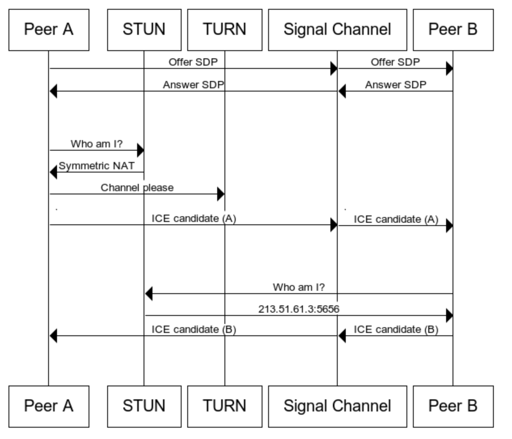
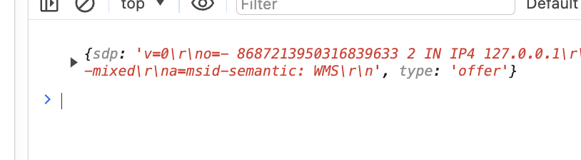
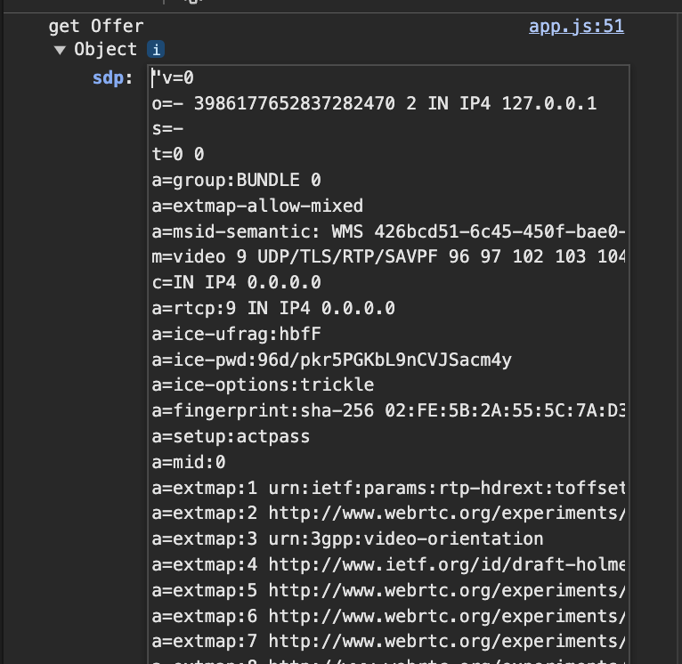
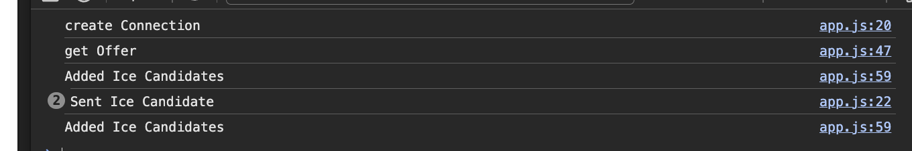
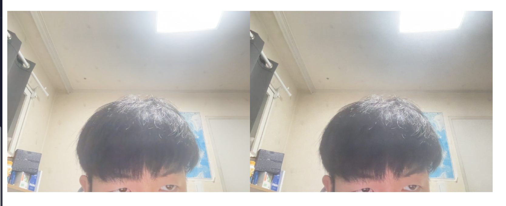
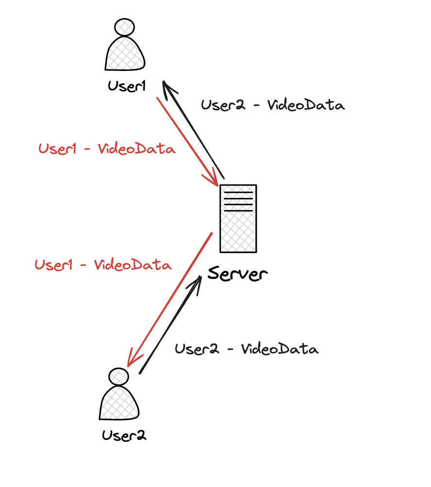
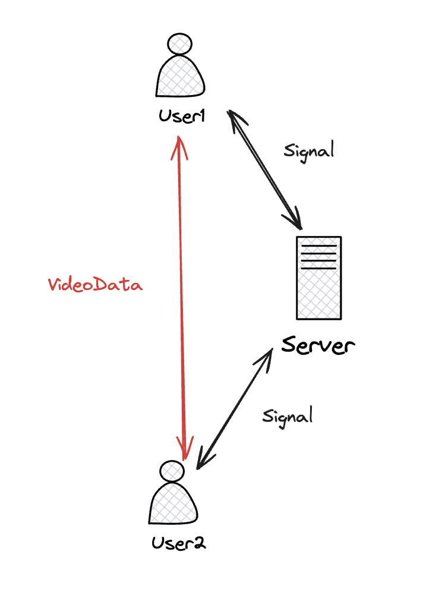

이전에 외주 개발을 통해 **OpenVidu**플랫폼을 사용하여 **WebRTC** 기술로 **실시간 드론 카메라 화면을 구현**한 경험이 있다. 프로젝트 당시 OpenVidu 사용법에 집중했었지만, 실제로 사용 하게되면서 WebRTC에 관심이 생겼다. 이에 따라, **오직 WebRTC를 활용**해 간단한 **라이브 스트리밍 기능**을 구현해보고자 한다.

## WebRTC란?

MDN [공식문서](https://developer.mozilla.org/en-US/docs/Web/API/WebRTC_API/Connectivity)에 나와있는 의미를 요약하면 아래와 같다.

> WebRTC는 웹 표준에 기반한 **실시간 커뮤니케이션 기술**입니다. 사용자는 비디오, 음성, 데이터를 **피어 간에 직접 전송**할 수 있으며, **JavaScript API** 또는 **네이티브 라이브러리**를 사용하여 구현할 수 있습니다. 별도의 외부 라이브러리 없이도 실시간으로 정보를 교환할 수 있는 **Peer-To-Peer 방식을 지원**한다. 

쉽게 말하면, **웹 표준을 활용**하여 **Peer-To-Peer 방식으로 실시간 커뮤니케이션**을 가능하게 하는 기술입니다.

## 어떻게 구현하는데?

MDN에 나온 [Connectivity 가이드라인](https://developer.mozilla.org/en-US/docs/Web/API/WebRTC_API/Connectivity)에 보면 아래와 같은 다이어그램이 나온다. 



우선 위의 다이어그램에서 Signal Channel(SignalServer)과 Peer들을 보자.(STUN,TURN은 아래에 언급한다)

1. Peer A가 **Offer를 생성**하여 서버를 통해 **Peer B에 전달**한다. 
2. Peer B가 **Offer를 받으면 Answer를 생성**하여 서버를 통해 **Peer A에게 전달**한다. 
3. **Peer A가 ICE candidate를 생성**해 서버를 통해 **Peer B에 전달**한다. PeerB는 PeerA가 보내준 candidate를 추가한다.
4. **Peer B도 ICE candidate를 생성**해 서버를 통해 **Peer A 전달**한다. PeerA는 PeerB가 보내준 candidate를 추가한다.

> 아래에는 MDN 가이드라인을 참고하여 만든 라이브스트리밍 앱을 만들며 적은 기록입니다.

### 사전작업

우선 라이브 스트리밍 앱을 구현하기 위해 카메라로 얻는 데이터를 사이트의 video태그에 연결해야 한다.

- `getUserMedia` 함수를 사용하여 사용자의 카메라에서 비디오 스트림을 얻는다.
- 비디오 태그에 속성값으로 추가해준다.

```js
const my = document.getElementById("my"); // video element
let myStream;

async function getCameras() { // myStream에 로컬 카메라를 연결합니다.
  try {
    myStream = await navigator.mediaDevices.getUserMedia({ video: true });
    my.srcObject = myStream;
  } catch (e) {
    console.log(e);
  }
}
```

- RTC 연결을 생성하여 클라이언트 간 통신을 설정한다. 또한, 이전에 얻은 **비디오 스트림을 이 RTC 연결에 추가**한다.

```js
let myPeerConnection;

function makeConnection() {
  myPeerConnection = new RTCPeerConnection();
  myStream.getTracks().forEach((track) => {
    myPeerConnection.addTrack(track, myStream);
  });
}
```

- 최초 접속 시, **'welcome' 메시지를 시그널 서버로 보내** 다른 사용자들이 새로운 유저의 접속을 인지할 수 있도록 한다.

```js
async function init() {
  await getCameras();
  makeConnection();
}
init(); // 카메라 연결함수와 RTC연결을 만드는 과정을 실행.

socket.emit("welcome"); // 서버에 접속 알림 알림!
```

- **서버**에서는 새로운 사용자가 접속하면 'test' 그룹에 해당 사용자를 추가한다. 이후 자신을 제외한 'test' 그룹의 모든 사용자들에게 'hi' 이벤트를 발송한다.

```js
//server.js
const SocketIO = require("socket.io");
const wsServer = SocketIO(httpServer);

wsServer.on("connection", (socket) => {
  socket.on("welcome", () => {
    socket.join("test");
    socket.to("test").emit("hi");
  });
});

```

이제 myPeerConnection을 활용해서 공식문서에 나온 다이어그램의 통신 시나리오를 할 준비가 되었다.

### Offer & Answer

#### offer 전송

우선 상황을 명확히 파악해야 한다. PeerA와 PeerB 간의 통신 시나리오는 **PeerB가 접속하는 순간**에 시작된다.

1. PeerB가 접속하면 트리거되는 **'hi' 이벤트를 받은 PeerA**는 **Offer를 생성**하여 localDescription을 설정한 후, 이 Offer를 **시그널 서버로 전송**한다.

```js
socket.on("hi", async () => {  
  const offer = await myPeerConnection.createOffer();
  console.log(offer);
  myPeerConnection.setLocalDescription(offer); 
  socket.emit("offer", offer);
});
```

이때 위에서 console.log를 브라우저 두 개의 창을 띄어 offer에 대한 로그를 확인할 수 있다. 


> setLocalDescription 함수의 역할은 다음과 같다:
- 네트워크 정보 등록: 로컬 피어의 네트워크 및 미디어 정보를 연결 객체에 설정.
- SDP(Session Description Protocol) 정보 설정: SDP를 사용하여 생성된 offer이나 answer를 로컬 세션 설명으로 설정. 이는 통신을 위한 초기 매개변수를 정의하는 데 사용.

2. **서버**는 PeerA가 전송한 **Offer를 PeerB에게** "offer" 이벤트를 통해 **그대로 전달**한다. 이 과정을 통해 PeerB는 PeerA와의 통신을 시작할 수 있는 초기 데이터를 받게 된다.

```js
// server.js에 추가
wsServer.on("connection", (socket) => {
...
  socket.on("offer", (offer) => {
    socket.emit("offer", offer);
  });
...
});

```
3. PeerB는 서버로부터 **"offer" 이벤트를 수신**받고 이를 확인한다. 참고로 이 offer에는 PeerA의 네트워크 정보와 미디어 정보가 포함되어 있고, PeerB는 이 정보를 사용하여 통신을 시작할 준비를 한다.

```js
socket.on("offer", (offer) => { 
  console.log(offer);
});
```
실제 PeerB입장에서 받은 "offer"는 PeerA에 대한 정보가 로그에 찍힌다.


#### answer 전송

1. PeerB가 offer를 수신받으면, **받은 offer를 기반으로 자신의 `remoteDescription`을 설정**한다. 그 후, 이 연결에 대한 응답으로 **answer를 생성**한다.

```js
socket.on("offer", async (offer) => { 
  myPeerConnection.setRemoteDescription(offer); 
  const answer = await myPeerConnection.createAnswer(offer);  
  console.log(answer);
});
```

2. PeerB는 **생성한 answer로 자신의 `localDescription`을 설정**한다. 설정이 완료되면, 이 **answer를 시그널 서버에 전송**한다.
```js
socket.on("offer", async (offer) => { 
  myPeerConnection.setRemoteDescription(offer); 
  const answer = await myPeerConnection.createAnswer(offer); 
  myPeerConnection.setLocalDescription(answer);   
  socket.emit("answer", answer);
});
```

3. 시그널 서버는 PeerB가 전송한 answer를 받아 **다른 참여자들(예: PeerA)에게 전달**한다.
```js
//server.js
socket.on("answer", (answer) => {
  socket.to("test").emit("answer", answer);  
});
```

4. PeerA는 **수신한 answer을 사용하여 자신의 remoteDescription을 설정**한다.

```js
socket.on("answer", (answer) => {  
  myPeerConnection.setRemoteDescription(answer);
});

```

### ICE-Candidate & Stream

ICE Candidate는 WebRTC 통신에 필요한 네트워크 프로토콜 정보를 제공한다. 이는 브라우저 간의 통신 경로를 결정하는 데 사용되며, 가장 적합한 통신 경로를 선택하는 데 도움을 준다.

내부적인 흐름은 [공식문서](https://developer.mozilla.org/en-US/docs/Web/API/RTCIceCandidate)에 나와있다. 공식문서에 따르면

1. 다수의 ICE Candidates가 각 연결에 대해 제안된다.
2. 이 중 합의된 하나가 최종적으로 사용된다.


그래서 이러한 제안을 수신하고 처리하기 위해서는 **ICE Candidate 이벤트를 수신 대기**해야 한다. 이를 위해 이전에 작성한 `makeConnection` 함수에 추가적인 수정이 필요하다.

```js
function makeConnection() {
  myPeerConnection = new RTCPeerConnection();
  myPeerConnection.addEventListener("icecandidate", (data) => {
    console.log("Sent Ice Candidate");
    socket.emit("ice", data.candidate);
  });
  myStream.getTracks().forEach((track) => {
    myPeerConnection.addTrack(track, myStream);
  });
}

```
2. 서버는 받은 ICE 정보를 그대로 다른 피어(Peer2)에게 전달한다.

```js
//server.js
socket.on("ice", (ice) => {  
  socket.to("test").emit("ice", ice);  
});
```
3. 다른 사람들이 ICE 이벤트를 받았을 때, 받은 IceCandidate를 추가한다.

```js
socket.on("ice", (ice) => {  
  console.log("Added Ice Candidates") 
  myPeerConnection.addIceCandidate(ice);
});
```

로그를 확인해보니 잘 나오는 것을 확인할 수 잇었다.


4. track 이벤트를 생성한 RTC 객체에 연결한다. 이 과정은 createConnection 함수에서 생성된 RTC 객체에서 처리한다.
> track이벤트: **원격 피어로부터 미디어 트랙(비디오 또는 오디오 트랙)이 수신될 때 발생**

```js
async function makeConnection() { 
  myPeerConnection = new RTCPeerConnection(); 
  myPeerConnection.addEventListener("icecandidate", handleIce); 
  myPeerConnection.addEventListener("track", (data)=> {  
    const peerFace = document.querySelector("#peerFace"); 
    peerFace.srcObject = data.streams[0];
  });
  myStream.getTracks().forEach((track) => myPeerConnection.addTrack(track, myStream)); 
}
```

브라우저를 두개 띄우고 확인 한 결과 잘 송,수신이 되는 것을 확인할 수 있다!



### STUN & TURN은 그럼 필요없나요?

STUN과 TURN 서버는 **다른 네트워크 환경에서의 피어 연결**을 위해 필수적이다. **로컬 환경이나 동일한 NAT 내부에서는 피어들이 서로의 주소를 쉽게 찾을 수 있지만**, 다른 네트워크 환경에서는 이들의 공용 IP 주소를 발견하기 위해 STUN 서버가 사용된다. 
만약 STUN 서버로도 연결이 어려운 상황이라면, TURN 서버가 릴레이 역할을 하여 데이터를 전송한다. 즉, STUN -> TURN 서버 순으로 나의 공용 IP를 찾으려고 한다.

따라서 `createConnection` 함수에서 `RTCPeerConnection`을 아래와 같이 설정해야 한다:

```js
  myPeerConnection = new RTCPeerConnection({
    iceServers: [
      { // 첫번째는 STUN서버
        urls: [
          "stun:stun.l.google.com:19302",
          "stun:stun1.l.google.com:19302",
          "stun:stun2.l.google.com:19302",
          "stun:stun3.l.google.com:19302",
          "stun:stun4.l.google.com:19302",
        ],
      },
      {// 두번째는 TRUN서버
      }
    ],
  });
```

이렇게 설정하면, ICECandidate를 생성하기 전에 외부에서 바라본 자신의 IP 주소를 파악하고 해당 정보를 자동으로 처리한다.

## 마무리

이렇게 해서 간단한 라이브 스트리밍 앱을 만들었다. MDN에서 제공하는 자세한 가이드라인을 따라 구현할 수 있었다. 만약 WebRTC 기술이 없었다면, **무거운 데이터를 서버를 통해 전송하고 다시 목적지로 보내야 했을 것**이다. 이 과정에서 서버는 많은 리소스를 소모했을 것이며, 사용자가 조금만 늘어나도 **서버 부담이 크게 증가했을 것**이다. Web-RTC의 도입전에는 아래와 같은 아키텍처의 라이브 스트리밍을 구현했을 것이다.



 그러나 WebRTC 덕분에, 아래 그림처럼 User1, User2, Server 간에는 단지 신호만 교환하고, **실제 영상 데이터는 클라이언트 간에 직접 Peer-to-Peer로 통신**하기 때문에 서버 부하가 크게 줄어든다. 이는 서버 리소스의 효율적인 사용을 가능하게 하며, WebRTC의 혁신적인 접근 방식을 보여준다.




 우리가 사용하는 기술들은 특정 문제를 해결하기 위해 개발되었다. 많은 경우, 개발자들은 우리는 그 기술이 해결하려는 문제의 본질을 직접 경험하지 못한 채 도입하기도 한다. 그러나 이번에 직접 해당 문제를 인지하면서 해당 기술을 사용해본 것은 나에게 매우 큰 경험이 되었다.
